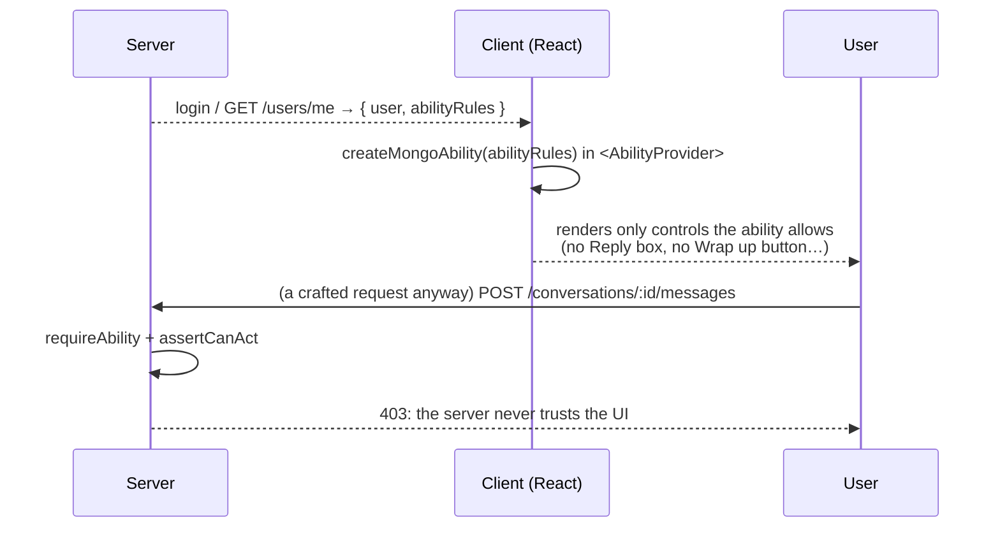
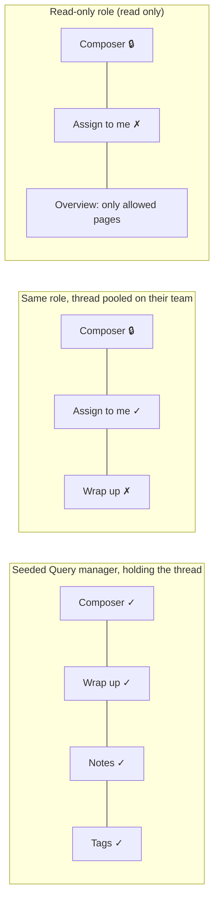
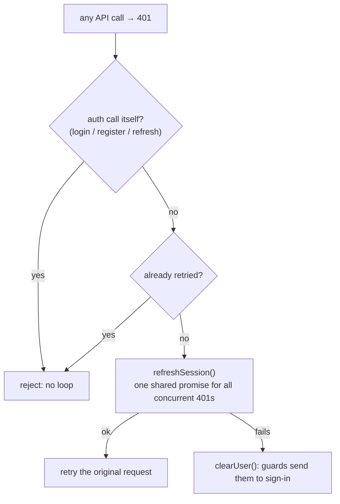
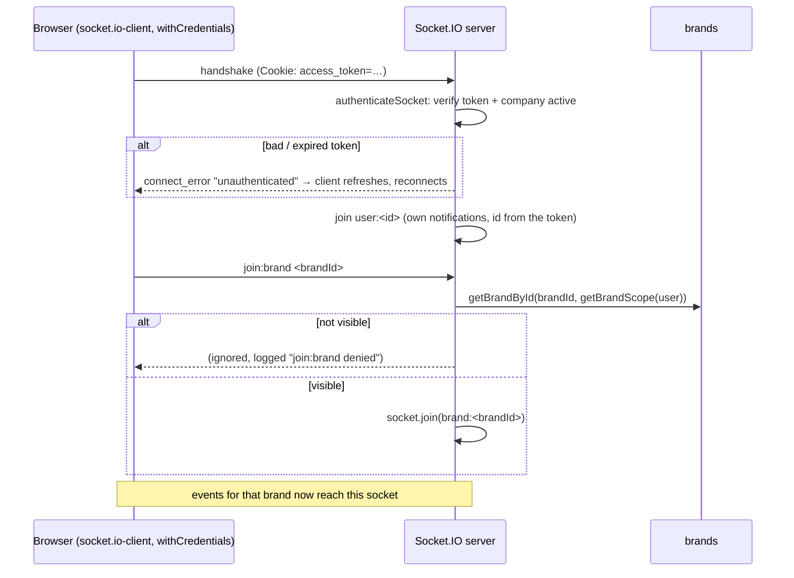

## The code

**Client**

{/* source: client/src/features/ability/model.ts */}
```ts title="client/src/features/ability/model.ts" lineNumbers
import { createMongoAbility, type MongoAbility, type RawRuleOf } from '@casl/ability';
import type { Role } from '@/types/auth';

/**
 * The client's copy of the server's ability (server/src/auth/ability.ts, spec docs/roles.md). The
 * server sends the signed-in user's rules (`abilityRules` on /users/me and sign-in) and the UI shows
 * only what will work. Cosmetic: the server checks every request.
 *
 * `ACTIONS` / `SUBJECTS` must match `server/src/auth/permissions.ts`; a server test reads this file
 * and fails when they drift.
 */
export const ACTIONS = [
  'manage',
  'read',
  'reply',
  'claim',
  'forward',
  'assign',
  'hold',
  'tag',
  'wrapUp',
  'reopen',
  'like',
  'hide',
  'delete',
  'create',
  'update',
  'send',
] as const;
export type Action = (typeof ACTIONS)[number];

export const SUBJECTS = [
  'all',
  'Conversation',
  'Comment',
  'Note',
  'Tag',
  'FixedReply',
  'WhatsAppTemplate',
  'BrandOverview',
  'TeamFigures',
  'OwnFigures',
  'SlaSettings',
] as const;
export type SubjectName = (typeof SUBJECTS)[number];

export type AppAbility = MongoAbility<[Action, SubjectName]>;
export type AbilityRules = RawRuleOf<AppAbility>[];

/** One `[action, subject]`; a list of them means "any of". */
export type AbilityCheck = readonly [Action, SubjectName];

const ADMIN_TIER: readonly Role[] = ['super_admin', 'company_owner', 'company_admin'];

/**
 * The ability from the server's rules. Before they arrive (a profile stored by an older build), the
 * admin tier gets the server's admin rules and a query manager nothing, until /users/me refreshes.
 */
export const buildAbility = (
  rules: AbilityRules | undefined,
  role: Role | undefined
): AppAbility => {
  if (rules) return createMongoAbility<AppAbility>(rules);
  if (role && ADMIN_TIER.includes(role)) {
    return createMongoAbility<AppAbility>([
      { action: 'manage', subject: 'all' },
      { action: ['claim', 'forward'], subject: ['Conversation', 'Comment'], inverted: true },
    ]);
  }
  return createMongoAbility<AppAbility>([]);
};

/**
 * Whether the user's real rules are in: false for a query manager whose stored profile predates
 * them, until /users/me answers. Gates that hide or redirect wait for it.
 */
export const abilityReady = (rules: AbilityRules | undefined, role: Role | undefined): boolean =>
  Boolean(rules) || (role !== undefined && ADMIN_TIER.includes(role));

export const canAny = (ability: AppAbility, checks: readonly AbilityCheck[]): boolean =>
  checks.some(([action, subject]) => ability.can(action, subject));

const WRAPPED_UP: readonly string[] = ['resolved', 'unresolved'];

/** The actions a status move needs (mirrors server/src/auth/status-action.ts). */
export const statusChangeActions = (from: string, to: string): Action[] => {
  if (WRAPPED_UP.includes(to)) return ['wrapUp'];
  if (WRAPPED_UP.includes(from)) return to === 'hold' ? ['reopen', 'hold'] : ['reopen'];
  return ['hold'];
};

/** Whether the ability allows moving a query from `from` to `to`. */
export const canMoveStatus = (
  ability: AppAbility,
  subject: 'Conversation' | 'Comment',
  from: string,
  to: string
): boolean => statusChangeActions(from, to).every(action => ability.can(action, subject));

/** What opens each Overview area (the server's gate table, docs/roles.md). */
export const BRAND_FIGURES: AbilityCheck = ['read', 'BrandOverview'];
export const TEAM_FIGURES: AbilityCheck = ['read', 'TeamFigures'];
export const OWN_FIGURES: AbilityCheck = ['read', 'OwnFigures'];
export const ANY_FIGURES: readonly AbilityCheck[] = [BRAND_FIGURES, TEAM_FIGURES, OWN_FIGURES];
export const READ_DMS: AbilityCheck = ['read', 'Conversation'];
export const READ_COMMENTS: AbilityCheck = ['read', 'Comment'];
```
{/* /source */}

{/* source: client/src/features/ability/ability-provider.tsx */}
```tsx title="client/src/features/ability/ability-provider.tsx" lineNumbers
import { useMemo, type ReactNode } from 'react';
import { AbilityProvider as CaslAbilityProvider } from '@casl/react';
import { useAuthStore } from '@/stores/auth-store';
import { buildAbility } from './model';

/** Provides the signed-in user's ability app-wide; rebuilt when their rules change. */
export function AbilityProvider({ children }: { children: ReactNode }) {
  const rules = useAuthStore(state => state.user?.abilityRules);
  const role = useAuthStore(state => state.user?.role);
  const ability = useMemo(() => buildAbility(rules, role), [rules, role]);
  return <CaslAbilityProvider value={ability}>{children}</CaslAbilityProvider>;
}
```
{/* /source */}

{/* source: client/src/features/ability/use-ability.ts */}
```ts title="client/src/features/ability/use-ability.ts" lineNumbers
import { useAbility } from '@casl/react';
import { useAuthStore } from '@/stores/auth-store';
import { abilityReady, canAny, type AbilityCheck, type AppAbility } from './model';

/** The signed-in user's ability (`AbilityProvider` in main.tsx). */
export const useAppAbility = (): AppAbility => useAbility<AppAbility>();

/** Whether the signed-in user can do any of `checks`. */
export const useCan = (...checks: AbilityCheck[]): boolean => canAny(useAppAbility(), checks);

/** Whether the user's rules have arrived (see `abilityReady`). */
export const useAbilityReady = (): boolean =>
  abilityReady(
    useAuthStore(state => state.user?.abilityRules),
    useAuthStore(state => state.user?.role)
  );
```
{/* /source */}

{/* source: client/src/features/inbox/reply-access.ts */}
```ts title="client/src/features/inbox/reply-access.ts" lineNumbers
import { useAuthStore } from '@/stores/auth-store';
import type { Action, SubjectName } from '@/features/ability/model';
import { useAppAbility } from '@/features/ability/use-ability';
import type { SessionAssignee } from './types';

/**
 * Client-side mirror of the server's act gate (server/src/auth/reply-access.ts `assertCanAct`).
 *
 * The gate restricts acting, not seeing: an agent reads every thread on their brands, but may reply,
 * react, moderate, note, tag, wrap up or edit customer fields only on the ones assigned to them
 * personally. A department or team pool is for claiming ("Assign to me", `useCanClaim`), not acting.
 * Every such control consults `useReplyAccess`, so a read-only thread shows a locked composer and no
 * buttons that would 403. Owners, admins and super admins always may.
 *
 * On top of that, each action needs its permission from the user's role (features/ability): `can`
 * answers both at once — may act on this thread, and may do this. Purely cosmetic — the server is
 * the authority.
 */
export interface ReplyAccess {
  /** Holds it (or isn't restricted): the act gate alone. */
  canAct: boolean;
  /** The act gate and the permission for `action` (on the thread's surface unless `subject`). */
  can: (action: Action, subject?: SubjectName) => boolean;
}

type Surface = 'Conversation' | 'Comment';

const useAccess = (canAct: boolean, surface: Surface): ReplyAccess => {
  const ability = useAppAbility();
  return {
    canAct,
    can: (action, subject) => canAct && ability.can(action, subject ?? surface),
  };
};

const holds = (
  user: { id: string; role: string } | null,
  assignee: SessionAssignee | null | undefined
): boolean => {
  // Only agents are restricted.
  if (!user || user.role !== 'query_manager') return true;
  if (assignee === undefined) return true;
  return assignee?.type === 'query_manager' && assignee.id === user.id;
};

/**
 * Whether the signed-in user may act on a thread with this assignee.
 *
 * `assignee === undefined` means "not loaded yet" and is treated as allowed, so the composer isn't
 * disabled mid-fetch; `null` is a genuinely unassigned thread.
 */
export function useReplyAccess(
  assignee: SessionAssignee | null | undefined,
  surface: Surface = 'Conversation'
): ReplyAccess {
  const user = useAuthStore(state => state.user);
  return useAccess(holds(user, assignee), surface);
}

/**
 * `useReplyAccess` for a comment thread, judged on its root: a thread under the page's own comment
 * (`isAgentReply` root) isn't a customer query and has no owner, so every agent may act there — as
 * the server's `ensureActionableComment` does.
 */
export function useCommentReplyAccess(root: {
  assignee?: SessionAssignee | null;
  isAgentReply?: boolean;
}): ReplyAccess {
  const user = useAuthStore(state => state.user);
  return useAccess(root.isAgentReply || holds(user, root.assignee ?? null), 'Comment');
}

/**
 * Whether the signed-in user may route queries to anyone (the Assign tab in the inbox right panel
 * and the comment sidebar): owners, admins and super admins, and query managers whose role has
 * "Assign and reassign".
 */
export function useCanRoute(): boolean {
  return useAppAbility().can('assign', 'Conversation');
}

/**
 * Whether the signed-in user may take a query with "Assign to me" (mirrors the server's claim rule,
 * server/src/auth/reply-access.ts `claimableFilter`): a query manager, on an `open` (not resolved)
 * query that is unassigned or pooled on their department or team. False while the query is still
 * loading (`assignee === undefined`). Cosmetic like `useReplyAccess`: department and team come from
 * the stored profile, which `useSyncCurrentUser` refreshes on load and window focus; the server
 * (which re-reads them on every claim) decides.
 */
export function useCanClaim(assignee: SessionAssignee | null | undefined, open: boolean): boolean {
  const user = useAuthStore(state => state.user);
  const mayClaim = useAppAbility().can('claim', 'Conversation');
  if (!user || user.role !== 'query_manager' || !mayClaim) return false;
  if (assignee === undefined || !open) return false;
  if (!assignee) return true;
  if (assignee.type === 'team') return assignee.id === user.teamId;
  return assignee.type === 'department' && assignee.id === user.departmentId;
}

/**
 * Whether the signed-in user may Forward a query (mirrors the server's `holdsQuery`): a query manager
 * who holds it personally, while it is open. Owners and admins route instead (`useCanRoute`).
 */
export function useCanForward(
  assignee: SessionAssignee | null | undefined,
  open: boolean
): boolean {
  const user = useAuthStore(state => state.user);
  const mayForward = useAppAbility().can('forward', 'Conversation');
  if (!user || user.role !== 'query_manager' || !open || !mayForward) return false;
  return assignee?.type === 'query_manager' && assignee.id === user.id;
}
```
{/* /source */}

{/* source: client/src/lib/api.ts */}
```ts title="client/src/lib/api.ts" lineNumbers
import axios, { AxiosError, type InternalAxiosRequestConfig } from 'axios';
import { useAuthStore } from '@/stores/auth-store';

// Relative base in dev → goes through the Vite proxy to the API (same-origin,
// so httpOnly auth cookies are sent). Override with VITE_API_URL in prod.
const baseURL = import.meta.env.VITE_API_URL ?? '/api/v1';

export const api = axios.create({
  baseURL,
  withCredentials: true,
});

// Endpoints that must NOT trigger the refresh-retry loop.
const AUTH_PATHS = ['/auth/login', '/auth/register-company', '/auth/refresh'];

// Share a single in-flight refresh across concurrent 401s (and the socket's connect_error retry —
// see lib/socket.ts), so simultaneous failures trigger only one POST /auth/refresh.
let refreshPromise: Promise<unknown> | null = null;

export function refreshSession(): Promise<unknown> {
  refreshPromise =
    refreshPromise ??
    api.post('/auth/refresh').finally(() => {
      refreshPromise = null;
    });
  return refreshPromise;
}

api.interceptors.response.use(
  response => response,
  async (error: AxiosError) => {
    const original = error.config as
      | (InternalAxiosRequestConfig & { _retry?: boolean })
      | undefined;

    const isAuthCall = original?.url && AUTH_PATHS.some(p => original.url?.includes(p));

    if (error.response?.status === 401 && original && !original._retry && !isAuthCall) {
      original._retry = true;
      try {
        await refreshSession();
        return api(original);
      } catch (refreshError) {
        // Refresh failed → session is dead. Drop the user so guards redirect.
        useAuthStore.getState().clearUser();
        return Promise.reject(refreshError);
      }
    }

    return Promise.reject(error);
  }
);

/**
 * Whether a query/mutation failure is a 404. Worth naming because the API answers 404 for
 * "you may not see this" as well as "it isn't there" — the assignment policy and tenant scope both
 * do (see server/src/auth/reply-access.ts), so a thread reassigned away under an open tab surfaces
 * here rather than as anything more specific.
 */
export function isNotFound(error: unknown): boolean {
  return axios.isAxiosError(error) && error.response?.status === 404;
}

// Pull a human-readable message out of an axios error (API envelope or 401 body).
export function getApiErrorMessage(error: unknown, fallback = 'Something went wrong'): string {
  if (axios.isAxiosError(error)) {
    const data = error.response?.data as { message?: string } | undefined;
    return data?.message ?? error.message ?? fallback;
  }
  return fallback;
}
```
{/* /source */}

**Server, realtime**

{/* source: server/src/libraries/socket/index.ts */}
```ts title="server/src/libraries/socket/index.ts" lineNumbers
import type { Server, Socket } from 'socket.io';
import logger from '@/libraries/log/logger';
import { verifyAccessToken } from '@/libraries/utils/tokens';
import { getById as getBrandById } from '@/modules/brand/service';
import { getBrandScope } from '@/auth/tenant';
import { brandRoom, EVENTS, setIO, userRoom } from './emit';
import { relayTyping } from './typing';
import { dropCachedRole, ROLES_CHANGED_EVENT } from '@/modules/role/service';
import { assertActiveCompanyAccess } from '@/auth/company-access';

// The authenticated user stashed on the socket (mirrors Express.User / the JWT payload).
type SocketUser = Express.User;

// Minimal cookie-header parse — avoids pulling in a dependency just to read one value.
const readCookie = (header: string, name: string): string | undefined => {
  for (const part of header.split(';')) {
    const eq = part.indexOf('=');
    if (eq === -1) continue;
    if (part.slice(0, eq).trim() === name) {
      return decodeURIComponent(part.slice(eq + 1).trim());
    }
  }
  return undefined;
};

/**
 * Authenticate the handshake from the httpOnly `access_token` cookie — the same token the HTTP API
 * uses. Tokens aren't readable from JS, so the browser sends them automatically on the WebSocket
 * handshake when the client connects with `withCredentials: true`. Mirrors the `authenticate`
 * middleware (src/middlewares/auth).
 */
const authenticateSocket = async (socket: Socket, next: (err?: Error) => void): Promise<void> => {
  try {
    const token = readCookie(socket.handshake.headers.cookie ?? '', 'access_token');
    if (!token) return next(new Error('unauthenticated'));
    const payload = verifyAccessToken(token);
    await assertActiveCompanyAccess(payload, 'socket authentication');
    socket.data.user = {
      id: payload.sub,
      email: payload.email,
      name: payload.name,
      role: payload.role,
      companyId: payload.companyId,
      departmentId: payload.departmentId,
      teamId: payload.teamId,
    } satisfies SocketUser;
    next();
  } catch (error) {
    logger.warn('socket authentication failed', error);
    next(new Error('unauthenticated'));
  }
};

// Register socket authentication and inbox room handlers on the (already-created) Socket.IO server.
export const initSocket = (io: Server): void => {
  setIO(io);
  io.use(authenticateSocket);
  // A role edited on another API process: drop its cached permissions here too (modules/role).
  io.on(ROLES_CHANGED_EVENT, dropCachedRole);

  io.on('connection', socket => {
    const user = socket.data.user as SocketUser | undefined;
    logger.info('socket connected', { id: socket.id, userId: user?.id });
    // Their own notifications. The id comes from the verified token, so no one joins another's room.
    if (user?.id) {
      Promise.resolve(socket.join(userRoom(user.id))).catch((error: unknown) =>
        logger.error('socket join user room error', error)
      );
    }

    // Join a brand's inbox room — only if the user is allowed to see that brand. Reuses the exact
    // tenant/brand scope the HTTP API enforces, so an agent can't subscribe to another company's
    // (or another department's) events.
    socket.on('join:brand', async (brandId: string) => {
      try {
        const brand = await getBrandById(String(brandId), getBrandScope(user));
        if (!brand) {
          logger.warn('socket join:brand denied', { brandId, userId: user?.id });
          return;
        }
        await socket.join(brandRoom(String(brandId)));
        logger.info('socket joined brand room', { brandId, userId: user?.id });
      } catch (error) {
        logger.error('socket join:brand error', error);
      }
    });

    // Leaving is unconditional: `socket.leave` on a room this socket never joined is a no-op.
    socket.on('leave:brand', async (brandId: string) => {
      await socket.leave(brandRoom(String(brandId)));
    });

    socket.on(EVENTS.TYPING, (payload: unknown) => relayTyping(socket, payload));

    socket.on('disconnect', reason => {
      logger.info('socket disconnected', { id: socket.id, reason });
    });
  });
};
```
{/* /source */}

## The golden rule: the client hides, the server decides



The server sends the **rules**, not the permission keys. They are the JSON from `ability.rules`, so the client builds exactly the same ability with the same CASL library and nothing can drift. A test on the server reads the client's `ACTIONS` / `SUBJECTS` lists and fails if they differ from the server's.

| Client piece | Job |
| --- | --- |
| `buildAbility(rules, role)` | the ability from the server's rules. Before they arrive: admins get the admin rules, query managers nothing. |
| `<AbilityProvider>` (main.tsx) | puts the ability in React context and rebuilds it when the rules change (refreshed on dashboard mount and window focus) |
| `useCan(...checks)` | any-of check, the twin of `requireAbility` |
| `useAbilityReady()` | `false` while a query manager's rules are still loading, so pages don't redirect or hide the rail too early |
| `canMoveStatus(ability, subject, from, to)` | the twin of `statusChangeActions`: the wrap-up dialog shows only allowed statuses |
| `useReplyAccess(assignee).can(action)` | the twin of `assertCanAct` **and** the permission: may act on this thread, and may do this |

### What a read-only agent sees



## Refreshing without the user noticing



Ten requests failing at once trigger **one** `POST /auth/refresh`, not ten. The socket's reconnect uses the same shared promise.

## Sockets: the same rules for live events



- The handshake reads the **same HttpOnly cookie**. JavaScript never touches the token.
- **Rooms are the authorization.** An event emitted to `brand:<id>` reaches only sockets that passed the brand scope when joining. Typing indicators use the same rooms.
- Your personal room `user:<id>` uses the id from the **verified token**, so nobody can join another person's notifications.
- Leaving a room is always allowed. Leaving a room you never joined does nothing.

## Check yourself

<details>
<summary>A developer forgets to hide the Wrap up button for a role without Wrap up. What does the user experience?</summary>

The button shows. Pressing it gets a 403 from the server. The data stays safe; only the experience is worse.
</details>

<details>
<summary>Why does the server send CASL rules instead of the role's permission keys?</summary>

The key-to-rule translation exists only on the server. Sending the built rules means the client needs no copy of the catalogue and can't disagree with it.
</details>
