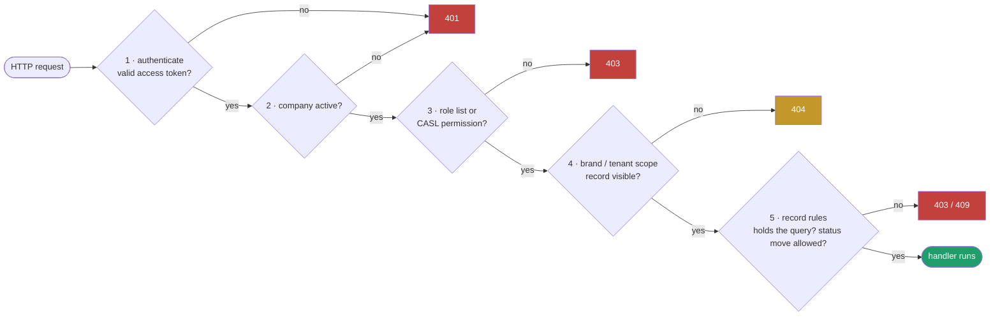
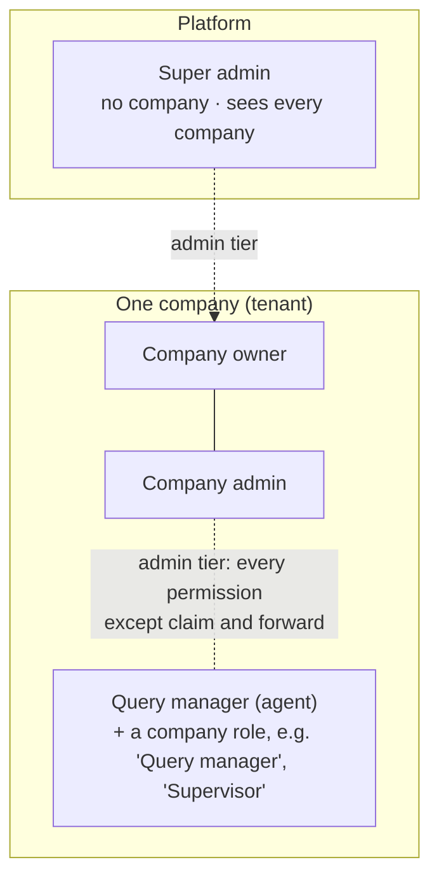

<Callout title="Source snapshot">
Listenyzen revision `18e6d95`, 10 November 2026. Code blocks are the real files, copied verbatim. The permission catalogue, route table and simulators are generated from the source by `scripts/sync-listenyzen-rbac.mjs`, and the simulators run the same CASL library version Listenyzen uses. Examples are illustrative.
</Callout>

## Three words, three questions

| Word | Question it answers | Listenyzen's answer | Fails with |
| --- | --- | --- | --- |
| **Authentication** (authn) | *Who are you?* | Email + password once, then a signed **JWT** in an HttpOnly cookie on every request | **401** Unauthenticated |
| **Authorization** (authz) | *May you do this?* | A role list (`authorize`) or a **CASL permission** (`requireAbility`) on each route, plus record rules | **403** Forbidden |
| **RBAC** (role-based access control) | *How are permissions handed out?* | People get a **role**; a role is a set of **permissions**; routes check permissions, never people | n/a |

And one more that is easy to forget:

| **Scoping** | *Which records can you even see?* | Every query is filtered to your **company**, and for agents to the **brands** granted to them | **404** Not found: it doesn't reveal that the record exists |

## The gates every request passes

Gates 1–3 are **middleware** on the route. Gates 4–5 run **inside** the handler or service, because they need the record. Each has its own chapter.

## Who is who

| Tier | `user.role` | Permissions come from | Can be limited by a company role? |
| --- | --- | --- | --- |
| Admin | `super_admin`, `company_owner`, `company_admin` | Code: `can('manage', 'all')`, except claiming and forwarding work | No |
| Operational | `query_manager` | Their **Role** document (`user.roleId`), or the company's seeded "Query manager" role | **Yes**: that is what roles are for |

## Try it: one request, every gate

Choose who is asking and what they try. Each gate lights up green or red, with the exact status and message Listenyzen returns.

<RequestSimulator />

## Reading order

<Steps>
<Step>
**[Signing in](/docs/listenyzen-rbac/sign-in)**: passwords, the two tokens, cookies, refresh, logout.
</Step>
<Step>
**[Request gates](/docs/listenyzen-rbac/request-gates)**: `authenticate`, company check, `authorize(...roles)`.
</Step>
<Step>
**[Scoping](/docs/listenyzen-rbac/scoping)**: tenant and brand filters, which decide what exists for you.
</Step>
<Step>
**[Roles and permissions](/docs/listenyzen-rbac/roles-and-permissions)**: the catalogue, CASL abilities, role documents and caches.
</Step>
<Step>
**[Route gates](/docs/listenyzen-rbac/route-gates)**: all 174 routes and what each one checks.
</Step>
<Step>
**[Record rules](/docs/listenyzen-rbac/record-rules)**: holding a query, claiming, forwarding, status moves.
</Step>
<Step>
**[Client and realtime](/docs/listenyzen-rbac/client-and-realtime)**: how the UI hides what won't work, and how sockets authenticate.
</Step>
<Step>
**[Walkthroughs and cheat sheet](/docs/listenyzen-rbac/walkthroughs)**: five full traces, every status code, and things to watch.
</Step>
</Steps>

The data model behind all of this (User, Role, Brand grants) is in the [Listenyzen data model](/docs/listenyzen/tenancy) guide.
