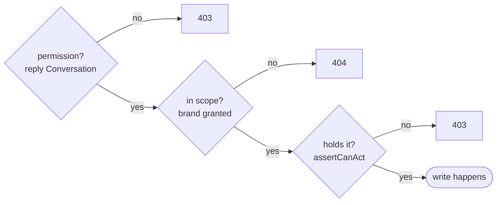
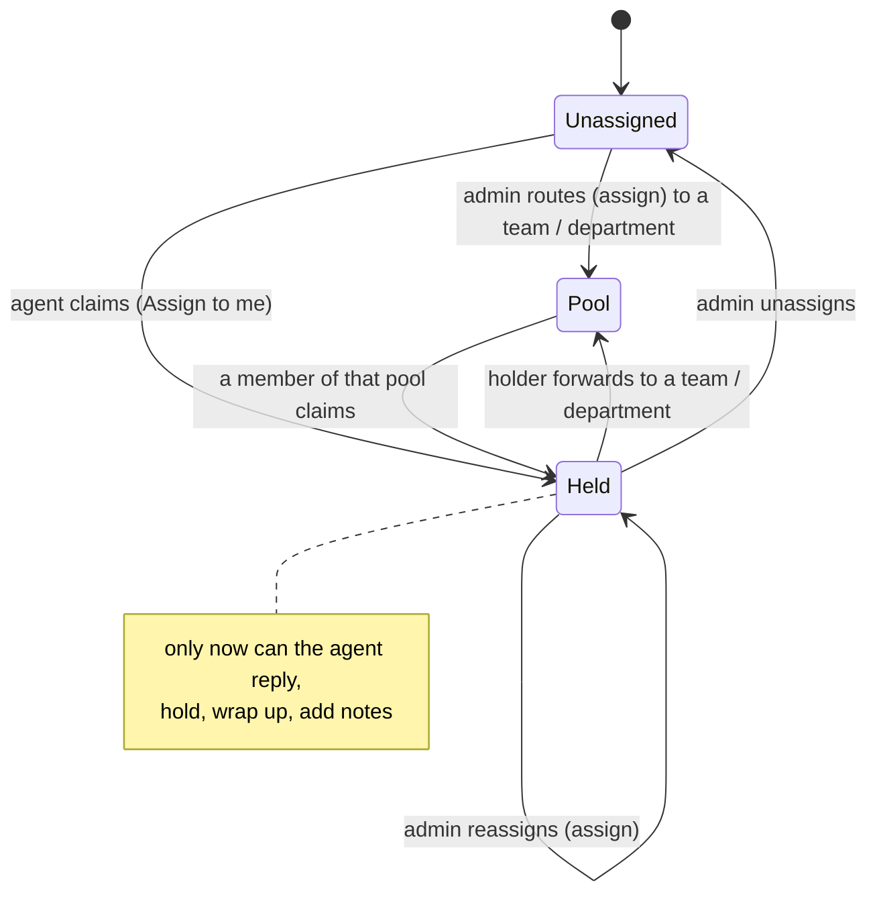
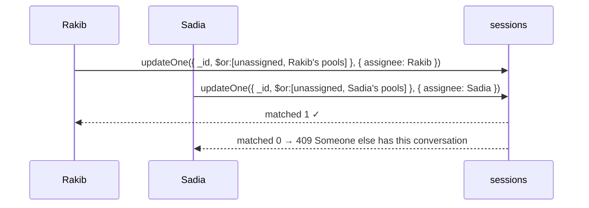
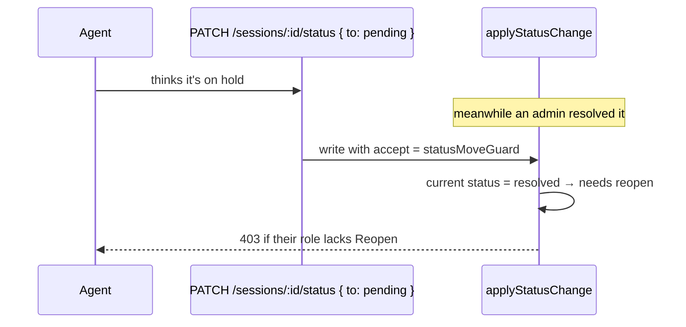

## The code

{/* source: server/src/auth/reply-access.ts */}
```ts title="server/src/auth/reply-access.ts" lineNumbers
import { Types } from 'mongoose';
import { ForbiddenError } from '@/libraries/error-handling';
import UserModel from '@/modules/user/schema';
import { ROLES } from './roles';

/**
 * Who may act on a thread, and what a query manager may take.
 *
 * **Acting** is every write on a thread: replying, reacting, moderating, and editing its status,
 * sentiment, tags, notes and customer fields. Each of those routes calls `assertCanAct`; reads never
 * do. Owners, admins and super admins always may. A query manager may only once the thread is
 * assigned to them personally: a department or team pool is for claiming, not replying. Seeing is
 * unaffected — a query manager still sees every thread on the brands they can see (`./tenant.ts`),
 * so an agent who worked a session keeps the thread's history after the next one goes to someone
 * else.
 *
 * **Routing** is separate: assigning anyone is an owner/admin act (the assignment routes are closed
 * to query managers), and a query manager takes work with "Assign to me" (the claim routes): an
 * unassigned query, or one pooled on their department or team (`claimableFilter`).
 *
 * This rule used to sit behind a company setting (`onlyAssignedCanAct`, off by default). It is
 * unconditional now; to make it optional again, read the setting here and return early from
 * `assertCanAct` (and from `useReplyAccess` on the client) when it is off.
 */

// The `{kind, id, name}` snapshot embedded on sessions, conversations and comments. Structural
// rather than imported so this stays free of module dependencies in both directions.
export interface AssigneeRef {
  kind: 'query_manager' | 'department' | 'team';
  id: Types.ObjectId | string;
}

/**
 * The pools the caller belongs to — their department and team — read from the User document rather
 * than the JWT's `departmentId` / `teamId`. A token keeps the claims it was signed with until it
 * expires, so after a team move it can be stale for that long — tolerable for the brand filters in
 * tenant.ts, not here, where it would let an agent take another pool's records or lock them out of
 * their own.
 */
const callerPools = async (
  user: Express.User
): Promise<{ departmentId?: string; teamId?: string; inactive: boolean }> => {
  const record = await UserModel.findById(user.id).select('departmentId teamId status').lean();
  return {
    departmentId: record?.departmentId ? String(record.departmentId) : undefined,
    teamId: record?.teamId ? String(record.teamId) : undefined,
    inactive: record?.status === 'inactive',
  };
};

/**
 * Guard every write on a record. 403 for a query manager who doesn't hold it personally: unassigned
 * and pooled records say to take them with Assign to me first.
 *
 * `assignee` is the record's current assignee: a conversation's (denormalized from its latest
 * session, so the thread's current holder owns all of its history), or a comment thread root's.
 * Async so a policy read can come back without touching the call sites.
 */
export const assertCanAct = async (
  user: Express.User | undefined,
  assignee: AssigneeRef | undefined | null,
  comingFrom: string
): Promise<void> => {
  if (user?.role !== ROLES.QUERY_MANAGER) return;

  if (assignee?.kind === 'query_manager' && String(assignee.id) === user.id) return;
  if (!assignee || assignee.kind !== 'query_manager') {
    throw new ForbiddenError(
      assignee
        ? 'This conversation is pooled: take it with Assign to me first'
        : 'This conversation is unassigned: take it with Assign to me first',
      comingFrom
    );
  }
  throw new ForbiddenError('This conversation is assigned to someone else', comingFrom);
};

/**
 * The records a query manager may take for themselves ("Assign to me"): unassigned, pooled on their
 * own department (which every team in it shares), or pooled on their own team. Never one held by
 * another person or pool, so claiming can't take work from anyone. A filter, so the claim checks and
 * writes in one atomic update (two agents claiming at once: one wins, the other matches nothing).
 */
export const claimableFilter = async (user: Express.User): Promise<Record<string, unknown>> => {
  const { departmentId, teamId, inactive } = await callerPools(user);
  // Deactivated, with an access token still valid for a few minutes: takes no work.
  if (inactive) {
    throw new ForbiddenError('This account is deactivated', 'auth/reply-access.ts claimableFilter');
  }
  const pool = (kind: 'department' | 'team', id: string): Record<string, unknown> => ({
    'assignee.kind': kind,
    'assignee.id': new Types.ObjectId(id),
  });
  // Under `$and`, so a caller's own `$or` spread next to it can't overwrite this one.
  return {
    $and: [
      {
        $or: [
          // `null` matches a missing field too.
          { assignee: null },
          ...(departmentId ? [pool('department', departmentId)] : []),
          ...(teamId ? [pool('team', teamId)] : []),
        ],
      },
    ],
  };
};

/**
 * What "Assigned to me" lists: work held by the caller, plus work pooled on their department or team
 * (theirs to take). Assignee ids to match against `assignee.id` — ObjectIds never collide across
 * users, departments and teams, so the kind needn't be matched too. Pools are read from the user
 * record, as for claiming, so a team move shows up at once — while brand visibility (`tenant.ts`)
 * follows the token until it refreshes. Deliberate: the brand gate still applies first.
 */
export const assignedToMeIds = async (user: Express.User): Promise<string[]> => {
  const { departmentId, teamId } = await callerPools(user);
  return [user.id, departmentId, teamId].filter((id): id is string => Boolean(id));
};
```
{/* /source */}

{/* source: server/src/auth/status-action.ts */}
```ts title="server/src/auth/status-action.ts" lineNumbers
import type { Action } from '@/auth/permissions';

/** A query's status (sessions and comment roots share them). */
type QueryStatus = 'pending' | 'hold' | 'resolved' | 'unresolved';

const WRAPPED_UP: readonly string[] = ['resolved', 'unresolved'];

/**
 * Every permission a manual status change needs (spec: docs/roles.md):
 * - wrap up as resolved / unresolved → `wrapUp` (also re-deciding a wrapped-up query);
 * - anything else out of a wrap-up (pending, or hold) → `reopen`, plus `hold` when it goes on hold,
 *   so hold can't be a way round reopen;
 * - on hold, or ending a hold → `hold`; pending → pending changes nothing and needs `hold` too, so a
 *   no-op isn't a way round the gate.
 */
export const statusChangeActions = (from: string, to: QueryStatus): Action[] => {
  if (WRAPPED_UP.includes(to)) return ['wrapUp'];
  if (WRAPPED_UP.includes(from)) return to === 'hold' ? ['reopen', 'hold'] : ['reopen'];
  return ['hold'];
};
```
{/* /source */}

## Why permissions aren't enough

A permission says "Sadia may reply to conversations". It doesn't say **which** conversations. Two agents with the same role could otherwise both answer the same customer. So every write on a query also passes a **record rule**:



## Acting: only the holder

`assertCanAct(user, assignee)` runs on **every write** on a thread: reply, react, moderate, status, sentiment, tags, notes, customer fields. Reads never run it.

| Who is asking | The query is held by | Result |
| --- | --- | --- |
| Owner, admin, super admin | anyone or nobody | ✓ always |
| Query manager | **them, personally** | ✓ |
| Query manager | nobody | 403 "This conversation is unassigned: take it with Assign to me first" |
| Query manager | a team or department pool, even their own | 403 "This conversation is pooled: take it with Assign to me first" |
| Query manager | another query manager | 403 "This conversation is assigned to someone else" |

- **The conversation is the unit.** Its `assignee` copies the latest session's, so the current holder may act on the whole thread and an earlier holder may only read it.
- A comment **reply** is held by whoever holds its thread root. A thread under the **page's own** post comment is open to every agent on the brand.
- **Seeing is not affected.** A query manager still sees every thread on brands they can see, so the history stays readable after the work moves on.

## Taking work: claim, forward, assign



| Action | Permission | Record rule |
| --- | --- | --- |
| **Assign to me** (claim) | `claim` | `claimableFilter`: unassigned, or pooled on **my** department or team. Never someone else's. |
| **Forward** | `forward` | `holdsQuery`: only the person holding it, else 403 "Only the query manager this is assigned to can forward it" |
| **Assign / reassign** (route others' work) | `assign` (admin tier, or a role that grants "Assign and reassign") | none: routing is a manager act |
| claim or forward a resolved query | | 409 "This conversation is already wrapped up" |

**A claim is one atomic write.** The filter "still claimable by me" is part of the update itself. Two agents clicking "Assign to me" at the same moment both send the update, one matches, and the other matches nothing and gets 409 "Someone else has this conversation". No read-then-write race.



Pools are read from the **user record**, not the token, so after a team move an agent can't claim from the pool they just left.

## Status moves

Changing a query's status needs a permission chosen **by the move**, from what it is to what it becomes:

<StatusMoveMatrix />

The rules behind the grid:

1. Into a wrap-up (`resolved` / `unresolved`) → **`wrapUp`**.
2. Out of a wrap-up → **`reopen`**, plus **`hold`** if it goes onto hold. Hold can't be used as a back door around reopen.
3. Anything else, including `pending → pending` → **`hold`**. A no-op isn't a way past the gate either.

**Checked at write time.** The guard (`statusMoveGuard`) runs **inside** the status write, against the status actually being changed. If the query was wrapped up a moment before, a request that looked like "end the hold" is checked as a **reopen**.



## Check yourself

<details>
<summary>A query is pooled on Sadia's team. Can she reply right away?</summary>

No: 403 "pooled". She claims it first ("Assign to me"), which needs the `claim` permission. Then she holds it and can reply.
</details>

<details>
<summary>A role has Wrap up but not Reopen. Can its holder move a resolved query to hold?</summary>

No. Out of a wrap-up into hold needs `reopen` **and** `hold`.
</details>

<details>
<summary>Why are pools for claiming and not for replying?</summary>

So every reply has one accountable person, and handler figures credit the right agent.
</details>
