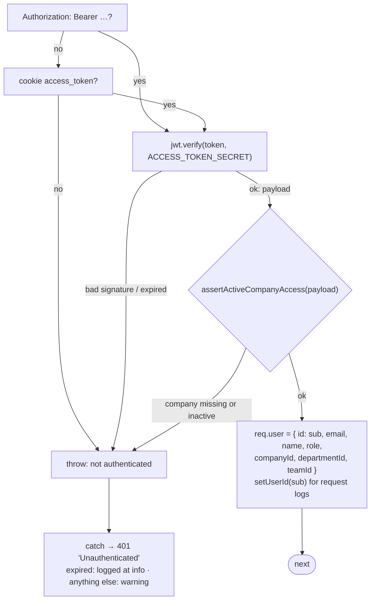
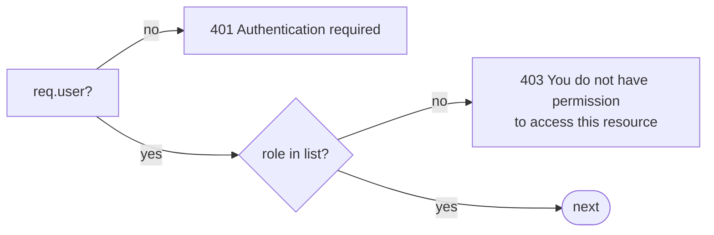
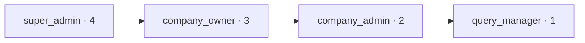

## The code

{/* source: server/src/middlewares/auth/index.ts */}
```ts title="server/src/middlewares/auth/index.ts" lineNumbers
import { Request, Response, NextFunction } from 'express';
import { UnauthorizedError, ForbiddenError } from '@/libraries/error-handling';
import { verifyAccessToken } from '@/libraries/utils/tokens';
import { Role } from '@/auth/roles';
import logger from '@/libraries/log/logger';
import { setUserId } from '@/middlewares/request-context';
import { assertActiveCompanyAccess } from '@/auth/company-access';

const AUTHENTICATE_FROM = 'authenticate middleware';

/**
 * Middleware to authenticate users using JWT token
 * Extracts token from Authorization header or cookies
 */
export const authenticate = async (
  req: Request,
  _res: Response,
  next: NextFunction
): Promise<void> => {
  try {
    // Extract token from Authorization header or cookies
    let token = req.headers.authorization?.replace('Bearer ', '');

    if (!token) {
      token = req.cookies?.access_token;
    }

    if (!token) {
      throw new UnauthorizedError('You are not authenticated', AUTHENTICATE_FROM);
    }

    // Verify token
    const payload = verifyAccessToken(token);

    // Company suspension takes effect on the next request, even for an access token minted while
    // the tenant was active. Super-admins bypass this because they are platform identities.
    await assertActiveCompanyAccess(payload, AUTHENTICATE_FROM);

    // Attach user to request
    req.user = {
      id: payload.sub,
      email: payload.email,
      name: payload.name,
      role: payload.role,
      companyId: payload.companyId,
      departmentId: payload.departmentId,
      teamId: payload.teamId,
    };
    setUserId(payload.sub);

    next();
  } catch (error) {
    // An expired token is what every active session does every 15 minutes — routine, and logging it
    // at `error` buried the failures that are not routine. A bad signature is worth a closer look:
    // it is either a stale deploy secret or someone forging tokens.
    const name = error instanceof Error ? error.name : '';
    if (name === 'TokenExpiredError') {
      logger.info('Authentication failed: token expired', { name });
    } else {
      logger.warn('Authentication failed', {
        name,
        reason: error instanceof Error ? error.message : String(error),
      });
    }
    next(new UnauthorizedError('Unauthenticated', AUTHENTICATE_FROM));
  }
};
export const checkUser = async (
  req: Request,
  _res: Response,
  next: NextFunction
): Promise<void> => {
  try {
    // Extract token from Authorization header or cookies
    let token = req.headers.authorization?.replace('Bearer ', '');
    if (!token) token = req.cookies?.access_token;

    // If no token found, continue without setting user
    if (!token) return next();

    // Try verifying token
    const payload = verifyAccessToken(token);
    await assertActiveCompanyAccess(payload, 'checkUser middleware');

    // Attach user to request
    req.user = {
      id: payload.sub,
      email: payload.email,
      name: payload.name,
      role: payload.role,
      companyId: payload.companyId,
      departmentId: payload.departmentId,
      teamId: payload.teamId,
    };
    setUserId(payload.sub);

    next();
  } catch (error) {
    // Don’t block the request — just log the error and continue
    logger.warn('Optional user check failed', error);
    next();
  }
};

/**
 * Middleware to authorize users based on role
 * @param role - Array of allowed role
 */
export const authorize = (...roles: Role[]) => {
  return (req: Request, _res: Response, next: NextFunction): void => {
    if (!req.user) {
      return next(new UnauthorizedError('Authentication required', 'authorize middleware'));
    }

    if (!roles.includes(req?.user?.role)) {
      logger.warn(
        `User ${req?.user?.id} with role ${req?.user?.role} attempted to access resource requiring role ${roles.join(', ')}`
      );
      return next(
        new ForbiddenError(
          'You do not have permission to access this resource',
          'authorize middleware'
        )
      );
    }

    next();
  };
};

/**
 * Optional authentication - attaches user if token exists but doesn't fail if missing
 */
export const optionalAuth = async (
  req: Request,
  _res: Response,
  next: NextFunction
): Promise<void> => {
  try {
    let token = req.headers.authorization?.replace('Bearer ', '');

    if (!token) {
      token = req.cookies?.access_token;
    }

    if (token) {
      const payload = verifyAccessToken(token);
      await assertActiveCompanyAccess(payload, 'optionalAuth middleware');
      req.user = {
        id: payload.sub,
        email: payload.email,
        name: payload.name,
        role: payload.role,
        companyId: payload.companyId,
        departmentId: payload.departmentId,
        teamId: payload.teamId,
        iat: payload.iat,
        exp: payload.exp,
      };
      setUserId(payload.sub);
    }
  } catch (error) {
    // Silently fail for optional auth
    logger.debug('Optional auth failed', error);
  }

  next();
};

/**
 * There used to be an `isOwnerOrAdmin(getUserId)` helper here. It allowed *any* elevated role
 * straight through with no company check, so it would have admitted another tenant's
 * company_admin — and it had zero callers, so it was a trap rather than a bug.
 *
 * Authorization in this codebase is two parts: `authorize(...roles)` for the role gate, and a
 * `getTenantScope` / `getBrandScope` filter applied in the service beneath, which is the thing
 * that actually enforces isolation. A role-only ownership helper cannot see the tenant, so don't
 * reintroduce one.
 */
```
{/* /source */}

{/* source: server/src/auth/company-access.ts */}
```ts title="server/src/auth/company-access.ts" lineNumbers
import { UnauthorizedError } from '@/libraries/error-handling';
import { isActive } from '@/modules/company/service';
import { ROLES, type Role } from './roles';

export interface CompanyPrincipal {
  role: Role;
  companyId?: string;
}

/**
 * Super-admins are platform identities and do not belong to a company. Every other identity is
 * usable only while its referenced company exists and is active.
 */
export const hasActiveCompanyAccess = async (principal: CompanyPrincipal): Promise<boolean> => {
  if (principal.role === ROLES.SUPER_ADMIN) return true;
  if (!principal.companyId) return false;
  return isActive(principal.companyId);
};

export const assertActiveCompanyAccess = async (
  principal: CompanyPrincipal,
  comingFrom: string
): Promise<void> => {
  if (!(await hasActiveCompanyAccess(principal))) {
    throw new UnauthorizedError('Your company is inactive', comingFrom);
  }
};
```
{/* /source */}

{/* source: server/src/auth/roles.ts */}
```ts title="server/src/auth/roles.ts" lineNumbers
/**
 * Single source of truth for user roles.
 *
 * Today the system has three flat roles. This file is the seam for what's coming:
 * - granular per-feature permissions will become a role -> permission map here,
 * - company/organization scoping will layer on top without touching call sites.
 *
 * Import `ROLES` / `Role` from here instead of hardcoding role strings anywhere.
 */

// Ordered tuple so it can feed both Mongoose enums and Zod enums.
export const ROLE_VALUES = [
  'super_admin',
  'company_owner',
  'company_admin',
  'query_manager',
] as const;

export type Role = (typeof ROLE_VALUES)[number];

export const ROLES = {
  SUPER_ADMIN: 'super_admin',
  COMPANY_OWNER: 'company_owner',
  COMPANY_ADMIN: 'company_admin',
  QUERY_MANAGER: 'query_manager',
} as const satisfies Record<string, Role>;

/**
 * The managers: who see Overview and supervisor data such as status history and the hold log
 * (docs/resolution-time-rules.md, R6). There is no supervisor role yet; when one arrives, add it here.
 */
export const MANAGER_ROLES = [ROLES.SUPER_ADMIN, ROLES.COMPANY_OWNER, ROLES.COMPANY_ADMIN] as const;

/**
 * Privilege ranking (higher = more privileged). Not used for permission checks yet,
 * but ready for hierarchy-based checks (e.g. "at least company_admin") when needed.
 */
export const ROLE_RANK: Record<Role, number> = {
  super_admin: 4,
  company_owner: 3,
  company_admin: 2,
  query_manager: 1,
};
```
{/* /source */}

## How a route lists its gates

A route is a chain of middleware. Each one either calls `next()` or throws, and the handler runs only if all of them pass:

```ts title="The shape of every protected route (simplified)"
router.patch(
  '/:id/status',
  authenticate,                               // gate 1 + 2: who are you, is your company active?
  requireAbility(['read', 'Conversation']),   // gate 3: CASL permission (or authorize(...roles))
  validateParams(idSchema),
  validateBody(statusSchema),
  async (req, res) => {
    /* gate 4 + 5 inside: brand scope, holds the query, status move */
  }
);
```

## Gate 1 · `authenticate`



- The token can come from an `Authorization: Bearer` header **or** the `access_token` cookie. The browser uses the cookie, and other API callers can use the header.
- **Every failure becomes the same `401 Unauthenticated`**: missing, expired, forged, or suspended company. Only the log tells them apart. An expired token is routine (every 15 minutes) and logged quietly. A bad signature is logged as a warning, because it means an old secret or a forgery.
- `req.user` is built **only from the verified token**. Nothing from the request body or query string can change who you are.

### Gate 2 · Company active

`hasActiveCompanyAccess` runs on **every** authenticated request, not just at login:

| Caller | Result |
| --- | --- |
| `super_admin` | always passes: platform identity, no company |
| anyone with no `companyId` in the token | fails |
| anyone else | passes only while their company exists and `status: 'active'` |

So suspending a company locks its people out **on their very next request**, even with a token signed a minute earlier.

## Gate 3a · `authorize(...roles)`: the role list

The older, coarse check. It compares `req.user.role` (from the token) with a list:



Since roles went live, `authorize` guards only **administration**: users, teams, departments, brands, channels, alert rules, saving SLA settings, history logs, the hold log, roles and rollups. Everyday work moved to `requireAbility` ([next chapters](/docs/listenyzen-rbac/roles-and-permissions)).

| Role list used | Routes |
| --- | --- |
| Super admin only | 8 (company CRUD, Overview rollup admin) |
| Super admin, owner, admin (`MANAGER_ROLES`) | 40 |
| Owner, admin | 26 (company roles and permissions, alert rules, channel connect and WhatsApp templates, brands-now) |
| Owner, admin, query manager | 6 (your own notifications and notification settings) |
| All four roles | 4 (brand list and one brand, a brand's tag vocabulary, file list) |

### The role tier, ranked



`ROLE_RANK` exists but **no check uses it**. Every check names roles explicitly. `MANAGER_ROLES` (the top three) is the admin tier in [CASL](/docs/listenyzen-rbac/roles-and-permissions).

## 401 vs 403 vs 404

| Status | Meaning in Listenyzen | Typical cause |
| --- | --- | --- |
| **401** Unauthorized | "We don't know who you are" | No / expired / forged token, suspended company. The client tries one refresh, then signs out. |
| **403** Forbidden | "We know you, and you may not" | Role not in the list, missing permission, not holding the query |
| **404** Not found | "Not here, as far as you can tell" | Outside your company or brand scope. Deliberately not 403, so the response doesn't confirm the record exists. |
| **409** Conflict | "Not now" | Claiming something someone else just took, a stale role `revision` |
| **429** Too many requests | "Slow down" | `authLimiter` on login, register and refresh |

## Things that are not used

- `checkUser` and `optionalAuth` (attach a user if a token is present, never fail) have **no callers**. Every protected route uses `authenticate`.
- An old `isOwnerOrAdmin` helper was removed because it let any elevated role through **without a company check**. The comment at the bottom of the file explains: role checks never replace the tenant scope.

## Check yourself

<details>
<summary>A token was signed while the company was active; the company is suspended a minute later. What happens on the next request?</summary>

401 at gate 2: `assertActiveCompanyAccess` runs on every request.
</details>

<details>
<summary>Why does `authenticate` answer every failure with the same message?</summary>

The caller learns only "not authenticated", not which part failed. The log keeps the details for operators.
</details>

<details>
<summary>Is a valid token from Company A enough to read Company B's conversation?</summary>

No. The permission gate may pass, but the scope filter (`{ companyId }` from the token) finds nothing, so the answer is 404 ([scoping](/docs/listenyzen-rbac/scoping)).
</details>
