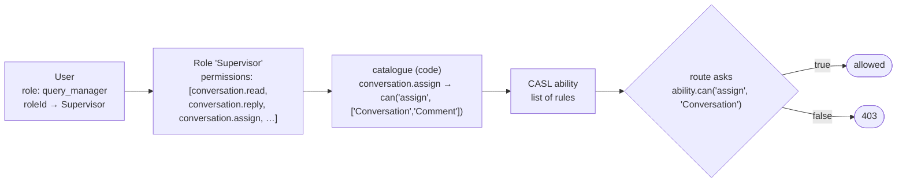
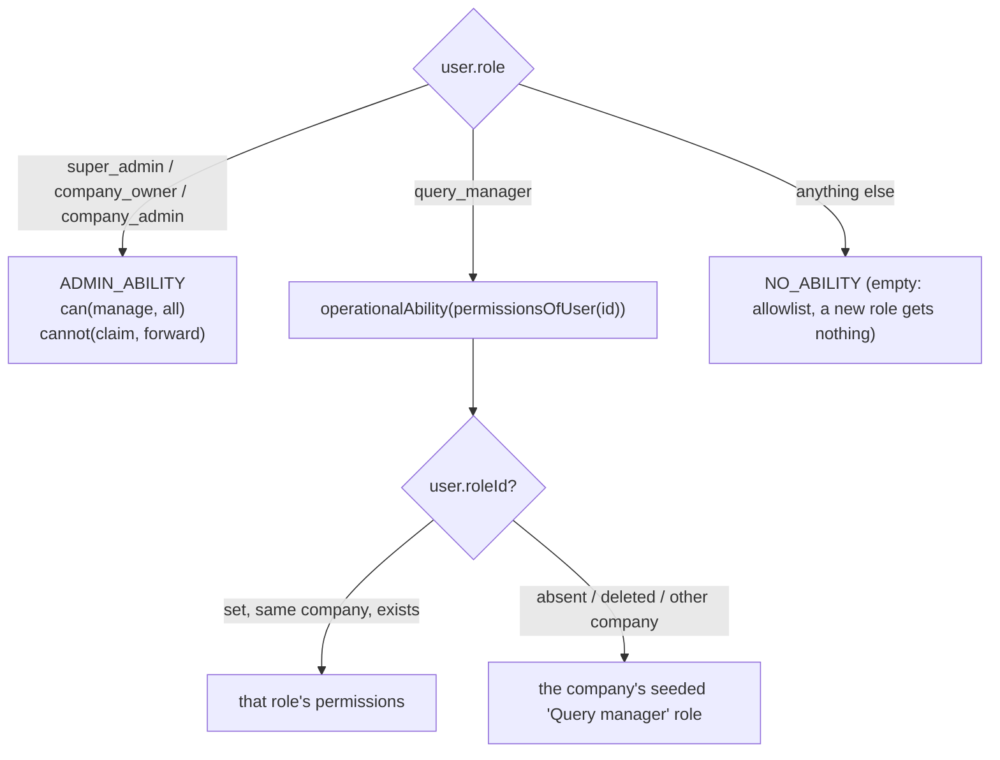
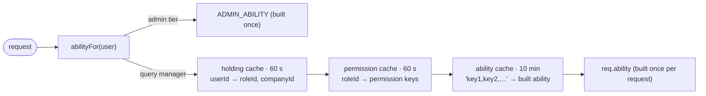

## The code

{/* source: server/src/auth/permissions.ts */}
```ts title="server/src/auth/permissions.ts" lineNumbers
/**
 * The permission catalogue (spec: docs/roles.md). Fixed in code: a Company composes its operational
 * roles from these keys (`modules/role`), and each entry's `rules` are the only place a key turns into
 * CASL rules (`auth/ability.ts`), so what a role stores can never drift from what the code checks.
 *
 * Only what operational users can be given is listed. The admin tier (company owner, company admin,
 * super admin) holds everything, including Workspace Admin, which no operational role can be given.
 * Everyone keeps their own profile and notification settings; those aren't permissions.
 *
 * Adding a permission = an entry in `CATALOGUE` with its rules, and (in phase 2) the check on
 * the route or action it gates.
 */

/** What can be done. `manage` = anything (CASL's wildcard action). */
export const ACTIONS = [
  'manage',
  'read',
  'reply',
  'claim',
  'forward',
  'assign',
  'hold',
  'tag',
  'wrapUp',
  'reopen',
  'like',
  'hide',
  'delete',
  'create',
  'update',
  'send',
] as const;
export type Action = (typeof ACTIONS)[number];

/**
 * What it is done to. `Conversation` = DM queries (conversations and their sessions), `Comment` =
 * comment threads. The figure subjects are Overview areas. `all` = CASL's wildcard subject.
 * The client keeps a copy (client/src/features/ability/model.ts), checked by role-ability.test.ts.
 */
export const SUBJECTS = [
  'all',
  'Conversation',
  'Comment',
  'Note',
  'Tag',
  'FixedReply',
  'WhatsAppTemplate',
  'BrandOverview',
  'TeamFigures',
  'OwnFigures',
  'SlaSettings',
] as const;
export type SubjectName = (typeof SUBJECTS)[number];

const INBOX = 'Inbox';
const COMMENTS = 'Comments';
const OVERVIEW = 'Overview';
const BRAND_SETUP = 'Brand setup';
export const PERMISSION_GROUPS = [INBOX, COMMENTS, OVERVIEW, BRAND_SETUP] as const;
export type PermissionGroup = (typeof PERMISSION_GROUPS)[number];

/** One CASL rule a permission grants (no conditions yet; record checks arrive in phase 2). */
export interface PermissionRule {
  action: Action | Action[];
  subject: SubjectName | SubjectName[];
}

interface CatalogueEntry {
  label: string;
  group: PermissionGroup;
  description: string;
  // The only translation from a stored key to CASL.
  rules: PermissionRule[];
}

const QUERIES: SubjectName[] = ['Conversation', 'Comment'];

/** The catalogue, in the order the client lists it. Each key is written here only. */
const CATALOGUE = {
  'conversation.read': {
    label: 'Read conversations',
    group: INBOX,
    description: 'Open the inbox and read DM conversations, their sessions and customer details.',
    rules: [{ action: 'read', subject: 'Conversation' }],
  },
  'conversation.reply': {
    label: 'Reply',
    group: INBOX,
    description: 'Send messages and attachments, react, and edit customer details.',
    rules: [{ action: 'reply', subject: 'Conversation' }],
  },
  'conversation.claim': {
    label: 'Assign to me',
    group: INBOX,
    description: 'Take an unassigned or pooled query (DMs and comment threads).',
    rules: [{ action: 'claim', subject: QUERIES }],
  },
  'conversation.forward': {
    label: 'Forward',
    group: INBOX,
    description: 'Pass a query you hold to a person, team or department.',
    rules: [{ action: 'forward', subject: QUERIES }],
  },
  'conversation.assign': {
    label: 'Assign and reassign',
    group: INBOX,
    description: 'Route any query to a person, team or department.',
    rules: [{ action: 'assign', subject: QUERIES }],
  },
  'conversation.hold.manage': {
    label: 'Put on hold',
    group: INBOX,
    description: 'Put a query on hold, which stops its resolution clock.',
    rules: [{ action: 'hold', subject: QUERIES }],
  },
  'conversation.tag.apply': {
    label: 'Apply tags',
    group: INBOX,
    description: 'Tag queries, and add new tags from the tag picker.',
    rules: [
      { action: 'tag', subject: QUERIES },
      { action: 'create', subject: 'Tag' },
    ],
  },
  'conversation.template.send': {
    label: 'Send WhatsApp templates',
    group: INBOX,
    description: 'Send approved WhatsApp message templates.',
    rules: [{ action: 'send', subject: 'WhatsAppTemplate' }],
  },
  'session.note.read': {
    label: 'Read internal notes',
    group: INBOX,
    description: 'See the internal notes on a session.',
    rules: [{ action: 'read', subject: 'Note' }],
  },
  'session.note.create': {
    label: 'Add internal notes',
    group: INBOX,
    description: 'Write internal notes on a session.',
    rules: [{ action: 'create', subject: 'Note' }],
  },
  'session.wrap': {
    label: 'Wrap up',
    group: INBOX,
    description: 'Close a query as resolved or unresolved, with its wrap-up fields.',
    rules: [{ action: 'wrapUp', subject: QUERIES }],
  },
  'session.reopen': {
    label: 'Reopen',
    group: INBOX,
    description: 'Move a wrapped-up query back to pending.',
    rules: [{ action: 'reopen', subject: QUERIES }],
  },
  'comment.read': {
    label: 'Read comments',
    group: COMMENTS,
    description: 'Open the comments workspace and read posts and comment threads.',
    rules: [{ action: 'read', subject: 'Comment' }],
  },
  'comment.reply': {
    label: 'Reply to comments',
    group: COMMENTS,
    description: 'Reply to comments as the page.',
    rules: [{ action: 'reply', subject: 'Comment' }],
  },
  'comment.like': {
    label: 'Like comments',
    group: COMMENTS,
    description: 'Like and unlike comments as the page.',
    rules: [{ action: 'like', subject: 'Comment' }],
  },
  'comment.hide': {
    label: 'Hide comments',
    group: COMMENTS,
    description: 'Hide and unhide comments on the page.',
    rules: [{ action: 'hide', subject: 'Comment' }],
  },
  'comment.delete': {
    label: 'Delete comments',
    group: COMMENTS,
    description: 'Delete comments from the page. Cannot be undone.',
    rules: [{ action: 'delete', subject: 'Comment' }],
  },
  'analytics.brand_health.read': {
    label: 'Brand figures',
    group: OVERVIEW,
    description: 'Brand Health, Engagement, SLA and Customers pages.',
    rules: [{ action: 'read', subject: 'BrandOverview' }],
  },
  'analytics.scorecard.read.self': {
    label: 'Own figures',
    group: OVERVIEW,
    description: 'Handler view: their own queries, turns and response times.',
    rules: [{ action: 'read', subject: 'OwnFigures' }],
  },
  'analytics.scorecard.read.all': {
    label: 'Team figures',
    group: OVERVIEW,
    description: 'Team Performance, Team view and Team Data for the whole Brand.',
    rules: [{ action: 'read', subject: 'TeamFigures' }],
  },
  'brand.tag.manage': {
    label: 'Manage tags',
    group: BRAND_SETUP,
    description: 'Rename and archive tags in the Brand’s vocabulary.',
    rules: [{ action: 'update', subject: 'Tag' }],
  },
  'brand.fixed_reply.manage': {
    label: 'Manage fixed replies',
    group: BRAND_SETUP,
    description: 'Add, edit and delete the Brand’s fixed replies.',
    rules: [{ action: 'manage', subject: 'FixedReply' }],
  },
  'brand.sla.read': {
    label: 'See SLA targets',
    group: BRAND_SETUP,
    description: 'See the Brand’s SLA targets and business hours (read only).',
    rules: [{ action: 'read', subject: 'SlaSettings' }],
  },
} satisfies Record<string, CatalogueEntry>;

export type PermissionKey = keyof typeof CATALOGUE;

/** Every key, in catalogue order (a tuple, for Zod and Mongoose enums). */
export const PERMISSION_KEYS = Object.keys(CATALOGUE) as [PermissionKey, ...PermissionKey[]];

export interface PermissionDefinition {
  key: PermissionKey;
  label: string;
  group: PermissionGroup;
  description: string;
}

/** The catalogue as the API serves it (no rules: the client gets rules from its own ability). */
export const PERMISSIONS: readonly PermissionDefinition[] = PERMISSION_KEYS.map(key => {
  // eslint-disable-next-line security/detect-object-injection
  const { label, group, description } = CATALOGUE[key];
  return { key, label, group, description };
});

/** A permission's CASL rules. */
export const rulesOf = (key: PermissionKey): readonly PermissionRule[] =>
  // eslint-disable-next-line security/detect-object-injection
  CATALOGUE[key]?.rules ?? [];

/**
 * The seeded Query manager role: exactly what a query manager could do before roles went live, so
 * moving the checks onto the ability (phase 2) changes nobody's access. Note this is wider than the
 * prototype's sample (it also manages fixed replies and deletes comments), because today's routes
 * allow both.
 */
export const QUERY_MANAGER_PERMISSIONS: readonly PermissionKey[] = [
  'conversation.read',
  'conversation.reply',
  'conversation.claim',
  'conversation.forward',
  'conversation.hold.manage',
  'conversation.tag.apply',
  'conversation.template.send',
  'session.note.read',
  'session.note.create',
  'session.wrap',
  'session.reopen',
  'comment.read',
  'comment.reply',
  'comment.like',
  'comment.hide',
  'comment.delete',
  'analytics.scorecard.read.self',
  'brand.fixed_reply.manage',
];

/** Keys in catalogue order, without duplicates or unknown keys (for storing). */
export const normalizePermissions = (keys: readonly string[]): PermissionKey[] => {
  const wanted = new Set(keys);
  return PERMISSION_KEYS.filter(key => wanted.has(key));
};
```
{/* /source */}

{/* source: server/src/auth/ability.ts */}
```ts title="server/src/auth/ability.ts" lineNumbers
import { AbilityBuilder, createMongoAbility, type MongoAbility } from '@casl/ability';
import { rulesOf, type Action, type PermissionKey, type SubjectName } from '@/auth/permissions';
import { MANAGER_ROLES, ROLES, type Role } from '@/auth/roles';
import { permissionsOfUser } from '@/modules/role/service';
import { TtlCache } from '@/libraries/cache/ttl-cache';

/**
 * What a signed-in user may do, as a CASL ability (spec: docs/roles.md). Phase 1 builds it; phase 2
 * moves the route checks onto it (`authorize(...roles)` → the ability), so every check reads one
 * place. Company isolation and Brand scope stay in `auth/tenant.ts`: the ability says what someone
 * may do, the scope says where.
 */
export type AppAbility = MongoAbility<[Action, SubjectName]>;

/**
 * Admin tier = the manager roles (super admin, owner, admin): every permission. An allowlist, so a
 * role added later gets nothing until it's placed deliberately.
 */
export const isAdminTier = (role: Role): boolean =>
  (MANAGER_ROLES as readonly Role[]).includes(role);

/**
 * The ability for a tier: the admin tier gets everything except taking work for themselves (claim
 * and forward stay query-manager actions, as today); an operational role gets exactly its
 * permissions' rules (`rulesOf`). Pure, so tests and the client-facing rules share it.
 */
export const defineAbility = (
  holder: { adminTier: true } | { adminTier: false; permissions: readonly PermissionKey[] }
): AppAbility => {
  const { can, cannot, build } = new AbilityBuilder<AppAbility>(createMongoAbility);
  if (holder.adminTier) {
    can('manage', 'all');
    cannot(['claim', 'forward'], ['Conversation', 'Comment']);
    return build();
  }
  for (const key of holder.permissions) {
    for (const rule of rulesOf(key)) can(rule.action, rule.subject);
  }
  return build();
};

const ADMIN_ABILITY = defineAbility({ adminTier: true });
// Built abilities by permission set (stored in catalogue order), so a query manager's request
// reuses one instead of compiling the same rules again. Keyed on content: nothing to invalidate.
const abilityByPermissions = new TtlCache<AppAbility>(10 * 60_000, 1_000);

const operationalAbility = (permissions: readonly PermissionKey[]): AppAbility => {
  const key = permissions.join(',');
  const cached = abilityByPermissions.get(key);
  if (cached) return cached;
  const ability = defineAbility({ adminTier: false, permissions });
  abilityByPermissions.set(key, ability);
  return ability;
};
const NO_ABILITY = defineAbility({ adminTier: false, permissions: [] });

/**
 * The signed-in user's ability. The tier comes from the token (like `authorize` today); an
 * operational user's permissions come from their role, read fresh-ish (cached per role, dropped on
 * every edit) so a role change applies on the next request.
 */
export const abilityFor = async (user: Pick<Express.User, 'id' | 'role'>): Promise<AppAbility> => {
  if (isAdminTier(user.role)) return ADMIN_ABILITY;
  if (user.role !== ROLES.QUERY_MANAGER) return NO_ABILITY;
  return operationalAbility(await permissionsOfUser(user.id));
};

/**
 * The caller's rules as plain JSON, for the client to rebuild the same ability (`/users/me` and the
 * sign-in responses). The client gates its UI on them; the server still checks every request.
 */
export const abilityRulesFor = async (
  user: Pick<Express.User, 'id' | 'role'>
): Promise<AppAbility['rules']> => (await abilityFor(user)).rules;
```
{/* /source */}

{/* source: server/src/modules/role/schema.ts */}
```ts title="server/src/modules/role/schema.ts" lineNumbers
import mongoose, { Document, Model, Schema, Types } from 'mongoose';
import { baseSchema } from '@/libraries/db/base-schema';
import { PERMISSION_KEYS, type PermissionKey } from '@/auth/permissions';

// Operational roles (spec: docs/roles.md). Company data: each Company composes its own from the
// permission catalogue (`auth/permissions.ts`). The admin tier (owner, admin, super admin) is fixed in
// code and never stored. Every holder is a query manager (`user.role`) — team, claim and forward work
// as before — and `user.roleId` names the role whose permissions apply.

/** `seeded`: shipped with the product, editable, never deleted. `company`: made by the Company. */
export const ROLE_ORIGINS = ['seeded', 'company'] as const;
export type RoleOrigin = (typeof ROLE_ORIGINS)[number];

/** The seeded roles. A user with no `roleId` holds the Company's `query_manager` role. */
export const SEED_KEYS = ['query_manager'] as const;
export type SeedKey = (typeof SEED_KEYS)[number];

export interface IRole extends Document {
  companyId: Types.ObjectId;
  name: string;
  description: string;
  permissions: PermissionKey[];
  origin: RoleOrigin;
  // Seeded roles only: which one, so seeding is idempotent.
  seedKey?: SeedKey;
  // The role new query managers get when none is picked. Exactly one per Company.
  isDefault: boolean;
  // Bumped on every edit; an edit names the revision it was based on (409 when stale). The
  // permission cache is dropped by the edit itself (`invalidateRole`), not keyed on this.
  revision: number;
  createdAt: Date;
  updatedAt: Date;
}

const roleSchema = new Schema<IRole>({
  companyId: { type: Schema.Types.ObjectId, ref: 'Company', required: true },
  name: { type: String, required: true, trim: true },
  description: { type: String, default: '', trim: true },
  permissions: { type: [{ type: String, enum: PERMISSION_KEYS }], default: [] },
  origin: { type: String, enum: ROLE_ORIGINS, required: true },
  seedKey: { type: String, enum: SEED_KEYS },
  isDefault: { type: Boolean, default: false },
  revision: { type: Number, default: 1, min: 1 },
});

roleSchema.add(baseSchema);

// Unique name per Company, ignoring case ("Supervisor" = "supervisor"); also serves the list.
roleSchema.index(
  { companyId: 1, name: 1 },
  { unique: true, collation: { locale: 'en', strength: 2 } }
);
// At most one default per Company (`makeDefault` relies on it).
roleSchema.index(
  { companyId: 1, isDefault: 1 },
  { unique: true, partialFilterExpression: { isDefault: true } }
);
// One of each seeded role per Company (the seeding upsert's guard).
roleSchema.index(
  { companyId: 1, seedKey: 1 },
  { unique: true, partialFilterExpression: { seedKey: { $exists: true } } }
);

const RoleModel: Model<IRole> = mongoose.model<IRole>('Role', roleSchema);

// ── Change history ──────────────────────────────────────────────────────────

export const ROLE_CHANGE_ACTIONS = ['created', 'updated', 'deleted', 'made-default'] as const;
export type RoleChangeAction = (typeof ROLE_CHANGE_ACTIONS)[number];

/** A role's editable fields, as the history shows them. */
export interface RoleSnapshot {
  name: string;
  description: string;
  permissions: PermissionKey[];
}

// One row per change; the role's name is copied so history outlives a delete or a rename.
export interface IRoleChange extends Document {
  companyId: Types.ObjectId;
  roleId: Types.ObjectId;
  roleName: string;
  action: RoleChangeAction;
  before: RoleSnapshot | null;
  after: RoleSnapshot | null;
  changedBy: { id: Types.ObjectId; name: string };
  createdAt: Date;
  updatedAt: Date;
}

const snapshotSchema = new Schema<RoleSnapshot>(
  {
    name: { type: String, required: true },
    description: { type: String, default: '' },
    permissions: { type: [String], default: [] },
  },
  { _id: false }
);

const roleChangeSchema = new Schema<IRoleChange>({
  companyId: { type: Schema.Types.ObjectId, ref: 'Company', required: true },
  roleId: { type: Schema.Types.ObjectId, ref: 'Role', required: true },
  roleName: { type: String, required: true },
  action: { type: String, enum: ROLE_CHANGE_ACTIONS, required: true },
  before: { type: snapshotSchema, default: null },
  after: { type: snapshotSchema, default: null },
  changedBy: {
    type: new Schema(
      {
        id: { type: Schema.Types.ObjectId, ref: 'User', required: true },
        name: { type: String, required: true },
      },
      { _id: false }
    ),
    required: true,
  },
});

roleChangeSchema.add(baseSchema);

// The Company's history and one role's, newest first (`_id` order = insertion order; the cursor).
roleChangeSchema.index({ companyId: 1, _id: -1 });
roleChangeSchema.index({ roleId: 1, _id: -1 });

export const RoleChangeModel: Model<IRoleChange> = mongoose.model<IRoleChange>(
  'RoleChange',
  roleChangeSchema
);

export default RoleModel;
```
{/* /source */}

{/* source: server/src/modules/user/role-writes.ts */}
```ts title="server/src/modules/user/role-writes.ts" lineNumbers
import { EventEmitter } from 'events';

// User writes that may change which role someone holds (`roleId`, `role`, `companyId`), raised by the
// user schema's hooks so the role holding cache (modules/role/service.ts) can't serve a stale role.
// No app imports, so the schema and the role service can both depend on it without a cycle.

/** The users written, or 'all' when the write's filter doesn't name one user. */
export type RoleWriteTargets = string[] | 'all';

const writes = new EventEmitter();
const EVENT = 'role-write';

export const ROLE_PATHS: readonly string[] = ['roleId', 'role', 'companyId'];

export const raiseUserRoleWrite = (targets: RoleWriteTargets): void => {
  writes.emit(EVENT, targets);
};

export const onUserRoleWrite = (listener: (targets: RoleWriteTargets) => void): void => {
  writes.on(EVENT, listener);
};

/** Whether an update (plain fields, operators or a pipeline) may touch a role path. */
export const touchesRole = (update: unknown): boolean => {
  if (!update) return false;
  // A pipeline can set anything.
  if (Array.isArray(update)) return true;
  const paths = Object.entries(update as Record<string, unknown>).flatMap(([key, value]) =>
    key.startsWith('$') && value && typeof value === 'object' ? Object.keys(value) : [key]
  );
  return paths.some(path => ROLE_PATHS.includes(path.split('.')[0]));
};
```
{/* /source */}

## RBAC in one picture



Four layers, each with one job:

| Layer | Lives in | Who changes it |
| --- | --- | --- |
| **Permission key** like `conversation.reply`: a human-sized capability | `permissions.ts` `CATALOGUE` (23 keys, 4 groups) | developers, in code |
| **CASL rule** like `{ action: 'reply', subject: 'Conversation' }` | inside each catalogue entry, **the only place** a key turns into rules | developers |
| **Role**: a named set of keys | `roles` collection, per company | company owners and admins, in the UI |
| **Holding**: who has which role | `user.roleId`, absent = the company's seeded role | owners and admins |

Routes never check a key or a role name. They ask CASL `can(action, subject)`. So changing what "Reply" allows is a one-line code change that every stored role follows.

## CASL in five ideas

| Idea | In Listenyzen |
| --- | --- |
| **Action**: a verb | `read`, `reply`, `claim`, `forward`, `assign`, `hold`, `tag`, `wrapUp`, `reopen`, `like`, `hide`, `delete`, `create`, `update`, `send`, and `manage` = any action |
| **Subject**: a thing | `Conversation` (DM queries), `Comment`, `Note`, `Tag`, `FixedReply`, `WhatsAppTemplate`, `BrandOverview`, `TeamFigures`, `OwnFigures`, `SlaSettings`, and `all` = any subject |
| **Rule** | `can('reply', 'Conversation')`; an **inverted** rule is `cannot(…)` |
| **Default deny** | No matching rule means **no**. An empty role can do nothing. |
| **Last rule wins** | The admin tier is `can('manage', 'all')` followed by `cannot(['claim','forward'], ['Conversation','Comment'])`, so admins can do everything except take work for themselves |

There are **no conditions** on rules yet (nothing like "only conversations assigned to me"). Record-level rules live in separate code ([record rules](/docs/listenyzen-rbac/record-rules)).

## Try it: the permission playground

Tick permissions, or start from a preset, then ask CASL anything. The grid shows every action × subject the ability allows. This is the real `@casl/ability` running `defineAbility` on the real catalogue.

<PermissionPlayground />

## The two tiers



The **seeded** role holds exactly what query managers could do before roles existed, so switching to roles changed nobody's access:

| | Seeded "Query manager" has it |
| --- | --- |
| Inbox: read, reply, claim, forward, hold, tags, WhatsApp templates, notes (read + add), wrap up, reopen | ✓ |
| Inbox: **assign and reassign** (routing others' work) | ✗ (admin work) |
| Comments: read, reply, like, hide, delete | ✓ |
| Overview: **own figures** | ✓ |
| Overview: brand figures, team figures | ✗ |
| Brand setup: manage fixed replies | ✓ |
| Brand setup: manage tags, see SLA targets | ✗ |

Note what **no** permission grants: `update SlaSettings` (saving SLA targets). Only the admin tier's `manage all` covers it.

## Role documents and their rules

| Rule | Behavior |
| --- | --- |
| RL1 | Names unique per company, ignoring case (409) |
| RL2 | An edit sends the `revision` it started from; stale → 409 |
| RL3 | Only company-made roles that aren't the default and that nobody holds can be deleted |
| RL4 | Exactly one default per company: the role new query managers get |
| RL5 | Unknown permission keys → 400; duplicates dropped; stored in catalogue order |
| RL6 | A `roleId` from another company, or a deleted role, reads as the seeded role |
| RL7 | Edits apply on the user's next request |

The data model, indexes and change history are in [Roles in the data-model guide](/docs/listenyzen/roles).

## Caches: how a change applies on the next request

Building an ability on every request would read the user and their role every time, so three caches sit in front:



| Change | What drops the cache |
| --- | --- |
| A role's permissions edited | the role service drops that role's permissions, **here and in every other API process** (`serverSideEmit('roles:changed')` over the Socket.IO Redis adapter) |
| A user's `roleId`, `role` or `companyId` written, by any code path | **schema hooks** on User (`role-writes.ts`): save, update and delete raise a drop for those users, or for everyone when the filter isn't a plain id |
| A lost cross-process message | the 60 s TTL catches up |

The ability cache needs no invalidation: it is keyed by the **content** of the permission set, so an edited role simply produces a different key.

## Check yourself

<details>
<summary>An owner creates a role with no permissions and gives it to an agent. What can the agent do?</summary>

Nothing gated by `requireAbility` (default deny). They can still sign in, see their profile and notification settings, and reach the few routes open to every signed-in user.
</details>

<details>
<summary>Why can't an admin "Assign to me"?</summary>

The admin ability ends with `cannot(['claim', 'forward'], …)`. Taking work for yourself is a query-manager action; admins route work with `assign`.
</details>

<details>
<summary>Two API servers run behind a load balancer. An owner edits a role on server A. When does server B notice?</summary>

Almost immediately via the `roles:changed` broadcast. If that message is lost, within 60 seconds when the cache expires.
</details>
