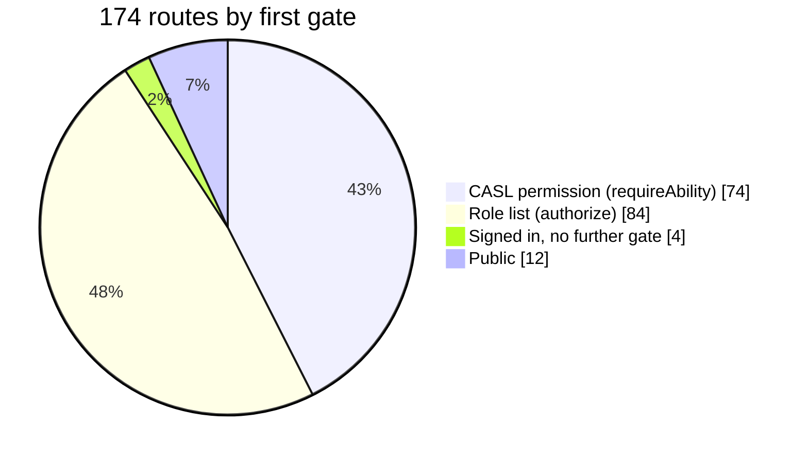
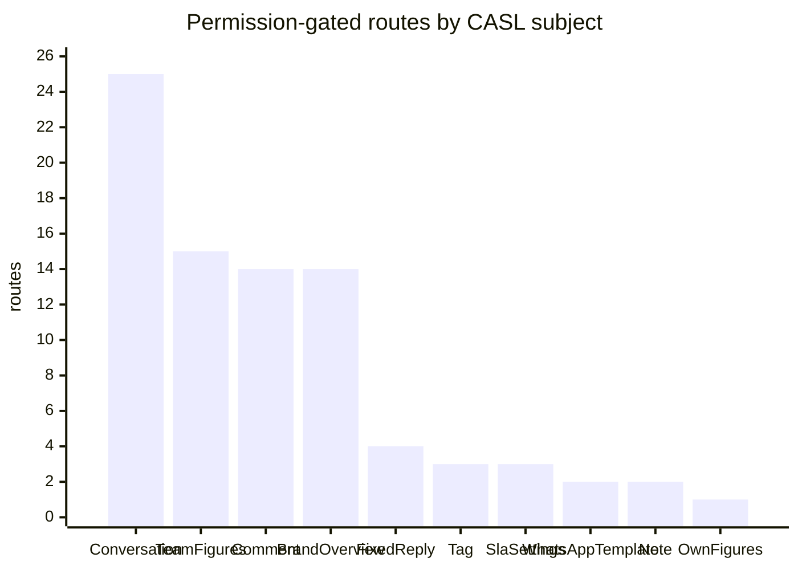

## The code

{/* source: server/src/middlewares/ability/index.ts */}
```ts title="server/src/middlewares/ability/index.ts" lineNumbers
import { NextFunction, Request, Response } from 'express';
import { ForbiddenError, UnauthorizedError } from '@/libraries/error-handling';
import logger from '@/libraries/log/logger';
import { abilityFor, type AppAbility } from '@/auth/ability';
import type { Action, SubjectName } from '@/auth/permissions';
import { statusChangeActions } from '@/auth/status-action';

// The permission gate (spec: docs/roles.md). `authorize(...roles)` checks a role list; this checks
// the signed-in user's CASL ability, so a Company's operational roles decide what their holders may
// do. Kept apart from `@/middlewares/auth` so suites that stub that module keep working: they stub
// `authenticate`, and this reads the `req.user` it sets.

/** One `[action, subject]` the caller must be able to do. */
export type AbilityCheck = readonly [Action, SubjectName];

/** The caller's ability, built once per request. */
export const abilityOf = async (req: Request): Promise<AppAbility> => {
  if (!req.user) throw new UnauthorizedError('Authentication required', 'abilityOf');
  req.ability ??= await abilityFor(req.user);
  return req.ability;
};

const deny = (req: Request, needs: string, comingFrom: string): ForbiddenError => {
  logger.warn('Permission denied', { userId: req.user?.id, role: req.user?.role, needs });
  return new ForbiddenError('You do not have permission to do this', comingFrom);
};

/** Throws 403 unless the caller can do at least one of `checks`. */
export const assertCan = async (
  req: Request,
  checks: readonly AbilityCheck[],
  comingFrom = 'assertCan'
): Promise<void> => {
  const ability = await abilityOf(req);
  if (!checks.some(([action, subject]) => ability.can(action, subject))) {
    const needs = checks.map(([action, subject]) => `${action} ${subject}`).join(' | ');
    throw deny(req, needs, comingFrom);
  }
};

/** Route gate: passes when the caller can do at least one of `checks`. */
export const requireAbility =
  (...checks: AbilityCheck[]) =>
  async (req: Request, _res: Response, next: NextFunction): Promise<void> => {
    await assertCan(req, checks, 'requireAbility middleware');
    next();
  };

/**
 * The status write's `accept` (`applyStatusChange`): throws 403 unless the caller may make the move
 * from the status actually being changed (`statusChangeActions`), so a change landing between a
 * check and the write can't turn a hold into a reopen.
 */
export const statusMoveGuard = async (
  req: Request,
  subject: 'Conversation' | 'Comment',
  to: Parameters<typeof statusChangeActions>[1]
): Promise<(current: { status: string }) => true> => {
  const ability = await abilityOf(req);
  return current => {
    const needed = statusChangeActions(current.status, to);
    const missing = needed.filter(action => !ability.can(action, subject));
    if (missing.length) {
      throw deny(req, missing.map(action => `${action} ${subject}`).join(' & '), 'statusMoveGuard');
    }
    return true;
  };
};
```
{/* /source */}

## Three ways to ask CASL

| Helper | Where | Behavior |
| --- | --- | --- |
| `requireAbility(...checks)` | route middleware | passes when the caller can do **at least one** of the checks (any-of), else 403 |
| `assertCan(req, checks)` | inside a handler, for a check that depends on the body | same, but called by hand. Example: `PATCH /comments/:id` with a `sentiment` also needs `wrapUp Comment`. |
| `statusMoveGuard(req, subject, to)` | passed into the status write itself | checks the move from the status **as it is at write time** ([record rules](/docs/listenyzen-rbac/record-rules#status-moves)) |

`abilityOf(req)` builds the ability once and keeps it on `req.ability`, so several checks in one request don't rebuild it.

"Any of" matters for shared things: the fixed-reply list opens for `reply Conversation` **or** `reply Comment` **or** `manage FixedReply`, so anyone who can reply anywhere can use canned replies.

## The whole API at a glance





The two kinds of gate split cleanly by purpose:

| Gate | Guards | Why |
| --- | --- | --- |
| `requireAbility` | everyday **work**: inbox, comments, notes, tags, fixed replies, Overview, reading SLA targets | a company can tune it per role |
| `authorize(...roles)` | **administration**: people, teams, brands, channels, roles, alert rules, saving SLA settings, history logs | never delegated to agents, fixed in code |

## Search every route

Choose a caller and see which routes they can pass. **Gate** is the middleware check. **Also checked** are the record rules that run inside, which the table can't decide without a real record. The scan reads the route files, so a check made deep in a service (such as brand scope) is not listed here.

<RouteGates />

## The public routes, and why

| Route | Why it has no `authenticate` |
| --- | --- |
| `POST /auth/login`, `/auth/register-company`, `/auth/refresh`, `/auth/logout` | you aren't signed in yet, or are signing out. Login, register and refresh are rate-limited. |
| `GET/POST /webhooks/facebook`, `/facebook/relay`, `/webhooks/whatsapp` | Meta (or the trusted relay) calls them. GET is the subscription handshake. POST checks Meta's `X-Hub-Signature-256` HMAC against the app secret instead of a user token. The relay path uses a shared relay token. |
| `GET /brands/instagram/oauth/callback` | Instagram redirects the browser here. A signed, 10-minute `state` token (`signOAuthState`) carries the brand and company through the round trip. |
| `POST /files/upload-image-single`, `/files/upload-image-multiple` | **no authentication middleware** in the inspected source. See [things to watch](/docs/listenyzen-rbac/walkthroughs#things-to-watch). |

And four routes need only **a signed-in user**: your own profile (`GET/PATCH /users/me`, `PATCH /users/me/change-password`) and your company (`GET /companies/me`).

## Check yourself

<details>
<summary>A route says requireAbility(['read','BrandOverview'], ['read','TeamFigures']). A role has only Team figures. Does it pass?</summary>

Yes. `requireAbility` is any-of. That is how the shared Overview tiles open for brand-figure **or** team-figure roles.
</details>

<details>
<summary>Why is saving SLA settings shown as denied for every query-manager preset?</summary>

It needs `update SlaSettings`, and no catalogue permission grants it. Only the admin tier's `manage all` covers it.
</details>
