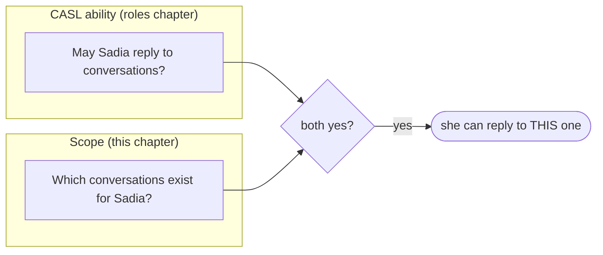
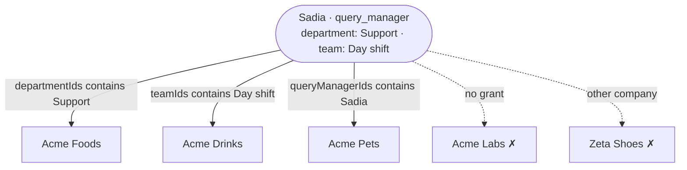
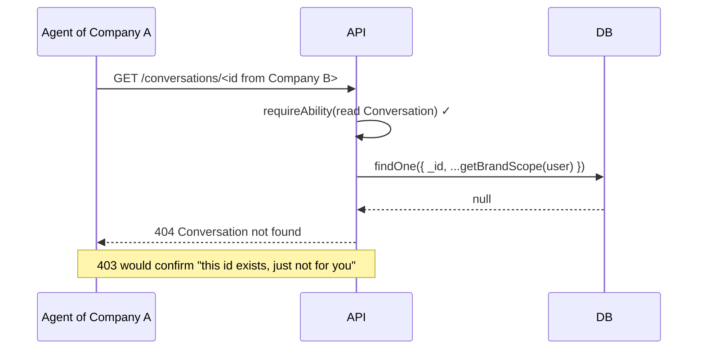

## The code

{/* source: server/src/auth/tenant.ts */}
```ts title="server/src/auth/tenant.ts" lineNumbers
import { ROLES } from '@/auth/roles';
import { UnauthorizedError } from '@/libraries/error-handling';

const comingFrom = 'auth/tenant.ts';

/**
 * Tenant isolation helper.
 *
 * Returns a Mongo filter fragment that scopes a query to the caller's company.
 * - super_admin  -> `{}` (no restriction; sees every company)
 * - everyone else -> `{ companyId }` taken from the authenticated user (the JWT)
 *
 * `companyId` is ALWAYS sourced from the token here, never from request bodies or
 * query params, so a company_admin cannot read or mutate another company's data.
 *
 * **Throws when there is no user.** This used to share a branch with super_admin and return `{}`,
 * which Mongo reads as "match everything" — so a missing user produced an unrestricted read of
 * every company's data, silently. Every caller runs behind `authenticate` (there are no
 * `optionalAuth` routes), so no user here is a wiring mistake, and the only safe way to surface a
 * wiring mistake in an isolation boundary is loudly. The socket `join:brand` handler passes a
 * `SocketUser | undefined` and catches its own errors, so this degrades to a denied join there.
 */
export const getTenantScope = (
  user?: Express.User
): Record<string, never> | { companyId: string } => {
  if (!user) {
    throw new UnauthorizedError('Cannot scope a query without an authenticated user', comingFrom);
  }
  if (user.role === ROLES.SUPER_ADMIN) return {};
  // Fall back to '' (matches nothing) rather than dropping the key, which would match everything.
  return { companyId: user.companyId ?? '' };
};

/**
 * Brand read scope. company_owner/company_admin see their whole company (via getTenantScope),
 * while a query_manager sees only brands assigned to their department, their team, or to them
 * individually.
 * Used anywhere brand access must be enforced (the brand module and brand-scoped features
 * like the inbox/conversations).
 *
 * Inherits the no-user guard from getTenantScope, which it calls first.
 */
export const getBrandScope = (
  user?: Express.User
): { companyId?: string; $or?: Record<string, unknown>[] } => {
  const scope = getTenantScope(user);
  // Not optional-chained: getTenantScope above throws when there is no user, so reaching this line
  // means there is one. Chaining here would imply otherwise.
  if (user!.role === ROLES.QUERY_MANAGER) {
    // Matching a scalar against an array field means "array contains it". A query manager without a
    // department or team sees only the brands they are assigned to by name (an empty id can't be
    // cast, so those clauses are left out rather than matched against '').
    // Department and team come from the token: a move between teams reaches brand visibility on the
    // next token refresh, which re-reads the user (auth/service.ts `refresh`).
    return {
      ...scope,
      $or: [
        ...(user!.departmentId ? [{ departmentIds: user!.departmentId }] : []),
        ...(user!.teamId ? [{ teamIds: user!.teamId }] : []),
        { queryManagerIds: user!.id },
      ],
    };
  }
  return scope;
};
```
{/* /source */}

## Permission says *what*, scope says *where*



The ability never mentions a company or brand. Every service query instead **adds a filter** built from the token:

| Function | Returns | Used for |
| --- | --- | --- |
| `getTenantScope(user)` | `{}` for super admin; otherwise `{ companyId }` | users, teams, departments, roles: anything owned by a company |
| `getBrandScope(user)` | the tenant scope; for a query manager plus `$or` of their three brand grants | brands, and through the brand every conversation, session, comment and Overview read |

`companyId` always comes **from the token**, never from the request body or query string, so nobody can ask for another company's data by changing a parameter.

## Brand visibility, three ways in



Try it. The filter on the left is exactly what `getBrandScope` returns, and the list shows which sample brands it matches:

<BrandScopeSimulator />

Things to notice:

- An array field compared with one value means "the array **contains** it" in MongoDB. Each clause is one lookup in a multikey index.
- With no department or team in the token, only the personal grant `{ queryManagerIds: id }` is left. The empty ids are **left out**, not matched against `''`.
- Owners and admins get the whole company; a super admin gets `{}`, every brand of every company.
- **The safety net:** with no user at all, `getTenantScope` **throws**. It once returned `{}`, which MongoDB reads as "match everything", so a wiring mistake would have exposed every company.

## Token claims vs the database

Brand visibility reads `departmentId` and `teamId` **from the token**. Claiming and "Assigned to me" read them **from the user record** (`reply-access.ts`). So after a team move:

| | Changes |
| --- | --- |
| Which pools they can claim from, "Assigned to me" | immediately |
| Which brands they can see | at the next token refresh (at most 15 minutes) |

The difference is deliberate. A slightly stale brand list is tolerable. Claiming from a pool they just left is not.

## Why a scope miss is 404, not 403



The client knows this too: `isNotFound()` in `client/src/lib/api.ts` notes that a 404 can mean "you may not see this".

## Where scope is applied

| Area | How |
| --- | --- |
| HTTP: brands, and through them inboxes, comments, Overview | `getBrandById(id, getBrandScope(user))`, then records of that brand |
| HTTP: users, teams, departments, roles | `getTenantScope(user)` added to the query |
| Realtime: joining `brand:<id>` | the same `getBrandScope` ([client and realtime](/docs/listenyzen-rbac/client-and-realtime#sockets-the-same-rules-for-live-events)) |

## Check yourself

<details>
<summary>A query manager has no team and no department. Which brands can they see?</summary>

Only brands that name them in `queryManagerIds`.
</details>

<details>
<summary>Why not put the company check inside the CASL ability?</summary>

The codebase keeps the two apart on purpose. The ability says *what* (no conditions), the scope says *where* (filters on indexed queries). The roles spec defers `accessibleBy` because it would bypass the tuned, hinted queries.
</details>
