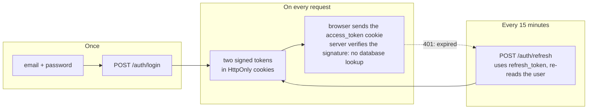
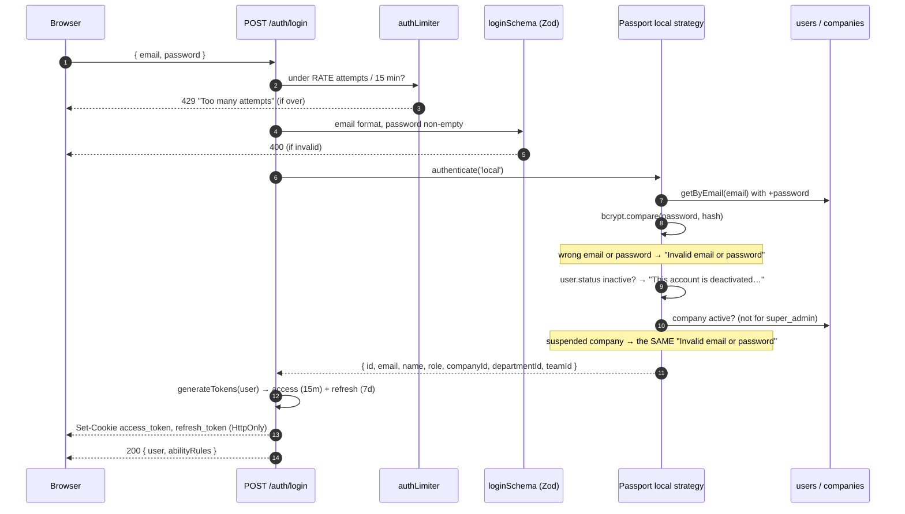
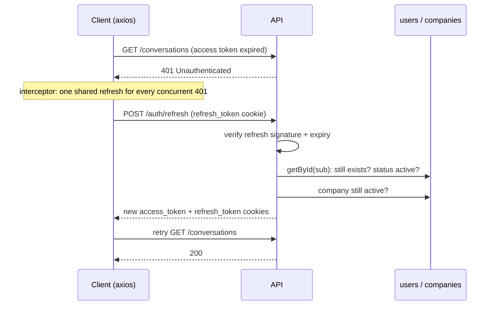
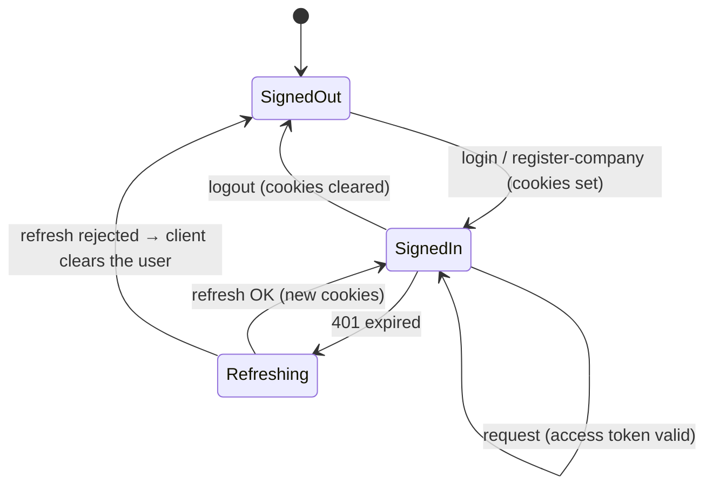

## The code

{/* source: server/src/auth/strategies/local.strategy.ts */}
```ts title="server/src/auth/strategies/local.strategy.ts" lineNumbers
import { Strategy as LocalStrategy } from 'passport-local';
import passport from 'passport';
import bcrypt from 'bcrypt';
import { getByEmail } from '@/modules/user/service';
import { hasActiveCompanyAccess } from '@/auth/company-access';

const ACCOUNT_DEACTIVATED = 'This account is deactivated. Contact your administrator.';
const INVALID_CREDENTIALS = 'Invalid email or password';

passport.use(
  new LocalStrategy(
    // eslint-disable-next-line sonarjs/no-hardcoded-passwords
    { usernameField: 'email', passwordField: 'password' },
    async (email, password, done) => {
      try {
        const user = await getByEmail(email);
        if (!user) return done(null, false, { message: INVALID_CREDENTIALS });

        const isMatch = await bcrypt.compare(password, user.password);
        if (!isMatch) return done(null, false, { message: INVALID_CREDENTIALS });

        // Told only after the right password, so it reveals nothing to someone guessing.
        if (user.status === 'inactive') {
          return done(null, false, { message: ACCOUNT_DEACTIVATED });
        }

        const companyId = user.companyId?.toString();
        if (!(await hasActiveCompanyAccess({ role: user.role, companyId }))) {
          // Keep the same response as bad credentials so login cannot reveal tenant status.
          return done(null, false, { message: INVALID_CREDENTIALS });
        }

        return done(null, {
          id: user.id,
          email: user.email,
          name: user.name,
          role: user.role,
          companyId,
          departmentId: user.departmentId?.toString(),
          teamId: user.teamId?.toString(),
        });
      } catch (err) {
        return done(err);
      }
    }
  )
);

export default passport;
```
{/* /source */}

{/* source: server/src/auth/password-policy.ts */}
```ts title="server/src/auth/password-policy.ts" lineNumbers
import { z } from 'zod';

/**
 * The one rule for a password being SET, wherever it is set.
 *
 * Every entry point used to be `z.string().min(1)` — public signup, admin user creation, and the
 * change-password route alike. A single character was an acceptable password on the route that
 * creates a company_owner, the most privileged account a tenant has.
 *
 * A length floor plus a small character-class requirement, and nothing beyond that: composition
 * rules past this point push people towards `Password1!`, which is worth less than the length.
 * The upper bound is bcrypt's — it silently truncates past 72 bytes, so accepting a 500-character
 * passphrase would quietly ignore most of it.
 *
 * Deliberately NOT applied where a password is CHECKED. An account created before this rule must
 * still be able to log in, and rejecting a short one at the door would only announce that it is
 * short.
 */
export const passwordPolicy = z
  .string()
  .min(8, 'Password must be at least 8 characters')
  .max(72, 'Password must be at most 72 characters')
  .refine(value => /[a-zA-Z]/.test(value), 'Password must contain a letter')
  .refine(value => /\d/.test(value), 'Password must contain a number');
```
{/* /source */}

{/* source: server/src/auth/validation.ts */}
```ts title="server/src/auth/validation.ts" lineNumbers
import { z } from 'zod';
import { passwordPolicy } from './password-policy';

const loginSchema = z.strictObject({
  email: z.email('Invalid email format').min(1, 'Email is required'),
  // Length-only on purpose — see `password-policy.ts`. Checking a password is not setting one.
  password: z.string().min(1, 'Password is required'),
});

const registerCompanySchema = z.strictObject({
  companyName: z.string().min(1, 'Company name is required'),
  name: z.string().min(1, 'Name is required'),
  email: z.email('Invalid email format').min(1, 'Email is required'),
  password: passwordPolicy,
});

// Type inference
type User = z.infer<typeof loginSchema>;

export { loginSchema, registerCompanySchema, type User };
```
{/* /source */}

{/* source: server/src/auth/api.ts */}
```ts title="server/src/auth/api.ts" lineNumbers
import express, { NextFunction, Request, Response } from 'express';
import rateLimit from 'express-rate-limit';
import { abilityRulesFor } from '@/auth/ability';
import logger from '@/libraries/log/logger';
import configs from '@/configs';
import { successResponse } from '@/libraries/utils/sendResponse';
import { validateBody } from '@/middlewares/request-validate';
import { loginSchema, registerCompanySchema } from './validation';
import passport from 'passport';
import { loginUser, refresh, registerCompany } from './service';
import { clearAuthCookies, setAuthCookies } from '@/libraries/utils/cookies';
import { IUser } from '@/modules/user/schema';
import { BadRequestError } from '@/libraries/error-handling';

const model: string = 'User';

/**
 * Tokens leave this module in httpOnly cookies and nowhere else.
 *
 * Every route here used to set the cookies AND copy the same two tokens into the response body,
 * which hands any XSS on the page exactly what the httpOnly flag exists to keep from it — the
 * cookie is unreadable, the JSON beside it is not. The client never used them: it sends
 * `withCredentials: true` and reads only `data.user`. If a non-browser consumer ever needs a
 * bearer token, that is a separate endpoint with its own decision, not a field quietly riding
 * along on the browser login.
 */

// Strict limiter for credential endpoints to slow brute-force attempts.
const authLimiter = rateLimit({
  windowMs: 15 * 60 * 1000, // 15 minutes
  max: configs.RATE,
  standardHeaders: true,
  legacyHeaders: false,
  message: { success: false, message: 'Too many attempts, please try again later.' },
});

// CRUD for entity
const routes = (): express.Router => {
  const router = express.Router();
  logger.info(`Setting up routes for model: ${model}`);

  /**
   * @route POST /auth/register-company
   * @description Onboard a new company together with its first company_admin, then log in.
   * @access Public
   */
  router.post(
    '/register-company',
    authLimiter,
    validateBody(registerCompanySchema),
    async (req: Request, res: Response) => {
      const { companyName, name, email, password } = req.body;
      const user = await registerCompany({ companyName, name, email, password });
      const { accessToken, refreshToken } = loginUser({
        id: user.id,
        email: user.email,
        name: user.name,
        role: user.role,
        companyId: user.companyId?.toString(),
        departmentId: user.departmentId?.toString(),
        teamId: user.teamId?.toString(),
      });
      setAuthCookies(res, { accessToken, refreshToken });
      const abilityRules = await abilityRulesFor({ id: user.id, role: user.role });
      successResponse(res, {
        data: { user: { ...user.toJSON(), abilityRules } },
        message: 'Company registered successfully',
      });
    }
  );
  /**
   * @route POST /auth/login
   * @description Login user
   * @access Public
   */
  router.post(
    '/login',
    authLimiter,
    validateBody(loginSchema),
    async (req: Request, res: Response, next: NextFunction) => {
      passport.authenticate(
        'local',
        { session: false },
        async (err: Error, user: IUser, info: { message: string }) => {
          if (err) return next(err);
          if (!user) return res.status(401).json({ message: info?.message });
          const { accessToken, refreshToken } = loginUser({
            id: user.id,
            email: user.email,
            name: user.name,
            role: user.role,
            companyId: user.companyId?.toString(),
            departmentId: user.departmentId?.toString(),
            teamId: user.teamId?.toString(),
          });
          setAuthCookies(res, { accessToken, refreshToken });
          // Passport doesn't await this callback: a failure must reach `next` by hand.
          try {
            const abilityRules = await abilityRulesFor({ id: user.id, role: user.role });
            successResponse(res, {
              data: { user: { ...(user as object), abilityRules } },
              message: 'User logged in successfully',
            });
          } catch (error) {
            next(error);
          }
        }
      )(req, res, next);
    }
  );
  /**
   * @route POST /auth/logout
   * @description Logout user
   * @access Private
   */
  router.post('/logout', (_req: Request, res: Response) => {
    clearAuthCookies(res);
    successResponse(res, { message: 'User logged out successfully' });
  });

  /**
   * @route POST /auth/refresh
   * @description Refresh tokens
   * @access Private
   */
  router.post('/refresh', authLimiter, async (req: Request, res: Response) => {
    const refresh_token = req.cookies?.refresh_token;
    if (!refresh_token)
      throw new BadRequestError('Refresh token is required', 'auth POST /refresh');
    const { accessToken, refreshToken } = await refresh(refresh_token);
    setAuthCookies(res, { accessToken, refreshToken });
    successResponse(res, { message: 'Tokens refreshed successfully' });
  });

  return router;
};

export { routes };
```
{/* /source */}

{/* source: server/src/auth/service.ts */}
```ts title="server/src/auth/service.ts" lineNumbers
import { Types } from 'mongoose';
import { sendEmail } from '@/libraries/email';
import { welcomeEmail } from '@/libraries/email/auth/welcome';
import { BadRequestError } from '@/libraries/error-handling';
import logger from '@/libraries/log/logger';
import { generateTokens, verifyRefreshToken } from '@/libraries/utils/tokens';
import { IUser } from '@/modules/user/schema';
import { create, deleteById as deleteUser, getById } from '@/modules/user/service';
import {
  create as createCompany,
  deleteById as deleteCompany,
  updateById as updateCompany,
} from '@/modules/company/service';
import { ICompany, CompanyStatus } from '@/modules/company/schema';
import { Role, ROLES } from '@/auth/roles';
import { hasActiveCompanyAccess } from '@/auth/company-access';

const PROVISION_FROM = 'auth provisionCompany()';

/**
 * Undo a half-finished provision, without ever replacing the error that caused it.
 *
 * A throw from inside the original `catch` would propagate in place of the real failure, so the
 * operator would see "could not delete company" and never learn what actually broke. Each step is
 * therefore caught and logged on its own: cleanup is best-effort by nature — the thing it is
 * cleaning up already went wrong — and a leftover row is a smaller problem than a lost cause.
 */
const rollbackProvision = async (companyId: string, userId?: string): Promise<void> => {
  if (userId) {
    try {
      await deleteUser(userId);
    } catch (cleanupError) {
      logger.error('provisionCompany(): could not roll back the owner', { userId, cleanupError });
    }
  }
  try {
    await deleteCompany(companyId);
  } catch (cleanupError) {
    logger.error('provisionCompany(): could not roll back the company', {
      companyId,
      cleanupError,
    });
  }
};

// Create a Company together with its owning company_owner user.
// Created sequentially (transactions need a replica set, which dev/test may not have);
// if the owner can't be created, the company is rolled back so no orphan tenant remains.
// Shared by public self-signup (registerCompany) and super_admin provisioning (POST /companies).
export const provisionCompany = async ({
  companyName,
  status,
  owner,
  logo,
}: {
  companyName: string;
  status?: CompanyStatus;
  owner: { name: string; email: string; password: string };
  // Optional storage key of a logo already saved to disk by the caller.
  logo?: string;
}): Promise<{ company: ICompany; owner: IUser }> => {
  const company = await createCompany({
    name: companyName,
    ...(status ? { status } : {}),
    ...(logo ? { logo } : {}),
  });

  let user: IUser | null = null;
  try {
    user = await create({
      email: owner.email,
      name: owner.name,
      password: owner.password,
      role: ROLES.COMPANY_OWNER,
      companyId: company.id,
    });
    if (!user) {
      throw new BadRequestError('failed to create company owner', PROVISION_FROM);
    }
    // Record the founding owner on the company.
    const updated = await updateCompany(company.id, { ownerId: new Types.ObjectId(user.id) });
    return { company: updated ?? company, owner: user };
  } catch (err) {
    // Roll back everything created so far, not just the company. `updateCompany` above runs after
    // the user exists, so a failure there used to delete the company and leave the owner behind,
    // pointing at a tenant that no longer exists — an account nobody could log into and nobody
    // could see.
    await rollbackProvision(company.id, user?.id);
    throw err;
  }
};

// Public onboarding: create a Company together with its first company_owner, then
// send a welcome email and return the owner so the route can auto-login them.
export const registerCompany = async ({
  companyName,
  name,
  email,
  password,
}: {
  companyName: string;
  name: string;
  email: string;
  password: string;
}): Promise<IUser> => {
  const { owner } = await provisionCompany({
    companyName,
    owner: { name, email, password },
  });

  // Best-effort welcome email — the company + owner are already committed, so a mail
  // failure must not fail the registration (or leave the tenant half-created).
  try {
    const emailTemplate = welcomeEmail({ name, email });
    await sendEmail({ to: email, ...emailTemplate });
  } catch (err) {
    logger.error('registerCompany(): welcome email failed', err);
  }
  return owner;
};
/* Login User  */
export const loginUser = (user: {
  id: string;
  email: string;
  name: string;
  role: Role;
  companyId?: string;
  departmentId?: string;
  teamId?: string;
}): { accessToken: string; refreshToken: string } => {
  const { accessToken, refreshToken } = generateTokens(user);
  // TODOO: save refresh token in DB or cache
  return { accessToken, refreshToken };
};

const REFRESH_FROM = 'auth service refresh() method';
// Deliberately the same message for a forged token and a deleted user: the caller learns that the
// refresh failed, not which of the two it was.
const REFRESH_REJECTED = 'Invalid refresh token';

/**
 * Mint a new token pair from a valid refresh token, reading the user's CURRENT claims.
 *
 * The old version copied `role`, `companyId` and `departmentId` straight out of the presented
 * token. Because each refresh also mints a fresh refresh token from those same copied claims, a
 * demotion or a company move never caught up: the stale role rode forward one refresh at a time,
 * indefinitely, for as long as the session stayed active. "Takes up to 7 days to take effect" was
 * the optimistic reading — the honest one is "never, while the user keeps using the app".
 *
 * Re-reading also gives us the one revocation we can have without a token store: a deleted user
 * can no longer refresh. That is not a substitute for real revocation (a stolen access token still
 * works until it expires), it is just the part that comes free here.
 */
export const refresh = async (
  token: string
): Promise<{ accessToken: string; refreshToken: string }> => {
  let payload;
  try {
    payload = verifyRefreshToken(token);
  } catch (error) {
    logger.warn(REFRESH_REJECTED, error);
    throw new BadRequestError(REFRESH_REJECTED, REFRESH_FROM);
  }

  // Unscoped on purpose: the subject is the token's own user, so there is no tenant to scope to —
  // the token IS the claim of identity being re-checked.
  const user = await getById(payload.sub);
  // A deactivated user's session ends at the next refresh (their access token lapses within its TTL).
  if (!user || user.status === 'inactive') {
    throw new BadRequestError(REFRESH_REJECTED, REFRESH_FROM);
  }

  const companyId = user.companyId?.toString();
  if (!(await hasActiveCompanyAccess({ role: user.role, companyId }))) {
    // Do not disclose whether the token, user, or tenant caused the rejection.
    throw new BadRequestError(REFRESH_REJECTED, REFRESH_FROM);
  }

  // TODO: save refresh token in DB or cache
  return generateTokens({
    id: user.id,
    email: user.email,
    name: user.name,
    role: user.role,
    companyId,
    departmentId: user.departmentId?.toString(),
    teamId: user.teamId?.toString(),
  });
};
```
{/* /source */}

{/* source: server/src/libraries/utils/tokens.ts */}
```ts title="server/src/libraries/utils/tokens.ts" lineNumbers
import jwt from 'jsonwebtoken';
import configs from '@/configs';
import ms from 'ms';
import { Role } from '@/auth/roles';

export interface AccessTokenPayload {
  sub: string;
  email: string;
  name?: string;
  role: Role;
  companyId?: string;
  departmentId?: string;
  teamId?: string;
  iat?: number;
  exp?: number;
}

export interface RefreshTokenPayload {
  sub: string;
  email: string;
  name?: string;
  role: Role;
  companyId?: string;
  departmentId?: string;
  teamId?: string;
  iat?: number;
  exp?: number;
}

export const generateTokens = (user: {
  id: string;
  email: string;
  name?: string;
  role: Role;
  companyId?: string;
  departmentId?: string;
  teamId?: string;
}): { accessToken: string; refreshToken: string } => {
  const payload = {
    sub: user.id,
    email: user.email,
    name: user.name,
    role: user.role,
    companyId: user.companyId,
    departmentId: user.departmentId,
    teamId: user.teamId,
  };

  const accessToken = jwt.sign(payload, configs.ACCESS_TOKEN_SECRET, {
    expiresIn: configs.ACCESS_TOKEN_EXPIRATION as ms.StringValue,
  });

  const refreshToken = jwt.sign(payload, configs.REFRESH_TOKEN_SECRET, {
    expiresIn: configs.REFRESH_TOKEN_EXPIRATION as ms.StringValue,
  });

  return { accessToken, refreshToken };
};

export const verifyAccessToken = (token: string): AccessTokenPayload =>
  jwt.verify(token, configs.ACCESS_TOKEN_SECRET) as AccessTokenPayload;

export const verifyRefreshToken = (token: string): RefreshTokenPayload =>
  jwt.verify(token, configs.REFRESH_TOKEN_SECRET) as RefreshTokenPayload;

// Signed, short-lived `state` for OAuth redirects (e.g. Instagram Login). It carries the brand +
// tenant the flow was started for through the untrusted browser round-trip, so the public callback
// can trust which brand to connect without its own session. Signed with the access-token secret.
export interface OAuthState {
  brandId: string;
  companyId?: string;
  /** Which client screen started the flow, so the callback returns there. */
  returnTo?: OAuthReturnTo;
}

export type OAuthReturnTo = 'brands' | 'integrations';

export const signOAuthState = (payload: OAuthState): string =>
  jwt.sign(payload, configs.ACCESS_TOKEN_SECRET, { expiresIn: '10m' });

export const verifyOAuthState = (token: string): OAuthState =>
  jwt.verify(token, configs.ACCESS_TOKEN_SECRET) as OAuthState;

/** The state's claims without checking signature or expiry: only for picking a fixed redirect. */
export const decodeOAuthState = (token: string): Partial<OAuthState> | null => {
  const decoded = jwt.decode(token);
  return decoded && typeof decoded === 'object' ? (decoded as Partial<OAuthState>) : null;
};
```
{/* /source */}

{/* source: server/src/libraries/utils/cookies.ts */}
```ts title="server/src/libraries/utils/cookies.ts" lineNumbers
import { CookieOptions, Response } from 'express';

const setAuthCookies = (
  res: Response,
  { accessToken, refreshToken }: { accessToken: string; refreshToken: string }
): void => {
  res.cookie('access_token', accessToken, {
    httpOnly: true,
    secure: process.env.NODE_ENV === 'production',
    sameSite: 'strict',
    maxAge: 15 * 60 * 1000, // 15 min
  });

  res.cookie('refresh_token', refreshToken, {
    httpOnly: true,
    secure: process.env.NODE_ENV === 'production',
    sameSite: 'strict',
    maxAge: 7 * 24 * 60 * 60 * 1000, // 7 days
  });
};
const clearAuthCookies = (res: Response): void => {
  const options: CookieOptions = {
    httpOnly: true,
    secure: process.env.NODE_ENV === 'production',
    sameSite: 'strict',
  };

  res.clearCookie('access_token', options);
  res.clearCookie('refresh_token', options);
};

export { setAuthCookies, clearAuthCookies };
```
{/* /source */}

## The idea in one picture



A password is checked **once**. After that, the server trusts a **signed token** that says who you are. Checking the signature is fast and needs no database. The catch is that a token can't be "un-signed": the access token is kept short (15 minutes) and the long one (7 days) is only used to get a new short one.

## Step 1 · Login



Three details worth noticing:

- **Same message for a wrong password and a suspended company.** A stranger can't use the login form to learn whether a company exists or is suspended.
- **"Deactivated" is said only after the right password.** It reveals nothing to someone guessing.
- **The tokens are never in the JSON body**, only in cookies. A script injected into the page (XSS) can read JSON but not an HttpOnly cookie. The body carries the user and their **`abilityRules`**, the CASL rules the UI uses to hide controls ([client chapter](/docs/listenyzen-rbac/client-and-realtime)).

### The password rules

| When | Rule |
| --- | --- |
| **Setting** a password (sign-up, new user, change password) | `passwordPolicy`: 8–72 characters, at least one letter and one digit |
| **Checking** a password (login) | only "not empty". An account created before the policy can still sign in. |
| Stored as | bcrypt hash, salt rounds 10 (`user/schema.ts` pre-save hook), `select: false` |

The 72-character ceiling is bcrypt's: it silently ignores bytes past 72, so a longer "passphrase" would mostly not count.

## Step 2 · What is inside a token

<TokenAnatomy />

| | Access token | Refresh token |
| --- | --- | --- |
| Cookie | `access_token` | `refresh_token` |
| Lifetime | `ACCESS_TOKEN_EXPIRATION`, 15 min in the committed config; cookie `maxAge` 15 min | `REFRESH_TOKEN_EXPIRATION`, 7 days; cookie `maxAge` 7 days |
| Signed with | `ACCESS_TOKEN_SECRET` | `REFRESH_TOKEN_SECRET` (a different secret) |
| Claims | `sub` (user id), `email`, `name`, `role`, `companyId`, `departmentId`, `teamId`, `iat`, `exp` | the same |
| Read by | every authenticated route, the socket handshake | only `POST /auth/refresh` |

Cookie flags: `httpOnly: true` (JavaScript can't read it), `sameSite: 'strict'` (not sent on requests started from other sites, which blocks cross-site request forgery), and `secure` in production (HTTPS only).

**What the token does *not* contain: permissions.** The role tier is in the token, but a query manager's company-role permissions are read from the database (cached 60 s) on each request. That is why a permission change applies on the next request without signing in again ([roles chapter](/docs/listenyzen-rbac/roles-and-permissions#caches-how-a-change-applies-on-the-next-request)).

## Step 3 · Refresh, quietly



**Refresh re-reads the user** instead of copying claims from the old token. An earlier version copied them, so a demotion or a company move never reached a session that kept refreshing. Now:

| Change made to the user | Takes effect |
| --- | --- |
| Company role (`roleId`) or its permissions edited | **Next request** (permissions aren't in the token) |
| Company suspended | **Next request** (`authenticate` checks it every time) |
| User deactivated | At the next refresh, **at most 15 minutes** (refresh rejects them; the old access token runs out) |
| `role`, `teamId`, `departmentId` changed | At the next refresh, **at most 15 minutes**, for everything read from the token (tier, brand visibility). Claims and "Assigned to me" read the database at once. |
| User deleted | At the next refresh |

A failed refresh always says `Invalid refresh token`, whatever the cause: forged, expired, user deleted, or company suspended.

## Step 4 · Sign out

`POST /auth/logout` **clears both cookies**. There is no server-side token list (`TODO: save refresh token in DB or cache` in `service.ts`), so a copied token is not revoked. A stolen refresh token keeps working until it expires, unless the user is deactivated or the company suspended.



## Rate limiting

`authLimiter` (`express-rate-limit`) guards `register-company`, `login` and `refresh`: at most `RATE` requests per 15 minutes per client (1000 in the committed example config), then `429 Too many attempts, please try again later.` It slows down password guessing. It doesn't lock the account.

## Check yourself

<details>
<summary>Why are there two tokens instead of one long-lived token?</summary>

A token can't be revoked, so the one sent on every request is kept short (15 min). The long one only goes to `/auth/refresh`, which re-checks the user and company before issuing a new pair.
</details>

<details>
<summary>An admin removes "Reply" from Sadia's role. When does she lose it?</summary>

On her next request. Permissions are read per request from her role (cached 60 s, dropped on every edit), not from the token.
</details>

<details>
<summary>Why does a suspended company's user see "Invalid email or password"?</summary>

So the login form can't be used to find out which companies exist or are suspended.
</details>
