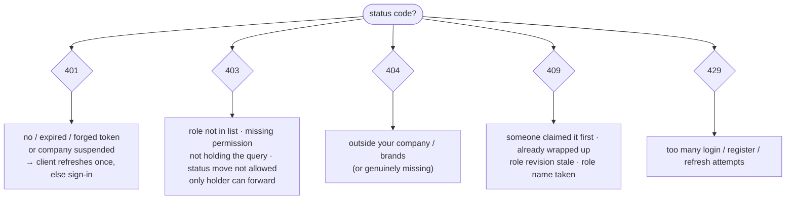

## Simulate your own

<RequestSimulator />

## Trace 1 · Sadia replies to a thread she holds

Sadia: query manager, seeded role, team Day shift. Brand Acme Foods is granted to her department. The thread is assigned to her personally.

| Gate | Check | Result |
| --- | --- | --- |
| authenticate | `access_token` cookie verifies, not expired | ✓ `req.user = Sadia` |
| company | Acme is active | ✓ |
| `requireAbility(['reply','Conversation'])` | seeded role has `conversation.reply` → `can('reply','Conversation')` | ✓ |
| brand scope | `{ companyId: Acme, $or: [{departmentIds: Support}, …] }` matches Acme Foods | ✓ |
| `assertCanAct` | assignee `{ kind: 'query_manager', id: Sadia }` | ✓ |
| → | message sent | **201** |

## Trace 2 · The same reply, but the thread sits in her team's pool

| Gate | Result |
| --- | --- |
| authenticate, company, permission, scope | ✓ as above |
| `assertCanAct` | assignee is `{ kind: 'team' }` → **403** "This conversation is pooled: take it with Assign to me first" |

The fix: `POST /conversations/:id/claim` → `requireAbility(['claim','Conversation'])` ✓ → `claimableFilter` (her team's pool) ✓ → she now holds it. Then Trace 1 applies.

## Trace 3 · A read-only agent tries to put a query on hold

Role "Read-only": `conversation.read`, `comment.read`. The query is held by him.

| Gate | Result |
| --- | --- |
| `requireAbility(['read','Conversation'])` on `PATCH /sessions/:id/status` | ✓ (the route itself only needs read) |
| `assertCanAct` | ✓ he holds it |
| `statusMoveGuard`: pending → hold needs `hold Conversation` | **403** "You do not have permission to do this" |

## Trace 4 · An admin of Company A opens Company B's conversation by id

| Gate | Result |
| --- | --- |
| authenticate, company | ✓ |
| `requireAbility(['read','Conversation'])` | ✓ admin tier: `manage all` |
| brand scope `{ companyId: A }` | nothing matches → **404** |

A permission is never enough without the scope.

## Trace 5 · An owner suspends a company while its agent is working

| Moment | What happens |
| --- | --- |
| 10:00 agent's token signed (valid until 10:15) | |
| 10:05 owner's company suspended by a super admin | |
| 10:06 agent's next request | `authenticate` → `assertActiveCompanyAccess` fails → **401** |
| client | tries `POST /auth/refresh` → company inactive → **400** "Invalid refresh token" → signs out |
| socket | the next handshake fails "unauthenticated" |

## Cheat sheet

| I want to know… | Look at |
| --- | --- |
| who the caller is | `req.user`, set only by `authenticate` from the verified token |
| whether they may do X | `abilityOf(req)` → `ability.can(action, subject)`; routes use `requireAbility` |
| which records exist for them | `getTenantScope` / `getBrandScope` in the service query |
| whether they may touch *this* query | `assertCanAct`, `claimableFilter`, `holdsQuery`, `statusMoveGuard` |
| what the UI should show | client `useCan`, `useReplyAccess(...).can`, `canMoveStatus` |
| add a new permission | add a catalogue entry with its rules in `permissions.ts`, gate the route with `requireAbility`, mirror any new action or subject in the client `model.ts` (a server test checks the mirror) |

## Glossary

| Term | Meaning here |
| --- | --- |
| **Access token** | 15-minute JWT in the `access_token` cookie; proves who you are on each request |
| **Refresh token** | 7-day JWT in the `refresh_token` cookie; only used to get a new pair |
| **Tier** | `user.role`: admin tier (super admin, owner, admin) or operational (query manager) |
| **Role** | a company-defined set of permission keys held by query managers (`user.roleId`) |
| **Permission (key)** | a catalogue entry like `session.wrap`, translated into CASL rules in code |
| **Ability** | the CASL object built from rules; answers `can(action, subject)` |
| **Scope** | the MongoDB filter that limits records to your company and brands |
| **Act gate** | only the personal holder of a query may write to it |
| **Pool** | a query assigned to a team or department, waiting to be claimed |

## Things to watch

Observations from the inspected source (`18e6d95`), not verified against a running deployment:

1. **`POST /files/upload-image-single` and `/files/upload-image-multiple` have no `authenticate` middleware**, so anyone who can reach the API can upload to the file store. Every other non-webhook route is protected.
2. **No token revocation.** Logout clears cookies, but there is no server-side list of refresh tokens (`TODO` in `auth/service.ts`). A copied refresh token works for up to 7 days unless the user is deactivated, deleted, or their company suspended.
3. **Token claims lag up to 15 minutes**: the tier and brand visibility read from the token. Permissions, company status, claims and "Assigned to me" don't lag.
4. **Unused helpers**: `checkUser`, `optionalAuth` and `ROLE_RANK` have no callers, which is safe but easy to misread as active.
5. **Rate limiting is per IP and window**, not per account, and doesn't lock accounts. Its strength depends on the `RATE` setting (1000 per 15 minutes in the committed example config).
