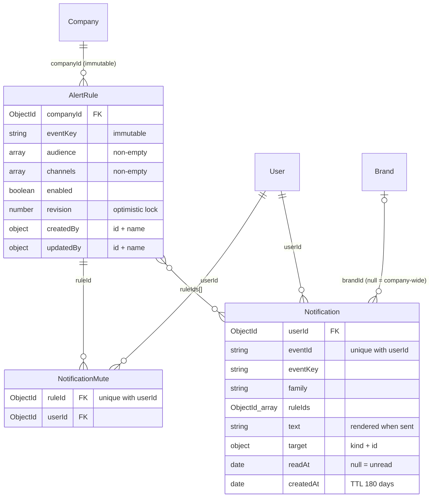
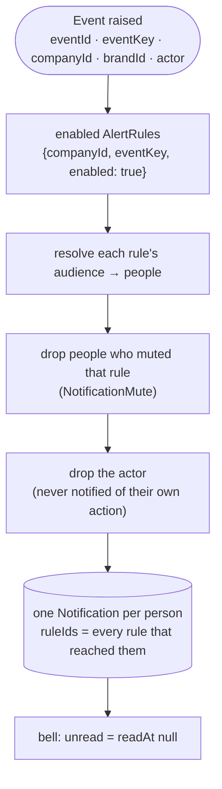
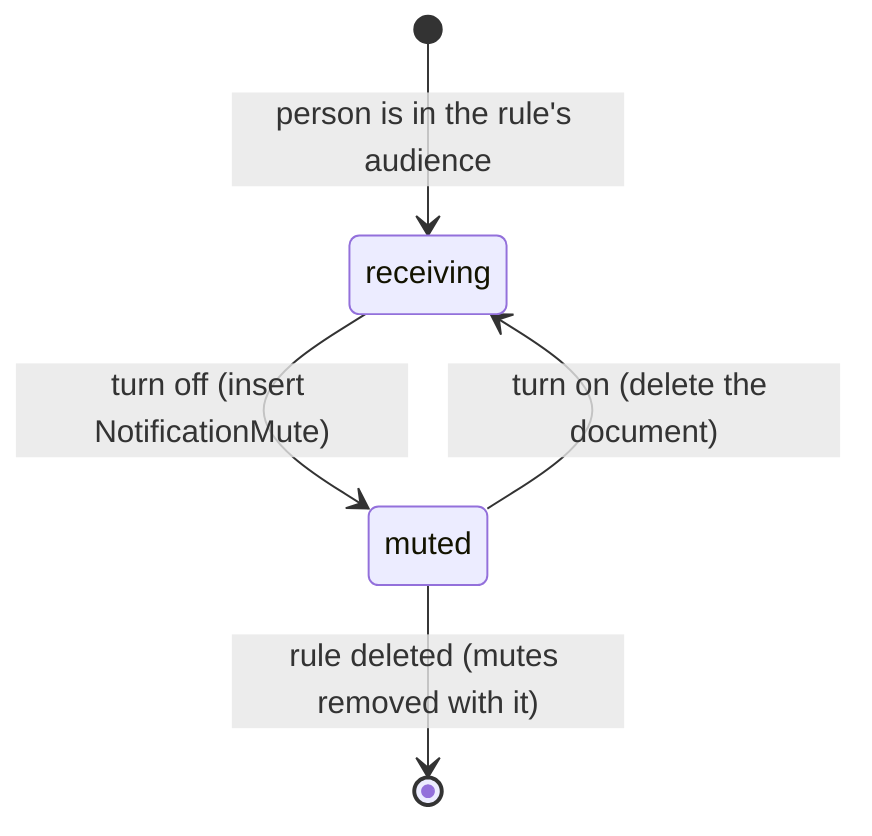

## The code

{/* schema: server/src/modules/alert/schema.ts */}
```ts title="server/src/modules/alert/schema.ts" lineNumbers
import mongoose, { Document, Model, Schema, Types } from 'mongoose';
import { baseSchema } from '@/libraries/db/base-schema';
import {
  ALERT_AUDIENCES,
  ALERT_CHANNELS,
  ALERT_EVENT_KEYS,
  ALERT_FAMILIES,
  NOTIFICATION_RETENTION_DAYS,
  type AlertAudience,
  type AlertChannel,
  type AlertEventKey,
  type AlertFamily,
} from './events';

const changedBySchema = new Schema(
  {
    id: { type: Schema.Types.ObjectId, ref: 'User', required: true },
    // Copied so the rule list survives the user being renamed or removed.
    name: { type: String, required: true },
  },
  { _id: false }
);

// ── Alert rule ────────────────────────────────────────────────────────────

// A Company's rule for one event: who it reaches and on which channels. A Company starts with no
// rules (no seeded defaults); an event without an enabled rule sends nothing. Several rules may
// share an event; a person reached by more than one still gets one notification.
export interface IAlertRule extends Document {
  companyId: Types.ObjectId;
  eventKey: AlertEventKey;
  /** Optional name; the event's name is shown when absent. */
  name?: string;
  audience: AlertAudience[];
  channels: AlertChannel[];
  enabled: boolean;
  /** Bumped on every edit; an edit sends the revision it started from (409 when stale). */
  revision: number;
  createdBy: { id: Types.ObjectId; name: string };
  updatedBy: { id: Types.ObjectId; name: string };
  createdAt: Date;
  updatedAt: Date;
}

const nonEmpty = (values: unknown[]): boolean => values.length > 0;

const alertRuleSchema = new Schema<IAlertRule>({
  companyId: { type: Schema.Types.ObjectId, ref: 'Company', required: true, immutable: true },
  eventKey: { type: String, enum: ALERT_EVENT_KEYS, required: true, immutable: true },
  name: { type: String, trim: true, maxlength: 80 },
  audience: {
    type: [{ type: String, enum: ALERT_AUDIENCES }],
    validate: { validator: nonEmpty, message: 'A rule needs an audience' },
  },
  channels: {
    type: [{ type: String, enum: ALERT_CHANNELS }],
    validate: { validator: nonEmpty, message: 'A rule needs a channel' },
  },
  enabled: { type: Boolean, default: true },
  revision: { type: Number, default: 1, min: 1 },
  createdBy: { type: changedBySchema, required: true, immutable: true },
  updatedBy: { type: changedBySchema, required: true },
});

alertRuleSchema.add(baseSchema);

// The Company's rule list, and the delivery lookup (enabled rules for an event).
alertRuleSchema.index({ companyId: 1, eventKey: 1, enabled: 1 });

export const AlertRuleModel: Model<IAlertRule> = mongoose.model<IAlertRule>(
  'AlertRule',
  alertRuleSchema
);

// ── Personal mute ─────────────────────────────────────────────────────────

// A person turned a rule off for themselves (My notification settings). Turning it back on deletes
// the document. Only a rule the person is in the audience of can be muted; there is no opting in.
// Removed with the rule. Ignored for an `alwaysOn` event.
export interface INotificationMute extends Document {
  companyId: Types.ObjectId;
  userId: Types.ObjectId;
  ruleId: Types.ObjectId;
  createdAt: Date;
}

const notificationMuteSchema = new Schema<INotificationMute>({
  companyId: { type: Schema.Types.ObjectId, ref: 'Company', required: true },
  userId: { type: Schema.Types.ObjectId, ref: 'User', required: true },
  ruleId: { type: Schema.Types.ObjectId, ref: 'AlertRule', required: true },
  createdAt: { type: Date, default: (): Date => new Date() },
});

// One mute per person and rule; serves delivery (a rule's mutes among its recipients) and the
// cascade when a rule is deleted.
notificationMuteSchema.index({ ruleId: 1, userId: 1 }, { unique: true });
// A person's settings page.
notificationMuteSchema.index({ userId: 1 });

export const NotificationMuteModel: Model<INotificationMute> = mongoose.model<INotificationMute>(
  'NotificationMute',
  notificationMuteSchema
);

// ── Notification ──────────────────────────────────────────────────────────

/** Where opening a notification goes. */
// `conversation` / `comment` carry the conversation or root comment id; the other two open the
// brand's (or, without a brand, the Company's) page.
export const NOTIFICATION_TARGET_KINDS = [
  'conversation',
  'comment',
  'slaSettings',
  'channels',
] as const;
export type NotificationTargetKind = (typeof NOTIFICATION_TARGET_KINDS)[number];

// One in-app notification for one person. Written once by the worker; only `readAt` changes.
// Expires after NOTIFICATION_RETENTION_DAYS.
export interface INotification extends Document {
  companyId: Types.ObjectId;
  userId: Types.ObjectId;
  /** One occurrence of an event, made when it is raised: a retried delivery job can't repeat it. */
  eventId: string;
  eventKey: AlertEventKey;
  /** Copied from the event, for the centre's family filter. */
  family: AlertFamily;
  /** The enabled, unmuted rules that reached this person. */
  ruleIds: Types.ObjectId[];
  /** `null` = Company-wide (e.g. service tiers). */
  brandId: Types.ObjectId | null;
  /** Rendered when sent. */
  text: string;
  target: { kind: NotificationTargetKind; id?: Types.ObjectId };
  /** Who raised it, when a person did. */
  actor?: { id: Types.ObjectId; name: string };
  readAt: Date | null;
  createdAt: Date;
}

const notificationSchema = new Schema<INotification>({
  companyId: { type: Schema.Types.ObjectId, ref: 'Company', required: true },
  userId: { type: Schema.Types.ObjectId, ref: 'User', required: true },
  eventId: { type: String, required: true },
  eventKey: { type: String, enum: ALERT_EVENT_KEYS, required: true },
  family: { type: String, enum: ALERT_FAMILIES, required: true },
  ruleIds: {
    type: [{ type: Schema.Types.ObjectId, ref: 'AlertRule' }],
    validate: { validator: nonEmpty, message: 'A notification comes from a rule' },
  },
  brandId: { type: Schema.Types.ObjectId, ref: 'Brand', default: null },
  text: { type: String, required: true },
  target: {
    type: new Schema(
      {
        kind: { type: String, enum: NOTIFICATION_TARGET_KINDS, required: true },
        id: { type: Schema.Types.ObjectId },
      },
      { _id: false }
    ),
    required: true,
  },
  actor: { type: changedBySchema },
  readAt: { type: Date, default: null },
  createdAt: {
    type: Date,
    default: (): Date => new Date(),
    expires: NOTIFICATION_RETENTION_DAYS * 24 * 60 * 60,
  },
});

// A person's centre, newest first (`_id` breaks ties for the cursor).
notificationSchema.index({ userId: 1, createdAt: -1, _id: -1 });
// The bell's unread count.
notificationSchema.index({ userId: 1, readAt: 1 });
// One notification per person per event occurrence (delivery is retried).
notificationSchema.index({ eventId: 1, userId: 1 }, { unique: true });

export const NotificationModel: Model<INotification> = mongoose.model<INotification>(
  'Notification',
  notificationSchema
);
```
{/* /schema */}

The enums come from `server/src/modules/alert/events.ts`:

| Event key | Family | Audience it can reach | Raised when |
| --- | --- | --- | --- |
| `queryAssigned` | work | assignee | a query is routed, claimed or forwarded (any change of holder or pool) |
| `queryUnassigned` | work | previousAssignee | an owner or admin reassigns or unassigns a query someone held personally |
| `noteAdded` | work | assignee | an internal note is added to a DM session |
| `queryWrappedUp` | work | assignee | someone other than the holder wraps the query up |
| `customerWrote` | work | assignee | an incoming DM, or a customer reply in a comment thread (raised by the worker) |
| `slaSettingsChanged` | governance | companyAdmins, companyOwner | a brand's SLA targets or business hours, or the company's service tiers, are saved |
| `channelConnected` | systemHealth | companyAdmins, companyOwner | a Facebook page, Instagram account or WhatsApp number is connected |

Audiences: `assignee` (the holder, or every active member of the pooled team or department), `previousAssignee`, `companyAdmins`, `companyOwner`. Channels: `inApp`, plus `email`, which can be picked on a rule but is not delivered yet. Notifications are kept for **180 days**.

## Map

<SchemaGraph domains={['alerts']} height={440} />

## ER diagram



## From event to notification



Several rules can match the same event, but a person still gets **one** notification, with `ruleIds` listing every rule that reached them. A delivery job that retries cannot create a duplicate either: `{eventId, userId}` is unique.

## AlertRule

<ModelFields model="AlertRule" />

- A company starts with **no rules**. An event without an enabled rule sends nothing.
- `companyId`, `eventKey` and `createdBy` are **immutable**. To change a rule's event, create a new rule.
- Editing uses **optimistic concurrency**: the client sends the `revision` it started from, and a stale one gets HTTP 409.

```json title="Sample rule"
{
  "companyId": "670000000000000000000001",
  "eventKey": "customerWrote",
  "name": "Customer replied",
  "audience": ["assignee"],
  "channels": ["inApp"],
  "enabled": true,
  "revision": 3,
  "createdBy": { "id": "670000000000000000000003", "name": "Amina Rahman" },
  "updatedBy": { "id": "670000000000000000000003", "name": "Amina Rahman" }
}
```

## NotificationMute

<ModelFields model="NotificationMute" />



There is no "opt in" document. Only a person already in the audience can mute, and turning it back on deletes the mute.

## Notification

<ModelFields model="Notification" />

```json title="Sample notification"
{
  "companyId": "670000000000000000000001",
  "userId": "670000000000000000000032",
  "eventId": "3f6c2a9e-8d1b-4c57-9a0e-2b7f5d41c6a8",
  "eventKey": "customerWrote",
  "family": "work",
  "ruleIds": ["670000000000000000000701"],
  "brandId": "670000000000000000000004",
  "text": "Tanvir Ahmed wrote on a query you hold",
  "target": { "kind": "conversation", "id": "670000000000000000000101" },
  "readAt": null,
  "createdAt": "2026-11-08T10:12:01.000Z"
}
```

<small>`eventId` is a `randomUUID()` made when the event is raised (`alert/raise.ts`). It is also the delivery job's id.</small>

`target.kind` decides where opening it goes: a `conversation` or `comment` carries its id, while `slaSettings` and `channels` open the brand's page (or the company's page when `brandId` is `null`).

## Check yourself

<details>
<summary>How is the unread badge counted cheaply?</summary>

`{userId, readAt}` index: count `{userId, readAt: null}`.
</details>

<details>
<summary>Who deletes a notification?</summary>

MongoDB itself: `createdAt` has a TTL (`expires`) of 180 days.
</details>

<details>
<summary>Two enabled rules both target `assignee` for `noteAdded`. How many notifications does the assignee get?</summary>

One, with both rule ids in `ruleIds`.
</details>
