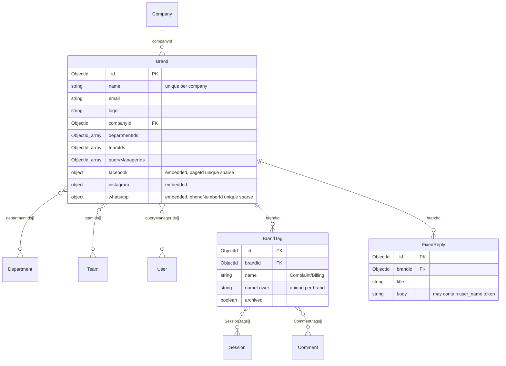
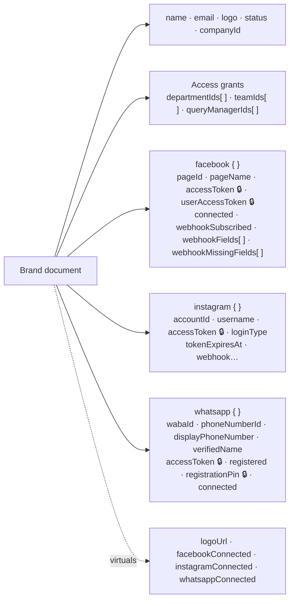
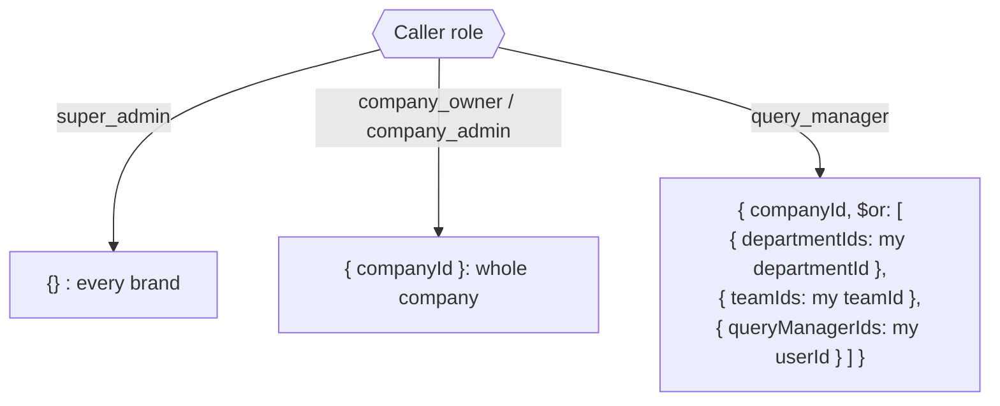
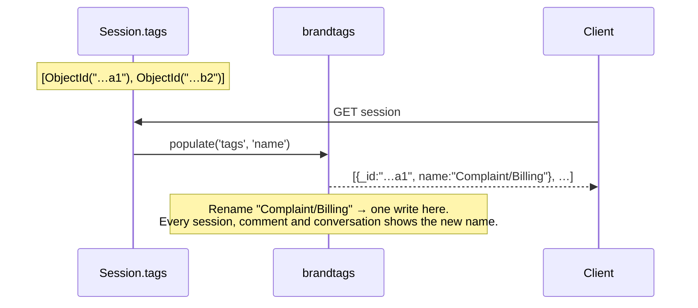
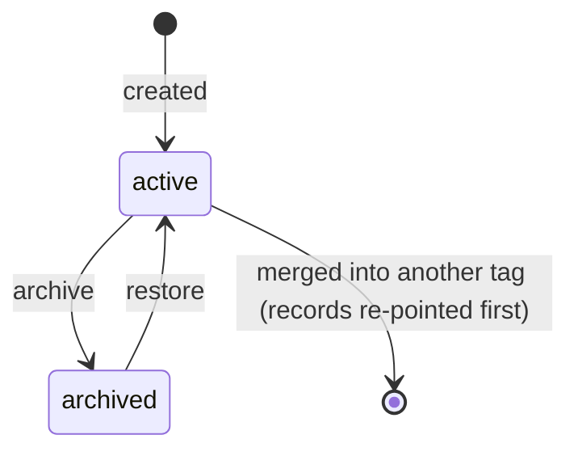

## The code

{/* schema: server/src/modules/brand/schema.ts */}
```ts title="server/src/modules/brand/schema.ts" lineNumbers
import mongoose, { Document, Model, Schema, Types } from 'mongoose';
import { baseSchema } from '@/libraries/db/base-schema';
import configs from '@/configs';

export const BRAND_STATUS = ['active', 'inactive'] as const;
export type BrandStatus = (typeof BRAND_STATUS)[number];

// Brands live under a company. A Facebook page is connected to each brand later (out of scope).
// Names are unique per company (not globally), so two companies can each have a "Acme" brand.
export interface IBrand extends Document {
  name: string;
  email: string;
  // Storage key of the logo relative to the uploads dir, e.g. 'brands/acme-...png'.
  logo: string;
  status: BrandStatus;
  companyId: Types.ObjectId;
  // Departments assigned to this brand by a company_owner/company_admin. Every query manager
  // belonging to one of these departments gets access to the brand.
  departmentIds: Types.ObjectId[];
  // Teams assigned to this brand: every member of one gets access, on top of their department's.
  teamIds: Types.ObjectId[];
  // Query managers assigned to this brand individually, in addition to whole-department
  // assignments. A query manager can see the brand via either path.
  queryManagerIds: Types.ObjectId[];
  // Note: the brand's tag vocabulary is NOT here. It lives in its own collection keyed by brandId
  // (see brand/tags/schema.ts), so this document stays a constant size on the visibility reads that
  // run for nearly every inbox and comments request.
  //
  // Connected Facebook Page. Tokens are stored server-side only and stripped from JSON.
  facebook?: {
    pageId: string;
    pageName: string;
    accessToken: string;
    userAccessToken: string;
    connected: boolean;
    connectedAt?: Date;
    // Whether Meta's `subscribed_apps` edge confirmed our app is subscribed to the page at all.
    // False means the page is stored and usable for sends, but no webhook will arrive — the
    // "connected but nothing comes in" state, which is otherwise invisible.
    webhookSubscribed?: boolean;
    // The fields Meta actually recorded.
    webhookFields?: string[];
    // The requested fields Meta refused. Separate from `webhookSubscribed` because a partial
    // subscription still delivers everything it did accept — only the named fields go missing.
    webhookMissingFields?: string[];
    webhookCheckedAt?: Date;
  };
  // Connected Instagram professional account. Either linked through the Facebook page
  // (`loginType: 'facebook'`, token is the page token) or connected directly via Instagram Login
  // (`loginType: 'instagram'`, token is a 60-day IG user token stored with its expiry).
  instagram?: {
    accountId: string;
    username: string;
    accessToken: string;
    connected: boolean;
    connectedAt?: Date;
    // How the account was connected. Defaults to 'facebook' for pre-existing connections.
    loginType?: 'facebook' | 'instagram';
    // Absolute expiry of the IG user token (Instagram-Login only); used to schedule refreshes.
    tokenExpiresAt?: Date;
    // Written ONLY by the Instagram-Login flow (`loginType: 'instagram'`), which has a real
    // `subscribed_apps` call on graph.instagram.com to verify. The Facebook-Login flow leaves these
    // undefined: Instagram webhooks are not subscribable by API there at all — the `instagram`
    // object in the App Dashboard is the subscription, so there is nothing for a connect to check.
    // Expect `comments` in `webhookMissingFields` until the app is Live with Advanced Access.
    webhookSubscribed?: boolean;
    webhookFields?: string[];
    webhookMissingFields?: string[];
    webhookCheckedAt?: Date;
  };
  // Connected WhatsApp business phone number, onboarded through Meta's Embedded Signup. Independent
  // of the Facebook page: the token is a business-integration system user token scoped to the
  // client's WhatsApp Business Account. It does not expire, but it IS revoked if the client removes
  // our app from their business portfolio.
  whatsapp?: {
    // The WABA that owns the number. Needed to subscribe our app to its webhooks.
    wabaId: string;
    // The routable id — sends target /{phoneNumberId}/messages and inbound webhooks carry it as
    // value.metadata.phone_number_id. This is the id we key the brand lookup on, not the WABA.
    phoneNumberId: string;
    // Human-readable, e.g. '+880 1712 345678'. Display only.
    displayPhoneNumber: string;
    // The name WhatsApp shows to customers, once Meta has approved it.
    verifiedName: string;
    accessToken: string;
    // Whether POST /{phoneNumberId}/register succeeded. False means the number is PENDING in
    // WhatsApp Manager and can neither send nor receive — the connection is credential-only.
    registered: boolean;
    // The two-step verification PIN set at registration. Required again to re-register the same
    // number (Meta rejects a second /register with a different PIN), so it must survive the connect.
    registrationPin?: string;
    connected: boolean;
    connectedAt?: Date;
  };
}

// Strip access tokens from any serialized brand so they never reach the client.
// The `connected` flags, page name and Instagram username stay visible.
function stripChannelSecrets(_doc: unknown, ret: Record<string, unknown>): Record<string, unknown> {
  const fb = ret.facebook as Record<string, unknown> | undefined;
  if (fb) {
    delete fb.accessToken;
    delete fb.userAccessToken;
  }
  const ig = ret.instagram as Record<string, unknown> | undefined;
  if (ig) {
    delete ig.accessToken;
  }
  const wa = ret.whatsapp as Record<string, unknown> | undefined;
  if (wa) {
    delete wa.accessToken;
    // Not a token, but a credential all the same: it re-registers the client's number.
    delete wa.registrationPin;
  }
  return ret;
}

const brandSchema = new Schema<IBrand>(
  {
    name: { type: String, required: true, trim: true },
    email: { type: String, required: true, trim: true, lowercase: true },
    logo: { type: String, required: true },
    status: { type: String, enum: [...BRAND_STATUS], default: 'active' },
    companyId: { type: Schema.Types.ObjectId, ref: 'Company', required: true, index: true },
    // Indexed so query managers can list "brands assigned to my department" efficiently.
    departmentIds: [{ type: Schema.Types.ObjectId, ref: 'Department', index: true }],
    // Indexed so query managers can list "brands assigned to my team" efficiently.
    teamIds: [{ type: Schema.Types.ObjectId, ref: 'Team', index: true }],
    // Indexed so query managers can list "brands assigned to me" efficiently.
    queryManagerIds: [{ type: Schema.Types.ObjectId, ref: 'User', index: true }],
    // Connected channels. `_id: false` keeps these as plain embedded objects.
    facebook: {
      type: {
        pageId: { type: String },
        pageName: { type: String },
        accessToken: { type: String },
        userAccessToken: { type: String },
        connected: { type: Boolean, default: false },
        connectedAt: { type: Date },
        webhookSubscribed: { type: Boolean },
        webhookFields: { type: [String] },
        webhookMissingFields: { type: [String] },
        webhookCheckedAt: { type: Date },
      },
      _id: false,
      default: undefined,
    },
    instagram: {
      type: {
        accountId: { type: String },
        username: { type: String },
        accessToken: { type: String },
        connected: { type: Boolean, default: false },
        connectedAt: { type: Date },
        loginType: { type: String, enum: ['facebook', 'instagram'], default: 'facebook' },
        tokenExpiresAt: { type: Date },
        webhookSubscribed: { type: Boolean },
        webhookFields: { type: [String] },
        webhookMissingFields: { type: [String] },
        webhookCheckedAt: { type: Date },
      },
      _id: false,
      default: undefined,
    },
    whatsapp: {
      type: {
        wabaId: { type: String },
        phoneNumberId: { type: String },
        displayPhoneNumber: { type: String },
        verifiedName: { type: String },
        accessToken: { type: String },
        registered: { type: Boolean, default: false },
        registrationPin: { type: String },
        connected: { type: Boolean, default: false },
        connectedAt: { type: Date },
      },
      _id: false,
      default: undefined,
    },
  },
  {
    toJSON: { virtuals: true, transform: stripChannelSecrets },
    toObject: { virtuals: true, transform: stripChannelSecrets },
  }
);

// A page id can only be connected to a single brand at a time. Sparse so brands
// without a connected page don't collide on a null value.
brandSchema.index({ 'facebook.pageId': 1 }, { unique: true, sparse: true });

// Same for a WhatsApp business phone number: one brand at a time, sparse for the unconnected.
brandSchema.index({ 'whatsapp.phoneNumberId': 1 }, { unique: true, sparse: true });

brandSchema.add(baseSchema);

// Unique brand name within a company.
brandSchema.index({ companyId: 1, name: 1 }, { unique: true });

// Absolute public URL for the logo, built from the locally-served uploads path.
brandSchema.virtual('logoUrl').get(function (this: IBrand) {
  return this.logo ? `${configs.BASE_URL}/uploads/${this.logo}` : null;
});

// Convenience booleans for the client so it doesn't have to reach into the subdocs.
brandSchema.virtual('facebookConnected').get(function (this: IBrand) {
  return Boolean(this.facebook?.connected);
});
brandSchema.virtual('instagramConnected').get(function (this: IBrand) {
  return Boolean(this.instagram?.connected);
});
brandSchema.virtual('whatsappConnected').get(function (this: IBrand) {
  return Boolean(this.whatsapp?.connected);
});

const BrandModel: Model<IBrand> = mongoose.model<IBrand>('Brand', brandSchema);

export default BrandModel;
```
{/* /schema */}

{/* schema: server/src/modules/brand/tags/schema.ts */}
```ts title="server/src/modules/brand/tags/schema.ts" lineNumbers
import mongoose, { Document, Model, Schema, Types } from 'mongoose';
import { baseSchema } from '@/libraries/db/base-schema';

/**
 * One tag in a brand's vocabulary, in its own collection rather than an array on the brand.
 *
 * The brand document is read on nearly every inbox and comments request just to answer "may this
 * user see this brand?" — an unbounded array of tags riding along on that read taxed requests that
 * had nothing to do with tags. Keeping tags here means the brand document stays a constant size and
 * the vocabulary is only touched when someone actually opens a picker.
 *
 * It also moves uniqueness into the database. As an embedded array it was checked in application
 * memory between a read and a save, so two agents creating `refund` at the same moment both saw it
 * absent and both wrote it. The unique index below makes that impossible.
 */
export interface IBrandTag extends Document {
  brandId: Types.ObjectId;
  // Denormalized from the brand so tags can be tenant-scoped without a join.
  companyId: Types.ObjectId;
  // `/`-joined path as typed (`Complaint/Billing`); every level is its own document.
  name: string;
  // Lowercased `name`, stored so the unique index can enforce case-insensitive uniqueness without a
  // collation the callers would all have to remember to pass.
  nameLower: string;
  // Archived tags stay put — records that carry them keep rendering and reporting — but drop out of
  // the picker. This is the delete; the vocabulary is never hard-deleted except by a merge, and even
  // then only after the merge's fan-out has landed (see `deleteMergedTags`).
  archived: boolean;
}

/**
 * A brand tag as it arrives on a record after `.populate('tags', 'name')`.
 *
 * Records (sessions, comments) store bare tag ids and read the name from here on every read, rather
 * than keeping a copy. That's why a rename is a single-document write: there is no snapshot to keep
 * in step. It also means a rename is visible everywhere immediately, which is what an admin fixing a
 * typo is asking for — a point-in-time copy of the wrong name is not.
 */
export interface IPopulatedBrandTag {
  _id: Types.ObjectId;
  name: string;
}

/**
 * The populate spec every read path uses to turn a record's stored tag ids into
 * `IPopulatedBrandTag`. Selecting only `name` keeps the rest of the tag document (brandId, companyId,
 * nameLower, archived, timestamps) off every tagged session and comment that goes over the wire.
 */
export const TAGS_POPULATE = { path: 'tags', select: 'name' } as const;

const brandTagSchema = new Schema<IBrandTag>({
  brandId: { type: Schema.Types.ObjectId, ref: 'Brand', required: true },
  companyId: { type: Schema.Types.ObjectId, ref: 'Company', required: true, index: true },
  name: { type: String, required: true, trim: true },
  nameLower: { type: String, required: true },
  archived: { type: Boolean, default: false },
});

brandTagSchema.add(baseSchema);

// Uniqueness per brand, case-insensitively — and, because `nameLower` sorts the same way `name`
// does, the index that serves the vocabulary read in path order. One index does both jobs.
brandTagSchema.index({ brandId: 1, nameLower: 1 }, { unique: true });

export const BrandTagModel: Model<IBrandTag> = mongoose.model<IBrandTag>(
  'BrandTag',
  brandTagSchema
);
```
{/* /schema */}

{/* schema: server/src/modules/fixed-reply/schema.ts */}
```ts title="server/src/modules/fixed-reply/schema.ts" lineNumbers
import mongoose, { Document, Model, Schema, Types } from 'mongoose';
import { baseSchema } from '@/libraries/db/base-schema';

// A brand-wide canned response. Bodies may contain the `{user_name}` token, which the client
// substitutes with the customer's name at insert time (the server stores/serves raw templates).
export interface IFixedReply extends Document {
  title: string;
  body: string;
  // The brand this reply belongs to. Replies are shared across everyone working the brand.
  brandId: Types.ObjectId;
  // Denormalized from the brand for tenant scoping (same pattern as Conversation.companyId).
  companyId: Types.ObjectId;
}

const fixedReplySchema = new Schema<IFixedReply>({
  title: { type: String, required: true, trim: true },
  body: { type: String, required: true, trim: true },
  // Indexed so listing a brand's replies is efficient.
  brandId: { type: Schema.Types.ObjectId, ref: 'Brand', required: true, index: true },
  companyId: { type: Schema.Types.ObjectId, ref: 'Company', required: true, index: true },
});

fixedReplySchema.add(baseSchema);

const FixedReplyModel: Model<IFixedReply> = mongoose.model<IFixedReply>(
  'FixedReply',
  fixedReplySchema
);

export default FixedReplyModel;
```
{/* /schema */}

## Map

<SchemaGraph domains={['brand']} height={520} />

## ER diagram



The three `}o--o{` lines on the brand are **many-to-many**, stored only on the brand side as arrays of ids. Nothing on Department, Team or User lists its brands. To find them, query `brands` with the array field, which the multikey indexes make fast.

## Brand

<ModelFields model="Brand" />

### What lives inside one brand document



🔒 = removed by the `toJSON` / `toObject` transform `stripChannelSecrets`, so it never reaches the client.

The channels are **embedded** because each brand has at most one of each and they are always read with it. Two sparse unique indexes stop one Facebook page or WhatsApp number from being connected to two brands. "Sparse" means brands without that channel don't all collide on `null`.

The **tag vocabulary is deliberately not embedded here.** The brand is read on nearly every inbox and comments request just to check visibility, so it is kept at a constant size.

### Who can see a brand

Visibility is a query on `brands`, built from the caller's token (`auth/tenant.ts` `getBrandScope`):



A query manager sees a brand through **any** of three grants: their department, their team, or by name. An array field compared with a single value means "the array contains it", so each clause is one multikey-index lookup.

```json title="Sample brand (as the API returns it: secrets stripped)"
{
  "_id": "670000000000000000000004",
  "name": "Acme Foods",
  "email": "care@acmefoods.example",
  "logo": "brands/acme-foods-1730000000.png",
  "status": "active",
  "companyId": "670000000000000000000001",
  "departmentIds": ["670000000000000000000021"],
  "teamIds": [],
  "queryManagerIds": ["670000000000000000000033"],
  "facebook": {
    "pageId": "1029384756",
    "pageName": "Acme Foods",
    "connected": true,
    "webhookSubscribed": true,
    "webhookFields": ["messages", "feed"],
    "webhookMissingFields": []
  },
  "whatsapp": {
    "wabaId": "5550001",
    "phoneNumberId": "1098765432",
    "displayPhoneNumber": "+880 1712 345678",
    "verifiedName": "Acme Foods",
    "registered": true,
    "connected": true
  },
  "logoUrl": "https://api.example/uploads/brands/acme-foods-1730000000.png",
  "facebookConnected": true,
  "instagramConnected": false,
  "whatsappConnected": true
}
```

## BrandTag

<ModelFields model="BrandTag" />

### Records store ids, names are read fresh



- **Hierarchy is a naming convention**, not a parent id: `Complaint` and `Complaint/Billing` are two documents.
- **Uniqueness lives in the database**: `{brandId, nameLower}` unique. Before, the tags were an array on the brand and two agents could create `refund` at the same time.
- **Archive, don't delete.** Archived tags drop out of the picker but keep rendering on old records. The only hard delete is a merge, after its fan-out finishes.



## FixedReply

<ModelFields model="FixedReply" />

```json title="Sample fixed reply"
{
  "title": "Order delay",
  "body": "Hi {user_name}, sorry for the wait. Your order is on its way.",
  "brandId": "670000000000000000000004",
  "companyId": "670000000000000000000001"
}
```

The server stores and serves the raw template. The **client** replaces `{user_name}` when the agent inserts it.

## Check yourself

<details>
<summary>How do you list every brand a team can see, and why is it fast?</summary>

`brands.find({ teamIds: teamId })`. `teamIds` has a multikey index, so the lookup reads only the matching index entries.
</details>

<details>
<summary>Why are tag names never copied onto sessions?</summary>

A rename would have to rewrite every tagged record. With ids, a rename is one document and shows everywhere at once.
</details>

<details>
<summary>Two brands try to connect the same Facebook page. What stops it?</summary>

The unique sparse index on `facebook.pageId`: the second write fails with a duplicate-key error.
</details>
