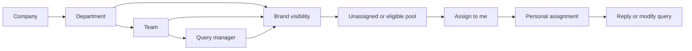

## Business requirement and dependencies

Departments organize staff; teams divide a department into working groups. Managers distribute work to a person or pool. Agents can see a brand's work but must take responsibility before changing a query. A pool is a queue to claim from, not shared permission to reply.

Read [entities and relationships](/docs/listenyzen/data-model), [identity and visibility](/docs/listenyzen/code-access), and [session identity](/docs/listenyzen/code-ingestion) first. This chapter reflects source revision `6516627`, inspected 19 October 2026. Examples use fictional IDs and compact responses; they were not executed against a live backend.



## 1. Create the team before the query manager

`POST /api/v1/teams` accepts name, departmentId and optional status. In `team/api.ts`, the handler reads the department with tenant scope, rejects missing/inactive departments, derives companyId from it, then calls `team/service.ts:create`. A tenant caller cannot pick another company by adding companyId to this strict body.

```json title="Example request body"
{ "name": "Night shift", "departmentId": "670000000000000000000003" }
```

```json title="Example response — HTTP 200"
{
  "success": true,
  "message": "Team created successfully",
  "data": {
    "_id": "670000000000000000000020",
    "name": "Night shift",
    "status": "active",
    "departmentId": "670000000000000000000003",
    "companyId": "670000000000000000000001"
  }
}
```

`GET /teams` is an offset-paginated, tenant-scoped list; departmentId and status are optional filters. `GET /teams/:id` reads one team. `PATCH /teams/:id` renames or changes status. All four routes require company_owner, company_admin or super_admin. There is no DELETE route.

The case-insensitive unique department/name index arbitrates concurrent creates and renames; duplicate names return 409. Names may repeat in different departments. PATCH rejects departmentId; a team cannot move because it would silently change every member's department. Deactivation preserves existing references. A department containing even inactive teams returns 409 on deletion.

The dedicated Teams page supports team management and a detail sheet with members and brands. The Departments page retains its Manage teams sheet (its list caps at 100). GET /teams now adds departmentName, departmentStatus, memberCount and brandCount to each row; GET /teams/:id remains an ordinary team document. `team/stats.ts` batches department lookup, member counts and brand reads. brandCount counts the union of direct team and department grants once per brand, including inactive brands; individual member grants do not count.

Manager-only `GET /api/v1/teams/:id/brands` returns an unpaginated A–Z list in tenant scope. Each row has id, name, status, logoUrl and grants (team, department, or both). It excludes brands reachable only through individual members. Member changes use the existing query-manager API.

## 2. Membership is one write of two related fields

Create a query manager through `POST /api/v1/query-managers`:

```json title="Example request body"
{
  "name": "Amina Rahman",
  "email": "amina@example.com",
  "password": "ExamplePassword1!",
  "teamId": "670000000000000000000020"
}
```

`team/membership.ts:resolveMembership` reads the team within the manager's company, checks both team and department are active, and returns teamId plus departmentId. The query-manager service writes these together. The response is HTTP 200 with message `Query manager created successfully` and a User object containing both IDs and role query_manager. Password is excluded from serialization.

Updates accept teamId, not departmentId. Re-sending the same team skips membership resolution so an agent already in a deactivated team remains editable. A move to a different team must pass current membership checks. The generic `/users` paths reject creating query managers or changing into/out of that role; use the dedicated feature. A company_admin calling POST /users currently gets 400 because its resolved creation role is query_manager.

JWTs and socket principals carry teamId and departmentId. Refresh re-reads User. A membership change therefore reaches brand visibility on refresh, while claims and the mine filter read current User membership immediately.

## 3. Grant visibility without assigning a query

`PUT /api/v1/brands/:id/teams` replaces the full direct team-grant set:

```json title="Example request body"
{ "teamIds": ["670000000000000000000020"] }
```

The handler resolves the brand in tenant scope, verifies every supplied team belongs to the brand's company, calls `setTeams`, and returns HTTP 200, message `Teams assigned successfully`, with the updated Brand. `GET /brands/:id/teams` returns directly granted teams; it is not the list of all teams eligible through department grants. An empty array clears direct grants only.

Brand access is the union of departmentIds, teamIds and queryManagerIds, inside the company constraint. The Brand Access UI saves these through three separate PUT requests, so a partially failed save is not atomic.

`GET /api/v1/sessions/assignees?brandId=...` returns departments, teams and queryManagers. Team entries contain id, name and departmentName. `brand/assignees.ts` shares the eligibility logic between the picker and mutation handlers. New team assignments require an active team in an active department, granted directly or through its department. Department pools require that department grant and an active department.

## 4. Managers route; query managers claim

| Operation | Who | Record actually updated |
| --- | --- | --- |
| PATCH `/sessions/:id/assignment` | Managers | Named session. |
| PATCH `/conversations/:id/assignment` | Managers | Latest session of that conversation. |
| PATCH `/comments/:id/assignment` | Managers | Thread root, even when a reply ID is supplied. |
| POST `/conversations/:id/claim` | Query manager | Latest session. |
| POST `/comments/:id/claim` | Query manager | Thread root. |

All paths above have `/api/v1` prefix. Managers means super_admin, company_owner and company_admin, subject to visibility/tenant rules. Claim is not exposed directly by session ID.

```json title="Manager assignment body"
{ "assigneeType": "team", "assigneeId": "670000000000000000000020" }
```

The other kinds are department and query_manager. `{ "assigneeType": null }` clears assignment. A body cannot supply the assignee's display name: the server resolves and stores the name snapshot. Conversation assignment returns the updated **Session**, not a Conversation wrapper.

`session/assignment.ts:routeSession` rejects resolved work, resolves an eligible target, then calls `assignSession` with openOnly. The write itself checks status is not resolved, closing the race where wrap-up happens after the initial read. Comment routing applies the same rule to the root. Hold and unresolved are still eligible; changing ownership preserves their status and clock pause.

## 5. Claim checks eligibility in the write

Example input, with no body:

```sh
curl -i -X POST "${BASE_URL}/api/v1/conversations/670000000000000000000005/claim" \
  -b cookies.txt -c cookies.txt
```

```json title="Example response — HTTP 200, compact Session"
{
  "success": true,
  "message": "Assigned to you",
  "data": {
    "_id": "670000000000000000000006",
    "conversationId": "670000000000000000000005",
    "status": "hold",
    "assignee": {
      "kind": "query_manager",
      "id": "670000000000000000000002",
      "name": "Amina Rahman"
    }
  }
}
```

In order, `claimForCaller` checks non-resolved status, recognizes an already-personally-assigned caller, resolves the caller as an eligible brand agent, builds `claimableFilter`, and performs `claimSession`. `claimableFilter` loads current User departmentId/teamId and allows unassigned work, the caller's department pool, or the caller's team pool. A sibling team's pool and another agent's personal work are excluded.

The eligibility condition is inside `findOneAndUpdate`, together with the non-resolved status condition. Two agents cannot both turn the same eligible pool into their personal assignment: one write wins and the other no longer matches. The losing route returns 409, such as `Someone else has this conversation` or `Someone else has this thread`. A previously resolved query returns 409 even if the caller was its assignee. An open query already assigned to the caller returns HTTP 200 with `Already assigned to you`.

A missing conversation session or broken comment-root chain returns 404. Query managers retain record visibility checks before claiming. An inactive team/departments takes no **new** pooled assignments, but existing pools remain claimable by their members. Claiming does not change hold to pending; sending a qualifying reply afterwards does.

The database write is small because visibility, actor eligibility and the claim filter were established by its caller:

```typescript title="server/src/modules/session/service.ts"
export const claimSession = async (
  id: string,
  assignee: ISessionAssignee,
  claimable: Record<string, unknown>
): Promise<ISession | null> => {
  const session = await SessionModel.findOneAndUpdate(
    { _id: id, status: { $ne: 'resolved' }, ...claimable },
    // The caller takes it for themselves: they are both the assignee and who made the change.
    assignmentUpdate(assignee, { cause: 'claimed', by: assignee.id }),
    { new: true }
  ).populate(TAGS_POPULATE);
  if (session) await afterAssignment(session);
  return session;
};
```

## 6. Personal ownership gates changes

`auth/reply-access.ts:assertCanAct(user, assignee, comingFrom)` has no company-setting lookup. For query managers, only kind query_manager with their own user ID passes. Unassigned and pooled work returns 403 with an Assign to me hint. Another personal owner returns 403. This applies to replies, reactions, moderation, status, sentiment, tags, notes and customer edits through the relevant query routes. Reads remain governed by brand visibility.

Session mutations use the conversation's current owner, including when editing historical sessions. An old session assignment does not independently authorize a former handler. The page-authored comment-thread exception bypasses this gate for reply/moderation paths: those roots have no claimable owner. Resolved unassigned or pooled queries remain admin-only because assignment is frozen.

The old onlyAssignedCanAct setting, GET/PATCH `/companies/me/settings`, client Settings page and nav entry are removed. Stored legacy setting values no longer affect permissions. Brand SLA/business-hours settings remain supported.

## 7. Keep list rows and permissions consistent

`mine=true` means personally assigned work **plus** the caller's team and department pools. `assignedToMeIds` reads live membership; the brand gate still uses token claims. A pooled result is an offer to claim, not permission to reply. List rows now show an assignment card and Assign to me action; routing/claiming by conversation ID avoids needing a session ID on those rows.

`syncConversationFromLatestSession` copies status, sentiment, tags and assignee. It now reads Conversation.mirrorVersion **before** reading the latest session, then writes only if that version is unchanged and increments it. On a race it retries up to five times. This prevents a late copy from overwriting a newer owner/status summary, which matters because the action gate reads that summary. It does not make the session and conversation writes a multi-document transaction.

Assignment changes emit `assignment:changed`. The session event includes conversationId so inbox/list caches can invalidate the correct conversation; comment consumers refresh the relevant thread/list. Changing a pool does not append a status-log entry or end a hold.

## 8. The current holder can forward work

Query managers use `POST /api/v1/conversations/:id/forward` or `POST /api/v1/comments/:id/forward`. Conversation forwarding resolves the latest Session; comment forwarding resolves the thread root even when given a reply ID. Managers continue using assignment routes.

```json title="Forward request body"
{ "assigneeType": "team", "assigneeId": "670000000000000000000020", "note": "Please investigate delivery." }
```

```json title="Illustrative HTTP 200 — compact response"
{
  "success": true,
  "message": "Conversation forwarded",
  "data": {
    "_id": "670000000000000000000006",
    "status": "hold",
    "assignee": { "kind": "team", "id": "670000000000000000000020", "name": "Night shift" }
  }
}
```

The shared forwardSchema requires a non-null query_manager/team/department target and assigneeId. The optional note is trimmed and limited to 500 characters. `session/assignment.ts` first checks that the caller personally holds the query, then rejects resolved work and forwarding to themselves. It resolves the target through brand eligibility. The service write again requires non-resolved status and the original holder's ID, so a concurrent ownership change returns 409 instead of being overwritten.

A nonholder receives 403; resolved work receives 409; self-forwarding receives 400. Missing session/root receives 404. Comment success uses message `Thread forwarded` and returns the root Comment. Forwarding preserves status, wrap-up and clock state: a held query stays held. The former holder loses action permission and a pool recipient must claim before acting.

The note is internal assignment history, not a provider message or SessionNote. Forwarding appends cause forwarded; manager routing appends routed; a successful claim appends claimed. Assignment and its log entry share one database write. Routing to the same target adds no entry. Read [history storage and presentation](/docs/listenyzen/code-history) next. The client entry point is `client/src/features/inbox/forward.tsx`.

## Migration and known boundaries

See [development](/docs/listenyzen/development) for the dry-run default-team migration and production index requirements. This source review did not execute a migration or confirm live deployment state. Hold-log deep links remain deferred; team pools, manager routing and claims are implemented in this snapshot.
