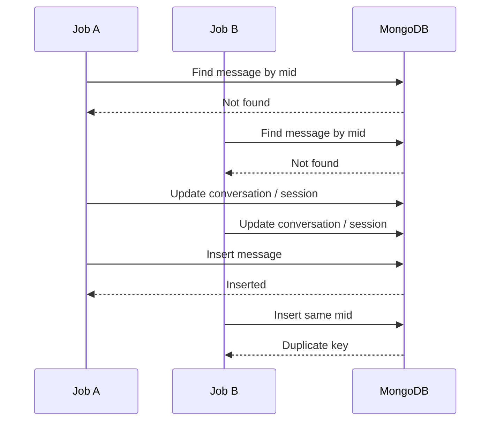

## The unit of queue work is an entry

The webhook router verifies the signature, creates one queue job per provider entry, and returns 200 after Redis accepts the jobs. The worker calls `processFbEntry` or `processWaEntry`. These processors translate provider events into application inputs, resolve the operational brand and invoke domain services.

For a direct message, the domain write path is `recordIncomingMessage`. Its input includes brand/company IDs, platform, channel ID, participant ID, provider mid, sender identity, text/attachments and sentAt. These are supplied by the trusted processing path, not copied from an authenticated browser body.

<CodeLens tour="ingestion" />

## 1. The early duplicate read is not the whole idempotency story

When `input.mid` exists, the service searches Message by provider ID. If found, it returns the existing message and conversation. This prevents ordinary sequential redelivery from repeating the whole write path.

However, two parallel jobs can both observe “not found.” The sparse unique index on mid protects the Message collection from duplicate rows, but preview and session writes occur **before** `MessageModel.create`. Those earlier side effects can already have happened when a duplicate insert is rejected.



This diagram illustrates a possible race in the shown ordering, not a claim that a specific production incident occurred. If you improve ingestion, define idempotency for **all side effects**, not just Message insertion.

## 2. Conversation upsert owns the inbox preview

`upsertConversation` uses `(pageId, participantId)` as its identity filter and `findOneAndUpdate` with `{ new: true, upsert: true, setDefaultsOnInsert: true }`.

| Update | Meaning |
| --- | --- |
| `$set` routing fields | Retains the brand/company/platform identity supplied by the processing path. |
| `$set` lastMessageText / lastMessageAt / direction | Makes the event visible in the inbox summary. |
| Conditional participant display fields | Updates name/avatar only when nonempty input is supplied. |
| `$inc: { unreadCount: 1 }` | Incoming work increases unread count. |
| `$set: { unreadCount: 0 }` for outgoing | Replying clears unread state. |

There is no general “only if newer” timestamp condition on that preview update. An out-of-order event can affect the summary even though its sentAt is older. Preserve this distinction between event arrival order and business timestamp when investigating inbox ordering.

## 3. Session assignment selects a business episode

Source: `server/src/modules/session/service.ts`.

```typescript title="server/src/modules/session/service.ts"
export const assignMessageToSession = async (input: AssignInput): Promise<AssignedSession> => {
  const latest = await SessionModel.findOne({
    conversationId: input.conversationId,
  }).sort({ startedAt: -1 });

  /**
   * Who may reopen a wrapped-up thread as a new episode.
   *
   * A customer writing back always does. An agent's outgoing message normally does not — an afterthought
   * typed after a wrap-up belongs to the episode it follows. The exception is a re-engagement, which is
   * a deliberate new outreach rather than a trailing remark.
   */
  const canStartNewEpisode = input.direction === 'incoming' || Boolean(input.isReengagement);
  const startNew = !latest || (latest.status === 'resolved' && canStartNewEpisode);

  if (startNew) {
    const created = await SessionModel.create({
      conversationId: input.conversationId,
      brandId: input.brandId,
      companyId: input.companyId,
      platform: input.platform,
      status: 'pending',
      startedAt: input.sentAt,
      lastActivityAt: input.sentAt,
      // Numbered off `latest`, which the lookup above already fetched — the ordinal costs no extra
      // read. Merging the newest session away frees its number and the next episode reuses it;
      // merging a middle one leaves a gap, since nothing renumbers the sessions that follow.
      sequence: (latest?.sequence ?? 0) + 1,
      messageCount: 1,
    });
    logger.info('assignMessageToSession(): opened new session', {
      conversationId: String(input.conversationId),
      sessionId: String(created._id),
    });
    // A fresh session becomes the latest — reflect its (default pending/NEUTRAL) status on the
    // conversation so a reopened thread stops reading as `resolved` in the list.
    await syncConversationFromLatestSession(input.conversationId);
    return { id: created._id as Types.ObjectId };
  }

  await SessionModel.updateOne(
    { _id: latest._id },
    { $set: { lastActivityAt: input.sentAt }, $inc: { messageCount: 1 } }
  );
  return { id: latest._id as Types.ObjectId };
};
```

### Branch A — create a new session

`startNew` is true when no session exists, or when the latest session is resolved and the input is incoming/explicit re-engagement. Creation writes a pending session, sequence `(latest.sequence ?? 0) + 1`, the input timestamp and messageCount 1.

The required sequence has no schema default: the creating path must derive it. It also has no unique conversation+sequence index in this snapshot. Two concurrent creators can race after the same latest-session read.

### Branch B — continue an episode

Otherwise, the service updates lastActivityAt and increments messageCount on the existing session. It returns the session’s ObjectId so Message can reference it. Ordinary outgoing follow-ups to a resolved episode remain in that episode; unresolved and hold also reuse the episode. After the message insert, `onMessageStored` may return that same episode to pending: a new customer message reopens unresolved, while a qualifying non-automatic outgoing reply ends hold.

The function increments a counter before the subsequent message insert. A later insertion failure can therefore leave a counter that requires reconciliation. There is no cross-document transaction around this sequence.

## 4. Message is the durable item; Session and Conversation summarize it

The insertion stores conversationId and sessionId together. `mid` is provider identity; `_id` is local identity. `senderId` is the provider sender; `senderUserId`, when present on outgoing records, is an internal staff user. These values serve different joins and should not be interchanged.

Attachments are embedded subdocuments, not references to the generic File model. A permanent storageKey and a temporary URL have different lifetimes. Do not persist an expiring URL as the only way to retrieve your own hosted media.

## 5. Session changes synchronize the current summary

Source: `server/src/modules/session/service.ts`.

```typescript title="server/src/modules/session/service.ts"
const syncConversationFromLatestSession = async (
  conversationId: Types.ObjectId | string
): Promise<void> => {
  const latest = await SessionModel.findOne({ conversationId }).sort({
    startedAt: -1,
  });
  if (!latest) return;
  // Mirror status/sentiment/tags and the assignee snapshot; `$unset` the assignee when the latest
  // session is unassigned so the conversation stops matching the "assigned to me" filter. Tags need
  // no such dance — an empty array is a perfectly good "no tags", and it keeps the field's type stable.
  const update: Record<string, unknown> = {
    $set: {
      status: latest.status,
      sentiment: latest.sentiment,
      // Bare ids: this read doesn't populate, so `tags` is exactly what the conversation should store.
      tags: latest.tags,
      ...(latest.assignee ? { assignee: latest.assignee } : {}),
    },
    ...(latest.assignee ? {} : { $unset: { assignee: '' } }),
  };
  await ConversationModel.updateOne({ _id: conversationId }, update);
};

// Push a session- or note-level event to everyone viewing the brand's inbox.
```

The helper always loads the **latest** session. It copies status, sentiment and tags, then either sets or unsets assignee. This matters when a historical session is edited: copying that old session directly onto Conversation would make the inbox display stale ownership and outcome.

Mongo update operators are intentional here:

- `$set` replaces the selected summary fields.
- `$unset` removes a previous assignment when the latest session has none.
- Omitting assignee from `$set` alone would leave an old assignee behind.

Status, sentiment, tag and assignment service functions call this helper after their session write. A new direct update that bypasses those services must account for the derived copy.

## 6. Realtime is after persistence

The emitted `message:new` payload contains conversationId, brandId, message and conversation. `emitToRoom` uses the API Socket.IO server or the worker’s Redis emitter. The room name is derived from the brand ID.

If emission is unavailable, the helper can skip delivery without rolling back storage. If a client reconnects, it must refetch persisted state; socket delivery is not the database’s source of truth.

<details>
<summary>Why might the emitted conversation object lag a later write?</summary>

The service obtains a conversation document from the upsert before session assignment and synchronization finish. Later writes can change the stored conversation without refreshing that in-memory object. When extending event payloads, distinguish the object held by the function from the final persisted state and the client’s refetch behavior.

</details>

## Outgoing messages reverse the external side of the flow

The send route establishes access and channel readiness, calls the provider, then invokes `recordOutgoingMessage`. Provider acceptance supplies the mid used for local persistence. A send can succeed externally and fail locally afterward; there is no transaction that can roll back the recipient’s delivered message.

Attachment sends can also partially succeed. The request sends optional text and then files sequentially. Existing storage uploads and earlier provider sends remain side effects if a later step fails.

## Where to put your change

| Desired behavior | Start here | Follow through |
| --- | --- | --- |
| Recognize a new provider event | `modules/webhook/facebook.ts` or `whatsapp.ts` | Normalize input, duplicate handling, domain write. |
| Change episode boundaries | `assignMessageToSession` | Sequence, counters, summary synchronization, SLA. |
| Add a message field | Message interface/schema + recorder input | Provider normalization, client types, event payload and reads. |
| Change assignment rules | Shared access/assignee helpers | Conversation and comment mutations, historical session access. |
| Change unread behavior | Conversation upsert + session clear helper | `conversation:read` event and client cache. |
| Persist a delivery status | WhatsApp status handler + message service | Monotonic status handling, failure semantics, SLA recomputation. |

Continue with [versioned settings and guarded SLA writes](/docs/listenyzen/code-sla).

## Status transitions follow message persistence

The current ingestion path calls `onMessageStored` after inserting Message. It applies the pending rules, synchronizes the conversation summary and refreshes SLA. When status changed, `reloadConversation` ensures the emitted message event contains the updated summary. See [hold and reopening code](/docs/listenyzen/code-status) for timestamp guards and the distinction between provider rejection and a later delivery failure.
