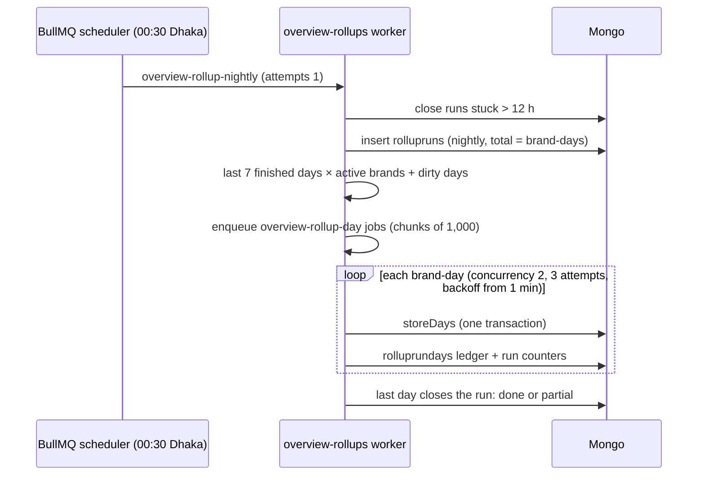

## Dependencies and business requirement

Read [SLA](/docs/listenyzen/code-sla) and [handler performance](/docs/listenyzen/code-handling) first. Rollups store their figures; they do not define new ones.

Before this change, every Overview range request scanned raw sessions, comments, messages and handling records, so cost grew with volume. Rollups precalculate every range figure per **brand × Asia/Dhaka business day**. A range read now costs **days, not records**: a year is about 1,100 small rows per brand. The source spec is `docs/overview-rollups.md` in the Listenyzen repository (decisions D1–D8).

Source snapshot: `4f35c48` plus the **uncommitted** overview-rollups working tree, inspected 1 November 2026. The source says that the client was not checked in a browser and the dev backfill was not applied. Examples are illustrative, not live responses.

<Callout title="The visible change">Range figures run **through yesterday**. Today is never shown, presets end yesterday, and every range response carries `asOf`, the last day it includes.</Callout>

## Decisions

| # | Decision |
| --- | --- |
| D1 | Daily rollups per brand × Asia/Dhaka day. Figures run through yesterday. |
| D2 | A nightly job at **00:30 Asia/Dhaka** recomputes the last **7** finished days. |
| D3 | No wider weekly pass. Dirty-day marking covers events that move or vanish. |
| D4 | A super admin can rebuild one brand or all brands over a date range and see run status. |
| D5 | Presets end yesterday: "Last 30 days" is the 30 days ending yesterday. |
| D6 | "Now" figures, unanswered turns and distinct-customer figures stay live. |
| D7 | Scope: every Overview tab. Inbox, Comments, Teams and Admin stay live. |
| D8 | Rollup jobs run on their own `overview-rollups` queue, never `webhooks`. |

## Storage comes first

All in `server/src/modules/overview/rollup/schema.ts`. `day` is a `YYYY-MM-DD` string in Asia/Dhaka, so days sort and compare as strings. `source` is the `HandlingSource` value (`session` or `comment`).

| Collection | One row per (unique) | Holds |
| --- | --- | --- |
| `overviewdays` | `{brandId, day, platform, source}` | `inbound`, `responded`, `closed`, `firstResponse` and `resolution` duration buckets (business and wall), `slaCompliance` (met/breached per metric), `slaResolved` (the `/sla` resolved half), `peakHours[24]`, `tags[]`, `sentiment[]` |
| `handlerdays` | `{brandId, day, platform, source, queryManagerId, teamId}` | `handled`, `resolved`, `unresolved`, `firstResponseAnswered`, `firstResponseTotalMs` |
| `rollupdays` | `{brandId, day}` | `computedAt`, `runId?`: the marker that the day was computed. A quiet day has a marker and no rows; a failed day has no marker. |
| `rollupruns` | one run | `source` (`nightly`/`manual`), `triggeredBy?`, `brandId?`, `from`, `to`, `total`, `completed`, `failed`, `failedDays[]` (first 100), `status` (`running`/`done`/`partial`/`failed`), `startedAt`, `finishedAt?` |
| `rolluprundays` | `{runId, brandId, day}` | `outcome`: a ledger so a job that runs twice counts once |
| `rollupdirtydays` | `{brandId, day}` | `markedAt`: an older day to recompute on the next nightly run |

Every stored figure is a count, a sum or a duration bucket. Those add up across days, so means, rates and percentiles are computed **after** the merge and match the old live figures exactly. Duration buckets are the existing `durations.ts` buckets: minutes below a day, hours past it.

Indexes beyond the unique keys: `rollupruns {startedAt: -1}`, `{source: 1, startedAt: -1}` and the partial unique `one_running_manual_run_per_scope` (`{brandId}` where `source: manual, status: running`). `rollupdirtydays` also has `{day: 1}`.

## What is rolled up and what stays live

Each figure is filed under one day, its **anchor**. Event-anchored figures always land inside the nightly window when the event happens. Opened-anchored figures can change after their day freezes.

| Endpoint | Rolled up (anchor) | Live |
| --- | --- | --- |
| `/engagement` | `inbound`, `responded` (opened) | backlog (now) |
| `/inbound-trend` | inbound (opened), closed (resolved) | none |
| `/first-response` | duration buckets (opened) | none |
| `/resolution-time` | duration buckets (resolved) | none |
| `/sla-compliance` | met/breached (the day each target was decided) | none |
| `/sla` | resolved half (resolved) | open half: at risk and breached now |
| `/peak-hours` | 24 hourly counts (message or comment time) | none |
| `/customers` | top tags, sentiment (opened) | customer counts: distinct customers don't add across days |
| `/customer-trend` | none | weekly customers over finished days |
| `/team` | queries closed (resolved) | on hold now; unanswered turns over finished days |
| `/handlers` | per query manager (`handledAt`, `decidedAt`, `firstResponseAt`) | none |
| `/stats`, `/holds` | none | entirely live; `/holds` is a log and is not clamped |

## Follow the computation

`computeDays(brandId, from, to, options)` in `rollup/compute.ts` is now the **only** code that reads source records for range figures. It uses the same filters, fields and hinted indexes as the old live reads, grouped by Dhaka day (`$dateToString` with `timezone`) and platform. Duration buckets come back as grouped rows rather than one `$facet` document, so a long range never reaches the 16 MB document limit. Lists inside a row are sorted, so recomputing a day stores identical rows.

**One finisher per figure.** Each old endpoint was split into "read counts" and "finish" (`inboundFigures`, `firstResponseFigures`, `slaFigures`, `handlerStatsFromCells` and others). `rollup/figures.ts` turns stored rows into those same counts and calls the same finisher, so rolled-up and live figures cannot drift. `test/overview-rollup.test.ts` checks live = stored = mixed for 3 ranges × 4 platform filters.

## Follow the write

`storeDays({ brandId, from, to, runId? })` in `rollup/store.ts`, per day:

1. Refuse any day that is not before today. A stored day is trusted by reads, so it must never be partial.
2. Note `computedAt` (start time) and the day's current dirty mark.
3. Compute the day **outside** the transaction. Computing inside it made parallel reads conflict about 26 times a day, according to the source notes.
4. In **one transaction**: if the marker shows a computation that started later, skip. Otherwise delete the brand-day's `overviewdays` and `handlerdays` rows, insert the new ones, upsert the `rollupdays` marker, and clear the dirty mark only if it is unchanged since step 2.

The result is idempotent: running a day twice changes nothing, and a query manager who dropped out of a day loses their row. Two writers of one day both write its marker, so their transactions conflict and one retries. Transactions need a **replica set**: Atlas always is one, and tests use `MongoMemoryReplSet`.

## Jobs and scheduling

Code: `rollup/jobs.ts` and the queue port `libraries/queue` (still the only `bullmq` import).



- **Queues.** The port now keeps named queues: `webhooks` (default; 5 attempts, 2 s timeout to enqueue) and `overview-rollups` (3 attempts, exponential backoff from 60 s, failures kept 24 h, 30 s enqueue timeout). Handlers receive `{ attempt, isFinal }`. `scheduleRepeating` wraps `upsertJobScheduler`, so every worker start keeps exactly one schedule in Redis.
- **Startup.** `startRollups()` in `worker.ts` checks that all the rollup unique indexes exist (`missingRollupIndexes`). While any is missing, or Mongo or Redis fails, it logs and retries every 5 minutes. It never throws, so webhook processing is unaffected. `stopRollups()` on shutdown cancels a pending start.
- **Nightly fan-out.** Yesterday − 6 … yesterday for every **active** brand, plus every dirty day before that window. Job ids are `rollup-{runId}-{brandId}-{day}` (BullMQ forbids `:`). Days that could not be queued are marked dirty. The fan-out itself is never retried, because a retry would start a second run.
- **Day job.** `runRollupDay` calls `storeDays` for one day. On the final failed attempt it marks the day dirty, records it in `failedDays` and completes the job.
- **Missed night.** BullMQ does not catch up, but the next night's 7-day window covers it.

## Dirty days: when an older day changes

Old figures go stale only when an event they were filed under **moves or vanishes**. `markChangedDays(brandId, [before, after][])` in `rollup/dirty.ts` records those days in `rollupdirtydays`. It marks only days older than today − 6, so everyday traffic writes nothing, and it never throws. The hooks:

| Write path | Marks |
| --- | --- |
| `session/status-log.ts` `applyStatusChange` | resolve date moved or cleared (a resolved query reopened) |
| `session/sla.ts` `syncSessionSla`, `comment/sla.ts` `syncThreadSla` | opening, first reply and both due times when they moved (`slaEventPairs`); also the resolve day when any of them changed, since its breach counts read them |
| `handling/sync.ts` `rewriteQueryHandling` | handled, decided and first-response days of every query manager whose record changed, also when the query is gone or the rewrite fails part-way |
| `comment/service.ts` `cascadeDelete` | every date of every deleted comment |

Reads also mark finished days that have no marker (`$setOnInsert`), so the next nightly run stores them. Writes that bypass these paths are **not covered**: the SLA and query-handling backfill scripts write without marks. Re-run the rollup backfill after them.

**Accepted gap (D3):** opened-anchored figures (response rate, first response time, top tags, sentiment) freeze 7 days after the opening day. Example: a customer writes on 1 October and gets the first reply on 10 October. October's response rate keeps counting that query as unanswered until someone rebuilds 1 October. Its resolve on 12 October is filed under 12 October, so closed counts and resolution time stay correct.

## Follow the read

`overview/reads.ts` builds every range endpoint; `api.ts` routes call it. `rollup/read.ts` serves the days:

1. `clampRange` cuts `to` to yesterday (Dhaka). `asOf` = the last day included, or `null` when none is left. `range` in the response still echoes the request.
2. Read the `rollupdays` markers, then the stored rows projected to only the fields the figure needs, then the markers **again**. A day whose marker changed was rewritten mid-read: it is recomputed live and the stored rows are re-read without it.
3. Days without a complete marker form **one live span** (first to last missing day). `computeDays` runs only the figure groups the endpoint needs (`parts`) and live rows of days that are stored are dropped. A missing day is slower, never a false zero.
4. `handlerdays` are summed **in MongoDB** per (query manager, team, source), a handful of rows whatever the range.
5. `rollup/figures.ts` folds the rows, and the endpoint's own finisher shapes the response.

```json title="Illustrative /first-response with a clamped range (requested on 1 November)"
{
  "range": { "from": "2026-10-03", "to": "2026-11-01" },
  "asOf": "2026-10-31",
  "all": { "answered": 180, "businessHours": { "mean": 1260000, "p50": 900000, "p90": 3000000 } }
}
```

`/inbound-trend` and `/customer-trend` stay arrays (no `asOf`) and end at the last finished day.

## Measured cost

Source: the Listenyzen progress notes (`docs/overview-rollups-progress-context.md`), `pnpm bench:team-performance` on a seeded throwaway replica set with 1M records a year. This documentation update did not re-run it.

| Read | Live | Stored rollups |
| --- | --- | --- |
| `/handlers`, 365 days | 1.6 s | 46 ms |
| `/team`, 365 days | 1.3 s | 570 ms (all of it the live unanswered-turns read, about 1M index keys) |
| `/handlers` / `/team`, 30 days | not stated | 4 ms / 49 ms |
| Storing one brand-day | 21 ms | n/a |

The next candidate the source lists: roll up total turns per day and read only unanswered turns live.

## Super-admin controls

Mounted at `/api/v1/admin/overview-rollups` (`rollup/api.ts`, `super_admin` only). Contracts, validation and handler code are in [the API reference](/docs/listenyzen/api-reference).

| Route | Behavior |
| --- | --- |
| `POST /rebuild` `{ brandId?, from, to }` | `to` ≤ yesterday; at most 366 days for one brand (any status) or 90 for every active brand; unknown brand 404; 409 while rollup indexes are missing or the same scope is still running. Answers **202** `{ runId }` once the run is recorded; the days are queued afterwards. |
| `GET /runs` `?source=&limit=` | Newest first, default 20, max 100, with progress, first failed days and the brand name. |
| `GET /status` | Latest nightly run, latest finished one, `stale` (none finished, or it started over 26 h ago), estimated `dirtyDays`, `missingIndexes`. |

## Follow the response into the interface

- `client/src/features/overview/filters.ts`: presets end at `lastFinishedDay()` (Yesterday, Last 7/30/90 days, This month, Last month, Last 12 months). "Today" is gone, and an old `?range=today` link falls back to the default. On the 1st, "This month" shows the month just ended, labelled "Last month". `rangeProblem` refuses a custom range ending after yesterday.
- `overview-filter.tsx`: the calendar stops at yesterday and marks Dhaka's today.
- `blocks.tsx` (`FilterChips`): "Data through `{day}`". It is computed in the browser from the range rather than read from `asOf`. The source lists this as a known difference: it can disagree if the browser clock is off or a tab stays open past midnight.
- Super admin: `pages/system/rollups.tsx` at `/dashboard/system/rollups` (nav "Overview figures" under Platform, plus a card on the welcome page; others are redirected to `/dashboard`). It shows health (Up to date / Behind / Not running), the last finished and latest run, days waiting, a rebuild form with brand search (first 100 matches) and the run list, polled every 5 s while a run is running. Hooks: `features/rollups/api.ts`.

## Repair and operations

- `pnpm backfill:overview-rollups` (dry run) / `--apply`, optionally `--from= --to= --brand=`, run from the Listenyzen `server/` directory. The default is the 365 days through yesterday for every brand. It stores directly (no queue) and builds the indexes first. Run it after changing what `computeDays` computes, and after the SLA or query-handling backfills.
- Production (`autoIndex` off): build the rollup indexes listed above, or no rollup runs. The worker waits, `/status` lists the missing indexes, and rebuilds answer 409. Production starts empty, so it needs no rollup backfill: the nightly run fills days from launch on. See [development](/docs/listenyzen/development).
- The comments partial index `{brandId, resolvedAt, platform}` (`COMMENT_ROOTS_BY_RESOLVED`) is no longer read. The source plans to drop it at the pre-production index pruning.
- `GET /health/queue` still reports only the `webhooks` queue. Watch rollups through `/admin/overview-rollups/status`.

To study one complete trace, take a resolved query reopened 10 days later. Follow it through `applyStatusChange` (resolve date cleared) → `markChangedDays` → a `rollupdirtydays` row → the next `runNightlyRollup` adding that day → `storeDays` → `/resolution-time` and `/team` no longer counting the old resolve.
