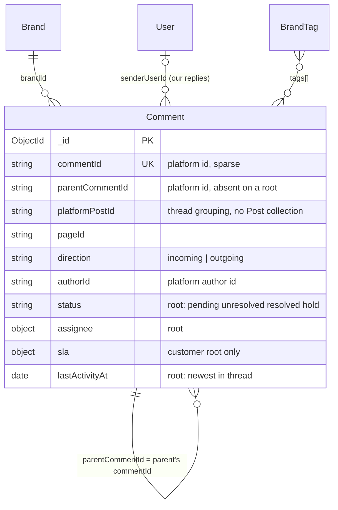
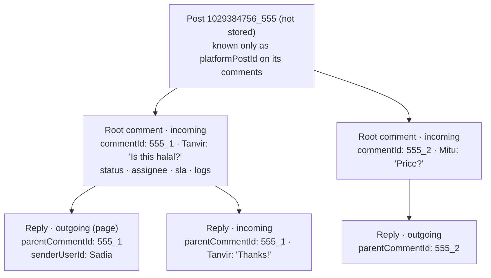
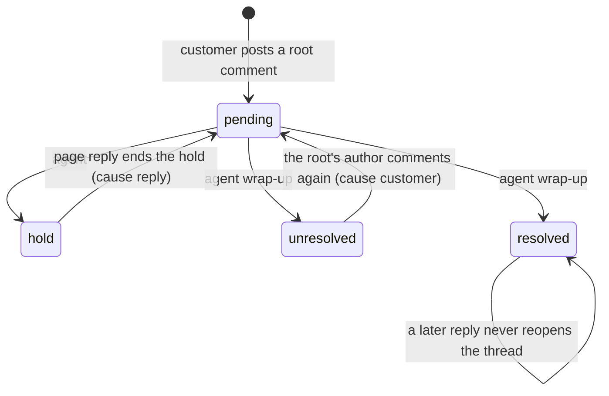

## The code

{/* schema: server/src/modules/comment/schema.ts */}
```ts title="server/src/modules/comment/schema.ts" lineNumbers
import mongoose, { Document, Model, Schema, Types } from 'mongoose';
import { baseSchema } from '@/libraries/db/base-schema';
// The assignee-type vocabulary (query_manager | department | team) is shared with sessions — reuse it as
// the single source of truth rather than redefining the enum here.
import {
  ASSIGNEE_TYPES,
  AssigneeType,
  assignmentChangeSchema,
  wrapUpChangeSchema,
  slaStateSchema,
  statusChangeSchema,
  SESSION_TYPES,
  SLA_DECISION_FIELDS,
  slaDecisionIndex,
  type IAssignmentChange,
  type SessionType,
  type IWrapUpChange,
  type ISlaState,
  type IStatusChange,
} from '@/modules/session/schema';
import { IPopulatedBrandTag } from '@/modules/brand/tags/schema';

// Which social surface a post/comment belongs to. Facebook Page feed comments are wired today;
// Instagram is handled by the same models and code paths once its webhook fields are subscribed.
export const COMMENT_PLATFORMS = ['facebook', 'instagram'] as const;
export type CommentPlatform = (typeof COMMENT_PLATFORMS)[number];

// incoming = a comment left by a user, outgoing = a public reply we posted (or the page posted).
export const COMMENT_DIRECTIONS = ['incoming', 'outgoing'] as const;
export type CommentDirection = (typeof COMMENT_DIRECTIONS)[number];

// Client-facing sentiment/status values (kept identical to the client types to avoid mapping).
export const COMMENT_SENTIMENTS = ['POSITIVE', 'NEUTRAL', 'NEGATIVE'] as const;
export type CommentSentiment = (typeof COMMENT_SENTIMENTS)[number];

// Mirrors the session status set (see conversation/schema): `pending` is the initial backlog state;
// `unresolved` / `resolved` / `hold` are the wrap-up outcomes an agent picks in the resolve modal.
export const COMMENT_STATUSES = ['pending', 'unresolved', 'resolved', 'hold'] as const;
export type CommentStatus = (typeof COMMENT_STATUSES)[number];

// A tag an agent has applied to a comment, as it reads back after `.populate('tags', 'name')`.
// Comments store the bare id; the name is the vocabulary's, read fresh on every read. Same shape as
// the session's `ISessionTag`. Distinct from the ML-assigned `topicTags` below, which are free
// strings with no vocabulary behind them.
export type ICommentTag = IPopulatedBrandTag;

// A comment routed to exactly one assignee — an individual query manager OR a whole department
// (mutually exclusive, hence a single embedded field). `name` is a denormalized snapshot so reads
// need no join. Same shape as the session's `ISessionAssignee`.
export interface ICommentAssignee {
  kind: AssigneeType;
  // References a User (query_manager) or a Department depending on `kind`; not a Mongoose `ref`
  // because the target model varies and we read the denormalized `name` rather than populating.
  id: Types.ObjectId;
  name: string;
}

/**
 * One comment on a post. `commentId` is the platform's comment id, used for idempotency.
 * Nesting is flat: `parentCommentId` holds the platform id of the parent comment (undefined
 * for a root comment); the two-level thread (root → replies, matching Facebook/Instagram) is
 * rebuilt for the client on read.
 *
 * There is no separate Post collection — a comment carries its own post context, denormalized
 * from the platform: `platformPostId` (the platform post/media id) is both the grouping key for
 * a thread and the id the client embeds the real post by; `pageId` is the connected page;
 * `permalinkUrl` is best-effort (only when a webhook delivered it for free).
 */
export interface IComment extends Document {
  // Post context, denormalized (no Post collection).
  pageId: string;
  platformPostId: string;
  permalinkUrl?: string;
  brandId: Types.ObjectId;
  companyId: Types.ObjectId;
  platform: CommentPlatform;
  direction: CommentDirection;
  // Platform comment id. Unique+sparse so a re-delivered webhook or our own reply echo folds in.
  commentId?: string;
  // Platform id of the parent comment; undefined for a root comment.
  parentCommentId?: string;
  // Platform id of the comment's author (page id for our own replies).
  authorId: string;
  authorName: string;
  authorAvatarUrl?: string;
  // The agent (User) who posted an outgoing reply from our platform, when applicable.
  senderUserId?: Types.ObjectId;
  text: string;
  // A single attachment on the comment, when the webhook delivered one for free (photo/video URL).
  attachmentUrl?: string;
  attachmentType?: 'image' | 'video';
  status: CommentStatus;
  // Unset until the ML pipeline or an agent assigns one — no NEUTRAL default.
  sentiment?: CommentSentiment;
  // Free-text note captured when an agent wraps the comment up (optional; unset until then).
  resolutionSummary?: string;
  // The kind of query, chosen at wrap-up as on sessions (customer roots; unset until then).
  sessionType?: SessionType;
  // ML-assigned topic labels (read-only in the UI).
  topicTags: string[];
  // Ids of the brand tags an agent has applied to this comment. Empty when none. Read paths
  // `.populate('tags', 'name')`, so on a comment that came from one of those this array holds
  // `ICommentTag` ({_id, name}) rather than bare ids.
  tags: Types.ObjectId[];
  // Who this comment is routed to (a query manager or department). Unset = unassigned.
  assignee?: ICommentAssignee;
  reactions: number;
  // Moderation state kept in step with the platform: hidden = not shown publicly (author still
  // sees it); likedByPage = the page reacted to this comment (Facebook only).
  isHidden: boolean;
  likedByPage: boolean;
  commentedAt: Date;
  // On a root comment: the newest activity in its thread — its own time or its latest reply's.
  // This is the brand comment list's sort key, so a thread floats up when a new reply lands (see
  // `bumpThreadActivity` in the service). On a reply it's just the reply's own time and unused.
  lastActivityAt: Date;
  // SLA, on a customer-written root only (the root plays the session, replies the messages). The
  // clock starts at the root comment; first response = the earliest page reply in the thread;
  // resolution = business time from the root to wrap-up, as for sessions (modules/comment/sla.ts).
  // A reply after wrap-up doesn't reopen the thread (see CLAUDE.md).
  slaStartAt?: Date;
  firstResponseAt?: Date;
  // Set while the root is `resolved`, cleared on any other status.
  resolvedAt?: Date;
  // On a root: who last changed its status and when, and every status change (the same log as a
  // session's, read by the resolution clock: docs/resolution-time-rules.md, R5, R6, R13). The log is
  // left out of reads unless selected, hence optional.
  statusChangedBy?: Types.ObjectId;
  statusChangedAt?: Date;
  statusLog?: IStatusChange[];
  // A root's assignment changes, as a session's `assignmentLog`.
  assignmentLog?: IAssignmentChange[];
  // A root's wrap-up edits, as a session's `wrapUpLog`.
  wrapUpLog?: IWrapUpChange[];
  statusRevision?: number;
  // A root's: as a session's `handlingRevision`.
  handlingRevision?: number;
  sla?: ISlaState;
  // Bumped on every change to the thread that can move its SLA (a comment stored or removed, hide /
  // unhide, a status change). A sync writes only if it is unchanged since the sync read the root.
  slaRevision?: number;
}

const commentSchema = new Schema<IComment>({
  // Post context, denormalized (no Post collection); `platformPostId` groups a thread's comments.
  pageId: { type: String, required: true },
  platformPostId: { type: String, required: true },
  permalinkUrl: { type: String },
  brandId: { type: Schema.Types.ObjectId, ref: 'Brand', required: true, index: true },
  companyId: { type: Schema.Types.ObjectId, ref: 'Company', required: true, index: true },
  platform: { type: String, enum: [...COMMENT_PLATFORMS], required: true },
  direction: { type: String, enum: [...COMMENT_DIRECTIONS], required: true },
  commentId: { type: String },
  parentCommentId: { type: String },
  authorId: { type: String, required: true },
  authorName: { type: String, default: '' },
  authorAvatarUrl: { type: String },
  senderUserId: { type: Schema.Types.ObjectId, ref: 'User' },
  text: { type: String, default: '' },
  attachmentUrl: { type: String },
  attachmentType: { type: String, enum: ['image', 'video'] },
  status: { type: String, enum: [...COMMENT_STATUSES], default: 'pending' },
  // No default — a comment carries no sentiment until the ML pipeline or an agent sets one.
  sentiment: { type: String, enum: [...COMMENT_SENTIMENTS] },
  resolutionSummary: { type: String },
  // No default: unset until the thread is wrapped up (as on sessions).
  sessionType: { type: String, enum: [...SESSION_TYPES] },
  topicTags: { type: [String], default: [] },
  // Brand tags applied to this comment, by id. `ref` so read paths can `.populate('tags', 'name')`.
  tags: {
    type: [{ type: Schema.Types.ObjectId, ref: 'BrandTag' }],
    default: [],
  },
  // Embedded (no _id); absent when unassigned. Mirrors the session's assignee subdoc.
  assignee: {
    type: {
      kind: { type: String, enum: [...ASSIGNEE_TYPES], required: true },
      id: { type: Schema.Types.ObjectId, required: true },
      name: { type: String, required: true },
    },
    _id: false,
    default: undefined,
  },
  reactions: { type: Number, default: 0 },
  isHidden: { type: Boolean, default: false },
  likedByPage: { type: Boolean, default: false },
  commentedAt: { type: Date, default: (): Date => new Date() },
  lastActivityAt: { type: Date, default: (): Date => new Date() },
  slaStartAt: { type: Date },
  firstResponseAt: { type: Date },
  resolvedAt: { type: Date },
  statusChangedBy: { type: Schema.Types.ObjectId, ref: 'User' },
  statusChangedAt: { type: Date },
  statusLog: { type: [statusChangeSchema], default: [], select: false },
  assignmentLog: { type: [assignmentChangeSchema], default: [], select: false },
  wrapUpLog: { type: [wrapUpChangeSchema], default: [], select: false },
  statusRevision: { type: Number },
  handlingRevision: { type: Number },
  sla: { type: slaStateSchema },
  slaRevision: { type: Number },
});

commentSchema.add(baseSchema);

// De-duplicate re-delivered webhooks / our own reply echoes.
commentSchema.index({ commentId: 1 }, { unique: true, sparse: true });
// Read one thread's direct children chronologically. Thread detail walks this index once per nesting
// level, which is normally one level for Facebook/Instagram.
commentSchema.index({ brandId: 1, platformPostId: 1, parentCommentId: 1, commentedAt: 1, _id: 1 });
// Overview range reads: a brand's comments by platform, then date. Platform first so a platform filter
// reads only that platform's range; unfiltered reads pass every platform (overview/indexes.ts).
commentSchema.index({ brandId: 1, platform: 1, commentedAt: 1 });
// Overview SLA counts: a brand's threads by status, and resolved ones by resolution date.
commentSchema.index({ brandId: 1, status: 1, resolvedAt: 1 });
// Resolved customer threads by resolution date and platform, answered from the index alone (Team
// Performance's queries closed). Reads match `parentCommentId: null`, which this filter implies;
// `$exists: false` doesn't, so it can't use the index.
commentSchema.index(
  { brandId: 1, resolvedAt: 1, platform: 1 },
  {
    partialFilterExpression: { status: 'resolved', direction: 'incoming', parentCommentId: null },
  }
);
// The hold log: threads ever put on hold, by when their status changed (HELD_BY_CHANGE, hinted).
// Partial, so only held threads are indexed: the read touches held queries, not every query.
commentSchema.index(
  { brandId: 1, 'statusLog.at': 1, platform: 1 },
  { partialFilterExpression: { 'statusLog.status': 'hold' } }
);
// Overview closure: unresolved threads by when they became unresolved (UNRESOLVED_BY_CHANGED).
commentSchema.index(
  { brandId: 1, statusChangedAt: 1, platform: 1 },
  { partialFilterExpression: { status: 'unresolved' } }
);
// Overview SLA compliance, as on sessions (customer roots only: replies carry no `sla`).
for (const field of SLA_DECISION_FIELDS) commentSchema.index(...slaDecisionIndex(field));
// Brand comment list: root comments only, newest thread activity first.
commentSchema.index({ brandId: 1, lastActivityAt: -1, _id: -1 });
// The same list narrowed by assignee ("Assigned to me"), newest first — sessions and conversations
// carry the same index. Without it every such page walks the brand's whole
// `{brandId, lastActivityAt}` index and fetches documents to test the assignee. Measured on
// 400 comments with a quarter of them assigned: 82 documents examined for a 21-row page, and the
// amplification is 1/(their share of the brand's comments) — an agent holding 1% of a busy brand
// would fetch ~2,100 documents for one page, growing with the brand rather than with their queue.
// With this index: 21 examined for 21 returned, and a SORT_MERGE across the $in instead.
//
// Partial so only assigned comments are indexed (most are not), and matched on the assignee id
// alone, which works for both kinds because user and department ids are globally unique.
commentSchema.index(
  { brandId: 1, 'assignee.id': 1, lastActivityAt: -1, _id: -1 },
  { partialFilterExpression: { 'assignee.id': { $exists: true } } }
);
// The same list narrowed to one or more brand tags ("show me everything tagged complaint/billing").
// Multikey on the tag ids; `lastActivityAt` keeps the sort covered so the filter doesn't force a
// blocking in-memory sort of the matched threads.
commentSchema.index({ brandId: 1, tags: 1, lastActivityAt: -1, _id: -1 });
// The same list narrowed to a single post ("show me this post's threads") — the `postId` filter the
// comments page sends when a post is picked. Same {brandId, field, sort} shape: without it the post
// filter runs off the plain {brandId, lastActivityAt} index and fetches every thread in the brand to
// test `platformPostId`, which is the whole brand's history for one viral post's worth of rows.
commentSchema.index({ brandId: 1, platformPostId: 1, lastActivityAt: -1, _id: -1 });
// The same list narrowed by platform / status / sentiment — one index each, in {brandId, field, sort}
// shape so the filter and the ordering both come from the index.
//
// Without these the filter can only be applied AFTER a fetch, so Mongo walks the `lastActivityAt` index
// newest-first fetching every document to test the field, and stops when the page fills. That makes the
// cost inversely proportional to how often the filter matches — fine at 100%, ruinous at 0%. Measured on
// 10M comments: `platform: 'facebook'` (all of them) returned in 4ms; `platform: 'instagram'` (none of
// them) never finished, because there was no page to fill and nothing to stop the scan. An empty result
// is an ordinary thing for a UI to ask for — a brand with no Instagram traffic, a sentiment nobody has
// used — so it can't be allowed to cost a collection scan.
//
// Not partial on `{parentCommentId: {$exists: false}}`, tempting as that is (only ~60% of comments are
// roots): MongoDB rejects `$exists: false` in a partialFilterExpression — "Expression not supported in
// partial index: $not". The root test therefore still costs a fetch, but only for the handful of
// documents a page actually returns, which is bounded.
commentSchema.index({ brandId: 1, platform: 1, lastActivityAt: -1, _id: -1 });
commentSchema.index({ brandId: 1, status: 1, lastActivityAt: -1, _id: -1 });
commentSchema.index({ brandId: 1, sentiment: 1, lastActivityAt: -1, _id: -1 });

export const CommentModel: Model<IComment> = mongoose.model<IComment>('Comment', commentSchema);
```
{/* /schema */}

Note the imports at the top. The status, assignment and wrap-up logs, the SLA state and the session types are **the same sub-schemas** that `session/schema.ts` defines ([Messaging](/docs/listenyzen/messaging#session)).

## Map

<SchemaGraph domains={['comments']} height={460} />

## ER diagram



The self-relation is unusual: `parentCommentId` holds the parent's **platform** id (`commentId`), not its MongoDB `_id`. Webhooks deliver replies with the platform parent id, so storing it as-is needs no lookup.

## There is no Post collection



| | Root comment (customer) | Reply |
| --- | --- | --- |
| `parentCommentId` | absent | the root's `commentId` |
| Plays the role of | a **Session**: the query | a **Message** in it |
| `status`, `assignee`, `tags`, wrap-up, logs | used | unused |
| `sla`, `slaStartAt`, `firstResponseAt` | set (`slaStartAt` = the root's time) | never |
| `lastActivityAt` | newest activity in the whole thread: the list's sort key | its own time, unused |

A thread is rebuilt on read with the index `{brandId, platformPostId, parentCommentId, commentedAt, _id}`. It reads the children of one parent in order, one nesting level at a time (normally just one).

## Comment

<ModelFields model="Comment" />

### Comment vs Session: same idea, different shape

| Concept | Session (DM) | Comment root |
| --- | --- | --- |
| The query | Session document | Customer-written root comment |
| The thread | Conversation | `platformPostId` + root |
| Items in it | Message (`sessionId`) | Replies (`parentCommentId`) |
| Status / assignee / logs | ✓ | ✓ same sub-schemas |
| SLA state | `sla` with seen counters | `sla` without them; `slaRevision` guards writes instead |
| Sentiment | default `NEUTRAL`, includes `MIXED` | **no default**, no `MIXED` |
| Extra | `sequence`, counters | `topicTags` (ML strings), `isHidden`, `likedByPage`, `reactions` count |
| Platforms | facebook, instagram, whatsapp | facebook, instagram |

### Status lifecycle of a root



The difference from sessions: **a resolved thread never reopens**, because there is no "next session" to open.

```json title="Sample root comment and a page reply"
[
  {
    "_id": "670000000000000000000501",
    "pageId": "1029384756",
    "platformPostId": "1029384756_555",
    "brandId": "670000000000000000000004",
    "companyId": "670000000000000000000001",
    "platform": "facebook",
    "direction": "incoming",
    "commentId": "555_1",
    "authorId": "41234567",
    "authorName": "Tanvir Ahmed",
    "text": "Is this halal?",
    "status": "pending",
    "topicTags": ["product-question"],
    "tags": [],
    "assignee": { "kind": "query_manager", "id": "670000000000000000000032", "name": "Sadia Islam" },
    "reactions": 2,
    "isHidden": false,
    "likedByPage": false,
    "commentedAt": "2026-11-08T08:00:00.000Z",
    "lastActivityAt": "2026-11-08T08:06:00.000Z",
    "slaStartAt": "2026-11-08T08:00:00.000Z",
    "firstResponseAt": "2026-11-08T08:06:00.000Z"
  },
  {
    "_id": "670000000000000000000502",
    "pageId": "1029384756",
    "platformPostId": "1029384756_555",
    "brandId": "670000000000000000000004",
    "companyId": "670000000000000000000001",
    "platform": "facebook",
    "direction": "outgoing",
    "commentId": "555_1_9",
    "parentCommentId": "555_1",
    "authorId": "1029384756",
    "senderUserId": "670000000000000000000032",
    "text": "Yes, it is certified halal.",
    "status": "pending",
    "commentedAt": "2026-11-08T08:06:00.000Z"
  }
]
```

### The hold-log index

Since revision `18e6d95`, roots that were ever put on hold are indexed by `{brandId, statusLog.at, platform}`, partial on `statusLog.status: 'hold'`. This is the same multikey index into the embedded log as on sessions ([explained there](/docs/listenyzen/messaging#an-index-inside-the-hidden-log)).

### Why so many indexes?

The comments list filters by one field at a time and always sorts by `lastActivityAt`. Without a matching `{brandId, field, lastActivityAt: -1, _id: -1}` index, MongoDB walks the brand's whole list and tests every document. The schema comments record the measurement: on 10M comments, filtering for a platform with **no** matches never finished. So each filter gets its own index: assignee, tags, post, platform, status and sentiment.

## Check yourself

<details>
<summary>How do you find the root of a reply?</summary>

Find the comment whose `commentId` equals the reply's `parentCommentId` (unique sparse index on `commentId`).
</details>

<details>
<summary>Which comments carry `sla`?</summary>

Only customer-written roots (`direction: 'incoming'`, no `parentCommentId`). That is why the SLA indexes are partial on `sla` existing, which keeps every reply out of them.
</details>

<details>
<summary>A customer replies under a resolved thread. What happens to its status?</summary>

Nothing. A resolved thread never reopens. The reply is stored and `lastActivityAt` moves the thread up the list.
</details>
