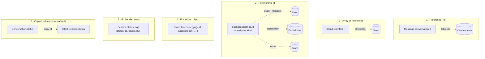
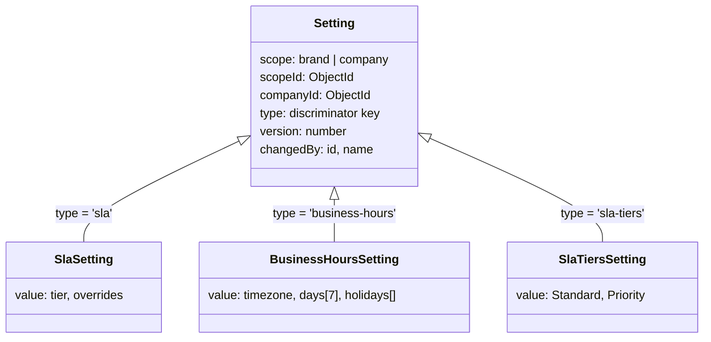

## The code

Every model except the derived ones adds this schema to get `createdAt` and `updatedAt`.

{/* schema: server/src/libraries/db/base-schema.ts */}
```ts title="server/src/libraries/db/base-schema.ts" lineNumbers
import { Schema, Document } from 'mongoose';

// Define an interface for the base schema (if needed)
interface IBaseSchema extends Document {
  createdAt: Date;
  updatedAt: Date;
}

// Create the base schema with TypeScript
const baseSchema = new Schema<IBaseSchema>(
  {
    createdAt: {
      type: Date,
      default: () => new Date(),
      index: true,
    },
    updatedAt: {
      type: Date,
      default: () => new Date(),
      index: true,
    },
  },
  { timestamps: true }
);

// Export the baseSchema using TypeScript's module syntax
export { baseSchema };
```
{/* /schema */}

`schema.add(baseSchema)` copies these two paths into a model, and `{ timestamps: true }` on the base makes Mongoose set them on every save. Both are **indexed**, which costs a write per document change. That is why the high-churn derived collections skip it:

| How time is kept | Models | Why |
| --- | --- | --- |
| `baseSchema` (indexed `createdAt`, `updatedAt`) | Company, User, Department, Team, Role, RoleChange, Brand, BrandTag, FixedReply, Setting, Customer, Conversation, Message, Session, SessionNote, Comment, AlertRule, File | Ordinary records |
| `{ timestamps: true }`, not indexed | QueryHandling, QueryTurn | Rewritten on every change; nothing reads by time |
| Own `createdAt` only | NotificationMute, Notification (with a 180-day TTL) | Written once |
| None (`versionKey: false`) | OverviewDay, CustomerWeek, RollupDay, RollupRun, RollupRunDay, RollupDirtyDay | Rollup rows carry their own `day`, `computedAt` or `startedAt` |

## The six ways one record relates to another



| Kind | Declared as | Where you meet it | Trade-off |
| --- | --- | --- | --- |
| **Reference** | `{ type: Schema.Types.ObjectId, ref: 'Conversation' }` | Most `…Id` fields | Can be `.populate()`d. MongoDB does not enforce it, so a deleted target leaves a dangling id. |
| **Array of references** | `[{ type: ObjectId, ref: 'Team' }]` | `Brand.departmentIds/teamIds/queryManagerIds`, `tags` on Session, Comment and Conversation, `Notification.ruleIds` | A multikey index makes "which brands include team X" fast |
| **Polymorphic id** | ObjectId **without** `ref`, plus a field that says the kind | `assignee.id` (+`kind`), `queryId` (+`source`), `Setting.scopeId` (+`scope`), `Notification.target.id` (+`kind`) | Cannot populate, so a `name` is copied next to it |
| **Embedded object** | `{ type: { … }, _id: false }` | `Brand.facebook/instagram/whatsapp`, `Session.sla`, `assignee`, `Message.template`, `failure` | Read with its parent, in one atomic write |
| **Embedded array** | `[subSchema]` | `statusLog`, `assignmentLog`, `wrapUpLog`, `attachments`, `reactions`, rollup buckets | Grows the parent, so the logs are `select: false` |
| **Copied value** | An ordinary field, kept in sync by code | `companyId` everywhere, Conversation's mirror fields, `changedBy.name`, `authorName` | A list or scope filter needs no join. Code must keep it in step. |

## Fields you only get when you ask

`select: false` keeps a field out of every query unless the query names it:

| Field | Why it's hidden | How code reads it |
| --- | --- | --- |
| `User.password` | Hash must never leave the server | `.select('+password')` in login and change-password only; a `toJSON` transform deletes it as a second layer |
| `statusLog`, `assignmentLog`, `wrapUpLog` on Session and Comment | Grow with every change; only supervisors read history | History endpoints select them explicitly |

Other secrets are not hidden but **stripped on serialization**: `Brand.toJSON` deletes `facebook.accessToken`, `userAccessToken`, `instagram.accessToken`, `whatsapp.accessToken` and `whatsapp.registrationPin`.

## Virtuals: computed, never stored

| Model | Virtual | Built from |
| --- | --- | --- |
| Company, Brand | `logoUrl` | `BASE_URL/uploads/` + `logo` |
| User | `avatarUrl` | `BASE_URL/uploads/` + `avatar` |
| Brand | `facebookConnected`, `instagramConnected`, `whatsappConnected` | the channel's `connected` flag |
| File | `url` | S3 bucket URL + `key` |

## One collection, several shapes: discriminators

`Setting` is a single collection where the `type` field picks the shape of `value`. Each type is a discriminator model with its own validation:



Details are in [Settings](/docs/listenyzen/settings).

## Three kinds of index you will see everywhere

| Kind | Example | Meaning |
| --- | --- | --- |
| **Unique** | `Conversation {pageId, participantId}` | One thread per page and customer: repeated webhooks fold into one document |
| **Sparse unique** | `Message {mid}` | Unique only among documents that have the field |
| **Partial** | `Session {brandId, assignee.id, …} where assignee.id exists` | Only matching documents are indexed, so the index stays small. A query must repeat the filter to use it. |
| **TTL** | `Notification.createdAt expires 180 days` | MongoDB deletes the document itself |
| **Compound sort** | `{brandId, lastMessageAt: -1, _id: -1}` | Filter + sort straight from the index; `_id` breaks ties for cursor pages |

`autoIndex` builds indexes automatically only outside production. In production every index is created by hand. The [index reference](/docs/listenyzen/files-and-indexes#every-index) lists all of them.

## Check yourself

<details>
<summary>Why can't `Session.assignee.id` use `.populate()`?</summary>

It has no `ref`, because it can point at a User, a Department or a Team depending on `assignee.kind`. That is why `assignee.name` is copied next to it.
</details>

<details>
<summary>A query reads a session without `statusLog`. Is the log empty?</summary>

No. It is `select: false`, so the query simply didn't ask for it. Absent from the result does not mean absent from the database.
</details>

<details>
<summary>Which collections can you delete and rebuild from the others?</summary>

QueryHandling and QueryTurn (handling backfill), and the six rollup collections (rollup backfill). Notifications expire on their own and are not rebuilt.
</details>
