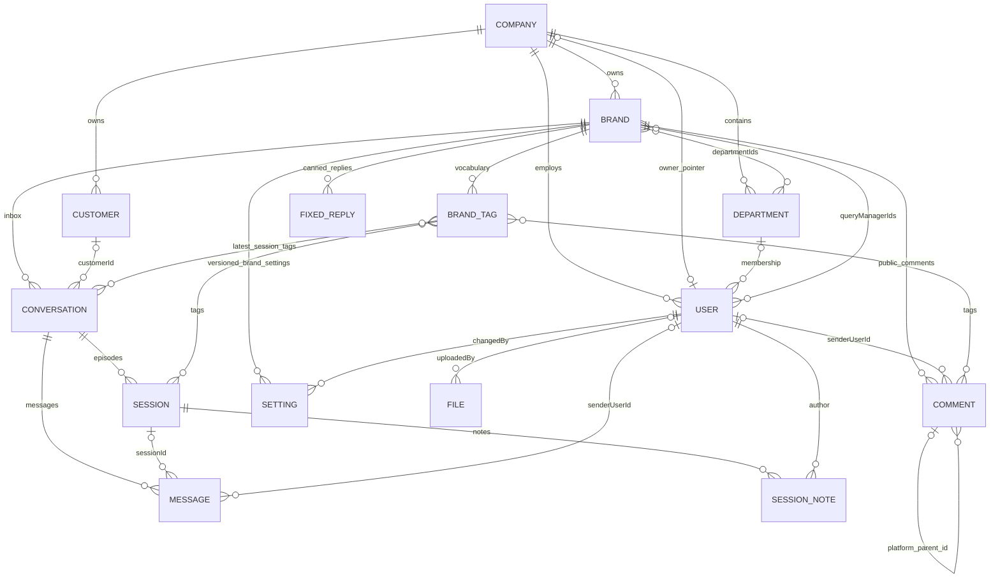

<EntityExplorer />


## Persistence fundamentals

Mongoose models live beside features. There are **13 base domain models**: Company, User, Department, Brand, BrandTag, Customer, Conversation, Message, Session, SessionNote, Comment, FixedReply and File, plus **Setting** with two discriminator models. In total this is **14 base collections**, with SLA/business-hours discriminators sharing the Setting collection.

ObjectId references are application links, not relational foreign-key constraints. Mongoose `ref` enables population; it does not enforce existence, company membership, cascading deletion, or relationship cardinality. Several references are deliberately polymorphic or use external string IDs.

`server/src/libraries/db/index.ts` configures `strictQuery: true`, pool size 10–25, 45-second socket timeout and 10-second connection timeout. API `autoIndex` defaults on outside production; the worker always disables it. Production index creation is an operational step. `autoCreate` is enabled.

## Core ER diagram

The diagram shows intended domain relationships; optional links and application conventions are explained below. It does not imply foreign-key enforcement.



A Session/Comment can additionally point to a User **or** Department through `assignee.kind` and `assignee.id`. These polymorphic links are omitted from the diagram to avoid implying both are populated simultaneously. Settings also support a company scope in the schema; currently mounted settings routes are brand-scoped.

## Model-by-model inventory

### Company

Source: `server/src/modules/company/schema.ts`.

- `name`: required, trimmed, globally unique.
- `status`: `active | inactive`, default `active`.
- `logo?`: local storage key; virtual `logoUrl` builds a public URL.
- `ownerId?`: User pointer. Provisioning creates a company and its owner, then sets this pointer. No unique index makes ownership strictly one-to-one at database level.
- `settings.onlyAssignedCanAct`: defaults false; determines whether query managers can modify only assigned work.
- One company has many brands, departments, users and customer records. Active-company checks gate login, refresh and authenticated operations.

### User

Source: `server/src/modules/user/schema.ts`.

- Required `name`, globally unique `email`, `role`, `password`.
- `companyId?`: absent for super admin; expected for tenant roles by route/provisioning logic.
- `departmentId?`: one department membership; agent-facing workflows use it.
- `avatar?`: local storage key with virtual `avatarUrl`.
- Roles: `super_admin`, `company_owner`, `company_admin`, `query_manager`.
- Password is excluded from ordinary queries via `select: false` and removed by document serialization transforms. Login/password-change explicitly select it.
- A pre-save hook hashes modified passwords using bcrypt with cost 10. Creation uses the document `save()` hook. Password updates through `user/service.ts` explicitly hash before `findOneAndUpdate`; raw update queries do not automatically execute the pre-save hook.
- Query-manager operations reuse this collection with a role filter.

### Department

Source: `server/src/modules/department/schema.ts`.

- Required `name`, `companyId`; `status` defaults active.
- Unique `(companyId, name)`.
- A department has many users and can be assigned to many brands. Brand membership and department existence are checked in application code.

### Brand

Source: `server/src/modules/brand/schema.ts`.

- Required `name`, normalized lowercase `email`, local `logo`, `companyId`; active/inactive status.
- `departmentIds[]`, `queryManagerIds[]`: two independent ways an agent can gain access.
- `facebook?`: `pageId`, `pageName`, page/user tokens, connection state/date, verified webhook subscription fields/missing fields/check time.
- `instagram?`: `accountId`, `username`, token, connection state/date, `loginType` (`facebook` or `instagram`), optional token expiry, webhook subscription diagnostics for the direct-login flow.
- `whatsapp?`: `wabaId`, `phoneNumberId`, display number, verified name, token, `registered`, registration PIN, connection state/date.
- Unique `(companyId, name)`, sparse unique `facebook.pageId` and `whatsapp.phoneNumberId`.
- No equivalent unique Instagram-account index is declared in this schema; do not assume symmetry across channels.
- Virtuals: `logoUrl`, `facebookConnected`, `instagramConnected`, `whatsappConnected`.
- `toJSON`/`toObject` remove channel tokens and WhatsApp PIN. `.lean()` bypasses these document transforms; use explicit safe projections when returning lean brand documents.

### BrandTag

Source: `server/src/modules/brand/tags/schema.ts`.

- Required `brandId`, `companyId`, `name`, `nameLower`; `archived` defaults false.
- `name` is a slash-separated path such as `Complaint/Billing`; ancestor levels are separate tag documents.
- Unique `(brandId, nameLower)` enforces case-insensitive vocabulary uniqueness through a normalized field.
- Sessions, comments and conversation summaries store tag ObjectIds. Session/comment read paths populate only tag `name`; consumers may therefore receive `{ _id, name }` instead of bare IDs.
- Archive hides a tag from ordinary selection but preserves existing references. Rename is reflected when records are populated again.

### Customer

Source: `server/src/modules/customer/schema.ts`.

- Required `companyId`, `platform`, `pageId`, `externalId`.
- `name` defaults empty; optional `avatarUrl`, `mobile`, `email`, `address`, `gender` (`male | female | other`).
- Unique `(platform, pageId, externalId)`.
- For WhatsApp, the common `pageId` field represents the business phone-number ID and the participant/external ID represents the customer's provider identity. Do not reformat opaque provider IDs as phone numbers.
- `customerId` on Conversation is optional; services also resolve customers by the channel identity tuple and can lazily create/link them during editing.

### Conversation

Source: `server/src/modules/conversation/schema.ts`.

- Required `brandId`, `companyId`, `platform`, `pageId`, `participantId`.
- Participant display snapshot: `participantName`, optional `participantAvatarUrl`; optional `customerId`.
- Inbox summary: `lastMessageText`, `lastMessageAt`, `lastMessageDirection`, `unreadCount`.
- Latest-session summary: `status`, `sentiment`, optional `assignee`, `tags[]`.
- Defaults: incoming direction, unread count 0, status `pending`, sentiment `NEUTRAL`.
- Unique `(pageId, participantId)` — **platform and company are not in this unique key**.
- One conversation has many sessions/messages. Customer-to-conversation is not constrained to one-to-one by a unique customer reference.
- Summary fields are intentionally denormalized; update them through the session/message services.

### Message

Source: `server/src/modules/conversation/schema.ts`, model `Message`.

- Required `conversationId`, `brandId`, `platform`, `direction`, `senderId`; optional `sessionId` for older or incomplete records.
- Optional provider `mid` is sparse unique and underpins deduplication.
- Optional `senderUserId`, `senderName` identify the internal sender; the provider sender ID is a separate field.
- `text`, `sentAt`, optional `system` flag.
- `attachments[]`: required `type`; optional `url`, persistent `storageKey`, display `name`, provider `mediaId`, `mimeType`, status `pending | ready | failed`.
- `reactions[]`: `emoji`, optional provider reaction/reactor ID, `source: customer | agent`, `at`.
- `template?`: name, language, category snapshot for WhatsApp templates.
- `deliveryStatus?`: enum includes `sent | delivered | read | failed`; successful sends write `sent`, and current WhatsApp status processing persists failures only.
- `failure?`: code/title/details/message, optional remediation owner (`agent | admin`), timestamp.
- No `companyId` field. Access must go through the visible conversation/brand, not an assumed direct tenant filter on Message.

### Session

Source: `server/src/modules/session/schema.ts`.

- Required `conversationId`, `brandId`, `companyId`, `platform`, and `sequence`.
- Status `pending | unresolved | resolved | hold`; sentiment `POSITIVE | NEUTRAL | NEGATIVE | MIXED`.
- `startedAt`, `lastActivityAt`; optional `resolvedAt`, `statusChangedBy`, `statusChangedAt`.
- Optional `assignee: { kind: query_manager | department, id, name }`. `name` is a display snapshot; `id` has no fixed Mongoose `ref`.
- `tags[]`, `messageCount`, `noteCount`.
- Optional `sessionType`: `complain | inquiry | compliment | support | sales | other`. Preserve the exact spelling `complain` in payloads.
- Optional `resolutionSummary`, `firstCustomerMessageAt`, `firstResponseAt`, `sla`.
- Sequence is computed from the previous session, required without a default, but has no unique `(conversationId, sequence)` index.

SLA state shape:

```typescript
{
  slaVersion: number;
  hoursVersion: number;
  firstResponse: null | { minutes: number; atRiskAt: Date; dueAt: Date };
  resolution: null | {
    minutes: number;
    usedMs: number;
    waitingSince: Date | null;
    atRiskAt: Date | null;
    dueAt: Date | null;
  };
  messagesSeen: number;
  failedMessagesSeen: number;
}
```

The last two counters guard against stale concurrent SLA computations. Dates become ISO strings in JSON.

### SessionNote

Source: `server/src/modules/session/schema.ts`, model `SessionNote`.

- Required `sessionId`, `conversationId`, `companyId`, `authorId`, `text`; `authorName` snapshot defaults empty.
- Notes are internal records, not outgoing channel messages.
- Chronological index `(sessionId, createdAt)`; adding a note increments the session's `noteCount` and emits `note:added`.

### Comment

Source: `server/src/modules/comment/schema.ts`.

- Required post/routing context: `pageId`, `platformPostId`, `brandId`, `companyId`, `platform` (`facebook | instagram`), `direction`, `authorId`.
- Optional `permalinkUrl`, provider `commentId`, and `parentCommentId`. Parent linkage uses the provider's **string comment ID**, not Mongo `_id`.
- Author display snapshot: `authorName`, optional `authorAvatarUrl`; optional internal `senderUserId`.
- `text`; optional attachment URL/type (`image | video`).
- Status uses the four session status values; sentiment supports `POSITIVE | NEUTRAL | NEGATIVE` and has no default. There is no comment `MIXED` sentiment.
- Optional `resolutionSummary`; `topicTags[]` are free-string labels, separate from user-maintained `tags[]` ObjectIds. Their presence does not establish an active ML pipeline.
- Optional polymorphic `assignee`; `reactions` count, `isHidden`, `likedByPage`.
- `commentedAt`, `lastActivityAt`; root comments carry `slaStartAt`, `firstResponseAt`, `resolvedAt`, SLA state and `slaRevision` when applicable.
- `commentId` is sparse unique. Thread traversal scopes by brand/post and follows `parentCommentId`.

### FixedReply

Source: `server/src/modules/fixed-reply/schema.ts`.

Required `title`, `body`, `brandId`, `companyId`. Title/body are trimmed. This is a local canned-reply record, distinct from a provider-approved WhatsApp template.

### File

Source: `server/src/modules/file/schema.ts`.

Required `filename`, `mimeType`, nonnegative `size`, unique S3 `key`; optional `uploadedBy`; mixed `metadata`; `isTemporary` defaults true. It has no company or brand field. Its `url` virtual constructs an AWS-style URL directly and does not share the newer R2/public-media URL behavior. Message attachments store their own metadata and are not File references.

### Setting, SlaSetting and BusinessHoursSetting

Source: `server/src/modules/settings/schema.ts`, `server/src/modules/settings/definitions.ts`.

- Base fields: `scope` (`brand | company`), `scopeId`, `companyId`, discriminator `type`, positive `version`, `changedBy: { id, name }`.
- `scopeId` is polymorphic, not a fixed reference. The currently mounted API establishes the scope through an authorized Brand.
- Unique `(scope, scopeId, type, version DESC)` prevents concurrent duplicate versions.
- `SlaSetting` discriminator value `sla`: tier `Standard | Priority`; nullable first-response/resolution overrides with `{ on, minutes }`.
- `BusinessHoursSetting` discriminator value `business-hours`: fixed server timezone, seven day entries `{ day, open, opens, closes }`, holiday date strings.
- Each save inserts another document. Version 0 is a synthesized default and need not exist in MongoDB.

## Index strategy

| Data             | Important indexes / purpose                                                                                                                                     |
| ---------------- | --------------------------------------------------------------------------------------------------------------------------------------------------------------- |
| Company/User     | Unique company name / user email.                                                                                                                               |
| Department/Brand | Unique company+name; tenant and assignment lookups.                                                                                                             |
| Brand channels   | Sparse unique Facebook page and WhatsApp phone IDs.                                                                                                             |
| BrandTag         | Unique brand+normalized path; company index.                                                                                                                    |
| Customer         | Unique platform+page+external identity.                                                                                                                         |
| Conversation     | Unique page+participant; brand+lastMessageAt+\_id cursor order; compound platform/status/sentiment/tag variants; partial assignee index.                        |
| Message          | Sparse unique provider mid; conversation+sentAt, session+sentAt, individual reference indexes.                                                                  |
| Session          | Conversation+startedAt+\_id; conversation/brand+lastActivityAt+\_id; brand+status+resolvedAt; brand+firstCustomerMessageAt; partial assignee index; brand+tags. |
| Comment          | Sparse unique provider commentId; brand+post+parent+commentedAt+\_id traversal; brand+lastActivityAt+\_id; status/resolvedAt and assignment-oriented indexes.   |
| SessionNote      | Session+createdAt and reference indexes.                                                                                                                        |
| Setting          | Unique scope+scopeId+type+version for history/concurrent-save protection.                                                                                       |
| File             | Unique key; uploadedBy and createdAt indexes.                                                                                                                   |

The schema files remain the exact index definitions. The cursor-index maintenance script creates a **selected** set of indexes, not every schema index. MongoDB production startup will not automatically create the rest.

## Validation, timestamps, deletion and consistency

- `baseSchema` defines `createdAt`/`updatedAt` with defaults/indexes and uses `timestamps: true`; feature schemas add it. Distinguish audit dates from business dates such as `sentAt`, `commentedAt`, `startedAt`, and `resolvedAt`.
- Request Zod validation, service invariant checks, Mongoose validation and unique indexes each protect different things. A unique database index is not equivalent to a Zod uniqueness check.
- The DB helper contains middleware intended to enable update validators, but it merely returns `{ runValidators: true }` from a pre-hook rather than setting query options. Do not assume this globally enables update validation; use explicit query options where needed.
- There is no universal soft-delete plugin or `deletedAt` convention. Companies, brands, departments and users have hard-delete service paths; active/inactive status is a separate concept. Brand tags are archived; comment hiding is provider moderation, not deletion.
- Deleting a brand explicitly deletes its vocabulary, but the general CRUD service paths do not cascade every dependent conversation/session/user/etc. MongoDB does not prevent dangling references.
- `withTransaction` exists but no production source caller was found. Company provisioning uses compensating deletions; message/session updates are multiple sequential writes.
- Session state copied onto Conversation must remain synchronized. Tag and customer display fields have different ownership: do not introduce arbitrary snapshots where existing reads intentionally populate live names.

