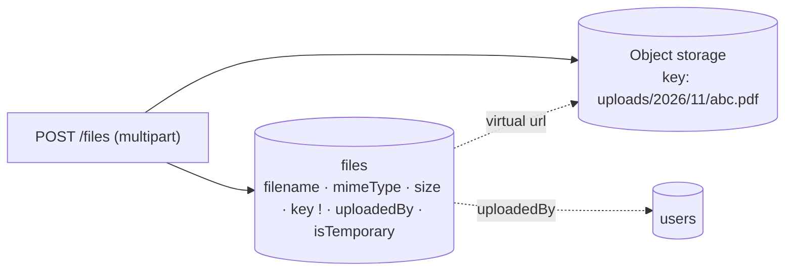
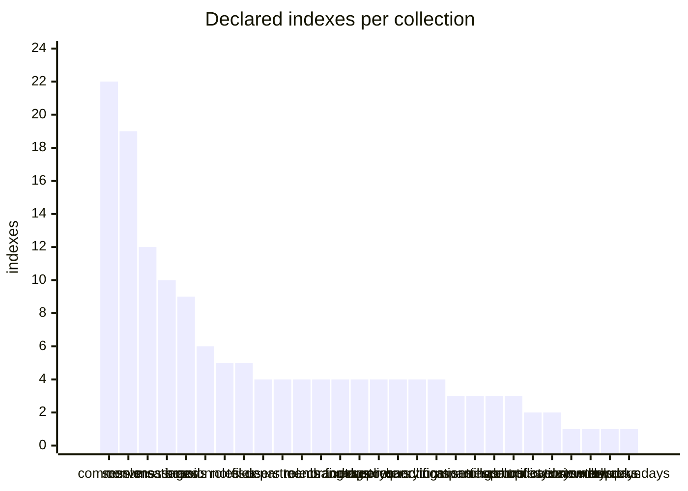
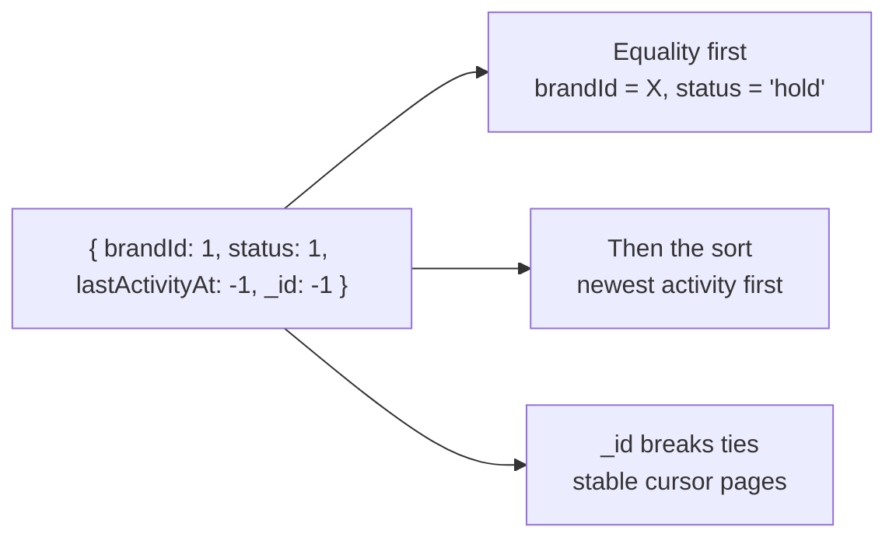

## The code

{/* schema: server/src/modules/file/schema.ts */}
```ts title="server/src/modules/file/schema.ts" lineNumbers
// src/domains/file/schema.ts
import mongoose, { Model, Schema } from 'mongoose';
import { baseSchema } from '@/libraries/db/base-schema';
import configs from '@/configs';

export interface IFile {
  _id?: string;
  filename: string;
  mimeType: string;
  size: number;
  key: string;
  uploadedBy?: string;
  metadata?: Record<string, string | number | boolean>;
  createdAt?: Date;
  updatedAt?: Date;
  isTemporary?: boolean;
}

const fileSchema = new Schema({
  filename: {
    type: String,
    required: true,
    trim: true,
    unique: false,
  },
  mimeType: {
    type: String,
    required: true,
  },
  size: {
    type: Number,
    required: true,
    min: 0,
  },
  key: {
    type: String,
    required: true,
    unique: true,
  },
  uploadedBy: {
    type: Schema.Types.ObjectId,
    ref: 'User',
  },
  metadata: {
    type: Schema.Types.Mixed,
    default: {},
  },
  isTemporary: {
    type: Schema.Types.Boolean,
    default: true,
  },
});

fileSchema.add(baseSchema);
// Indexes

fileSchema.index({ uploadedBy: 1 });
fileSchema.index({ createdAt: -1 });
// fileSchema.index({ key: 1 }, { unique: true }); // Removed: Duplicate index, already defined in schema path

fileSchema.virtual('url').get(function () {
  const baseUrl = `https://${configs.AWS_S3_BUCKET}.s3.${configs.AWS_S3_REGION}.amazonaws.com`;
  return `${baseUrl}/${this.key}`;
});

fileSchema.set('toJSON', { virtuals: true });
fileSchema.set('toObject', { virtuals: true });

const FileModel: Model<IFile> = mongoose.model<IFile>('File', fileSchema);

export default FileModel;
```
{/* /schema */}

## File

<ModelFields model="File" />

The bytes live in S3-compatible object storage, and this document is only the metadata. `url` is a virtual built from the bucket and `key`. Logos and avatars are **not** File documents: Company, Brand and User store a storage key in their own `logo` / `avatar` field.



```json title="Sample file"
{
  "filename": "invoice-1042.pdf",
  "mimeType": "application/pdf",
  "size": 48213,
  "key": "uploads/2026/11/7c1e-invoice-1042.pdf",
  "uploadedBy": "670000000000000000000003",
  "metadata": {},
  "isTemporary": true,
  "url": "https://<bucket>.s3.<region>.amazonaws.com/uploads/2026/11/7c1e-invoice-1042.pdf"
}
```

## Every index

The schemas declare **148 indexes** across 28 collections. MongoDB's automatic `_id` index comes on top of these. In production `autoIndex` is off, so every one of them is built by hand.



The busiest collections have the most indexes because the list screens filter by **one field at a time** and always sort the same way. Each filter gets its own `{brandId, field, sort, _id}` index, so the filter and the sort both come straight from the index.

### How to read an index



| Pattern | Why | Example |
| --- | --- | --- |
| Equality → sort → `_id` | Filter and order from one index, no in-memory sort | Every `{brandId, X, lastMessageAt: -1, _id: -1}` |
| Equality → range → covered fields | Count or sum without fetching documents | `queryhandlings {brandId, handledAt, queryManagerId, teamId, source, platform}` |
| Partial | Index only the documents a query cares about. The query must repeat the filter. | `messages {brandId, sentAt}` where `direction: 'incoming'` |
| Unique | Make the database enforce one-of | `{pageId, participantId}`, `{eventId, userId}` |
| Sparse unique | Unique among documents that have the field | `mid`, `commentId`, `facebook.pageId` |
| Multikey | Index each array element | `brands.teamIds`, `sessions.tags` |
| TTL | Delete documents after a time | `notifications.createdAt` (180 days) |

### The full list

<IndexTable />

## Check yourself

<details>
<summary>The comments list adds a "language" filter tomorrow. What does the schema need?</summary>

A `{brandId: 1, language: 1, lastActivityAt: -1, _id: -1}` index. Without it, a filter that rarely matches scans the whole brand.
</details>

<details>
<summary>Why does the Message partial index on `{brandId, sentAt}` need the query to say `direction: 'incoming'`?</summary>

MongoDB uses a partial index only when the query's filter guarantees the partial condition. Otherwise the index might be missing matching documents.
</details>
