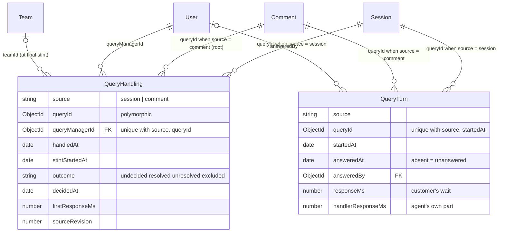
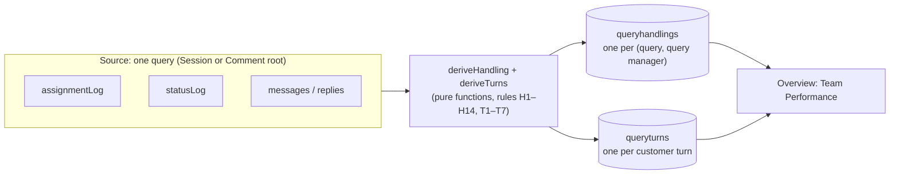
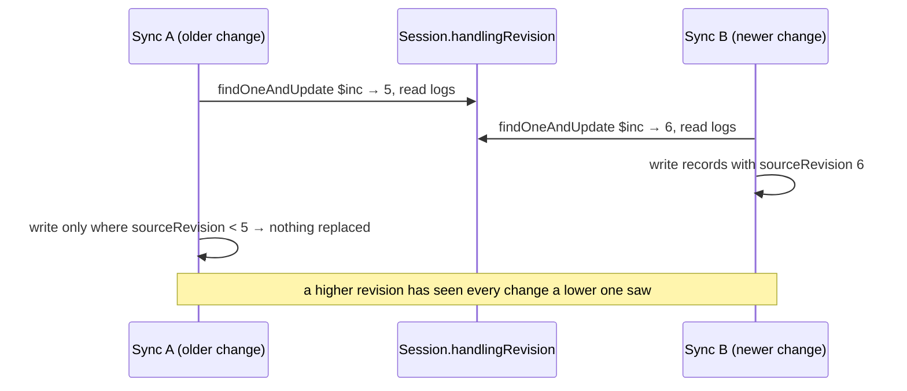
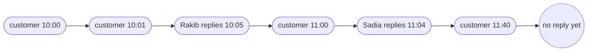

## The code

{/* schema: server/src/modules/handling/schema.ts */}
```ts title="server/src/modules/handling/schema.ts" lineNumbers
import mongoose, { Document, Model, Schema, Types } from 'mongoose';
import { CHANNEL_PLATFORMS, type ChannelPlatform } from '@/modules/conversation/schema';
import { ASSIGNMENT_CAUSES, type AssignmentCause } from '@/modules/session/schema';
import { HANDLING_OUTCOMES, type HandlingOutcome } from './derive';

// One query manager's handling of one query (a session, or a customer-written comment thread): what
// `deriveHandling` worked out from the query's assignment log, status timeline and replies
// (docs/handler-performance-rules.md). Stored so Overview's per-handler figures are indexed range
// reads, not a walk over every query's logs. Recomputed from the query on every change that can move
// it, never edited on its own.

export const HANDLING_SOURCES = ['session', 'comment'] as const;
export type HandlingSource = (typeof HANDLING_SOURCES)[number];

export interface IQueryHandling extends Document {
  // Denormalized from the query for tenant-scoped range reads.
  brandId: Types.ObjectId;
  companyId: Types.ObjectId;
  source: HandlingSource;
  // The session's id, or the comment thread's root id.
  queryId: Types.ObjectId;
  platform: ChannelPlatform;
  queryManagerId: Types.ObjectId;
  // Membership at the start of their final stint (H14); absent when it wasn't known.
  teamId?: Types.ObjectId;
  departmentId?: Types.ObjectId;
  // H2: their first reply, else the decision of a stint they wrapped up. Ranges count "handled" by it.
  handledAt: Date;
  firstReplyAt?: Date;
  // Their final stint (H1); open while `stintEndedAt` is unset.
  stintStartedAt: Date;
  stintEndedAt?: Date;
  stintEndCause?: AssignmentCause;
  // H13: the final stint's first response, business and wall clock; absent when there's no sample.
  firstResponseAt?: Date;
  firstResponseMs?: number;
  firstResponseWallMs?: number;
  outcome: HandlingOutcome;
  // H11: when the outcome was decided; set only for `resolved` / `unresolved`.
  decidedAt?: Date;
  // The query's revision the record was worked out from. A sync that read an older one can't
  // overwrite it (concurrent changes to the same query).
  sourceRevision: number;
}

const queryHandlingSchema = new Schema<IQueryHandling>(
  {
    brandId: { type: Schema.Types.ObjectId, ref: 'Brand', required: true },
    companyId: { type: Schema.Types.ObjectId, ref: 'Company', required: true },
    source: { type: String, enum: [...HANDLING_SOURCES], required: true },
    queryId: { type: Schema.Types.ObjectId, required: true },
    platform: { type: String, enum: [...CHANNEL_PLATFORMS], required: true },
    queryManagerId: { type: Schema.Types.ObjectId, ref: 'User', required: true },
    teamId: { type: Schema.Types.ObjectId, ref: 'Team' },
    departmentId: { type: Schema.Types.ObjectId, ref: 'Department' },
    handledAt: { type: Date, required: true },
    firstReplyAt: { type: Date },
    stintStartedAt: { type: Date, required: true },
    stintEndedAt: { type: Date },
    stintEndCause: { type: String, enum: [...ASSIGNMENT_CAUSES] },
    firstResponseAt: { type: Date },
    firstResponseMs: { type: Number },
    firstResponseWallMs: { type: Number },
    outcome: { type: String, enum: [...HANDLING_OUTCOMES], required: true },
    decidedAt: { type: Date },
    sourceRevision: { type: Number, required: true },
  },
  // Timestamps without `baseSchema`'s indexes on them: nothing reads this collection by them, and
  // every recompute would pay for both.
  { timestamps: true }
);

// One record per (query, query manager); the sync upserts on it and finds a query's records by it.
queryHandlingSchema.index({ source: 1, queryId: 1, queryManagerId: 1 }, { unique: true });
// Overview ranges, one per figure (hinted, see overview/indexes.ts). Each carries every field its
// figure groups or sums by, so the read is answered from the index without fetching documents.
// Handled: by `handledAt`.
queryHandlingSchema.index({
  brandId: 1,
  handledAt: 1,
  queryManagerId: 1,
  teamId: 1,
  source: 1,
  platform: 1,
});
// Resolution rate: decisions in range. Only decided records carry `decidedAt`.
queryHandlingSchema.index(
  { brandId: 1, decidedAt: 1, queryManagerId: 1, teamId: 1, outcome: 1, source: 1, platform: 1 },
  { partialFilterExpression: { decidedAt: { $exists: true } } }
);
// First response: samples in range, by the reply's time. Only records with a sample carry it.
queryHandlingSchema.index(
  {
    brandId: 1,
    firstResponseAt: 1,
    queryManagerId: 1,
    teamId: 1,
    firstResponseMs: 1,
    source: 1,
    platform: 1,
  },
  { partialFilterExpression: { firstResponseAt: { $exists: true } } }
);

export const QueryHandlingModel: Model<IQueryHandling> = mongoose.model<IQueryHandling>(
  'QueryHandling',
  queryHandlingSchema
);

/**
 * One turn of a query: a run of customer messages and the reply that ended it, credited to whoever
 * sent that reply (T1–T6), or still unanswered (T7: only `startedAt`). Stored for the same reason as
 * `QueryHandling`, and recomputed with it.
 */
export interface IQueryTurn extends Document {
  brandId: Types.ObjectId;
  companyId: Types.ObjectId;
  source: HandlingSource;
  queryId: Types.ObjectId;
  platform: ChannelPlatform;
  // The turn's first customer message; with the query, it identifies the turn.
  startedAt: Date;
  // Absent while unanswered (T7), and so are the response times.
  answeredAt?: Date;
  // The agent whose reply ended it; absent for a native page reply (the brand's figure only).
  answeredBy?: Types.ObjectId;
  // T3: the customer's wait, turn start to the reply (the brand's figure).
  responseMs?: number;
  responseWallMs?: number;
  // T5 / T6: set when a query manager holding the query answered: their part of the wait (only time
  // they held it) and their membership then. Absent for an admin, owner or native reply.
  handlerResponseMs?: number;
  handlerResponseWallMs?: number;
  teamId?: Types.ObjectId;
  departmentId?: Types.ObjectId;
  sourceRevision: number;
}

const queryTurnSchema = new Schema<IQueryTurn>(
  {
    brandId: { type: Schema.Types.ObjectId, ref: 'Brand', required: true },
    companyId: { type: Schema.Types.ObjectId, ref: 'Company', required: true },
    source: { type: String, enum: [...HANDLING_SOURCES], required: true },
    queryId: { type: Schema.Types.ObjectId, required: true },
    platform: { type: String, enum: [...CHANNEL_PLATFORMS], required: true },
    startedAt: { type: Date, required: true },
    answeredAt: { type: Date },
    answeredBy: { type: Schema.Types.ObjectId, ref: 'User' },
    responseMs: { type: Number },
    responseWallMs: { type: Number },
    handlerResponseMs: { type: Number },
    handlerResponseWallMs: { type: Number },
    teamId: { type: Schema.Types.ObjectId, ref: 'Team' },
    departmentId: { type: Schema.Types.ObjectId, ref: 'Department' },
    sourceRevision: { type: Number, required: true },
  },
  // As `QueryHandling`: timestamps, not indexed.
  { timestamps: true }
);

// One record per turn; the sync upserts on it and finds a query's turns by its prefix.
queryTurnSchema.index({ source: 1, queryId: 1, startedAt: 1 }, { unique: true });
// Overview: turns by when they started, answered or not (T7, hinted). Covers the unanswered count.
queryTurnSchema.index({ brandId: 1, startedAt: 1, platform: 1, answeredAt: 1 });
// Overview: answered turns by the day they were answered, with their wait (TURNS_BY_ANSWERED,
// hinted, covering): the Team view's turn response time and turns answered.
queryTurnSchema.index(
  { brandId: 1, answeredAt: 1, source: 1, platform: 1, responseMs: 1, responseWallMs: 1 },
  { partialFilterExpression: { answeredAt: { $exists: true } } }
);

// Overview: turns a query manager answered while holding the query, by answer day, with their own
// wait (TURNS_BY_HANDLER, hinted, covering): the Team view's per-handler turn figures.
queryTurnSchema.index(
  {
    brandId: 1,
    answeredAt: 1,
    answeredBy: 1,
    teamId: 1,
    source: 1,
    platform: 1,
    handlerResponseWallMs: 1,
  },
  { partialFilterExpression: { handlerResponseWallMs: { $gte: 0 } } }
);

export const QueryTurnModel: Model<IQueryTurn> = mongoose.model<IQueryTurn>(
  'QueryTurn',
  queryTurnSchema
);
```
{/* /schema */}

`HANDLING_OUTCOMES` comes from `handling/derive.ts`: `undecided | resolved | unresolved | excluded`.

## Map

<SchemaGraph domains={['handling']} height={480} />

## ER diagram



## Derived, not edited



These records are **never edited on their own**. After every change to a query (an assignment, a message, a status change, a failed send), the sync re-derives the query's records and rewrites them. If the sync fails, a `handling-sync` job retries it. They can always be rebuilt with `pnpm backfill:query-handling --apply`.

## QueryHandling

<ModelFields model="QueryHandling" />

### Reading one record: stints

```mermaid
gantt
    title One session, two query managers
    dateFormat HH:mm
    axisFormat %H:%M
    section Rakib
    holds the query (stint)      :r1, 10:00, 30m
    section Sadia
    holds the query (final stint) :s1, 10:30, 60m
    section Events
    customer writes              :milestone, 10:00, 0m
    Rakib replies                :milestone, 10:05, 0m
    forwarded to Sadia           :milestone, 10:30, 0m
    customer writes again        :milestone, 11:00, 0m
    Sadia replies (first response 4 min) :milestone, 11:04, 0m
    Sadia resolves               :milestone, 11:30, 0m
```



This produces two QueryHandling documents:

```json title="Derived records for the timeline above"
[
  {
    "source": "session", "queryId": "670000000000000000000402", "queryManagerId": "…Rakib",
    "handledAt": "10:05 (first reply)", "stintStartedAt": "10:00", "stintEndedAt": "10:30",
    "stintEndCause": "forwarded", "outcome": "unresolved", "decidedAt": "10:30"
  },
  {
    "source": "session", "queryId": "670000000000000000000402", "queryManagerId": "…Sadia",
    "teamId": "…Day shift", "handledAt": "11:04", "stintStartedAt": "10:30",
    "firstResponseAt": "11:04", "firstResponseMs": 240000,
    "outcome": "resolved", "decidedAt": "11:30"
  }
]
```

<small>Times are shortened for reading; real documents store full dates. Rakib's record: forwarding after replying counts as `unresolved` for him (rule H6).</small>

| Field | Rule in short |
| --- | --- |
| `handledAt` (H2) | Their first reply in any stint, else the decision of their final stint |
| Stint (H1) | Their held periods with no other person holding the query in between |
| `outcome` (H4–H10) | Decided by the final stint: resolved during it → `resolved`; wrapped up unresolved or forwarded after a reply → `unresolved`; routed away by a manager → `excluded`; still open → `undecided` |
| `firstResponse*` (H13) | Final stint's first reply to a waiting customer, counting only time they held the query |
| `teamId` / `departmentId` (H14) | Stamped from their latest assignment entry in the final stint |

### Concurrency guard



## QueryTurn

<ModelFields model="QueryTurn" />



| Turn | `startedAt` | `answeredAt` | `answeredBy` | `responseMs` (customer's wait) |
| --- | --- | --- | --- | --- |
| 1 | 10:00 | 10:05 | Rakib | 5 min |
| 2 | 11:00 | 11:04 | Sadia | 4 min |
| 3 | 11:40 | absent | absent | absent: unanswered (T7) |

`responseMs` is the **brand's** figure: the customer's full wait. `handlerResponseMs` is set only when a query manager holding the query answered, and counts only time they held it. An open turn on a resolved query is dropped.

## Indexes built for one read each

Every Overview read here has its own **covering** index: it contains every field the read groups or sums by, so MongoDB answers from the index without fetching a document. Partial filters keep each index to the records that matter.

<IndexTable domains={['handling']} />

## Check yourself

<details>
<summary>Why is `queryId` not a `ref`?</summary>

It is a Session id or a root Comment id depending on `source`, so it is polymorphic.
</details>

<details>
<summary>Why don't these models use `baseSchema`?</summary>

`baseSchema` indexes `createdAt` and `updatedAt`, and every recompute would pay for both. Nothing reads these records by time, so they use plain `{ timestamps: true }`.
</details>

<details>
<summary>Sadia moves from Day shift to Night shift tomorrow. Which team gets credit for today's resolved query?</summary>

Day shift. `teamId` is stamped from the assignment-log entry at the time (H14), not read from her current user record.
</details>
