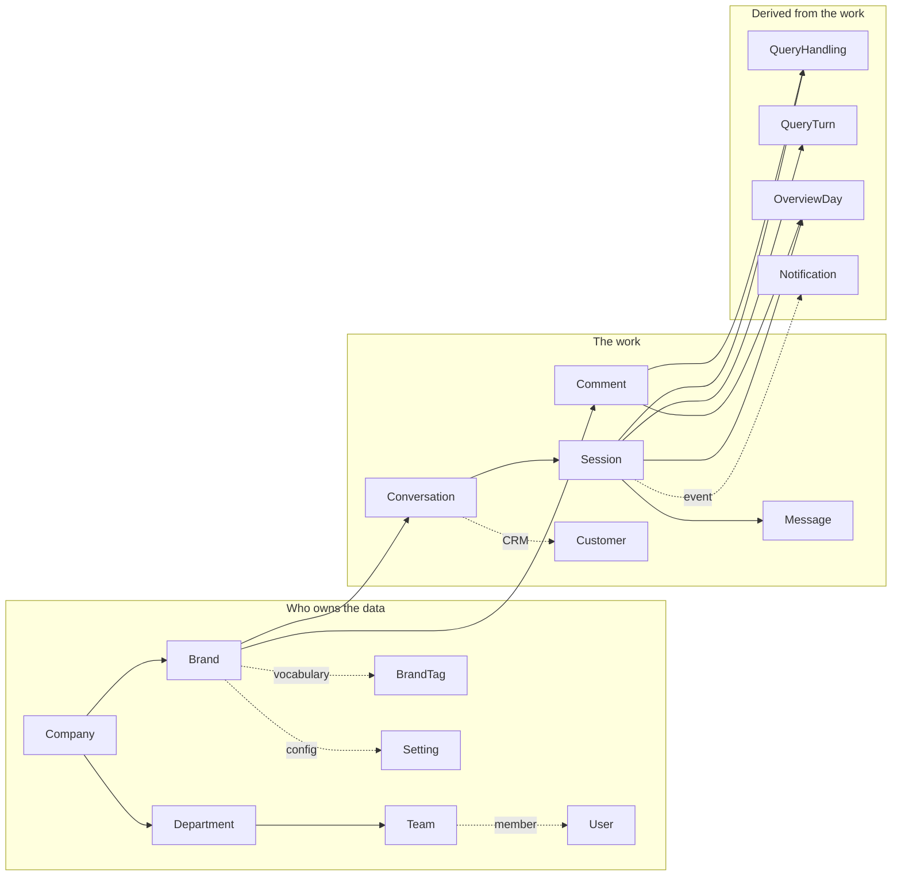

<Callout title="Source snapshot">
Listenyzen revision `ffd5b3d`, 9 November 2026. Every chapter opens with the real `schema.ts` code, copied verbatim by `scripts/sync-listenyzen-schemas.mjs`. Field tables and diagrams are drawn from the same files. Sample documents are illustrative, not live data.
</Callout>

## The whole system in one sentence

A **company** runs **brands**. Each brand connects Facebook, Instagram and WhatsApp channels. Customers write to those channels as **DM conversations** or **public comments**. Every piece of incoming work becomes a **query**: a **session** for DMs, a **root comment** for comments. **Staff** in departments and teams work those queries under the brand's **settings** (SLA targets, business hours). Everything else is **derived**: handler performance records, daily Overview figures, and notifications.

The arrows above are the **mental model**: "is part of", "produces". The interactive map below shows the **actual stored ids**: an arrow goes from the model that **holds the id** to the model it points at.

## Interactive map

<SchemaGraph height={680} />

Tenant-scope copies are hidden at first. Nearly every model carries a `companyId`, and drawing all of them buries the real structure. Turn them on to see how tenant scoping works.

## All 26 models

<ModelCards />

## Relationship matrix

Each row is a model that **holds** an id. Each column is a model being **pointed at**. A cell shows the field name. A hatched cell is a polymorphic id, whose target depends on another field such as `assignee.kind` or `source`. Tenant-scope copies are left out here as well.

<RelationMatrix />

## Six ideas that explain most of the schema

1. **Reference, don't embed, when it grows or is shared.** Messages are separate documents pointing at a conversation. Tags are a separate collection, so a rename is one write. History logs are embedded, but hidden with `select: false`. See [conventions](/docs/listenyzen/conventions).
2. **Denormalize for the list screens.** Conversation copies its latest session's status, sentiment, assignee and tags, so the inbox never joins. Copies are marked **copy** in every field table.
3. **Tenant scoping is a copied `companyId`** (and often `brandId`) on every record, so each query can filter without a join.
4. **A query is either a Session or a root Comment.** Both share the same status, assignment, wrap-up and SLA sub-schemas. Derived records say which one they mean with `source` plus `queryId`.
5. **Settings are append-only versions.** A session remembers which versions were in force when its clock started.
6. **Derived collections can always be rebuilt** from the source records: QueryHandling and QueryTurn, the rollups, and notifications (which expire anyway).

## Reading order

<Steps>
<Step>
**[Conventions](/docs/listenyzen/conventions)**: `baseSchema`, ObjectId references, embedded subdocuments, `select: false`, discriminators. You need these words for every other chapter.
</Step>
<Step>
**[Tenancy](/docs/listenyzen/tenancy)** → **[Brand](/docs/listenyzen/brand)** → **[Settings](/docs/listenyzen/settings)**: who owns what, and who may see which brand.
</Step>
<Step>
**[Messaging](/docs/listenyzen/messaging)** → **[Comments](/docs/listenyzen/comments)**: the work itself, which makes up most of the data.
</Step>
<Step>
**[Handling](/docs/listenyzen/handling)** → **[Rollups](/docs/listenyzen/rollups)** → **[Alerts](/docs/listenyzen/alerts)**: data computed from the work.
</Step>
<Step>
**[Files and every index](/docs/listenyzen/files-and-indexes)**: the last model and a complete index reference.
</Step>
</Steps>

Each chapter follows the same order: **the code** → **map** → **ER diagram** → **one section per model** (field table, sample document) → **lifecycles and write paths** → **check yourself**.
