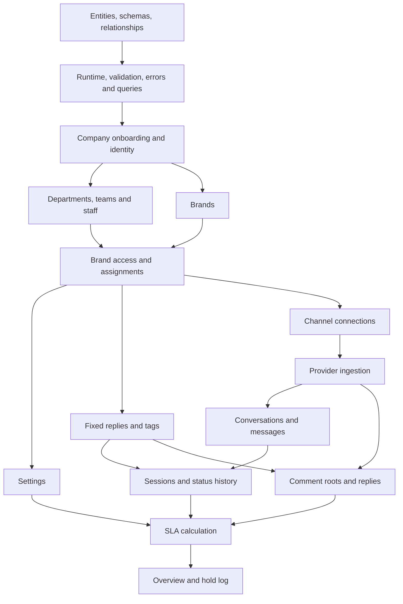

Studying the implementation? Follow [Read the whole codebase in order](/docs/listenyzen/code-reading-order) for exact files, module order and checkpoints.

## How to read this documentation

Begin with [every database entity, schema and relationship](/docs/listenyzen/data-model). Then follow the stages below. “No dependency” means no earlier **business feature** is required; database/runtime primitives still exist. Authentication and tenant scope are cross-cutting prerequisites, not optional steps.

For each stage, read the requirement, prerequisites and code path before trying the input/output example. The examples are source-derived illustrations using fictional IDs, not recorded integration-test results. Entity outputs omit nonessential fields. The [complete API reference](/docs/listenyzen/api-reference) provides the exact handler and validation declarations for every operation, plus request/response examples and access rules.



Settings and reusable replies can be learned independently once brand access is understood. Private inbox and public comments are parallel domain paths. Standalone files are storage support; they do not require an existing support episode.

## 0. Foundation: schemas and shared mechanics

**Prerequisites:** No business record prerequisite. Learn MongoDB identities, references, indexes, response envelopes and API/worker health first.

**Business rule and implementation:** A healthy request process is not evidence that queued work is being consumed. /health checks process dependencies; /health/queue reports stalled or flooded work.

**Read the code:** `server/src/routes.ts; server/src/libraries/db/index.ts; server/src/libraries/utils/sendResponse.ts`.

### Example input and output

`GET /health`

```sh
curl -i "${BASE_URL}/health"
```

```json title="Illustrative response — HTTP 200"
{
  "status": "ok",
  "uptime": 120,
  "components": {
    "mongo": "connected",
    "redis": "connected",
    "realtime": "up"
  }
}
```

### Endpoints in this stage

| Method | Endpoint |
| --- | --- |
| GET | `/health` |
| GET | `/health/queue` |

Use the endpoint explorer’s **Business logic** tab for prerequisites and implementation entry points, then **Validation** and **Handler code** to follow the individual operation.

## 1. Company onboarding and authentication

**Prerequisites:** Database foundation. Registration bootstraps Company and User together; login needs an existing user. Company administration needs an authenticated permitted role.

**Business rule and implementation:** A company is the tenant boundary. Registration creates the company and owner, links ownerId and uses compensating cleanup on failure. Password verification precedes issuing access/refresh cookies. Personal assignment controls query-manager mutations; suspension is checked separately from role permission.

**Read the code:** `server/src/auth/api.ts → auth/service.ts; auth/company-access.ts; modules/company/service.ts`.

### Example input and output

`POST /api/v1/auth/register-company`

```sh
curl -i -X POST "${BASE_URL}/api/v1/auth/register-company" \
  -b cookies.txt -c cookies.txt \
  -H "Content-Type: application/json" \
  --data '{"companyName":"Example Company","name":"Amina Rahman","email":"amina@example.com","password":"ExamplePassword1!"}'
```

```json title="Illustrative response — HTTP 200"
{
  "success": true,
  "message": "Company registered successfully",
  "data": {
    "user": {
      "_id": "670000000000000000000002",
      "name": "Amina Rahman",
      "email": "amina@example.com",
      "role": "company_owner",
      "companyId": "670000000000000000000001"
    }
  }
}
```

### Endpoints in this stage

| Method | Endpoint |
| --- | --- |
| POST | `/api/v1/auth/register-company` |
| POST | `/api/v1/auth/login` |
| POST | `/api/v1/auth/logout` |
| POST | `/api/v1/auth/refresh` |
| GET | `/api/v1/companies/me` |
| GET | `/api/v1/companies` |
| POST | `/api/v1/companies` |
| GET | `/api/v1/companies/:id` |
| PATCH | `/api/v1/companies/:id` |
| DELETE | `/api/v1/companies/:id` |

Use the endpoint explorer’s **Business logic** tab for prerequisites and implementation entry points, then **Validation** and **Handler code** to follow the individual operation.

## 2. Departments, teams and staff

Follow Company → Department → Team → Query manager. `POST /teams` creates the organizational group; `POST /query-managers` now requires teamId and derives departmentId. Read the [teams and assignment walkthrough](/docs/listenyzen/code-assignment) for complete input/output examples and the claim → reply sequence.


**Prerequisites:** Company and authenticated role. A department can exist before agents; create a team under that department before creating query managers. Team membership derives their department.

**Business rule and implementation:** Query managers are Users filtered by role, not another collection. Tenant filters limit reads and writes. Password creation runs the save hook; direct password updates explicitly hash. Department membership later grants one of the brand-access and assignment paths.

**Read the code:** `server/src/modules/user/service.ts; modules/department/service.ts; modules/query-manager/service.ts; auth/tenant.ts`.

### Example input and output

`POST /api/v1/departments`

```sh
curl -i -X POST "${BASE_URL}/api/v1/departments" \
  -b cookies.txt -c cookies.txt \
  -H "Content-Type: application/json" \
  --data '{"name":"Customer Care"}'
```

```json title="Illustrative response — HTTP 200"
{
  "success": true,
  "message": "Department created successfully",
  "data": {
    "_id": "670000000000000000000003",
    "name": "Customer Care",
    "companyId": "670000000000000000000001",
    "status": "active"
  }
}
```

### Endpoints in this stage

| Method | Endpoint |
| --- | --- |
| GET | `/api/v1/departments` |
| POST | `/api/v1/departments` |
| GET | `/api/v1/departments/:id` |
| PATCH | `/api/v1/departments/:id` |
| DELETE | `/api/v1/departments/:id` |
| GET | `/api/v1/query-managers` |
| POST | `/api/v1/query-managers` |
| GET | `/api/v1/query-managers/:id` |
| PATCH | `/api/v1/query-managers/:id` |
| DELETE | `/api/v1/query-managers/:id` |
| GET | `/api/v1/users` |
| POST | `/api/v1/users` |
| GET | `/api/v1/users/me` |
| GET | `/api/v1/users/:id` |
| PATCH | `/api/v1/users/me` |
| PATCH | `/api/v1/users/me/change-password` |
| PATCH | `/api/v1/users/:id` |
| DELETE | `/api/v1/users/:id` |
| GET | `/api/v1/teams` |
| POST | `/api/v1/teams` |
| GET | `/api/v1/teams/:id` |
| PATCH | `/api/v1/teams/:id` |

Use the endpoint explorer’s **Business logic** tab for prerequisites and implementation entry points, then **Validation** and **Handler code** to follow the individual operation.

## 3. Brands, access assignments and provider connections

**Prerequisites:** Company and identity. Department/agent assignment additionally needs those records; social connection needs provider credentials and the selected brand.

**Business rule and implementation:** Brand departmentIds, teamIds and queryManagerIds grant alternative visibility paths inside the tenant scope. Provider identifiers and secrets live in channel subdocuments. Connections, provider templates and tags have different prerequisites: local tags need only a visible brand, while provider calls need a connected operational channel. Archived tags preserve existing references.

**Read the code:** `server/src/modules/brand/service.ts; brand/assignees.ts; brand/channel-access.ts; brand/tags/service.ts; auth/tenant.ts`.

### Example input and output

`POST /api/v1/brands/:id/tags`

```sh
curl -i -X POST "${BASE_URL}/api/v1/brands/670000000000000000000004/tags" \
  -b cookies.txt -c cookies.txt \
  -H "Content-Type: application/json" \
  --data '{"name":"Support"}'
```

```json title="Illustrative response — HTTP 200"
{
  "success": true,
  "message": "Tag added successfully",
  "data": {
    "created": {
      "_id": "670000000000000000000009",
      "name": "Support",
      "id": "670000000000000000000009",
      "archived": false
    },
    "tags": [
      {
        "_id": "670000000000000000000009",
        "name": "Support",
        "id": "670000000000000000000009",
        "archived": false
      }
    ]
  }
}
```

### Endpoints in this stage

| Method | Endpoint |
| --- | --- |
| GET | `/api/v1/brands` |
| POST | `/api/v1/brands` |
| GET | `/api/v1/brands/:id` |
| GET | `/api/v1/brands/:id/departments` |
| PUT | `/api/v1/brands/:id/departments` |
| GET | `/api/v1/brands/:id/query-managers` |
| PUT | `/api/v1/brands/:id/query-managers` |
| PATCH | `/api/v1/brands/:id` |
| DELETE | `/api/v1/brands/:id` |
| POST | `/api/v1/brands/:id/facebook/connect` |
| DELETE | `/api/v1/brands/:id/facebook` |
| POST | `/api/v1/brands/:id/instagram/connect` |
| DELETE | `/api/v1/brands/:id/instagram` |
| GET | `/api/v1/brands/:id/instagram/login-url` |
| GET | `/api/v1/brands/instagram/oauth/callback` |
| GET | `/api/v1/brands/:id/tags` |
| POST | `/api/v1/brands/:id/tags` |
| PATCH | `/api/v1/brands/:id/tags/:tagId` |
| PATCH | `/api/v1/brands/:id/tags/:tagId/archive` |
| GET | `/api/v1/brands/:id/whatsapp/templates` |
| POST | `/api/v1/brands/:id/whatsapp/templates` |
| POST | `/api/v1/brands/:id/whatsapp/templates/:templateId` |
| DELETE | `/api/v1/brands/:id/whatsapp/templates/:templateId` |
| POST | `/api/v1/brands/:id/whatsapp/connect` |
| POST | `/api/v1/brands/:id/whatsapp/connect-manual` |
| POST | `/api/v1/brands/:id/whatsapp/register` |
| DELETE | `/api/v1/brands/:id/whatsapp` |
| GET | `/api/v1/brands/:id/teams` |
| PUT | `/api/v1/brands/:id/teams` |

Use the endpoint explorer’s **Business logic** tab for prerequisites and implementation entry points, then **Validation** and **Handler code** to follow the individual operation.

## 4. Independent brand configuration and reusable replies

**Prerequisites:** Visible brand and permitted role. Settings and fixed replies do not require conversations, sessions or comments, and can be learned independently of each other.

**Business rule and implementation:** FixedReply stores reusable local text; it is not a provider-approved WhatsApp template. Settings append immutable versions. baseVersion prevents silent overwrites, and the unique scope/type/version index resolves concurrent saves. Virtual version zero provides defaults without inserting a row. SLA later uses the settings in force at clock start.

**Read the code:** `server/src/modules/fixed-reply/service.ts; modules/settings/service.ts; modules/settings/definitions.ts`.

### Example input and output

`PUT /api/v1/brands/:brandId/settings/:type`

```sh
curl -i -X PUT "${BASE_URL}/api/v1/brands/670000000000000000000004/settings/sla" \
  -b cookies.txt -c cookies.txt \
  -H "Content-Type: application/json" \
  --data '{"baseVersion":0,"value":{"tier":"Standard","overrides":{"firstResponse":null,"resolution":null}}}'
```

```json title="Illustrative response — HTTP 200"
{
  "success": true,
  "message": "Saved as version 1",
  "data": {
    "type": "sla",
    "version": 1,
    "value": {
      "tier": "Standard",
      "overrides": {
        "firstResponse": null,
        "resolution": null
      }
    },
    "changedBy": {
      "id": "670000000000000000000002",
      "name": "Amina Rahman"
    },
    "savedAt": "2026-10-15T09:00:00.000Z"
  }
}
```

### Endpoints in this stage

| Method | Endpoint |
| --- | --- |
| GET | `/api/v1/brands/:brandId/fixed-replies` |
| POST | `/api/v1/brands/:brandId/fixed-replies` |
| PATCH | `/api/v1/brands/:brandId/fixed-replies/:id` |
| DELETE | `/api/v1/brands/:brandId/fixed-replies/:id` |
| GET | `/api/v1/brands/:brandId/settings/:type` |
| PUT | `/api/v1/brands/:brandId/settings/:type` |
| GET | `/api/v1/brands/:brandId/settings/:type/history` |

Use the endpoint explorer’s **Business logic** tab for prerequisites and implementation entry points, then **Validation** and **Handler code** to follow the individual operation.

## 5. Storage support

**Prerequisites:** Authentication and configured object storage; no conversation is required for the standalone file routes.

**Business rule and implementation:** File metadata is independent of Message attachment metadata. Uploads involve external storage, and File has no company field; inspect the actual route access checks rather than inventing a tenant foreign key. Conversation attachments additionally require a visible actionable conversation and provider send.

**Read the code:** `server/src/modules/file/api.ts; modules/file/service.ts; modules/conversation/media.ts`.

### Example input and output

`GET /api/v1/files`

```sh
curl -i -X GET "${BASE_URL}/api/v1/files?limit=20" \
  -b cookies.txt -c cookies.txt
```

```json title="Illustrative response — HTTP 200"
{
  "success": true,
  "message": "success",
  "data": [
    {
      "_id": "67000000000000000000000a",
      "filename": "photo.png",
      "key": "generated-photo.png",
      "size": 2048,
      "mimeType": "image/png"
    }
  ],
  "pagination": {
    "page": 1,
    "limit": 20,
    "totalCount": 1,
    "totalPages": 1,
    "hasNext": false,
    "hasPrev": false,
    "startIndex": 1,
    "endIndex": 1
  }
}
```

### Endpoints in this stage

| Method | Endpoint |
| --- | --- |
| GET | `/api/v1/files` |
| POST | `/api/v1/files/upload-image-single` |
| POST | `/api/v1/files/upload-image-multiple` |

Use the endpoint explorer’s **Business logic** tab for prerequisites and implementation entry points, then **Validation** and **Handler code** to follow the individual operation.

## 6. Provider ingestion

**Prerequisites:** Operational connected brand, signature/verification configuration, Redis queue and worker. Browser login is not the provider authentication mechanism.

**Business rule and implementation:** Verification and signature checks precede queue work. The worker translates provider identities into domain input. Incoming message persistence updates conversation preview, chooses a session, inserts Message, applies status rules and recomputes SLA before emitting. Sparse unique provider IDs prevent duplicate records, but earlier cross-document writes are not one transaction.

**Read the code:** `server/src/modules/webhook/index.ts; webhook/queue.ts; webhook/facebook.ts; webhook/whatsapp.ts; modules/conversation/service.ts`.

### Example input and output

`POST /api/v1/webhooks/whatsapp`

```sh
curl -i -X POST "${BASE_URL}/api/v1/webhooks/whatsapp" \
  -H "X-Hub-Signature-256: sha256=<VALID_HMAC>" \
  -H "Content-Type: application/json" \
  --data '{"object":"whatsapp_business_account","entry":[]}'
```

```json title="Illustrative response — HTTP 200"
"OK"
```

### Endpoints in this stage

| Method | Endpoint |
| --- | --- |
| GET | `/api/v1/webhooks/facebook` |
| POST | `/api/v1/webhooks/facebook` |
| POST | `/api/v1/webhooks/facebook/relay` |
| GET | `/api/v1/webhooks/whatsapp` |
| POST | `/api/v1/webhooks/whatsapp` |

Use the endpoint explorer’s **Business logic** tab for prerequisites and implementation entry points, then **Validation** and **Handler code** to follow the individual operation.

## 7. Private inbox and customer context

**Prerequisites:** Visible brand and stored conversation; provider sends additionally need channel access, action policy and provider configuration. Session/message knowledge is needed to interpret summaries.

**Business rule and implementation:** Conversation is the long-lived thread, Message is the event and Session is the support episode. List routes use stable compound cursors. Customer lookup/editing can resolve the external identity and lazily link a Customer. A send checks access before provider work and local storage. Attachments can partially succeed; template re-engagement can start a new episode after resolved work.

**Read the code:** `server/src/modules/conversation/api.ts; conversation/access.ts; conversation/service.ts; conversation/send-channel.ts; conversation/whatsapp-templates.ts`.

### Example input and output

`POST /api/v1/conversations/:id/messages`

```sh
curl -i -X POST "${BASE_URL}/api/v1/conversations/670000000000000000000005/messages" \
  -b cookies.txt -c cookies.txt \
  -H "Content-Type: application/json" \
  --data '{"text":"How can we help?"}'
```

```json title="Illustrative response — HTTP 201"
{
  "success": true,
  "message": "Reply sent",
  "data": {
    "_id": "670000000000000000000007",
    "conversationId": "670000000000000000000005",
    "sessionId": "670000000000000000000006",
    "mid": "provider-message-id",
    "direction": "outgoing",
    "text": "How can we help?",
    "sentAt": "2026-10-15T09:00:00.000Z"
  }
}
```

### Endpoints in this stage

| Method | Endpoint |
| --- | --- |
| GET | `/api/v1/conversations` |
| GET | `/api/v1/conversations/:id/messages` |
| GET | `/api/v1/conversations/:id/sessions` |
| GET | `/api/v1/conversations/:id/stats` |
| GET | `/api/v1/conversations/:id/customer` |
| PATCH | `/api/v1/conversations/:id/customer` |
| POST | `/api/v1/conversations/:id/messages` |
| POST | `/api/v1/conversations/:id/attachments` |
| POST | `/api/v1/conversations/:id/messages/:messageId/reaction` |
| DELETE | `/api/v1/conversations/:id/messages/:messageId/reaction` |
| POST | `/api/v1/conversations/:id/messages/:messageId/media` |
| GET | `/api/v1/conversations/:id/whatsapp/templates` |
| POST | `/api/v1/conversations/:id/whatsapp/templates` |
| POST | `/api/v1/conversations/:id/claim` |
| PATCH | `/api/v1/conversations/:id/assignment` |

Use the endpoint explorer’s **Business logic** tab for prerequisites and implementation entry points, then **Validation** and **Handler code** to follow the individual operation.

## 8. Session handling, classification and history

**Prerequisites:** Conversation and session. Tags need the brand vocabulary; assignees need eligible staff/departments. Status reporting requires manager access; SLA depends on settings.

**Business rule and implementation:** Wrap-up records the outcome; notes stay internal. hold/unresolved/resolved stop resolution, and pending resumes it. A customer message reopens unresolved work; a qualifying agent reply ends hold. A same-status save does not append status history. Status changes mirror the latest session onto Conversation. Session merge is removed; mergeWithPrevious is rejected. Same-status classification edits can still append wrap-up history.

**Read the code:** `server/src/modules/session/api.ts; session/service.ts; session/status-log.ts; session/status-history.ts; session/sla.ts`.

### Example input and output

`PATCH /api/v1/sessions/:id/status`

```sh
curl -i -X PATCH "${BASE_URL}/api/v1/sessions/670000000000000000000006/status" \
  -b cookies.txt -c cookies.txt \
  -H "Content-Type: application/json" \
  --data '{"status":"hold","reason":"Waiting for warehouse confirmation"}'
```

```json title="Illustrative response — HTTP 200"
{
  "success": true,
  "message": "Session status updated",
  "data": {
    "_id": "670000000000000000000006",
    "conversationId": "670000000000000000000005",
    "brandId": "670000000000000000000004",
    "companyId": "670000000000000000000001",
    "platform": "facebook",
    "status": "hold",
    "sentiment": "NEUTRAL",
    "sequence": 1,
    "startedAt": "2026-10-15T09:00:00.000Z",
    "lastActivityAt": "2026-10-15T09:00:00.000Z",
    "tags": [],
    "messageCount": 1
  }
}
```

### Endpoints in this stage

| Method | Endpoint |
| --- | --- |
| GET | `/api/v1/sessions` |
| GET | `/api/v1/sessions/assignees` |
| GET | `/api/v1/sessions/:id` |
| PATCH | `/api/v1/sessions/:id/status` |
| PATCH | `/api/v1/sessions/:id/sentiment` |
| PATCH | `/api/v1/sessions/:id/wrap-up` |
| PATCH | `/api/v1/sessions/:id/assignment` |
| PUT | `/api/v1/sessions/:id/tags` |
| GET | `/api/v1/sessions/:id/notes` |
| POST | `/api/v1/sessions/:id/notes` |
| GET | `/api/v1/sessions/:id/status-log` |

Use the endpoint explorer’s **Business logic** tab for prerequisites and implementation entry points, then **Validation** and **Handler code** to follow the individual operation.

## 9. Public comment threads

**Prerequisites:** Brand/channel and ingested comment tree. Uses the shared access, tag, status and SLA concepts; no Conversation or Session document is required.

**Business rule and implementation:** Provider parentCommentId joins replies to a root within brand/post scope. The root owns thread status and SLA. Page replies end hold, and root-author replies reopen unresolved roots. Resolved roots do not automatically reopen. Replies, hiding, liking and deletion can call the provider; local wrap-up and classification update domain state. Reading history using a reply ID resolves the root first.

**Read the code:** `server/src/modules/comment/api.ts; comment/service.ts; comment/sla.ts; modules/session/status-log.ts`.

### Example input and output

`PATCH /api/v1/comments/:id/wrap-up`

```sh
curl -i -X PATCH "${BASE_URL}/api/v1/comments/670000000000000000000008/wrap-up" \
  -b cookies.txt -c cookies.txt \
  -H "Content-Type: application/json" \
  --data '{"status":"resolved","sentiment":"POSITIVE","resolutionSummary":"Issue resolved.","tagIds":[]}'
```

```json title="Illustrative response — HTTP 200"
{
  "success": true,
  "message": "Comment wrapped up",
  "data": {
    "_id": "670000000000000000000008",
    "brandId": "670000000000000000000004",
    "companyId": "670000000000000000000001",
    "platform": "facebook",
    "commentId": "page_comment_id",
    "platformPostId": "page_post_id",
    "text": "Thank you for contacting us.",
    "status": "resolved",
    "sentiment": "NEUTRAL",
    "tags": []
  }
}
```

### Endpoints in this stage

| Method | Endpoint |
| --- | --- |
| GET | `/api/v1/comments` |
| GET | `/api/v1/comments/posts` |
| GET | `/api/v1/comments/:id` |
| POST | `/api/v1/comments/:id/replies` |
| PATCH | `/api/v1/comments/:id` |
| PUT | `/api/v1/comments/:id/tags` |
| PATCH | `/api/v1/comments/:id/assignment` |
| PATCH | `/api/v1/comments/:id/wrap-up` |
| POST | `/api/v1/comments/:id/hide` |
| POST | `/api/v1/comments/:id/like` |
| DELETE | `/api/v1/comments/:id` |
| GET | `/api/v1/comments/:id/status-log` |
| POST | `/api/v1/comments/:id/claim` |

Use the endpoint explorer’s **Business logic** tab for prerequisites and implementation entry points, then **Validation** and **Handler code** to follow the individual operation.

## 10. Supervisor reporting

**Prerequisites:** Visible brand, manager role, stored sessions/comment roots, status history and historical settings. Reports derive from earlier workflows; they do not create support queries.

**Business rule and implementation:** Stats count pending sessions now. SLA reporting includes pending/hold/unresolved as open, but stopped resolution clocks are not at risk and retain earlier breaches. Engagement backlog excludes holds. Compliance counts decided targets. Hold rows are computed on read, not stored separately; an overlapping-date filter still returns full-hold durations, capped at 1,000 newest rows.

**Read the code:** `server/src/modules/overview/api.ts; overview/service.ts; overview/holds.ts; modules/settings/service.ts`.

### Example input and output

`GET /api/v1/brands/:brandId/overview/holds`

```sh
curl -i "${BASE_URL}/api/v1/brands/670000000000000000000004/overview/holds?from=2026-10-17&to=2026-10-17&source=sessions" \
  -b cookies.txt -c cookies.txt
```

```json title="Illustrative response — HTTP 200"
{
  "success": true,
  "message": "success",
  "data": [
    {
      "source": "session",
      "id": "670000000000000000000006",
      "conversationId": "670000000000000000000005",
      "heldBy": {
        "id": "670000000000000000000002",
        "name": "Amina Rahman"
      },
      "reason": "Waiting for warehouse confirmation",
      "startedAt": "2026-10-17T04:10:00.000Z",
      "endedAt": "2026-10-17T04:40:00.000Z",
      "endedBy": {
        "cause": "reply",
        "by": {
          "id": "670000000000000000000002",
          "name": "Amina Rahman"
        }
      },
      "durationMs": 1800000,
      "businessMs": 1800000
    }
  ]
}
```

### Endpoints in this stage

| Method | Endpoint |
| --- | --- |
| GET | `/api/v1/brands/:brandId/overview/stats` |
| GET | `/api/v1/brands/:brandId/overview/sla` |
| GET | `/api/v1/brands/:brandId/overview/engagement` |
| GET | `/api/v1/brands/:brandId/overview/inbound-trend` |
| GET | `/api/v1/brands/:brandId/overview/sla-compliance` |
| GET | `/api/v1/brands/:brandId/overview/holds` |

Use the endpoint explorer’s **Business logic** tab for prerequisites and implementation entry points, then **Validation** and **Handler code** to follow the individual operation.

## What changed in this revision

The previous update introduced teams, required query-manager membership, team brand grants and pools, atomic claims, personal-only modification permissions and guarded conversation mirroring. It retains the previously documented SLA and status-history behavior. The client adds hold-reason fields, manager History tabs and the Admin hold-log page. The detailed transition examples are in [hold, reopen and history](/docs/listenyzen/code-status).

Team pools, manager routing and claims are now implemented. Hold-row deep links remain deferred. Existing production index/backfill state is not verified by this source review. See [development and repair](/docs/listenyzen/development) before operating on stored data.

## Latest additions: continue after ownership and status

The current snapshot adds forwarding, assignment/classification history, live session SLA details and a dedicated Teams page. Session merging is removed. Study these in this order:

| Prerequisite | Requirement and routes | Walkthrough |
| --- | --- | --- |
| Organization and brand grants | Enriched GET /teams and GET /teams/:id/brands explain members and team/department brand access. | [Teams and ownership](/docs/listenyzen/code-assignment) |
| Personal ownership and eligible targets | POST /conversations/:id/forward and POST /comments/:id/forward hand work to an eligible person/pool and retain an internal note. | [Forwarding input/output](/docs/listenyzen/code-assignment#8-the-current-holder-can-forward-work) |
| Assignment and status writers | GET /sessions/:id/assignment-log, /wrap-up-log and matching comment routes explain ownership/classification separately from status. | [History examples](/docs/listenyzen/code-history) |
| Historical settings and status intervals | GET /sessions/:id/sla supplies business-time usage for the details sheet. | [SLA usage example](/docs/listenyzen/code-sla#8-read-live-usage-and-follow-it-into-the-client) |

Every route above has the /api/v1 prefix. See the API reference for each operation's validation, errors and complete source handler. Examples are illustrative, not live calls.
