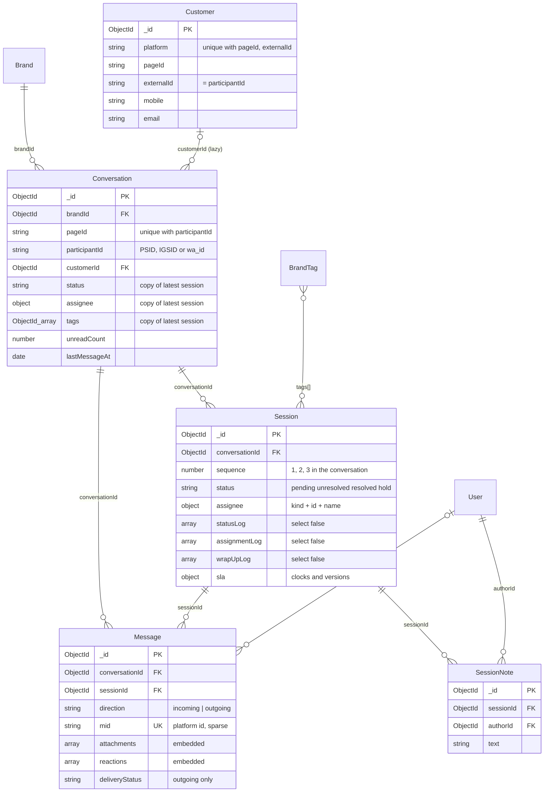
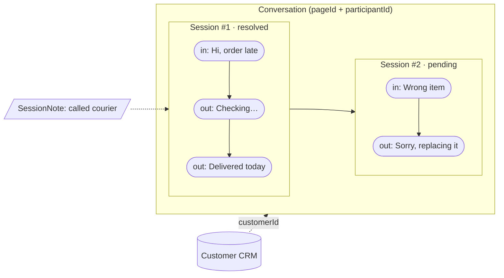
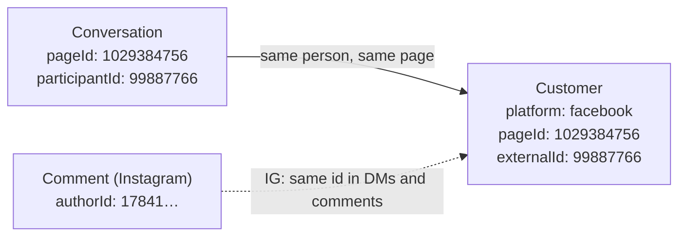
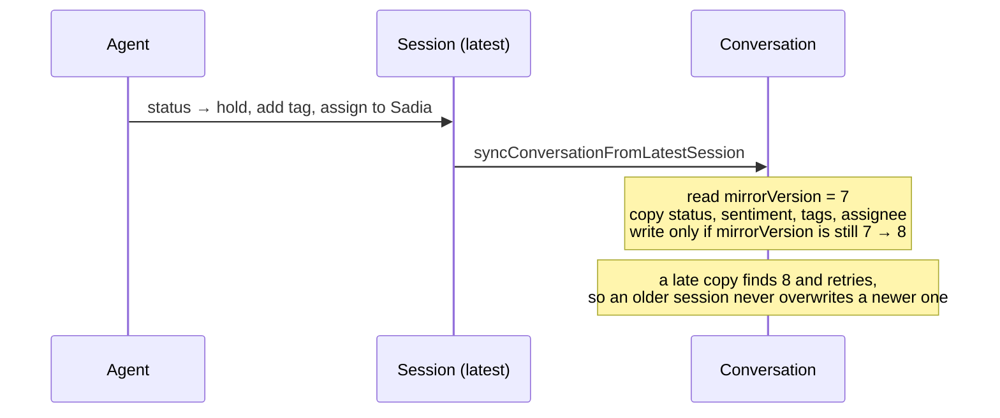
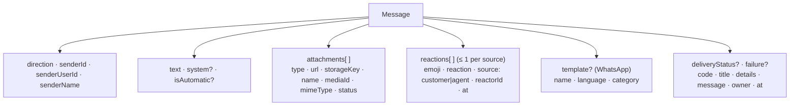
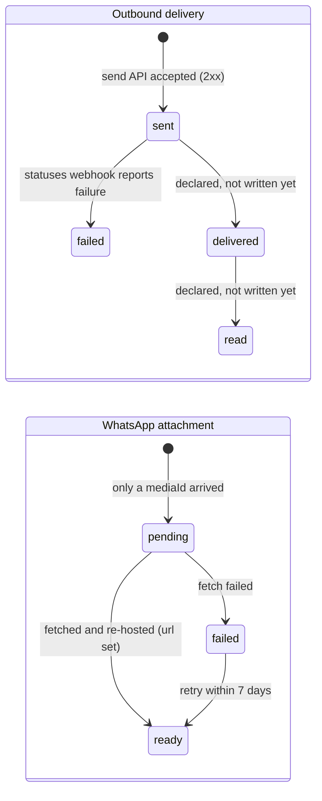
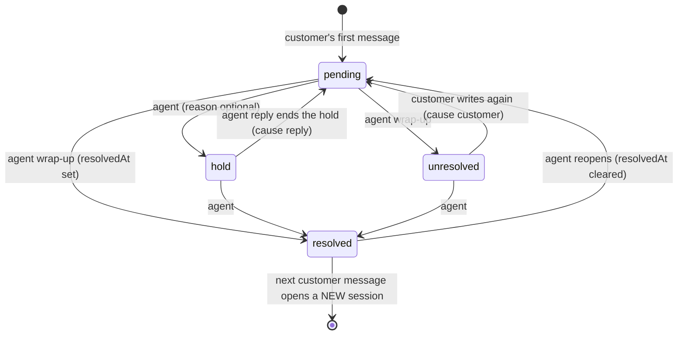
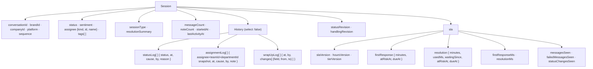
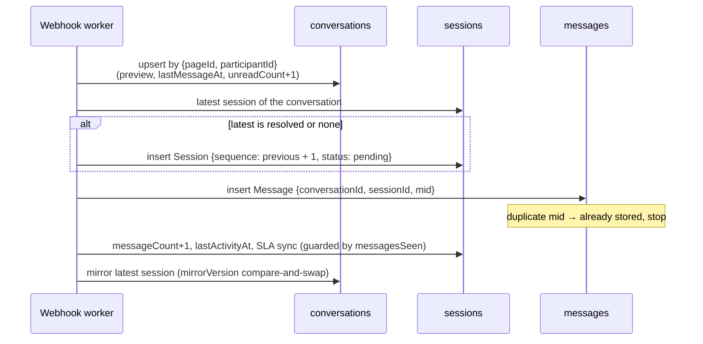

## The code

Three files define the five models. `conversation/schema.ts` holds both Conversation and Message; `session/schema.ts` holds Session, SessionNote and the sub-schemas comments reuse.

{/* schema: server/src/modules/customer/schema.ts */}
```ts title="server/src/modules/customer/schema.ts" lineNumbers
import mongoose, { Document, Model, Schema, Types } from 'mongoose';
import { baseSchema } from '@/libraries/db/base-schema';
import { CHANNEL_PLATFORMS, ChannelPlatform } from '@/modules/conversation/schema';

// The customer's editable gender. Kept in sync with the client's radio options.
export const CUSTOMER_GENDERS = ['male', 'female', 'other'] as const;
export type CustomerGender = (typeof CUSTOMER_GENDERS)[number];

/**
 * A person a brand talks to on a connected channel. Identity is the platform-scoped id Meta gives
 * us — the same value stored as `Conversation.participantId` (Messenger PSID / IG Direct IGSID) and
 * `Comment.authorId` — so inbox and (later) comments can share one CRM record. Uniquely keyed by
 * (platform, pageId, externalId).
 *
 * Note: on Instagram the id is consistent across DMs and comments (same IGSID); on Facebook the
 * messaging PSID and a feed comment's author id are different scoped ids for the same person and are
 * not reconciled here — a Facebook commenter may therefore land as a separate record until a Meta
 * id-matching step is added.
 */
export interface ICustomer extends Document {
  // Denormalized from the conversation/brand so customer queries can be tenant-scoped directly.
  companyId: Types.ObjectId;
  platform: ChannelPlatform;
  // Our account id on the platform: the Facebook Page id or the Instagram Business account id.
  pageId: string;
  // The person's platform-scoped id (PSID / IGSID). Matches Conversation.participantId.
  externalId: string;
  // Cached profile from the channel; the fields below are the editable CRM extras.
  name: string;
  avatarUrl?: string;
  mobile?: string;
  email?: string;
  address?: string;
  gender?: CustomerGender;
}

const customerSchema = new Schema<ICustomer>({
  companyId: { type: Schema.Types.ObjectId, ref: 'Company', required: true, index: true },
  platform: { type: String, enum: [...CHANNEL_PLATFORMS], required: true },
  pageId: { type: String, required: true },
  externalId: { type: String, required: true },
  name: { type: String, default: '' },
  avatarUrl: { type: String },
  mobile: { type: String },
  email: { type: String },
  address: { type: String },
  gender: { type: String, enum: [...CUSTOMER_GENDERS] },
});

customerSchema.add(baseSchema);

// One CRM record per (page, person). Find-or-create keys off this triple.
customerSchema.index({ platform: 1, pageId: 1, externalId: 1 }, { unique: true });

export const CustomerModel: Model<ICustomer> = mongoose.model<ICustomer>(
  'Customer',
  customerSchema
);
```
{/* /schema */}

{/* schema: server/src/modules/conversation/schema.ts */}
```ts title="server/src/modules/conversation/schema.ts" lineNumbers
import mongoose, { Document, Model, Schema, Types } from 'mongoose';
import { baseSchema } from '@/libraries/db/base-schema';
// Type-only (erased at compile time) so there's no runtime import cycle — session/schema imports
// the enums below from this file. The Conversation denormalizes the latest session's assignee.
import type { ISessionAssignee } from '@/modules/session/schema';

// Which social channel a conversation/message belongs to. Messenger, Instagram Direct and WhatsApp
// all share these models — they differ only in the ids stored (see `pageId` below).
export const CHANNEL_PLATFORMS = ['facebook', 'instagram', 'whatsapp'] as const;
export type ChannelPlatform = (typeof CHANNEL_PLATFORMS)[number];

// Incoming = from the customer, outgoing = a reply sent from our platform (or the page inbox).
export const MESSAGE_DIRECTIONS = ['incoming', 'outgoing'] as const;
export type MessageDirection = (typeof MESSAGE_DIRECTIONS)[number];

// Session status/sentiment enums live here (not in session/schema) because the Conversation
// carries a denormalized copy of its latest session's status + sentiment, and session/schema
// already imports from this file — keeping them here avoids a circular import.
// `idle` is intentionally NOT a stored status — the frontend derives it from `lastActivityAt`.
export const SESSION_STATUSES = ['pending', 'unresolved', 'resolved', 'hold'] as const;
export type SessionStatus = (typeof SESSION_STATUSES)[number];

// Manually assigned (no ML pipeline exists). `MIXED` extends the comment module's three values.
export const SESSION_SENTIMENTS = ['POSITIVE', 'NEUTRAL', 'NEGATIVE', 'MIXED'] as const;
export type SessionSentiment = (typeof SESSION_SENTIMENTS)[number];

/**
 * How an attachment's bytes are doing. Absent on every Messenger and Instagram attachment and on every
 * outbound one — those arrive with a URL already, so absence means "there is nothing to fetch".
 *
 *  - `pending` — WhatsApp gave us a media id and nothing else. The bytes are fetched on demand, when
 *    an agent opens the thread or clicks the tile (`modules/conversation/media.ts`).
 *  - `ready`   — fetched and re-hosted; `url` is set.
 *  - `failed`  — a fetch was attempted and did not work. Retryable while the media id is alive.
 *
 * There is deliberately no `expired` state: WhatsApp media ids die 7 days after the message arrived,
 * and that is derivable from the message's own timestamp — storing it would mean a sweep to write it.
 */
export const ATTACHMENT_STATUSES = ['pending', 'ready', 'failed'] as const;
export type AttachmentStatus = (typeof ATTACHMENT_STATUSES)[number];

/**
 * What the platform has told us about an outbound message since we handed it over.
 *
 * `sent` is written when the send API accepts the message — that acceptance is all a 2xx from Graph
 * means, and on WhatsApp it is emphatically not delivery: Cloud API validates asynchronously and
 * reports the real outcome minutes later on the `statuses` webhook. A template we are not eligible to
 * send (billing unconfigured, error 131042) is accepted, given a wamid, and then quietly dropped.
 *
 * Only `sent` and `failed` are ever written today. `delivered` and `read` are declared so that
 * handling those two webhook cases later is a code change and not a schema migration — they would
 * triple the writes per outbound message to power read receipts nobody has asked for.
 *
 * Absent means unknown, which covers every row written before this field existed and every inbound
 * message (a customer's own message has no delivery state of ours to track). The UI renders absence
 * exactly like `sent`.
 */
export const MESSAGE_DELIVERY_STATUSES = ['sent', 'delivered', 'read', 'failed'] as const;
export type MessageDeliveryStatus = (typeof MESSAGE_DELIVERY_STATUSES)[number];

/**
 * Why the platform refused to deliver an outbound message. Present only alongside
 * `deliveryStatus: 'failed'`.
 *
 * Meta's own words, unedited. `details` names specifics we could not write ourselves — the account
 * whose currency is unset, the size a file exceeded — and `code` is what makes the row actionable:
 * 131042 is a job for whoever owns the billing account, 131047 is a job for the agent. Both are kept
 * because the sentence alone cannot be branched on and the code alone cannot be read.
 */
export interface IMessageFailure {
  code?: number;
  title?: string;
  details?: string;
  /**
   * The one line an agent reads, resolved when the failure is recorded rather than at render time.
   *
   * Stored rather than derived because it is a record of what we told the agent, and because deriving
   * it later would mean shipping the same copy to the client and keeping the two in step. Improving
   * the wording later does not rewrite history, which is the correct behaviour for a log of what
   * happened — the same choice the 131052 notice row already makes with its `text`.
   */
  message: string;
  /** Who can act on it, when we know: the agent, or whoever administers the WhatsApp account. */
  owner?: 'agent' | 'admin';
  at: Date;
}

// A single attachment: from the Messenger webhook (image/video/audio/file, URL included), from an
// agent's own send, or from WhatsApp — where only a media id arrives and the bytes come later.
export interface IMessageAttachment {
  type: string;
  /**
   * The display URL.
   *
   * For platform-hosted bytes (a Messenger attachment, a Giphy link) this is theirs and all we
   * have. For bytes we host it is derived from `storageKey` at write time — a public URL, which is
   * a pure function of the key and never expires, so there is nothing to recompute per read.
   *
   * What must never go here is a *presigned* URL: those expire (7 days at most), which turned every
   * attachment in the product into a 403 a week after it was sent.
   */
  url?: string;
  /**
   * Object-storage key for attachments we host. The durable handle; `url` is derived from it.
   *
   * Kept even though `url` is stored, because the key is the thing that stays true: a change of
   * public domain, or a later move to presigned reads, rebuilds every URL from this. Without it
   * that would be an unrecoverable data problem rather than a backfill.
   */
  storageKey?: string;
  name?: string;
  /**
   * The platform's own handle for the bytes, kept so a fetch can be attempted (or re-attempted)
   * later. WhatsApp only — Messenger hands us a URL and needs no handle.
   */
  mediaId?: string;
  // What WhatsApp said the bytes are, before we have them. Lets the UI label a not-yet-fetched
  // attachment ("PDF", "Photo") instead of showing a generic tile.
  mimeType?: string;
  status?: AttachmentStatus;
}

// Who a reaction came from: the customer (via webhook) or an agent (sent from our UI — Instagram
// only; Messenger's API has no page-send-reaction).
export const REACTION_SOURCES = ['customer', 'agent'] as const;
export type ReactionSource = (typeof REACTION_SOURCES)[number];

// A reaction on a message. Meta allows at most one reaction per participant per message, so a
// message carries at most one reaction per source (customer / agent). `reaction` is Messenger's
// type name (love/like/…) when provided; `emoji` is always present.
export interface IMessageReaction {
  emoji: string;
  reaction?: string;
  source: ReactionSource;
  // The PSID/IGSID (customer) or the reacting agent's User id.
  reactorId?: string;
  at: Date;
}

/**
 * What an outbound message was sent as, when it went out as an approved WhatsApp template rather than
 * free text. Absent on every other message, which is what "was this a template send?" tests.
 *
 * Recorded for cost reconciliation. Template sends are the only messages Meta charges for (marketing
 * always; utility/authentication outside an open window), we control every one of them, and Cloud API
 * never echoes our own sends back over the webhook — so this row is the only record that the send
 * happened at all. Reconciled against Meta's monthly billing export, which joins on the `mid` (the
 * wamid) already stored alongside. Ref: docs/whatsapp-integration.md §10.5.
 *
 * The recipient's country — the other half of Meta's rate card — is deliberately NOT stored. Deriving
 * it would mean parsing a calling code out of `wa_id`, which §11.1 forbids because `wa_id` is an
 * opaque business-scoped id in some regions. Meta's export carries the country; the wamid joins to it.
 */
export interface IMessageTemplate {
  name: string;
  // Language AND locale, e.g. 'en_US'. Part of the template's identity, not decoration — (name,
  // language) is what Meta matched on, and the same name can exist under several locales.
  language: string;
  // MARKETING | UTILITY | AUTHENTICATION. The category Meta billed at send time, snapshotted here
  // because Meta re-categorises templates and a later read would report the wrong rate for this send.
  category: string;
}

/**
 * A 1:1 thread between a brand's connected channel and one customer.
 * Uniquely keyed by (pageId, participantId) so repeated webhooks fold into one thread.
 */
export interface IConversation extends Document {
  brandId: Types.ObjectId;
  // Denormalized from the brand so conversation queries can be tenant-scoped directly.
  companyId: Types.ObjectId;
  platform: ChannelPlatform;
  // Our own account id on the platform: the Facebook Page id (Messenger), the Instagram Business
  // account id (IG Direct), or the WhatsApp business phone number id. Together with the brand it
  // resolves the access token. For WhatsApp this is deliberately NOT the WABA id — the phone number
  // id is what sends are addressed to and what inbound webhooks carry.
  pageId: string;
  // The customer's platform-scoped id: PSID (Messenger), IGSID (Instagram Direct), or wa_id
  // (WhatsApp — usually the phone number in E.164 without '+', but treat it as opaque).
  participantId: string;
  participantName: string;
  participantAvatarUrl?: string;
  // The shared CRM record for this person (mobile/email/address/gender). Linked lazily the first
  // time an agent saves customer info; absent on threads never edited.
  customerId?: Types.ObjectId;
  // Denormalized last-message summary powering the thread-list preview + ordering.
  lastMessageText: string;
  lastMessageAt: Date;
  lastMessageDirection: MessageDirection;
  // Count of unread incoming messages; reset to 0 when the thread is opened.
  unreadCount: number;
  // Denormalized from the latest session, kept in sync by the session service, so the
  // thread list can be filtered/sorted by status + sentiment without joining sessions.
  status: SessionStatus;
  sentiment: SessionSentiment;
  // Denormalized from the latest session's assignee (same "latest session wins" rule as status),
  // so the thread list can filter by "assigned to me / my department" without joining sessions.
  // Absent = unassigned.
  assignee?: ISessionAssignee;
  // Bumped by every copy of the latest session's status, sentiment, tags and assignee; the copy is
  // compare-and-swap on it (`syncConversationFromLatestSession` in session/service.ts).
  mirrorVersion?: number;
  // Brand-tag ids on the latest session (same "latest session wins" rule again), so the thread list
  // can filter by tag without joining sessions. A reopened thread starts a fresh, untagged session
  // and so reads as untagged — the tag describes what this thread is about *now*, not ever.
  // `ref` so read paths can `.populate('tags', 'name')`; empty when the latest session has none.
  tags: Types.ObjectId[];
}

/** One message within a conversation. `mid` is Facebook's message id, used for idempotency. */
export interface IMessage extends Document {
  /**
   * A message the platform generated about the conversation rather than something either side typed —
   * today only "the customer sent a file WhatsApp refused to accept" (webhook error 131052).
   *
   * Stored as a real inbound message so it takes its place in the thread, bumps the conversation and
   * counts as unread — an agent has to notice it, which is the entire point. The flag is what stops it
   * being rendered as the customer's own words: the client draws it as a centred notice instead of a
   * bubble. Absent on every ordinary message.
   */
  system?: boolean;
  // Outbound only: sent by the system, not an agent (e.g. the WhatsApp media-failure reply). It is not
  // a response: it neither counts as the first response nor ends a hold. Absent on every agent message.
  isAutomatic?: boolean;
  conversationId: Types.ObjectId;
  // The session (support episode) this message belongs to. Assigned when the message is recorded.
  sessionId?: Types.ObjectId;
  brandId: Types.ObjectId;
  platform: ChannelPlatform;
  direction: MessageDirection;
  // Facebook message id (mid). Unique+sparse so a re-delivered webhook or our own echo folds in.
  mid?: string;
  // PSID for incoming, pageId for outgoing.
  senderId: string;
  // The agent (User) who sent an outgoing reply from our platform, when applicable.
  senderUserId?: Types.ObjectId;
  senderName?: string;
  text: string;
  attachments: IMessageAttachment[];
  // Reactions on this message (at most one per source). Customer reactions arrive via webhook;
  // agent reactions are sent from our UI (Instagram only).
  reactions: IMessageReaction[];
  // Present only on WhatsApp template sends. `text` still holds the rendered body, so the thread reads
  // normally; this records what produced it and what it cost.
  template?: IMessageTemplate;
  // Outbound only, and only what the platform has actually told us. See MESSAGE_DELIVERY_STATUSES.
  deliveryStatus?: MessageDeliveryStatus;
  failure?: IMessageFailure;
  sentAt: Date;
}

// Denormalized copy of the latest session's assignee. Shape mirrors session/schema's
// ISessionAssignee; `kind` values are ASSIGNEE_TYPES (kept in sync there — hardcoded here to avoid
// a runtime import cycle). `id` is a User id (query_manager), Department id or Team id.
const assigneeSchema = new Schema<ISessionAssignee>(
  {
    kind: { type: String, enum: ['query_manager', 'department', 'team'], required: true },
    id: { type: Schema.Types.ObjectId, required: true },
    name: { type: String, default: '' },
  },
  { _id: false }
);

const conversationSchema = new Schema<IConversation>({
  brandId: { type: Schema.Types.ObjectId, ref: 'Brand', required: true, index: true },
  companyId: { type: Schema.Types.ObjectId, ref: 'Company', required: true, index: true },
  platform: { type: String, enum: [...CHANNEL_PLATFORMS], required: true },
  pageId: { type: String, required: true },
  participantId: { type: String, required: true },
  participantName: { type: String, default: '' },
  participantAvatarUrl: { type: String },
  customerId: { type: Schema.Types.ObjectId, ref: 'Customer', index: true },
  lastMessageText: { type: String, default: '' },
  // No standalone index: every read of this field is brand-scoped and served by the compound
  // {brandId, lastMessageAt, _id} below. On its own it only cost a write on each new message.
  lastMessageAt: { type: Date, default: (): Date => new Date() },
  lastMessageDirection: { type: String, enum: [...MESSAGE_DIRECTIONS], default: 'incoming' },
  unreadCount: { type: Number, default: 0 },
  // No standalone index: every query is brand-scoped, so a lone {status} index can serve neither the
  // scoping nor the sort. The compound {brandId, status, lastMessageAt} below replaces it.
  status: { type: String, enum: [...SESSION_STATUSES], default: 'pending' },
  sentiment: { type: String, enum: [...SESSION_SENTIMENTS], default: 'NEUTRAL' },
  assignee: { type: assigneeSchema },
  mirrorVersion: { type: Number },
  tags: {
    type: [{ type: Schema.Types.ObjectId, ref: 'BrandTag' }],
    default: [],
  },
});

conversationSchema.add(baseSchema);

// One thread per (page, customer). Upserts key off this pair.
conversationSchema.index({ pageId: 1, participantId: 1 }, { unique: true });
// Thread list ordering: newest activity first, per brand.
conversationSchema.index({ brandId: 1, lastMessageAt: -1, _id: -1 });
// "Assigned to me / my department" filter, newest activity first. The trailing lastMessageAt lets
// Mongo satisfy the default `-lastMessageAt` sort straight from the index (a SORT_MERGE across the
// $in of {my user id, my department id}) instead of a blocking in-memory sort. Partial so only
// assigned threads are indexed — mirrors the session collection's assignee index.
conversationSchema.index(
  { brandId: 1, 'assignee.id': 1, lastMessageAt: -1, _id: -1 },
  { partialFilterExpression: { 'assignee.id': { $exists: true } } }
);
// The thread list's other three filters (see `filterableFields` in conversation/service.ts), each in
// {brandId, field, sort} shape so both the filter and the `-lastMessageAt` ordering come from the index.
// Unindexed, these are applied after a fetch: the page itself stays quick while the filter is common,
// but the count that runs alongside it cannot early-exit. Measured on 1M conversations: counting
// `{brandId}` off the index took 84ms, counting `{brandId, platform}` fetched every document and took
// 395ms. A rarer value walks further still.
conversationSchema.index({ brandId: 1, platform: 1, lastMessageAt: -1, _id: -1 });
conversationSchema.index({ brandId: 1, status: 1, lastMessageAt: -1, _id: -1 });
conversationSchema.index({ brandId: 1, sentiment: 1, lastMessageAt: -1, _id: -1 });
// The tag filter, same {brandId, field, sort} shape — a multikey index over the denormalized tag ids.
// Mirrors the comment collection's {brandId, tags, lastActivityAt}.
conversationSchema.index({ brandId: 1, tags: 1, lastMessageAt: -1, _id: -1 });

const attachmentSchema = new Schema<IMessageAttachment>(
  {
    type: { type: String, required: true },
    url: { type: String },
    storageKey: { type: String },
    name: { type: String },
    mediaId: { type: String },
    mimeType: { type: String },
    // No default: an attachment that arrived with a URL has no fetch state, and writing 'ready' onto
    // every Messenger attachment would only make absence ambiguous.
    status: { type: String, enum: [...ATTACHMENT_STATUSES] },
  },
  { _id: false }
);

const reactionSchema = new Schema<IMessageReaction>(
  {
    emoji: { type: String, required: true },
    reaction: { type: String },
    source: { type: String, enum: [...REACTION_SOURCES], required: true },
    reactorId: { type: String },
    at: { type: Date, default: (): Date => new Date() },
  },
  { _id: false }
);

const messageTemplateSchema = new Schema<IMessageTemplate>(
  {
    name: { type: String, required: true },
    language: { type: String, required: true },
    category: { type: String, required: true },
  },
  { _id: false }
);

const messageFailureSchema = new Schema<IMessageFailure>(
  {
    code: { type: Number },
    title: { type: String },
    details: { type: String },
    message: { type: String, required: true },
    owner: { type: String, enum: ['agent', 'admin'] },
    at: { type: Date, default: (): Date => new Date() },
  },
  { _id: false }
);

const messageSchema = new Schema<IMessage>({
  conversationId: { type: Schema.Types.ObjectId, ref: 'Conversation', required: true, index: true },
  sessionId: { type: Schema.Types.ObjectId, ref: 'Session', index: true },
  brandId: { type: Schema.Types.ObjectId, ref: 'Brand', required: true, index: true },
  platform: { type: String, enum: [...CHANNEL_PLATFORMS], required: true },
  direction: { type: String, enum: [...MESSAGE_DIRECTIONS], required: true },
  mid: { type: String },
  senderId: { type: String, required: true },
  senderUserId: { type: Schema.Types.ObjectId, ref: 'User' },
  senderName: { type: String },
  text: { type: String, default: '' },
  // No default: absence means "an ordinary message", and writing `false` onto every row would only
  // make the flag look like something the send paths are expected to set.
  system: { type: Boolean },
  // No default either (see `system`).
  isAutomatic: { type: Boolean },
  attachments: { type: [attachmentSchema], default: [] },
  reactions: { type: [reactionSchema], default: [] },
  // `default: undefined` so non-template messages carry no empty subdocument — absence is the test.
  template: { type: messageTemplateSchema, default: undefined },
  // No default, for the same reason attachmentSchema.status has none: a value written onto every
  // historical row and every inbound message would make absence mean two different things.
  deliveryStatus: { type: String, enum: [...MESSAGE_DELIVERY_STATUSES] },
  failure: { type: messageFailureSchema, default: undefined },
  sentAt: { type: Date, default: (): Date => new Date() },
});

messageSchema.add(baseSchema);

// Chronological read within a thread.
messageSchema.index({ conversationId: 1, sentAt: 1 });
// Chronological read within a single session (powers the grouped inbox view).
messageSchema.index({ sessionId: 1, sentAt: 1 });
// Overview peak hours: a brand's inbound messages in a date range. Partial (inbound only), so
// replies never enter it; the query must say `direction: 'incoming'` to use it.
messageSchema.index(
  { brandId: 1, sentAt: 1 },
  { partialFilterExpression: { direction: 'incoming' } }
);
// De-duplicate re-delivered webhooks / our own echoes. Sparse: outgoing rows may lack a mid briefly.
// Overview: outgoing messages by when they were sent (OUTGOING_MESSAGES_BY_DATE, hinted, covering):
// the Team view's messages sent, and per sender (Handler view). Partial, so incoming messages never
// enter it.
messageSchema.index(
  { brandId: 1, sentAt: 1, platform: 1, isAutomatic: 1, deliveryStatus: 1, senderUserId: 1 },
  { partialFilterExpression: { direction: 'outgoing' } }
);
messageSchema.index({ mid: 1 }, { unique: true, sparse: true });

export const ConversationModel: Model<IConversation> = mongoose.model<IConversation>(
  'Conversation',
  conversationSchema
);
export const MessageModel: Model<IMessage> = mongoose.model<IMessage>('Message', messageSchema);
```
{/* /schema */}

{/* schema: server/src/modules/session/schema.ts */}
```ts title="server/src/modules/session/schema.ts" lineNumbers
import mongoose, { Document, Model, Schema, Types } from 'mongoose';
import { baseSchema } from '@/libraries/db/base-schema';
import { IPopulatedBrandTag } from '@/modules/brand/tags/schema';
import {
  CHANNEL_PLATFORMS,
  ChannelPlatform,
  SESSION_STATUSES,
  SESSION_SENTIMENTS,
  SessionStatus,
  SessionSentiment,
} from '@/modules/conversation/schema';

// A session is a time-bounded support episode within a conversation. A customer's first message
// opens a `pending` session; once `resolved`, the next customer message opens a fresh one.
// The status/sentiment enums live in conversation/schema (the Conversation keeps a denormalized
// copy of its latest session's); re-exported here so existing importers keep their import path.
export { SESSION_STATUSES, SESSION_SENTIMENTS };
export type { SessionStatus, SessionSentiment };

// A session is routed to exactly one assignee — an individual query manager, a whole department or a
// team (mutually exclusive, hence a single embedded field rather than several ids). A department or
// team is a pool its members claim from. `name` is a denormalized
// snapshot so the inbox thread read can show "assigned to X" without joining/populating.
export const ASSIGNEE_TYPES = ['query_manager', 'department', 'team'] as const;
export type AssigneeType = (typeof ASSIGNEE_TYPES)[number];

// The kind of interaction a session represents, chosen by the agent at wrap-up. Session-specific
// (unlike the shared status/sentiment enums, which live in conversation/schema), so it lives here.
export const SESSION_TYPES = [
  'complain',
  'inquiry',
  'compliment',
  'support',
  'sales',
  'other',
] as const;
export type SessionType = (typeof SESSION_TYPES)[number];

/**
 * One status change, appended to a session's `statusLog` (comment roots will share it). The log is
 * the resolution clock's input — hold, resolved and unresolved stretches aren't charged — and the
 * hold log supervisors read (docs/resolution-time-rules.md, R5 and R6). An entry lasts until the
 * next one.
 */
export const STATUS_CHANGE_CAUSES = ['agent', 'reply', 'customer'] as const;
export const STATUS_REASON_MAX_LENGTH = 500;
export type StatusChangeCause = (typeof STATUS_CHANGE_CAUSES)[number];

export interface IStatusChange {
  status: SessionStatus;
  at: Date;
  // `agent`: set by an agent; `reply`: an agent's message ended a hold; `customer`: a customer message
  // reopened an unresolved query (both → pending).
  cause: StatusChangeCause;
  // The user who made the change (absent for a native-platform reply).
  by?: Types.ObjectId;
  // Optional note the agent gave, e.g. why a query was put on hold.
  reason?: string;
}

/**
 * How an assignment came about: a manager routed it, a query manager took it ("Assign to me"), or
 * the query manager holding it passed it on ("Forward").
 */
export const ASSIGNMENT_CAUSES = ['routed', 'claimed', 'forwarded'] as const;
// A forwarding note, like a hold reason.
export const FORWARD_NOTE_MAX_LENGTH = 500;
export type AssignmentCause = (typeof ASSIGNMENT_CAUSES)[number];

/**
 * One assignment change: who the query went to (null: unassigned), when, how and by whom. The
 * assignee is a snapshot, so the history keeps the name it had then. Shared with comment roots.
 */
export interface IAssignmentChange {
  assignee: IAssignmentLogAssignee | null;
  at: Date;
  cause: AssignmentCause;
  by?: Types.ObjectId;
  // Why it was forwarded, for whoever gets it.
  note?: string;
}

/** The wrap-up fields whose edits are logged (comment roots have no session type). */
export const WRAP_UP_FIELDS = ['sentiment', 'sessionType', 'tags', 'resolutionSummary'] as const;
export type WrapUpField = (typeof WRAP_UP_FIELDS)[number];

/**
 * One field's edit: its value before and after (absent: unset). Tags are tag ids, read back with
 * their current names.
 */
export interface IWrapUpFieldChange {
  field: WrapUpField;
  from?: string | Types.ObjectId[];
  to?: string | Types.ObjectId[];
}

/** One edit of the wrap-up fields (several fields when made together, e.g. at wrap-up). */
export interface IWrapUpChange {
  at: Date;
  by?: Types.ObjectId;
  changes: IWrapUpFieldChange[];
}

/** Who made an assignment change and how, for the write paths. */
export interface AssignmentActor {
  cause: AssignmentCause;
  by?: Types.ObjectId | string;
  note?: string;
  /** Who held it before, when the caller read it: for the "taken from me" alert. Not logged. */
  previousAssignee?: { kind: string; id: Types.ObjectId | string } | null;
}

/**
 * An assignee as the assignment log keeps it. A query manager's entry also stamps their team and
 * department at that moment, so handler performance credits the team they were in then, not the one
 * they're in now (docs/handler-performance-rules.md, H14). Absent on pools and on older entries.
 */
export interface IAssignmentLogAssignee extends ISessionAssignee {
  teamId?: Types.ObjectId;
  departmentId?: Types.ObjectId;
}

/** The assignee fields a holder check reads; sessions and comment roots both carry them. */
export type AssigneeKey = Pick<ISessionAssignee, 'kind' | 'id'>;

export interface ISessionAssignee {
  kind: AssigneeType;
  // References a User (query_manager) or a Department depending on `kind`; not a Mongoose `ref`
  // because the target model varies and we read the denormalized `name` rather than populating.
  id: Types.ObjectId;
  name: string;
}

// A tag applied to a session, as it reads back after `.populate('tags', 'name')`. Sessions store the
// bare id; the name is the vocabulary's, read fresh on every read — see the brand module, which owns
// it. Comments do exactly the same, so both use the one shape defined there.
export type ISessionTag = IPopulatedBrandTag;

/**
 * A support episode inside a conversation. Messages point at a session via `Message.sessionId`.
 * `startedAt` orders sessions within a conversation; `lastActivityAt` (bumped on every message,
 * either direction) powers list ordering and the frontend's idle badge.
 */
export interface ISession extends Document {
  conversationId: Types.ObjectId;
  // Denormalized from the conversation so session queries can be tenant-scoped directly.
  brandId: Types.ObjectId;
  companyId: Types.ObjectId;
  platform: ChannelPlatform;
  status: SessionStatus;
  sentiment: SessionSentiment;
  startedAt: Date;
  lastActivityAt: Date;
  // 1-based position within its conversation (oldest episode = 1), stamped at creation from the
  // previous session's number. Stored rather than counted on read: a client holds only a paginated
  // window of sessions and cannot derive the ordinal itself, and counting the earlier ones on every
  // read is the scan cursor pagination exists to avoid. Numbers are never reassigned: merging a
  // middle session away leaves a gap, because renumbering the sessions that follow would be an
  // unbounded write on the message hot path.
  sequence: number;
  // Set when status transitions to `resolved`.
  resolvedAt?: Date;
  // Who last changed the status, and when.
  statusChangedBy?: Types.ObjectId;
  statusChangedAt?: Date;
  // Bumped with every `statusLog` append; the status write path guards on it.
  statusRevision?: number;
  // Bumped by every handler-performance sync as it reads the query, so a sync that read it earlier
  // can't overwrite a later one's records (`syncQueryHandling`, modules/handling/sync.ts).
  handlingRevision?: number;
  // Every status change, oldest first. Empty on sessions from before it existed (and on new ones
  // still `pending`); see `statusTimeline` in ./sla.ts for how those are read. Optional in the type
  // because reads leave it out unless they select it.
  statusLog?: IStatusChange[];
  // Every assignment change, oldest first. Like `statusLog`, left out of reads unless selected.
  assignmentLog?: IAssignmentChange[];
  // Every edit of sentiment, type, tags or summary, oldest first. Left out of reads unless selected.
  wrapUpLog?: IWrapUpChange[];
  // Who this support episode is routed to (a query manager or a department). Unset = unassigned.
  assignee?: ISessionAssignee;
  // Ids of the brand tags applied to this session, from its brand's vocabulary. Empty when none.
  // Read paths `.populate('tags', 'name')`, so on a session that came from one of those this array
  // holds `ISessionTag` ({_id, name}) rather than bare ids.
  tags: Types.ObjectId[];
  // Denormalized counters.
  messageCount: number;
  noteCount: number;
  // Set at wrap-up. `sessionType` is required in the wrap-up UI (unset until then); the free-text
  // `resolutionSummary` is optional.
  sessionType?: SessionType;
  resolutionSummary?: string;
  // SLA clock: starts at the first customer message; first response = first brand reply after it.
  firstCustomerMessageAt?: Date;
  firstResponseAt?: Date;
  sla?: ISessionSlaState;
}

/** The first-response clock, worked out once from the policy in force at the clock start. */
export interface ISlaClock {
  minutes: number;
  // When 80% of the target's business time has passed, and when all of it has.
  atRiskAt: Date;
  dueAt: Date;
}

/**
 * The resolution clock of a session (or comment thread). It charges the business time from the first
 * customer message (the root comment) to wrap-up, customer wait included
 * (docs/resolution-time-rules.md, R1). Recomputed on every message (comment) and status change.
 *
 * `atRiskAt` / `dueAt` are the moments the charged time reaches 80% / 100% of the target: the actual
 * moment once crossed, projected while the clock runs, null if a stopped clock never reached it. So
 * the Overview reads "breached" as `dueAt <= now` and "at risk" as `atRiskAt <= now < dueAt`.
 */
export interface IResolutionClock {
  minutes: number;
  // Business time charged by finished spans (all of it, once resolved).
  usedMs: number;
  // Start of the span in progress: set while the clock runs, null once stopped. (Named for the
  // earlier customer-wait clock; kept so stored data needs no migration.)
  waitingSince: Date | null;
  atRiskAt: Date | null;
  dueAt: Date | null;
}

/**
 * The SLA state of a session or comment thread: the policy versions in force when its clock started
 * (first customer message / root comment), the first-response clock and the resolution clock. A
 * metric is null when it isn't measured: turned off, or no business hours to count in.
 */
export interface ISlaState {
  slaVersion: number;
  hoursVersion: number;
  // The company's service-tier version (`sla-tiers`); missing on items not recomputed since it was
  // added (backfill).
  tierVersion?: number;
  firstResponse: ISlaClock | null;
  resolution: IResolutionClock | null;
  // Business time from the clock start to the first reply, under the hours in force at the clock
  // start; null while unanswered. Stored so Overview's first response time is a database sum rather
  // than a business-hours walk per item. Missing on items not recomputed since it was added (backfill).
  firstResponseMs?: number | null;
  // Business time the resolution clock charged up to the resolve (R1), whether or not the brand has a
  // resolution target; null until resolved, or when a legacy stop time is unknown. Missing on items not
  // recomputed since it was added (backfill).
  resolutionMs?: number | null;
}

/** A session's SLA state, plus what its stale-write guard compares. */
export interface ISessionSlaState extends ISlaState {
  // How many of the session's messages the stored values were worked out from. A sync that saw
  // fewer can't overwrite them (concurrent worker jobs).
  messagesSeen: number;
  // Delivery failures are one-way mutations; a sync that saw fewer failures is stale too.
  failedMessagesSeen: number;
  // How many `statusLog` entries the values were worked out from; the log only grows.
  statusChangesSeen: number;
}

/**
 * An internal note attached to a session. Notes are agent-only — kept in their own collection so
 * they can never leak into the customer-facing Send-API flow. Rendered inline with messages on
 * the client, labelled "Internal note · <authorName>".
 */
export interface ISessionNote extends Document {
  sessionId: Types.ObjectId;
  conversationId: Types.ObjectId;
  companyId: Types.ObjectId;
  authorId: Types.ObjectId;
  authorName: string;
  text: string;
}

// Shared with comment roots, which will keep the same log.
export const statusChangeSchema = new Schema<IStatusChange>(
  {
    status: { type: String, enum: [...SESSION_STATUSES], required: true },
    at: { type: Date, required: true },
    cause: { type: String, enum: [...STATUS_CHANGE_CAUSES], required: true },
    by: { type: Schema.Types.ObjectId, ref: 'User' },
    reason: { type: String, trim: true, maxlength: STATUS_REASON_MAX_LENGTH },
  },
  { _id: false }
);

const assigneeSnapshotSchema = new Schema<IAssignmentLogAssignee>(
  {
    kind: { type: String, enum: [...ASSIGNEE_TYPES], required: true },
    id: { type: Schema.Types.ObjectId, required: true },
    name: { type: String, required: true },
    teamId: { type: Schema.Types.ObjectId, ref: 'Team' },
    departmentId: { type: Schema.Types.ObjectId, ref: 'Department' },
  },
  { _id: false }
);

// Shared with comment roots.
export const assignmentChangeSchema = new Schema<IAssignmentChange>(
  {
    assignee: { type: assigneeSnapshotSchema, default: null },
    at: { type: Date, required: true },
    cause: { type: String, enum: [...ASSIGNMENT_CAUSES], required: true },
    by: { type: Schema.Types.ObjectId, ref: 'User' },
    note: { type: String, trim: true, maxlength: FORWARD_NOTE_MAX_LENGTH },
  },
  { _id: false }
);

/** Whether two assignees are the same (both nobody, or the same kind and id). */
export const sameAssignee = (
  current: Pick<ISessionAssignee, 'kind' | 'id'> | null | undefined,
  next: Pick<ISessionAssignee, 'kind' | 'id'> | null
): boolean =>
  !current || !next ? !current && !next : current.kind === next.kind && current.id.equals(next.id);

/**
 * The update that records an assignment change next to the write that makes it, so the two can't
 * drift: the new assignee (or its removal) plus one log entry.
 */
export const assignmentUpdate = (
  assignee: ISessionAssignee | null,
  actor: AssignmentActor,
  // A query manager's team and department now (`assigneeMembership`), stamped on the log entry only.
  membership?: Pick<IAssignmentLogAssignee, 'teamId' | 'departmentId'>,
  at: Date = new Date()
): Record<string, unknown> => {
  // `$push` doesn't run the schema's validators, so the limit is applied here.
  const note = actor.note?.trim().slice(0, FORWARD_NOTE_MAX_LENGTH);
  const logged = assignee && membership ? { ...assignee, ...membership } : assignee;
  return {
    ...(assignee ? { $set: { assignee } } : { $unset: { assignee: '' } }),
    $push: {
      assignmentLog: {
        assignee: logged,
        at,
        cause: actor.cause,
        by: actor.by,
        ...(note ? { note } : {}),
      },
    },
  };
};

// Shared with comment roots. `from` / `to` hold a string, or tag ids for `tags`.
export const wrapUpChangeSchema = new Schema<IWrapUpChange>(
  {
    at: { type: Date, required: true },
    by: { type: Schema.Types.ObjectId, ref: 'User' },
    changes: [
      new Schema<IWrapUpFieldChange>(
        {
          field: { type: String, enum: [...WRAP_UP_FIELDS], required: true },
          from: { type: Schema.Types.Mixed },
          to: { type: Schema.Types.Mixed },
        },
        { _id: false }
      ),
    ],
  },
  { _id: false }
);

/**
 * The moments an SLA target is decided: the first reply, the resolve, and the two due times. Overview's
 * SLA compliance reads what was decided in a range, an `$or` over these, so sessions and comment roots
 * index each one (`slaDecisionIndex`).
 */
export const SLA_DECISION_FIELDS = [
  'firstResponseAt',
  'resolvedAt',
  'sla.firstResponse.dueAt',
  'sla.resolution.dueAt',
] as const;
export type SlaDecisionField = (typeof SLA_DECISION_FIELDS)[number];

/**
 * `{brandId, field}`, partial on having an SLA: only measured queries are decided, and it keeps
 * comment replies (which never carry `sla`) out. A query must say `sla: {$exists: true}` to use it.
 */
export const slaDecisionIndex = (
  field: SlaDecisionField
): [Record<string, 1>, { partialFilterExpression: Record<string, unknown> }] => [
  { brandId: 1, [field]: 1 },
  { partialFilterExpression: { sla: { $exists: true } } },
];

const slaClockSchema = new Schema<ISlaClock>(
  {
    minutes: { type: Number, required: true },
    atRiskAt: { type: Date, required: true },
    dueAt: { type: Date, required: true },
  },
  { _id: false }
);

const resolutionClockSchema = new Schema<IResolutionClock>(
  {
    minutes: { type: Number, required: true },
    usedMs: { type: Number, default: 0 },
    waitingSince: { type: Date, default: null },
    atRiskAt: { type: Date, default: null },
    dueAt: { type: Date, default: null },
  },
  { _id: false }
);

const slaStateFields = {
  slaVersion: { type: Number, required: true },
  hoursVersion: { type: Number, required: true },
  tierVersion: { type: Number },
  firstResponse: { type: slaClockSchema, default: null },
  resolution: { type: resolutionClockSchema, default: null },
  firstResponseMs: { type: Number, default: null },
  resolutionMs: { type: Number, default: null },
};

// Shared with comment threads (on their root), which run the same SLA rules.
export const slaStateSchema = new Schema<ISlaState>(slaStateFields, { _id: false });

const sessionSlaSchema = new Schema<ISessionSlaState>(
  {
    ...slaStateFields,
    // Defaults so a snapshot stored before these fields existed still validates until backfilled.
    messagesSeen: { type: Number, default: 0 },
    failedMessagesSeen: { type: Number, default: 0 },
    statusChangesSeen: { type: Number, default: 0 },
  },
  { _id: false }
);

const sessionSchema = new Schema<ISession>({
  conversationId: {
    type: Schema.Types.ObjectId,
    ref: 'Conversation',
    required: true,
    index: true,
  },
  brandId: { type: Schema.Types.ObjectId, ref: 'Brand', required: true, index: true },
  companyId: { type: Schema.Types.ObjectId, ref: 'Company', required: true, index: true },
  platform: { type: String, enum: [...CHANNEL_PLATFORMS], required: true },
  status: { type: String, enum: [...SESSION_STATUSES], default: 'pending' },
  sentiment: { type: String, enum: [...SESSION_SENTIMENTS], default: 'NEUTRAL' },
  startedAt: { type: Date, default: (): Date => new Date() },
  // No standalone index — see the conversation schema's `lastMessageAt`. Reads are scoped by
  // brand or conversation and come off a compound index; this field is bumped on every message.
  lastActivityAt: { type: Date, default: (): Date => new Date() },
  // Required, with no default: the number is only correct when the creating path derives it from
  // the conversation's previous session, so a missing one has to fail loudly rather than settle on
  // a plausible-looking 1.
  sequence: { type: Number, required: true },
  resolvedAt: { type: Date },
  statusChangedBy: { type: Schema.Types.ObjectId, ref: 'User' },
  statusChangedAt: { type: Date },
  // Left out of reads unless selected: it grows with every change, and who held what (and why) is
  // for supervisors (R6), not every session read and socket update.
  statusLog: { type: [statusChangeSchema], default: [], select: false },
  assignmentLog: { type: [assignmentChangeSchema], default: [], select: false },
  wrapUpLog: { type: [wrapUpChangeSchema], default: [], select: false },
  statusRevision: { type: Number },
  handlingRevision: { type: Number },
  // Embedded (no _id); absent when unassigned. Follows the brand channel-subdoc pattern.
  assignee: {
    type: {
      kind: { type: String, enum: [...ASSIGNEE_TYPES], required: true },
      id: { type: Schema.Types.ObjectId, required: true },
      name: { type: String, required: true },
    },
    _id: false,
    default: undefined,
  },
  // Brand tags applied to this session, by id. `ref` so read paths can `.populate('tags', 'name')`.
  tags: {
    type: [{ type: Schema.Types.ObjectId, ref: 'BrandTag' }],
    default: [],
  },
  messageCount: { type: Number, default: 0 },
  noteCount: { type: Number, default: 0 },
  // Wrap-up details. No default on sessionType — it stays unset until the session is wrapped up.
  sessionType: { type: String, enum: [...SESSION_TYPES] },
  resolutionSummary: { type: String },
  firstCustomerMessageAt: { type: Date },
  firstResponseAt: { type: Date },
  sla: { type: sessionSlaSchema },
});

sessionSchema.add(baseSchema);

// Order sessions within a conversation, and cursor-page ties deterministically by id.
sessionSchema.index({ conversationId: 1, startedAt: 1, _id: 1 });
// Cursor-paginated session list, newest activity first within one conversation.
sessionSchema.index({ conversationId: 1, lastActivityAt: -1, _id: -1 });
// Session list ordering: newest activity first, per brand.
sessionSchema.index({ brandId: 1, lastActivityAt: -1, _id: -1 });
// Overview counts: a brand's sessions by status, and resolved ones by resolution date (SLA breaches).
// `platform` last, so per-platform counts are answered from the index alone.
sessionSchema.index({ brandId: 1, status: 1, resolvedAt: 1, platform: 1 });
// The hold log: queries whose status changed since a range began (overview/holds.ts).
sessionSchema.index({ brandId: 1, statusChangedAt: 1 });
// Overview closure: unresolved sessions by when they became unresolved (UNRESOLVED_BY_CHANGED).
sessionSchema.index(
  { brandId: 1, statusChangedAt: 1, platform: 1 },
  { partialFilterExpression: { status: 'unresolved' } }
);
// Overview engagement: a brand's sessions by when the customer first wrote (inbound, response rate).
sessionSchema.index({ brandId: 1, firstCustomerMessageAt: 1 });
// A customer's sessions by when they first wrote: Overview's new vs returning looks up each
// customer's earlier or first session (overview/customers.ts).
sessionSchema.index({ conversationId: 1, firstCustomerMessageAt: 1 });
// Overview SLA compliance: what was decided in a range, one index per way a target is decided.
for (const field of SLA_DECISION_FIELDS) sessionSchema.index(...slaDecisionIndex(field));
// Filter a brand's sessions by assignee (e.g. "assigned to me / my department"), newest first.
// Partial so only assigned sessions are indexed — most sessions are unassigned. Works for both
// assignee kinds since the query matches on the (globally unique) assignee id.
sessionSchema.index(
  { brandId: 1, 'assignee.id': 1, lastActivityAt: -1, _id: -1 },
  { partialFilterExpression: { 'assignee.id': { $exists: true } } }
);
// Find every session carrying a given brand tag. Nothing queries this yet — it existed for the rename
// fan-out, which is gone, and the inbox can't filter by tag because it lists conversations rather than
// sessions (see docs/tag-system.md §5). Kept for that filter when it lands; drop it in the pre-prod
// index sweep if it hasn't. Multikey, so untagged sessions take one null key each.
sessionSchema.index({ brandId: 1, tags: 1 });

const sessionNoteSchema = new Schema<ISessionNote>({
  sessionId: { type: Schema.Types.ObjectId, ref: 'Session', required: true, index: true },
  conversationId: { type: Schema.Types.ObjectId, ref: 'Conversation', required: true, index: true },
  companyId: { type: Schema.Types.ObjectId, ref: 'Company', required: true, index: true },
  authorId: { type: Schema.Types.ObjectId, ref: 'User', required: true },
  authorName: { type: String, default: '' },
  text: { type: String, required: true },
});

sessionNoteSchema.add(baseSchema);

// Chronological read of a session's notes.
sessionNoteSchema.index({ sessionId: 1, createdAt: 1 });

export const SessionModel: Model<ISession> = mongoose.model<ISession>('Session', sessionSchema);
export const SessionNoteModel: Model<ISessionNote> = mongoose.model<ISessionNote>(
  'SessionNote',
  sessionNoteSchema
);
```
{/* /schema */}

## Map

<SchemaGraph domains={['messaging']} height={600} />

## ER diagram



## How the pieces fit: one thread, many episodes



- A **Conversation** is the whole DM thread with one person on one channel. There is exactly one, thanks to the unique `{pageId, participantId}` index.
- A **Session** is one **support episode** (one query) inside it. A customer message after the session is `resolved` opens a new session with the next `sequence`.
- Every **Message** points at both its conversation and its session, so a thread can be read either way.
- **Notes** live in their own collection, so they can never be sent to the customer by accident.

## Customer

<ModelFields model="Customer" />



Identity is **the platform's scoped id**, not an email or phone number. On Instagram the same IGSID appears in DMs and comments. On Facebook the Messenger PSID and the commenter id are different ids for the same person, so they can end up as two Customer records. `Conversation.customerId` is filled in only the first time an agent saves CRM details.

## Conversation

<ModelFields model="Conversation" />

### The mirror: why the inbox never joins sessions



The inbox list filters and sorts on `brandId` + one of `status`, `sentiment`, `platform`, `tags` or `assignee.id`, then `lastMessageAt`. Each combination has its own `{brandId, field, lastMessageAt: -1, _id: -1}` index (see the field table above), so both the filter and the sort come straight from an index.

```json title="Sample conversation"
{
  "_id": "670000000000000000000101",
  "brandId": "670000000000000000000004",
  "companyId": "670000000000000000000001",
  "platform": "facebook",
  "pageId": "1029384756",
  "participantId": "99887766",
  "participantName": "Tanvir Ahmed",
  "customerId": "670000000000000000000201",
  "lastMessageText": "Wrong item in my box",
  "lastMessageAt": "2026-11-08T10:12:00.000Z",
  "lastMessageDirection": "incoming",
  "unreadCount": 1,
  "status": "pending",
  "sentiment": "NEGATIVE",
  "assignee": { "kind": "team", "id": "670000000000000000000041", "name": "Day shift" },
  "mirrorVersion": 8,
  "tags": ["670000000000000000000301"]
}
```

## Message

<ModelFields model="Message" />

### Inside one message



Many fields have **no default on purpose**. An absent value means "not applicable", which is different from `false`:

| Field | Absent means |
| --- | --- |
| `system` | an ordinary message (not a platform notice) |
| `isAutomatic` | sent by a person |
| `deliveryStatus` | incoming, or written before tracking existed (shown like `sent`) |
| `attachments[].status` | arrived with a URL, nothing to fetch |
| `template` | not a WhatsApp template send |



```json title="Sample messages (one incoming, one failed WhatsApp template)"
[
  {
    "conversationId": "670000000000000000000101",
    "sessionId": "670000000000000000000402",
    "brandId": "670000000000000000000004",
    "platform": "facebook",
    "direction": "incoming",
    "mid": "m_AbC123",
    "senderId": "99887766",
    "text": "Wrong item in my box",
    "attachments": [{ "type": "image", "url": "https://cdn.example/photo.jpg" }],
    "reactions": [],
    "sentAt": "2026-11-08T10:12:00.000Z"
  },
  {
    "conversationId": "670000000000000000000150",
    "brandId": "670000000000000000000004",
    "platform": "whatsapp",
    "direction": "outgoing",
    "mid": "wamid.HBgL…",
    "senderId": "1098765432",
    "senderUserId": "670000000000000000000032",
    "text": "Your order has shipped.",
    "template": { "name": "order_shipped", "language": "en_US", "category": "UTILITY" },
    "deliveryStatus": "failed",
    "failure": { "code": 131042, "message": "Billing is not set up for this WhatsApp account.", "owner": "admin", "at": "2026-11-08T10:15:00.000Z" },
    "sentAt": "2026-11-08T10:14:00.000Z"
  }
]
```

`mid` is the platform's id with a **unique sparse** index. A webhook delivered twice, or the echo of our own send, tries to insert the same `mid` and is folded into the existing message.

## Session

<ModelFields model="Session" />

### Status lifecycle



`idle` is **not** a status. The client derives it from `lastActivityAt`.

### What a session carries



**The three logs are the session's memory.** The current `status`, `assignee` and wrap-up fields are only the latest values. The logs record every change with who made it and when:

```json title="Sample session history (selected explicitly)"
{
  "statusLog": [
    { "status": "hold", "at": "2026-11-08T10:20:00.000Z", "cause": "agent", "by": "670000000000000000000032", "reason": "Waiting for warehouse" },
    { "status": "pending", "at": "2026-11-08T11:05:00.000Z", "cause": "reply", "by": "670000000000000000000032" },
    { "status": "resolved", "at": "2026-11-08T11:30:00.000Z", "cause": "agent", "by": "670000000000000000000032" }
  ],
  "assignmentLog": [
    { "assignee": { "kind": "team", "id": "670000000000000000000041", "name": "Day shift" }, "at": "2026-11-08T10:13:00.000Z", "cause": "routed", "by": "670000000000000000000003" },
    { "assignee": { "kind": "query_manager", "id": "670000000000000000000032", "name": "Sadia Islam", "teamId": "670000000000000000000041", "departmentId": "670000000000000000000021" }, "at": "2026-11-08T10:15:00.000Z", "cause": "claimed", "by": "670000000000000000000032" }
  ],
  "wrapUpLog": [
    { "at": "2026-11-08T11:30:00.000Z", "by": "670000000000000000000032", "changes": [
      { "field": "sessionType", "to": "complain" },
      { "field": "tags", "from": [], "to": ["670000000000000000000301"] }
    ] }
  ]
}
```

`assignmentLog[].assignee` stamps the query manager's **team and department at that moment**. Handler performance credits the team they were in then, not the one they are in now.

### The SLA clocks, stored

| Field | Meaning |
| --- | --- |
| `firstCustomerMessageAt` | Clock start |
| `sla.firstResponse.atRiskAt` / `dueAt` | When 80% / 100% of the first-response target is used up (business time) |
| `firstResponseAt` | First brand reply after the start; decides the first-response target |
| `sla.resolution.usedMs` | Business time charged so far. Hold, unresolved and resolved stretches are not charged. |
| `sla.resolution.waitingSince` | Start of the running span (`null` once stopped) |
| `sla.resolution.atRiskAt` / `dueAt` | When the charged time reaches 80% / 100%: actual once crossed, projected while running, `null` if never reached |
| `sla.firstResponseMs` / `resolutionMs` | Final business-time durations, stored so Overview sums them in the database |
| `messagesSeen`, `failedMessagesSeen`, `statusChangesSeen` | Stale-write guard: a sync that saw fewer cannot overwrite |

Overview reads "breached" as `dueAt ≤ now` and "at risk" as `atRiskAt ≤ now < dueAt`. Four partial indexes, `{brandId, field}` for each of `firstResponseAt`, `resolvedAt`, `sla.firstResponse.dueAt` and `sla.resolution.dueAt`, find what was decided in a date range.

## SessionNote

<ModelFields model="SessionNote" />

```json title="Sample note"
{
  "sessionId": "670000000000000000000402",
  "conversationId": "670000000000000000000101",
  "companyId": "670000000000000000000001",
  "authorId": "670000000000000000000032",
  "authorName": "Sadia Islam",
  "text": "Called the courier, replacement leaves tomorrow."
}
```

## Write path: one incoming message (simplified)



## Check yourself

<details>
<summary>A customer writes after their query was resolved. How many documents are created?</summary>

A new Session (next `sequence`, `pending`) and a new Message pointing at it. The Conversation is updated, not created.
</details>

<details>
<summary>Why does Message store `brandId` when the conversation already has it?</summary>

It is a copy for brand-scoped message reads. The Overview peak-hours index `{brandId, sentAt}` (partial on incoming) needs it on the message itself.
</details>

<details>
<summary>Where is "who handled this query and in which team" recorded?</summary>

In `assignmentLog`, where each entry snapshots the assignee and, for a query manager, their `teamId` and `departmentId` at that time. The current `assignee` holds only the latest value.
</details>

<details>
<summary>Why can't `Conversation.assignee.id` be populated?</summary>

It points at a User, a Department or a Team depending on `kind`, so it has no `ref`. `name` is copied next to it.
</details>
