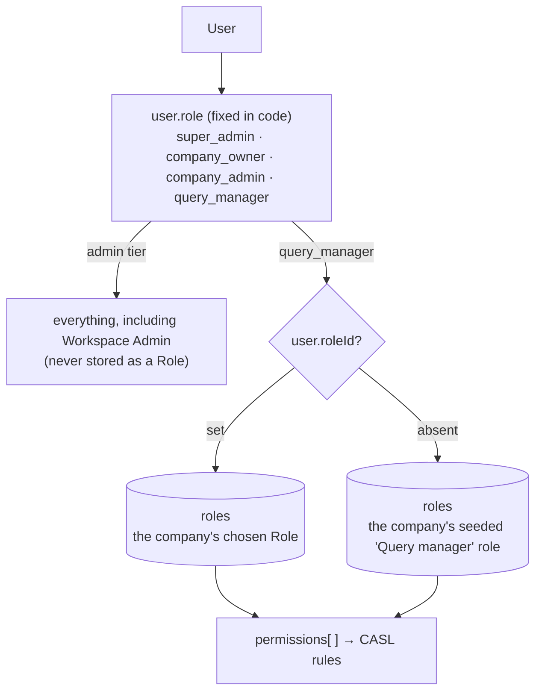
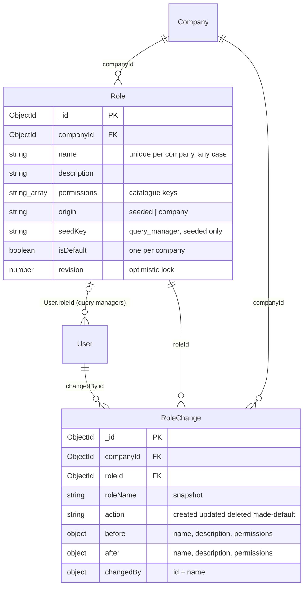
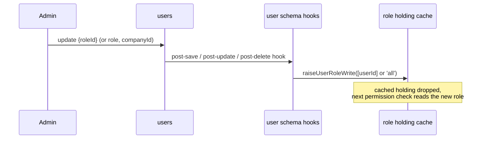
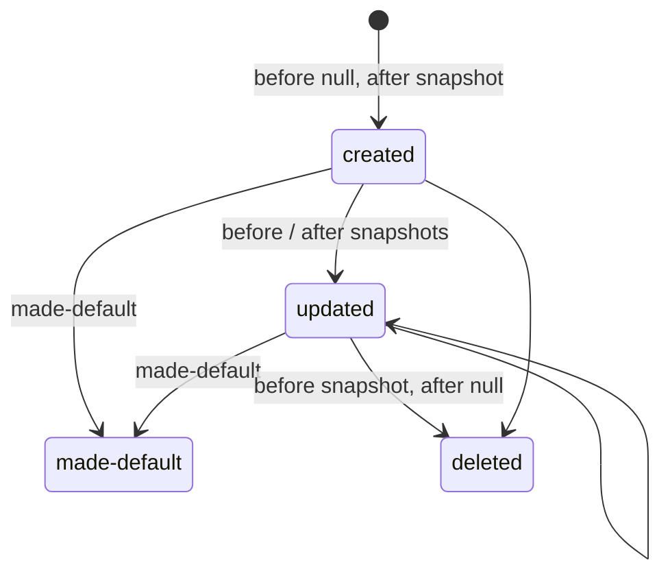

## The code

{/* schema: server/src/modules/role/schema.ts */}
```ts title="server/src/modules/role/schema.ts" lineNumbers
import mongoose, { Document, Model, Schema, Types } from 'mongoose';
import { baseSchema } from '@/libraries/db/base-schema';
import { PERMISSION_KEYS, type PermissionKey } from '@/auth/permissions';

// Operational roles (spec: docs/roles.md). Company data: each Company composes its own from the
// permission catalogue (`auth/permissions.ts`). The admin tier (owner, admin, super admin) is fixed in
// code and never stored. Every holder is a query manager (`user.role`) — team, claim and forward work
// as before — and `user.roleId` names the role whose permissions apply.

/** `seeded`: shipped with the product, editable, never deleted. `company`: made by the Company. */
export const ROLE_ORIGINS = ['seeded', 'company'] as const;
export type RoleOrigin = (typeof ROLE_ORIGINS)[number];

/** The seeded roles. A user with no `roleId` holds the Company's `query_manager` role. */
export const SEED_KEYS = ['query_manager'] as const;
export type SeedKey = (typeof SEED_KEYS)[number];

export interface IRole extends Document {
  companyId: Types.ObjectId;
  name: string;
  description: string;
  permissions: PermissionKey[];
  origin: RoleOrigin;
  // Seeded roles only: which one, so seeding is idempotent.
  seedKey?: SeedKey;
  // The role new query managers get when none is picked. Exactly one per Company.
  isDefault: boolean;
  // Bumped on every edit; an edit names the revision it was based on (409 when stale). The
  // permission cache is dropped by the edit itself (`invalidateRole`), not keyed on this.
  revision: number;
  createdAt: Date;
  updatedAt: Date;
}

const roleSchema = new Schema<IRole>({
  companyId: { type: Schema.Types.ObjectId, ref: 'Company', required: true },
  name: { type: String, required: true, trim: true },
  description: { type: String, default: '', trim: true },
  permissions: { type: [{ type: String, enum: PERMISSION_KEYS }], default: [] },
  origin: { type: String, enum: ROLE_ORIGINS, required: true },
  seedKey: { type: String, enum: SEED_KEYS },
  isDefault: { type: Boolean, default: false },
  revision: { type: Number, default: 1, min: 1 },
});

roleSchema.add(baseSchema);

// Unique name per Company, ignoring case ("Supervisor" = "supervisor"); also serves the list.
roleSchema.index(
  { companyId: 1, name: 1 },
  { unique: true, collation: { locale: 'en', strength: 2 } }
);
// At most one default per Company (`makeDefault` relies on it).
roleSchema.index(
  { companyId: 1, isDefault: 1 },
  { unique: true, partialFilterExpression: { isDefault: true } }
);
// One of each seeded role per Company (the seeding upsert's guard).
roleSchema.index(
  { companyId: 1, seedKey: 1 },
  { unique: true, partialFilterExpression: { seedKey: { $exists: true } } }
);

const RoleModel: Model<IRole> = mongoose.model<IRole>('Role', roleSchema);

// ── Change history ──────────────────────────────────────────────────────────

export const ROLE_CHANGE_ACTIONS = ['created', 'updated', 'deleted', 'made-default'] as const;
export type RoleChangeAction = (typeof ROLE_CHANGE_ACTIONS)[number];

/** A role's editable fields, as the history shows them. */
export interface RoleSnapshot {
  name: string;
  description: string;
  permissions: PermissionKey[];
}

// One row per change; the role's name is copied so history outlives a delete or a rename.
export interface IRoleChange extends Document {
  companyId: Types.ObjectId;
  roleId: Types.ObjectId;
  roleName: string;
  action: RoleChangeAction;
  before: RoleSnapshot | null;
  after: RoleSnapshot | null;
  changedBy: { id: Types.ObjectId; name: string };
  createdAt: Date;
  updatedAt: Date;
}

const snapshotSchema = new Schema<RoleSnapshot>(
  {
    name: { type: String, required: true },
    description: { type: String, default: '' },
    permissions: { type: [String], default: [] },
  },
  { _id: false }
);

const roleChangeSchema = new Schema<IRoleChange>({
  companyId: { type: Schema.Types.ObjectId, ref: 'Company', required: true },
  roleId: { type: Schema.Types.ObjectId, ref: 'Role', required: true },
  roleName: { type: String, required: true },
  action: { type: String, enum: ROLE_CHANGE_ACTIONS, required: true },
  before: { type: snapshotSchema, default: null },
  after: { type: snapshotSchema, default: null },
  changedBy: {
    type: new Schema(
      {
        id: { type: Schema.Types.ObjectId, ref: 'User', required: true },
        name: { type: String, required: true },
      },
      { _id: false }
    ),
    required: true,
  },
});

roleChangeSchema.add(baseSchema);

// The Company's history and one role's, newest first (`_id` order = insertion order; the cursor).
roleChangeSchema.index({ companyId: 1, _id: -1 });
roleChangeSchema.index({ roleId: 1, _id: -1 });

export const RoleChangeModel: Model<IRoleChange> = mongoose.model<IRoleChange>(
  'RoleChange',
  roleChangeSchema
);

export default RoleModel;
```
{/* /schema */}

`PERMISSION_KEYS` comes from `server/src/auth/permissions.ts`, the **permission catalogue**. It is fixed in code. A company can only combine its keys, never invent new ones.

## Two layers of "role"



- `User.role` is still the **tier**. Owner, admin and super admin hold every permission and are never stored as Role documents.
- Every Role holder is a `query_manager`, so teams, claims and forwarding work as before. `User.roleId` picks **which permissions** apply.
- A query manager with no `roleId` holds the company's **seeded** role. It is created on first use, so no migration is needed.

## Map

<SchemaGraph domains={['roles']} height={420} />

## ER diagram



## Role

<ModelFields model="Role" />

### Three partial or collated unique indexes, three rules

| Index | Rule it enforces |
| --- | --- |
| `{companyId, name}` unique, case-insensitive collation | "Supervisor" and "supervisor" can't both exist in one company |
| `{companyId, isDefault}` unique, partial on `isDefault: true` | **At most one** default role per company. Only the default document is indexed, so any number of non-default roles fit. |
| `{companyId, seedKey}` unique, partial on `seedKey` existing | One seeded role per company: two concurrent seeds race and one wins |

### The permission catalogue

The keys a role's `permissions` array can hold. ✓ marks the seeded **Query manager** role's defaults.

| Group | Key | Label | Seeded |
| --- | --- | --- | --- |
| Inbox | `conversation.read` | Read conversations | ✓ |
| Inbox | `conversation.reply` | Reply | ✓ |
| Inbox | `conversation.claim` | Assign to me | ✓ |
| Inbox | `conversation.forward` | Forward | ✓ |
| Inbox | `conversation.assign` | Assign and reassign | |
| Inbox | `conversation.hold.manage` | Put on hold | ✓ |
| Inbox | `conversation.tag.apply` | Apply tags | ✓ |
| Inbox | `conversation.template.send` | Send WhatsApp templates | ✓ |
| Inbox | `session.note.read` | Read internal notes | ✓ |
| Inbox | `session.note.create` | Add internal notes | ✓ |
| Inbox | `session.wrap` | Wrap up | ✓ |
| Inbox | `session.reopen` | Reopen | ✓ |
| Comments | `comment.read` | Read comments | ✓ |
| Comments | `comment.reply` | Reply to comments | ✓ |
| Comments | `comment.like` | Like comments | ✓ |
| Comments | `comment.hide` | Hide comments | ✓ |
| Comments | `comment.delete` | Delete comments | ✓ |
| Overview | `analytics.brand_health.read` | Brand figures | |
| Overview | `analytics.scorecard.read.self` | Own figures | ✓ |
| Overview | `analytics.scorecard.read.all` | Team figures | |
| Brand setup | `brand.tag.manage` | Manage tags | |
| Brand setup | `brand.fixed_reply.manage` | Manage fixed replies | ✓ |
| Brand setup | `brand.sla.read` | See SLA targets | |

Each key maps to one or more CASL rules (`{ action, subject }`) **in code only**. The database stores keys, never rules, so what a role grants can't drift from what the routes check.

```json title="Sample company role"
{
  "_id": "670000000000000000000801",
  "companyId": "670000000000000000000001",
  "name": "Supervisor",
  "description": "Routes work and watches team figures.",
  "permissions": ["conversation.read", "conversation.reply", "conversation.assign", "analytics.scorecard.read.all", "brand.sla.read"],
  "origin": "company",
  "isDefault": false,
  "revision": 2
}
```

### Keeping permission checks fresh



The User schema now carries **middleware**. Any save, update or delete that touches `roleId`, `role` or `companyId` drops that user's cached role, so a permission check never runs on a stale role. An update whose filter isn't a plain `_id` or `_id $in` clears the cache for **everyone**.

## RoleChange

<ModelFields model="RoleChange" />



An append-only history: one row per change. `roleName` is copied so the history still reads correctly after a rename or delete. The two indexes sort by `_id: -1`, newest first, because `_id` order is insertion order and doubles as the page cursor.

```json title="Sample change"
{
  "companyId": "670000000000000000000001",
  "roleId": "670000000000000000000801",
  "roleName": "Supervisor",
  "action": "updated",
  "before": { "name": "Supervisor", "description": "Routes work and watches team figures.", "permissions": ["conversation.read", "conversation.reply", "conversation.assign"] },
  "after": { "name": "Supervisor", "description": "Routes work and watches team figures.", "permissions": ["conversation.read", "conversation.reply", "conversation.assign", "analytics.scorecard.read.all", "brand.sla.read"] },
  "changedBy": { "id": "670000000000000000000003", "name": "Amina Rahman" }
}
```

## Check yourself

<details>
<summary>A company admin's `roleId` is set. Does it limit what they can do?</summary>

No. The admin tier holds everything and roles apply to query managers only. `roleId` is described as a query-manager field.
</details>

<details>
<summary>How does the database guarantee one default role per company?</summary>

The partial unique index `{companyId, isDefault}` indexes only documents with `isDefault: true`, so a second default in the same company is a duplicate key.
</details>

<details>
<summary>Why store `permissions` as keys like `conversation.reply` rather than CASL rules?</summary>

The key-to-rule translation lives only in `auth/permissions.ts`. Changing what a key allows is a code change, and every stored role follows it automatically.
</details>
