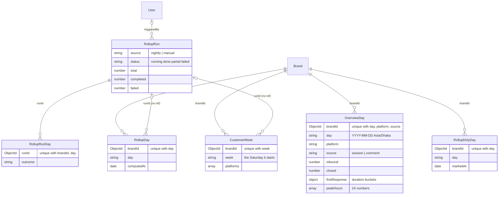
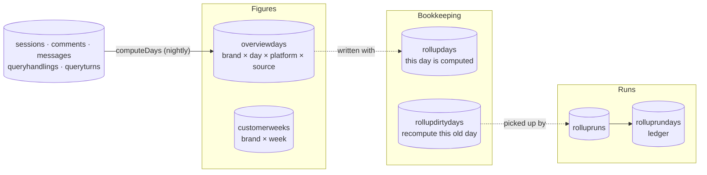
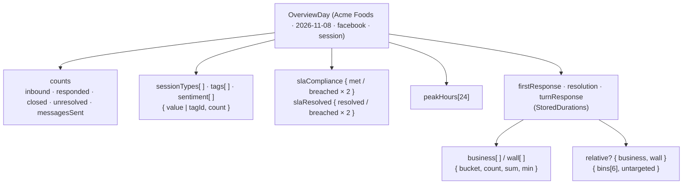
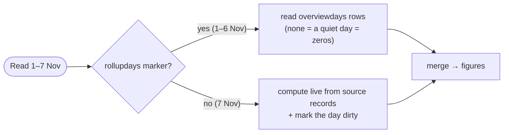
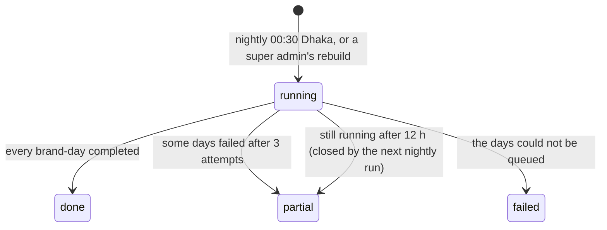
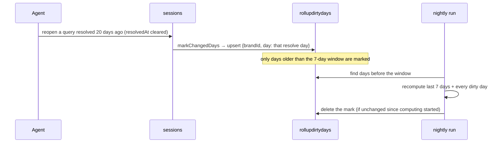

## The code

{/* schema: server/src/modules/overview/rollup/schema.ts */}
```ts title="server/src/modules/overview/rollup/schema.ts" lineNumbers
import mongoose, { Schema, Types } from 'mongoose';
import { CHANNEL_PLATFORMS, type ChannelPlatform } from '@/modules/conversation/schema';
import { HANDLING_SOURCES, type HandlingSource } from '@/modules/handling/schema';

// Overview figures precalculated per brand and business day (Asia/Dhaka), so a range read costs
// days, not records (docs/overview-rollups.md). Every stored figure is a count, a sum or a duration
// bucket: they add up across days, and means, rates and percentiles are worked out after the merge.
// Rows are written only by `storeDays` (./store.ts), a whole brand-day at a time.

/** A duration bucket as stored: `durations.ts`' `DurationBucket` with `bucket` for its `_id`. */
export interface StoredBucket {
  bucket: number;
  count: number;
  sum: number;
  min: number;
}

// The SLA page's relative histogram bins (FR-10.6.9a): a duration as a share of the item's own
// target, < 25%, 25–50%, 50–75%, 75–100%, 100–200%, > 200% (docs/sla-page-tabs.md).
export const RELATIVE_BIN_EDGES = [0.25, 0.5, 0.75, 1, 2] as const;
export const RELATIVE_BINS = RELATIVE_BIN_EDGES.length + 1;

/** One clock form's durations by relative bin, and how many timed items had no target. */
export interface RelativeCounts {
  // RELATIVE_BINS counts.
  bins: number[];
  // Timed items without a target for the metric: any in a range → the fixed bins are shown.
  untargeted: number;
}

/** Business-time and wall-clock buckets of one duration figure. */
export interface StoredDurations {
  business: StoredBucket[];
  wall: StoredBucket[];
  // Missing on days stored before it existed: read as "no target", so the fixed bins are shown.
  relative?: { business: RelativeCounts; wall: RelativeCounts };
}

export interface SlaComplianceCounts {
  // Each filed under the day it was decided: the reply, the due time, the resolve, the due time.
  firstResponseMet: number;
  firstResponseBreached: number;
  resolutionMet: number;
  resolutionBreached: number;
}

export interface SlaResolvedCounts {
  // Measured queries resolved on the day, and those of them that missed the target (`/sla`).
  frResolved: number;
  frBreachedResolved: number;
  resResolved: number;
  resBreachedResolved: number;
}

/**
 * One brand, day, platform and source (DM sessions or customer comment threads). Each figure is
 * filed under the day of its own anchor, noted per field; a row exists when any figure is non-zero.
 */
export interface OverviewDay {
  brandId: Types.ObjectId;
  // YYYY-MM-DD, Asia/Dhaka.
  day: string;
  platform: ChannelPlatform;
  source: HandlingSource;
  // Opened on the day (first customer message; a customer root's `commentedAt`).
  inbound: number;
  // Of those, the ones with a brand reply when computed.
  responded: number;
  // Opened on the day and answered: first customer message → first reply.
  firstResponse: StoredDurations;
  // Resolved on the day.
  closed: number;
  // Unresolved now, filed under the day they became unresolved (docs/team-view-closure.md).
  unresolved: number;
  // Resolved or unresolved on the day (as `closed` / `unresolved`), per session type (null: unset).
  sessionTypes: { value: string | null; count: number }[];
  // Resolved on the day: clock start → resolve. Sessions without a first customer message aren't
  // timed, so this can count fewer than `closed`.
  resolution: StoredDurations;
  slaResolved: SlaResolvedCounts;
  slaCompliance: SlaComplianceCounts;
  // Turns answered on the day (T5: by the answer's day): their wait, business (`responseMs`) and
  // wall clock; the wall-clock buckets' counts are the turns answered.
  turnResponse: StoredDurations;
  // Sent on the day: outgoing DM messages neither automatic nor failed (H3), and the page's
  // outgoing comment replies.
  messagesSent: number;
  // Inbound by hour of the day (00–23): DM messages; customer comments, replies included.
  peakHours: number[];
  // Opened on the day: uses per tag, and handler sentiment (null: not set).
  tags: { tagId: Types.ObjectId; count: number }[];
  sentiment: { value: string | null; count: number }[];
}

/**
 * One brand, day, platform, source, query manager and team: handling figures. Computed live
 * (`computeHandlerDays`), never stored: per-handler reads cap their range instead.
 */
export interface HandlerDay {
  brandId: Types.ObjectId;
  day: string;
  platform: ChannelPlatform;
  source: HandlingSource;
  queryManagerId: Types.ObjectId;
  // The team stamped on the handling record; null when it had none.
  teamId: Types.ObjectId | null;
  // Handled on the day (H2).
  handled: number;
  // Decided on the day (H11 / H12).
  resolved: number;
  unresolved: number;
  // First responses on the day (H13): how many, and their business-time sum.
  firstResponseAnswered: number;
  firstResponseTotalMs: number;
  // Turns they answered on the day while holding the query (T5), and the wall-clock sum of their
  // own part of the wait (docs/team-view-handlers.md).
  turnsAnswered: number;
  turnResponseWallTotalMs: number;
  // Messages they sent on the day (TP-A3): DM messages and comment replies, filed under their team
  // at calculation time (docs/handler-view-summary.md).
  messagesSent: number;
  // Owned (docs/handler-view-tabs.md): the queries this query manager held when they were closed
  // (resolved by the resolve day, unresolved by the day set), filed under their team at calculation
  // time. Resolved, and how many of those carried a resolution time and its business-time sum.
  ownedResolved: number;
  ownedResolutionTimed: number;
  ownedResolutionTotalMs: number;
  // SLA targets decided on the day on queries they hold (or held at close).
  slaCompliance: SlaComplianceCounts;
  // Session types and tags of the closed queries they owned (`value` null: not set).
  sessionTypes: { value: string | null; count: number }[];
  tags: { tagId: Types.ObjectId; count: number }[];
}

/** A brand-day that has been computed. A day without one is read live (never shown as zero). */
export interface RollupDay {
  brandId: Types.ObjectId;
  day: string;
  computedAt: Date;
  // The rollup run that wrote it; absent for writes outside a run.
  runId?: Types.ObjectId;
}

const bucketSchema = new Schema<StoredBucket>(
  {
    bucket: { type: Number, required: true },
    count: { type: Number, required: true },
    sum: { type: Number, required: true },
    min: { type: Number, required: true },
  },
  { _id: false }
);

const relativeCountsSchema = new Schema<RelativeCounts>(
  { bins: { type: [Number], required: true }, untargeted: { type: Number, required: true } },
  { _id: false }
);

const durationsSchema = new Schema<StoredDurations>(
  {
    business: { type: [bucketSchema], default: [] },
    wall: { type: [bucketSchema], default: [] },
    relative: {
      type: new Schema(
        { business: relativeCountsSchema, wall: relativeCountsSchema },
        { _id: false }
      ),
    },
  },
  { _id: false }
);

const count = { type: Number, default: 0 };

const overviewDaySchema = new Schema<OverviewDay>(
  {
    brandId: { type: Schema.Types.ObjectId, ref: 'Brand', required: true },
    day: { type: String, required: true },
    platform: { type: String, enum: [...CHANNEL_PLATFORMS], required: true },
    source: { type: String, enum: [...HANDLING_SOURCES], required: true },
    inbound: count,
    responded: count,
    firstResponse: { type: durationsSchema, default: (): object => ({}) },
    closed: count,
    unresolved: count,
    sessionTypes: {
      type: [
        new Schema(
          { value: { type: String, default: null }, count: { type: Number, required: true } },
          { _id: false }
        ),
      ],
      default: [],
    },
    resolution: { type: durationsSchema, default: (): object => ({}) },
    turnResponse: { type: durationsSchema, default: (): object => ({}) },
    messagesSent: count,
    slaResolved: {
      frResolved: count,
      frBreachedResolved: count,
      resResolved: count,
      resBreachedResolved: count,
    },
    slaCompliance: {
      firstResponseMet: count,
      firstResponseBreached: count,
      resolutionMet: count,
      resolutionBreached: count,
    },
    peakHours: { type: [Number], default: (): number[] => Array.from({ length: 24 }, () => 0) },
    tags: {
      type: [
        new Schema(
          {
            tagId: { type: Schema.Types.ObjectId, required: true },
            count: { type: Number, required: true },
          },
          { _id: false }
        ),
      ],
      default: [],
    },
    sentiment: {
      type: [
        new Schema(
          { value: { type: String, default: null }, count: { type: Number, required: true } },
          { _id: false }
        ),
      ],
      default: [],
    },
  },
  { versionKey: false }
);
// One row per brand, day, platform and source; serves the range reads too.
overviewDaySchema.index({ brandId: 1, day: 1, platform: 1, source: 1 }, { unique: true });

const rollupDaySchema = new Schema<RollupDay>(
  {
    brandId: { type: Schema.Types.ObjectId, ref: 'Brand', required: true },
    day: { type: String, required: true },
    computedAt: { type: Date, required: true },
    runId: { type: Schema.Types.ObjectId },
  },
  { versionKey: false }
);
rollupDaySchema.index({ brandId: 1, day: 1 }, { unique: true });

export const ROLLUP_RUN_SOURCES = ['nightly', 'manual'] as const;
export type RollupRunSource = (typeof ROLLUP_RUN_SOURCES)[number];
export const ROLLUP_RUN_STATUSES = ['running', 'done', 'partial', 'failed'] as const;
export type RollupRunStatus = (typeof ROLLUP_RUN_STATUSES)[number];

/** One rollup run: the nightly window, or a rebuild a super admin started. */
export interface RollupRun {
  _id: Types.ObjectId;
  source: RollupRunSource;
  // Who started a manual run.
  triggeredBy?: Types.ObjectId;
  // A run limited to one brand; absent: every brand it covers.
  brandId?: Types.ObjectId;
  from: string;
  to: string;
  // Brand-days queued, and how they ended.
  total: number;
  completed: number;
  failed: number;
  // The first failures (capped), for the status screen.
  failedDays: { brandId: Types.ObjectId; day: string; error: string }[];
  // `failed`: the run couldn't queue its days.
  status: RollupRunStatus;
  error?: string;
  startedAt: Date;
  finishedAt?: Date;
}

/**
 * A finished day outside the nightly window whose stored figures went stale: an event filed under
 * it moved or vanished (a resolved query reopened, a reply or comment deleted, a handling record
 * rewritten). The next nightly run recomputes it; a successful recompute clears it.
 */
export interface RollupDirtyDay {
  brandId: Types.ObjectId;
  day: string;
  markedAt: Date;
}

const rollupRunSchema = new Schema<RollupRun>(
  {
    source: { type: String, enum: [...ROLLUP_RUN_SOURCES], required: true },
    triggeredBy: { type: Schema.Types.ObjectId, ref: 'User' },
    brandId: { type: Schema.Types.ObjectId, ref: 'Brand' },
    from: { type: String, required: true },
    to: { type: String, required: true },
    total: count,
    completed: count,
    failed: count,
    failedDays: {
      type: [
        new Schema(
          {
            brandId: { type: Schema.Types.ObjectId, required: true },
            day: { type: String, required: true },
            error: { type: String, required: true },
          },
          { _id: false }
        ),
      ],
      default: [],
    },
    status: { type: String, enum: [...ROLLUP_RUN_STATUSES], default: 'running' },
    error: { type: String },
    startedAt: { type: Date, required: true },
    finishedAt: { type: Date },
  },
  { versionKey: false }
);
// The status screen: newest first, optionally one source.
rollupRunSchema.index({ startedAt: -1 });
rollupRunSchema.index({ source: 1, startedAt: -1 });
// One manual run per scope at a time: a brand, or every brand (no `brandId`, indexed as null).
rollupRunSchema.index(
  { brandId: 1 },
  {
    unique: true,
    name: 'one_running_manual_run_per_scope',
    partialFilterExpression: { source: 'manual', status: 'running' },
  }
);

/**
 * How one brand-day of a run ended. Unique per run and brand-day, so a job that runs twice (a retry
 * after its count landed, a stalled job run again) counts once.
 */
export interface RollupRunDay {
  runId: Types.ObjectId;
  brandId: Types.ObjectId;
  day: string;
  outcome: 'completed' | 'failed';
}

const rollupRunDaySchema = new Schema<RollupRunDay>(
  {
    runId: { type: Schema.Types.ObjectId, ref: 'RollupRun', required: true },
    brandId: { type: Schema.Types.ObjectId, ref: 'Brand', required: true },
    day: { type: String, required: true },
    outcome: { type: String, enum: ['completed', 'failed'], required: true },
  },
  { versionKey: false }
);
rollupRunDaySchema.index({ runId: 1, brandId: 1, day: 1 }, { unique: true });

const rollupDirtyDaySchema = new Schema<RollupDirtyDay>(
  {
    brandId: { type: Schema.Types.ObjectId, ref: 'Brand', required: true },
    day: { type: String, required: true },
    markedAt: { type: Date, required: true },
  },
  { versionKey: false }
);
rollupDirtyDaySchema.index({ brandId: 1, day: 1 }, { unique: true });
// The nightly run reads every brand's marks before its window.
rollupDirtyDaySchema.index({ day: 1 });

/** One platform's customers in a stored week (`customers.ts` `computeCustomerWeeks`). */
export interface CustomerWeekPlatform {
  platform: ChannelPlatform;
  customers: number;
  repeat: number;
  returning: number;
}

/**
 * One brand and finished week (Saturday to Friday): the customer trend's counts, per platform (a
 * customer is a conversation, which has one platform, so they add up). Written whole by
 * `storeCustomerWeek` (./weeks.ts); the row existing means the week is computed (a quiet week has
 * no platforms), so no marker is needed (docs/customer-weeks.md).
 */
export interface StoredCustomerWeek {
  brandId: Types.ObjectId;
  // The Saturday that starts it, YYYY-MM-DD (Asia/Dhaka).
  week: string;
  // Platforms with any customer that week.
  platforms: CustomerWeekPlatform[];
  // When the computation that wrote it started: an older one never replaces it.
  computedAt: Date;
  runId?: Types.ObjectId;
}

const customerWeekSchema = new Schema<StoredCustomerWeek>(
  {
    brandId: { type: Schema.Types.ObjectId, ref: 'Brand', required: true },
    week: { type: String, required: true },
    platforms: {
      type: [
        new Schema<CustomerWeekPlatform>(
          {
            platform: { type: String, enum: [...CHANNEL_PLATFORMS], required: true },
            customers: count,
            repeat: count,
            returning: count,
          },
          { _id: false }
        ),
      ],
      default: [],
    },
    computedAt: { type: Date, required: true },
    runId: { type: Schema.Types.ObjectId },
  },
  { versionKey: false }
);
// One row per brand and week; serves the range read too.
customerWeekSchema.index({ brandId: 1, week: 1 }, { unique: true });

export const OverviewDayModel = mongoose.model<OverviewDay>('OverviewDay', overviewDaySchema);
export const RollupDayModel = mongoose.model<RollupDay>('RollupDay', rollupDaySchema);
export const RollupRunModel = mongoose.model<RollupRun>('RollupRun', rollupRunSchema);
export const RollupRunDayModel = mongoose.model<RollupRunDay>('RollupRunDay', rollupRunDaySchema);
export const RollupDirtyDayModel = mongoose.model<RollupDirtyDay>(
  'RollupDirtyDay',
  rollupDirtyDaySchema
);
export const CustomerWeekModel = mongoose.model<StoredCustomerWeek>(
  'CustomerWeek',
  customerWeekSchema
);
```
{/* /schema */}

The file also declares a `HandlerDay` interface **with no model**. Per-handler figures are computed live (`computeHandlerDays`) and never stored, so the file defines six collections.

## Map

<SchemaGraph domains={['rollups']} height={520} />

## ER diagram



## Three roles



Rollups exist so a range read costs **days, not records**: a year is about 1,100 small rows per brand, whatever the traffic.

## OverviewDay

<ModelFields model="OverviewDay" />

### Every figure adds up across days



Only counts, sums and duration **buckets** are stored, never a mean, rate or percentile. Those are computed **after** merging the days, so a 30-day figure equals what a live 30-day query would give. Buckets are minutes below a day and hours past it, and `relative` bins a duration as a share of the item's own SLA target (under 25%, 25–50%, 50–75%, 75–100%, 100–200%, over 200%).

```json title="Sample OverviewDay (shortened)"
{
  "brandId": "670000000000000000000004",
  "day": "2026-11-08",
  "platform": "facebook",
  "source": "session",
  "inbound": 42,
  "responded": 39,
  "closed": 35,
  "unresolved": 3,
  "messagesSent": 118,
  "firstResponse": {
    "business": [{ "bucket": 4, "count": 10, "sum": 2580000, "min": 240000 }],
    "wall": [{ "bucket": 5, "count": 12, "sum": 3720000, "min": 300000 }]
  },
  "slaCompliance": { "firstResponseMet": 37, "firstResponseBreached": 2, "resolutionMet": 33, "resolutionBreached": 2 },
  "peakHours": [0, 0, 0, 0, 0, 0, 0, 0, 1, 3, 5, 6, 4, 3, 2, 4, 5, 3, 2, 2, 1, 1, 0, 0],
  "tags": [{ "tagId": "670000000000000000000301", "count": 7 }],
  "sentiment": [{ "value": "NEGATIVE", "count": 9 }, { "value": "NEUTRAL", "count": 33 }],
  "sessionTypes": [{ "value": "complain", "count": 12 }, { "value": null, "count": 23 }]
}
```

A row exists only when some figure is non-zero. So how do you tell a quiet day from a day that was never computed? With the marker below.

## RollupDay

<ModelFields model="RollupDay" />



The rows and their marker are written in **one transaction**, so a reader never sees half a day. That is why MongoDB must run as a replica set.

## CustomerWeek

<ModelFields model="CustomerWeek" />

Distinct customers don't add up across days: someone who wrote on Monday and Tuesday is one customer, not two. So the customer trend is stored **per week** (Saturday to Friday). The row existing is itself the marker: a quiet week has `platforms: []`.

## RollupRun

<ModelFields model="RollupRun" />



The partial unique index `one_running_manual_run_per_scope` allows at most one **running manual** run per brand, and one for "every brand" (`brandId` absent indexes as `null`). A second rebuild of the same scope gets a duplicate-key error.

## RollupRunDay

<ModelFields model="RollupRunDay" />

A ledger with a unique `{runId, brandId, day}`. If a job runs twice (a retry after its count already landed, a stalled job picked up again), the second insert fails and the run's counters are not bumped twice.

## RollupDirtyDay

<ModelFields model="RollupDirtyDay" />



The nightly run always recomputes the last 7 finished days. A dirty mark covers an **older** day whose events moved or vanished: a reopened query, a deleted comment, or an SLA or handling rewrite. The `{day: 1}` index lets the nightly run find every brand's marks at once.

## Check yourself

<details>
<summary>Why is there no `createdAt` on these collections?</summary>

They set `versionKey: false` and don't add `baseSchema`. Each row carries its own meaningful time instead: `day`, `week`, `computedAt`, `startedAt` or `markedAt`.
</details>

<details>
<summary>Why is the response rate stored as `inbound` and `responded`, not a percentage?</summary>

Percentages don't add up across days. Storing both counts lets any range compute `responded ÷ inbound` exactly.
</details>

<details>
<summary>A day has an `overviewdays` row but no `rollupdays` marker. Is it trusted?</summary>

No. Reads trust only marked days. The row may come from a write that committed between the reader's checks, so the day is computed live.
</details>
