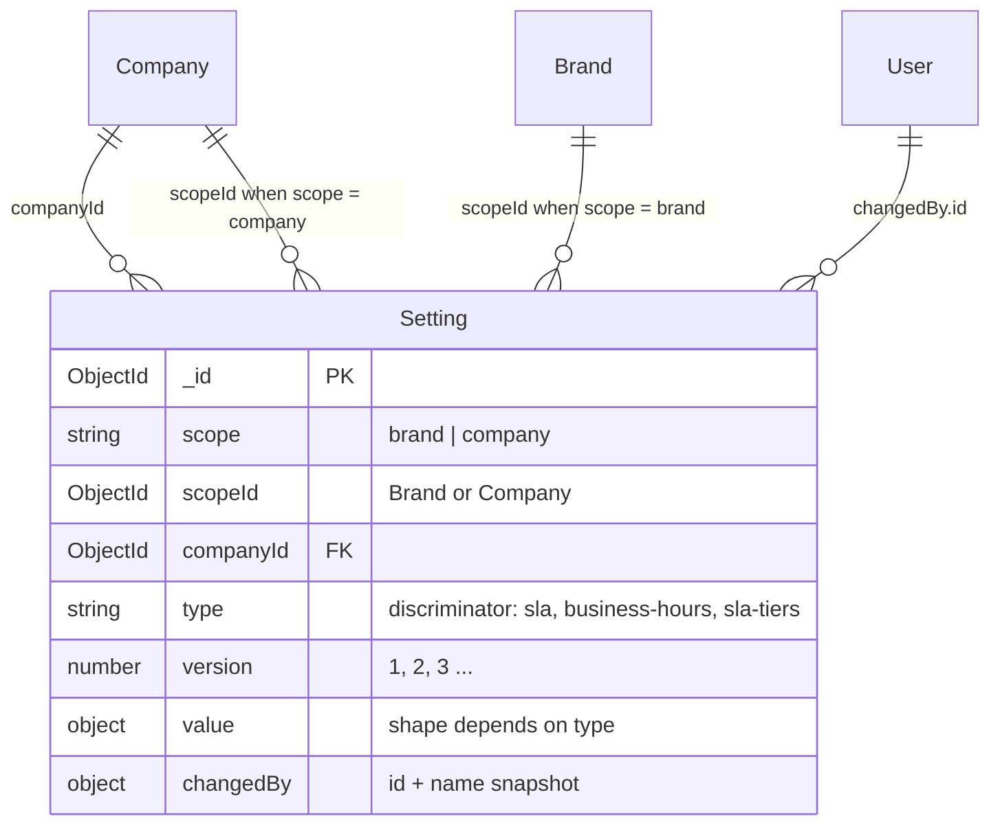
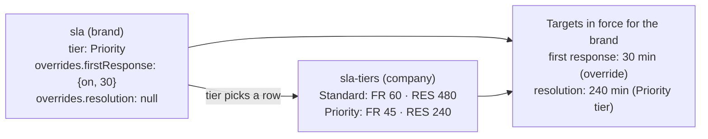
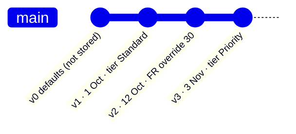
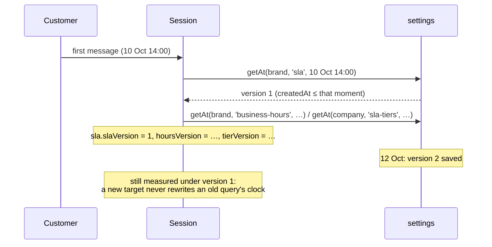

## The code

{/* schema: server/src/modules/settings/schema.ts */}
```ts title="server/src/modules/settings/schema.ts" lineNumbers
import mongoose, { Document, Model, Schema, Types } from 'mongoose';
import { baseSchema } from '@/libraries/db/base-schema';
import {
  SETTING_SCOPES,
  SLA_TIERS,
  TARGET_MAX_MINUTES,
  TARGET_MIN_MINUTES,
  WEEK,
  type SettingScope,
  type SettingType,
} from './definitions';

// One document per saved version of one setting type. Append-only: a save inserts version + 1,
// so the versions double as the audit log.
export interface ISetting extends Document {
  scope: SettingScope;
  // The brand or company id, per `scope`.
  scopeId: Types.ObjectId;
  // Always set, for tenant scoping.
  companyId: Types.ObjectId;
  // Discriminator key.
  type: SettingType;
  version: number;
  value: unknown;
  // Name copied so history survives the user being renamed or removed.
  changedBy: { id: Types.ObjectId; name: string };
  createdAt: Date;
  updatedAt: Date;
}

const settingSchema = new Schema<ISetting>(
  {
    scope: { type: String, enum: SETTING_SCOPES, required: true },
    scopeId: { type: Schema.Types.ObjectId, required: true },
    companyId: { type: Schema.Types.ObjectId, ref: 'Company', required: true },
    version: { type: Number, required: true, min: 1 },
    changedBy: {
      type: new Schema(
        {
          id: { type: Schema.Types.ObjectId, ref: 'User', required: true },
          name: { type: String, required: true },
        },
        { _id: false }
      ),
      required: true,
    },
  },
  { discriminatorKey: 'type' }
);

settingSchema.add(baseSchema);

// Latest-version lookup, and the guard against two saves claiming the same version.
settingSchema.index({ scope: 1, scopeId: 1, type: 1, version: -1 }, { unique: true });

const SettingModel: Model<ISetting> = mongoose.model<ISetting>('Setting', settingSchema);

// ── Discriminators ─────────────────────────────────────────────────────────

const targetSchema = new Schema(
  {
    on: { type: Boolean, required: true },
    minutes: { type: Number, required: true, min: TARGET_MIN_MINUTES, max: TARGET_MAX_MINUTES },
  },
  { _id: false }
);

const slaValueSchema = new Schema(
  {
    tier: { type: String, enum: SLA_TIERS, required: true },
    overrides: {
      firstResponse: { type: targetSchema, default: null },
      resolution: { type: targetSchema, default: null },
    },
  },
  { _id: false }
);

const tierTargetsSchema = new Schema(
  {
    firstResponse: { type: targetSchema, required: true },
    resolution: { type: targetSchema, required: true },
  },
  { _id: false }
);

const slaTiersValueSchema = new Schema(
  {
    Standard: { type: tierTargetsSchema, required: true },
    Priority: { type: tierTargetsSchema, required: true },
  },
  { _id: false }
);

const daySchema = new Schema(
  {
    day: { type: String, enum: WEEK, required: true },
    open: { type: Boolean, required: true },
    opens: { type: String, required: true },
    closes: { type: String, required: true },
  },
  { _id: false }
);

const businessHoursValueSchema = new Schema(
  {
    timezone: { type: String, required: true },
    days: { type: [daySchema], required: true },
    holidays: { type: [String], default: [] },
  },
  { _id: false }
);

// Write through these so each type's value schema applies.
const SETTING_MODELS: Record<SettingType, Model<ISetting>> = {
  sla: SettingModel.discriminator<ISetting>(
    'SlaSetting',
    new Schema({ value: { type: slaValueSchema, required: true } }),
    { value: 'sla' }
  ),
  'business-hours': SettingModel.discriminator<ISetting>(
    'BusinessHoursSetting',
    new Schema({ value: { type: businessHoursValueSchema, required: true } }),
    { value: 'business-hours' }
  ),
  'sla-tiers': SettingModel.discriminator<ISetting>(
    'SlaTiersSetting',
    new Schema({ value: { type: slaTiersValueSchema, required: true } }),
    { value: 'sla-tiers' }
  ),
};

// eslint-disable-next-line security/detect-object-injection
export const modelOf = (type: SettingType): Model<ISetting> => SETTING_MODELS[type];

export default SettingModel;
```
{/* /schema */}

The constants it imports (`SETTING_SCOPES`, `SLA_TIERS`, `WEEK`, the target limits) and the default values live in `server/src/modules/settings/definitions.ts`.

## Map

<SchemaGraph domains={['settings']} height={380} />

## ER diagram



## Setting

<ModelFields model="Setting" />

### Three shapes in one collection

| `type` | Scope | Discriminator model | `value` shape | Version 0 (served until the first save) |
| --- | --- | --- | --- | --- |
| `sla` | brand | `SlaSetting` | `{ tier: 'Standard' \| 'Priority', overrides: { firstResponse: Target \| null, resolution: Target \| null } }` | Standard tier, no overrides |
| `business-hours` | brand | `BusinessHoursSetting` | `{ timezone, days: [{ day, open, opens, closes }] × 7, holidays: string[] }` | Asia/Dhaka, 09:00–21:00, Friday closed |
| `sla-tiers` | company | `SlaTiersSetting` | `{ Standard: { firstResponse, resolution }, Priority: { … } }` | Standard 60 / 480 min, Priority 45 / 240 min |

A **Target** is `{ on: boolean, minutes: number }`, with minutes between 5 and 4,320 (72 h). Outside production the minimum is 1.



`null` in an override means "inherit the tier". This is `targetsInForce` in `definitions.ts`.

### Append-only versions



Every save **inserts** a new document with `version + 1`; nothing is ever updated. So:

- the versions **are** the audit log, and `changedBy.name` is copied so the log survives a renamed or removed user;
- the unique index `{scope, scopeId, type, version: -1}` both finds the latest version and stops two simultaneous saves from claiming the same number. One of them gets a duplicate-key error.

```json title="Sample: two versions of a brand's SLA setting"
[
  {
    "scope": "brand", "scopeId": "670000000000000000000004", "companyId": "670000000000000000000001",
    "type": "sla", "version": 1,
    "value": { "tier": "Standard", "overrides": { "firstResponse": null, "resolution": null } },
    "changedBy": { "id": "670000000000000000000003", "name": "Amina Rahman" },
    "createdAt": "2026-10-01T05:00:00.000Z"
  },
  {
    "scope": "brand", "scopeId": "670000000000000000000004", "companyId": "670000000000000000000001",
    "type": "sla", "version": 2,
    "value": { "tier": "Standard", "overrides": { "firstResponse": { "on": true, "minutes": 30 }, "resolution": null } },
    "changedBy": { "id": "670000000000000000000003", "name": "Amina Rahman" },
    "createdAt": "2026-10-12T09:30:00.000Z"
  }
]
```

### How a session pins the versions it started under



`getAt` picks the newest version with `createdAt ≤ at`. The session stores the version numbers in `sla.slaVersion`, `sla.hoursVersion` and `sla.tierVersion` ([Messaging](/docs/listenyzen/messaging#session)).

## Check yourself

<details>
<summary>Where is the "current" SLA of a brand stored?</summary>

Nowhere as a separate field. It is the document with the highest `version` for `{scope: 'brand', scopeId, type: 'sla'}`. If none exists yet, the server serves the version-0 defaults.
</details>

<details>
<summary>Why does `scopeId` have no `ref`?</summary>

It points at a Brand or a Company depending on `scope`, so it is a polymorphic id.
</details>

<details>
<summary>An admin changes business hours. Which existing sessions change their due times?</summary>

None. Each session keeps the `hoursVersion` that was in force at its clock start.
</details>
