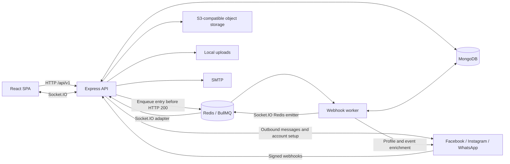

<SystemWalkthrough />

## What this application does

Listenyzen is a multi-tenant customer engagement application. A **company** owns **brands**. Each brand connects social accounts; staff handle private messages and public comments from those accounts in a shared inbox. Staff can assign work, add internal notes, classify interactions, maintain customer details, use reusable replies, and record outcomes. Versioned SLA and business-hour settings support response and resolution reporting.

The critical vocabulary is:

| Term            | Meaning in this codebase                                                                                            |
| --------------- | ------------------------------------------------------------------------------------------------------------------- |
| Company         | Tenant boundary; owns brands and staff.                                                                             |
| Brand           | Operational inbox boundary; contains connected channel credentials and staff/department access assignments.         |
| Query manager   | An agent handling customer interactions; a `User` with `role: 'query_manager'`, not a separate database model.      |
| Customer        | A channel-specific identity and editable contact record. Not automatically one identity across all social channels. |
| Conversation    | Long-lived direct-message thread for a page/phone/account and participant.                                          |
| Message         | One incoming/outgoing item within a conversation, usually attached to a session.                                    |
| Session         | A support episode within a conversation; carries ownership, classification, outcome, notes, and SLA.                |
| Comment thread  | A root public comment plus replies; separate from direct-message conversations and sessions.                        |
| Post            | Platform context copied onto comments, not a `Post` collection.                                                     |
| Assignment      | Either one query manager or one department; distinct from permission to see a brand.                                |
| Brand tag       | A reusable, optionally hierarchical label; records store its ID.                                                    |
| Setting version | An immutable saved configuration record; history and current value share one collection.                            |

## Runtime and dependencies

Sources: `server/package.json`, `server/tsconfig.json`, `server/Dockerfile`, `package.json`.

| Concern           | Implementation                                                                                                                                  |
| ----------------- | ----------------------------------------------------------------------------------------------------------------------------------------------- |
| Runtime           | Node.js; Docker images use `node:24-alpine`. No backend `engines` constraint in the manifest.                                                   |
| Language          | TypeScript pinned to `5.8.3`; CommonJS modules, `target: ES2015`.                                                                               |
| HTTP              | Express `^5.1.0`; routes under `/api/v1`.                                                                                                       |
| Package manager   | `pnpm@11.9.0`; separate root, server, and client installs/lockfiles. This is not a package workspace.                                           |
| Database          | MongoDB via Mongoose `^8.16.2`. MongoDB server version is not pinned by these app manifests; deployment comments expect external Atlas.         |
| Queue             | BullMQ `^6.3.2`, using ioredis `^5.8.2`.                                                                                                        |
| Realtime          | Socket.IO `^4.8.1`, Redis adapter `^8.3.0`, Redis emitter `^5.1.0`.                                                                             |
| Redis clients     | Both `redis` `^5.9.0` and `ioredis`; they serve different transport/queue roles. Compose uses `redis:7-alpine`.                                 |
| Authentication    | Passport `^0.7.0`, passport-local `^1.0.0`, jsonwebtoken `^9.0.2`, bcrypt `^6.0.0`.                                                             |
| Validation        | Zod `^4.1.9`, plus Mongoose schemas and application-level checks.                                                                               |
| Storage           | AWS SDK S3 client/presigner `^3.896.0`, multer `^2.0.2`, multer-s3 `^3.0.1`; local disk for logos/avatars.                                      |
| Email             | Nodemailer `^7.0.9`; SMTP transport.                                                                                                            |
| HTTP controls     | Helmet, CORS, HPP, express-rate-limit, compression, cookie-parser, `qs`.                                                                        |
| Logging           | Winston `^3.17.0`, winston-daily-rotate-file `^5.0.0`.                                                                                          |
| Development/build | nodemon, tsx, TypeScript compiler, tsc-alias, ESLint, Prettier.                                                                                 |
| Client context    | React/Vite SPA, Axios with credentials, TanStack Query consumers and Socket.IO client; backend changes often require cache/event updates there. |

`prom-client` is declared, but no active metrics exporter or `/metrics` route was found in `server/src`. Likewise, installed dependencies and old commented scaffolding do not establish that a service is running.

## Processes and infrastructure

- **API:** `src/app.ts` connects MongoDB, builds Express, and delegates HTTP/realtime startup to `src/server.ts`.
- **Worker:** `src/worker.ts` independently connects MongoDB, configures a Redis socket emitter, registers webhook handlers, and starts BullMQ. It has no HTTP listener.
- **Redis:** durable webhook work plus cross-process realtime transport. It is not an HTTP session store; application authentication uses JWTs.
- **MongoDB:** persistent domain records. API and worker share the database.
- **Meta:** Facebook Page/Messenger, Instagram through two login paths, and WhatsApp Cloud API. `FACEBOOK_GRAPH_VERSION` defaults to `v25.0` in this checkout; that is a code default, not a statement about the provider's current preferred version.
- **S3-compatible storage:** AWS S3 or an endpoint such as R2; credentials are application-level. Public media URLs are optional; private reads use presigned URLs.
- **Local uploads:** brand/company logos and user avatars. Public `/uploads` URLs are built with `BASE_URL`.
- **SMTP:** registration welcome messages; email failure does not roll back successful company registration.

