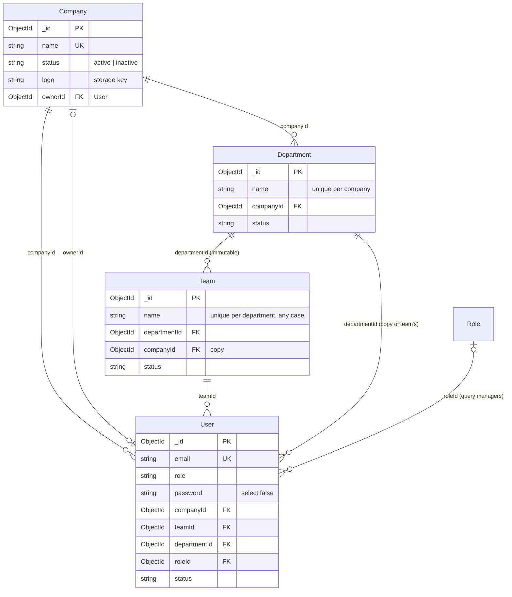
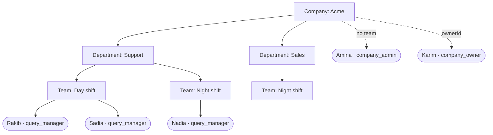
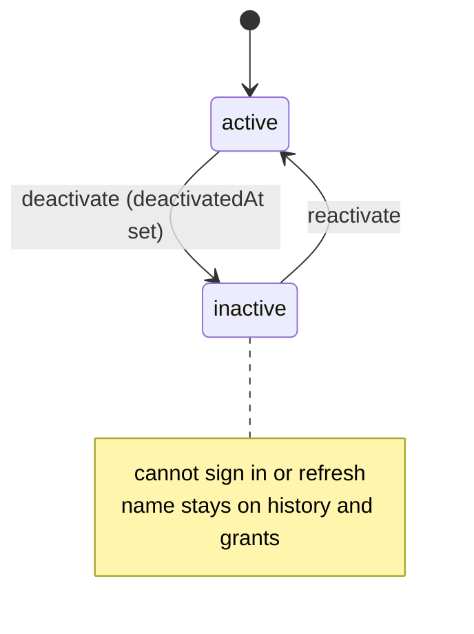

## The code

{/* schema: server/src/modules/company/schema.ts */}
```ts title="server/src/modules/company/schema.ts" lineNumbers
import mongoose, { Document, Model, Schema, Types } from 'mongoose';
import { baseSchema } from '@/libraries/db/base-schema';
import configs from '@/configs';

export const COMPANY_STATUS = ['active', 'inactive'] as const;
export type CompanyStatus = (typeof COMPANY_STATUS)[number];

export interface ICompany extends Document {
  name: string;
  status: CompanyStatus;
  // Storage key of an optional logo relative to the uploads dir, e.g. 'companies/acme-...png'.
  logo?: string;
  // The company_owner who owns/created the company (set during provisionCompany).
  ownerId?: Types.ObjectId;
  // A `settings.onlyAssignedCanAct` flag may linger on older documents: the setting was removed
  // (see auth/reply-access.ts) and nothing reads it.
}

const companySchema = new Schema<ICompany>(
  {
    name: { type: String, required: true, unique: true, trim: true },
    status: { type: String, enum: [...COMPANY_STATUS], default: 'active' },
    logo: { type: String },
    ownerId: { type: Schema.Types.ObjectId, ref: 'User' },
  },
  { toJSON: { virtuals: true }, toObject: { virtuals: true } }
);

companySchema.add(baseSchema);

// Absolute public URL for the logo, built from the locally-served uploads path.
companySchema.virtual('logoUrl').get(function (this: ICompany) {
  return this.logo ? `${configs.BASE_URL}/uploads/${this.logo}` : null;
});

const CompanyModel: Model<ICompany> = mongoose.model<ICompany>('Company', companySchema);

export default CompanyModel;
```
{/* /schema */}

{/* schema: server/src/modules/user/schema.ts */}
```ts title="server/src/modules/user/schema.ts" lineNumbers
import bcrypt from 'bcrypt';
import mongoose, { Schema, Document, Model, Query, Types } from 'mongoose';
import { ROLE_PATHS, raiseUserRoleWrite, touchesRole, type RoleWriteTargets } from './role-writes';
import { baseSchema } from '@/libraries/db/base-schema';
import { ROLE_VALUES, Role } from '@/auth/roles';
import configs from '@/configs';

/** An inactive user can't sign in or refresh a session; their history and grants are kept. */
export const USER_STATUSES = ['active', 'inactive'] as const;
export type UserStatus = (typeof USER_STATUSES)[number];

// Define an interface for the User document
export interface User extends Document {
  name: string;
  email: string;
  role: Role;
  password: string;
  // Company a user belongs to. Set for company_admin & query_manager; absent for super_admin.
  companyId?: Types.ObjectId;
  // Team a query_manager belongs to (required for them; see modules/team/membership.ts).
  teamId?: Types.ObjectId;
  // Department a query_manager belongs to: always their team's department, written alongside
  // `teamId` and never on its own. Kept on the user because brand scope, the JWT and the claim
  // queries all read it.
  departmentId?: Types.ObjectId;
  // Query managers only: the operational role whose permissions apply (modules/role). Absent = the
  // Company's seeded Query manager role.
  roleId?: Types.ObjectId;
  // Storage key of an optional avatar relative to the uploads dir, e.g. 'avatars/jane-...png'.
  avatar?: string;
  // Deactivated users keep their record (names on history, grants) but can't sign in.
  status: UserStatus;
  deactivatedAt?: Date;
}
export interface IUser extends User, Document {
  comparePassword(candidatePassword: string): Promise<boolean>;
}
// Create the schema with TypeScript
const userSchema = new Schema<IUser>(
  {
    name: { type: String, required: true },
    email: { type: String, required: true, unique: true, index: true },
    role: { type: String, required: true, enum: [...ROLE_VALUES] },
    status: { type: String, enum: [...USER_STATUSES], default: 'active' },
    deactivatedAt: { type: Date },
    // `select: false` keeps the hash out of every query that does not ask for it by name. The two
    // paths that legitimately need it — login and change-password — opt back in with
    // `.select('+password')`; see getByEmail and getByIdWithPassword in ./service.
    password: { type: String, required: true, select: false },
    companyId: { type: Schema.Types.ObjectId, ref: 'Company', index: true },
    teamId: { type: Schema.Types.ObjectId, ref: 'Team' },
    departmentId: { type: Schema.Types.ObjectId, ref: 'Department' },
    roleId: { type: Schema.Types.ObjectId, ref: 'Role' },
    avatar: { type: String },
  },
  {
    // Two layers, deliberately. `select: false` covers documents that were queried; the transform
    // covers the one it cannot — a document returned straight out of `save()`, which holds the hash
    // in memory because the pre-save hook just wrote it there. `create()` is exactly that path.
    toJSON: {
      virtuals: true,
      transform: (_doc, ret): Record<string, unknown> => {
        delete (ret as { password?: string }).password;
        return ret;
      },
    },
    toObject: {
      virtuals: true,
      transform: (_doc, ret): Record<string, unknown> => {
        delete (ret as { password?: string }).password;
        return ret;
      },
    },
  }
);

// Add the base schema properties
userSchema.add(baseSchema);

// Absolute public URL for the avatar, built from the locally-served uploads path.
userSchema.virtual('avatarUrl').get(function (this: IUser) {
  return this.avatar ? `${configs.BASE_URL}/uploads/${this.avatar}` : null;
});

// Hash password before saving
userSchema.pre('save', async function (next) {
  if (!this.isModified('password')) return next(); // Only hash if changed
  const salt = await bcrypt.genSalt(10);
  this.password = await bcrypt.hash(this.password, salt);
  next();
});

// Writes that may change someone's role drop their cached role holding (modules/user/role-writes.ts),
// so a permission check never runs on a stale role. Covers saves, updates and deletes.
const targetsOf = (filter: Record<string, unknown>): RoleWriteTargets => {
  const id = filter._id;
  if (typeof id === 'string' || id instanceof Types.ObjectId) return [String(id)];
  const inList = (id as { $in?: unknown[] } | undefined)?.$in;
  return Array.isArray(inList) ? inList.map(String) : 'all';
};

userSchema.pre('save', function (next) {
  this.$locals.roleWritten = !this.isNew && ROLE_PATHS.some(path => this.isModified(path));
  next();
});

userSchema.post('save', function (doc) {
  if (doc.$locals.roleWritten) raiseUserRoleWrite([String(doc._id)]);
});

userSchema.post(/^(updateOne|updateMany|findOneAndUpdate|replaceOne)$/, function () {
  const query = this as unknown as Query<unknown, IUser>;
  if (touchesRole(query.getUpdate())) raiseUserRoleWrite(targetsOf(query.getFilter()));
});

userSchema.post(/^(deleteOne|deleteMany|findOneAndDelete)$/, function () {
  const query = this as unknown as Query<unknown, IUser>;
  if (typeof query.getFilter === 'function') raiseUserRoleWrite(targetsOf(query.getFilter()));
});

// Instance methods
userSchema.methods.comparePassword = async function (password: string): Promise<boolean> {
  if (!this.password) throw new Error('Password not selected');
  return bcrypt.compare(password, this.password);
};

// Create and export the model
const UserModel: Model<IUser> = mongoose.model<IUser>('User', userSchema);

export default UserModel;
```
{/* /schema */}

{/* schema: server/src/modules/department/schema.ts */}
```ts title="server/src/modules/department/schema.ts" lineNumbers
import mongoose, { Document, Model, Schema, Types } from 'mongoose';
import { baseSchema } from '@/libraries/db/base-schema';

export const DEPARTMENT_STATUS = ['active', 'inactive'] as const;
export type DepartmentStatus = (typeof DEPARTMENT_STATUS)[number];

// Departments live under a company. Names are unique per company (not globally), so two
// companies can each have a "Support" department.
export interface IDepartment extends Document {
  name: string;
  status: DepartmentStatus;
  companyId: Types.ObjectId;
}

const departmentSchema = new Schema<IDepartment>({
  name: { type: String, required: true, trim: true },
  status: { type: String, enum: [...DEPARTMENT_STATUS], default: 'active' },
  companyId: { type: Schema.Types.ObjectId, ref: 'Company', required: true, index: true },
});

departmentSchema.add(baseSchema);

// Unique department name within a company.
departmentSchema.index({ companyId: 1, name: 1 }, { unique: true });

const DepartmentModel: Model<IDepartment> = mongoose.model<IDepartment>(
  'Department',
  departmentSchema
);

export default DepartmentModel;
```
{/* /schema */}

{/* schema: server/src/modules/team/schema.ts */}
```ts title="server/src/modules/team/schema.ts" lineNumbers
import mongoose, { Document, Model, Schema, Types } from 'mongoose';
import { baseSchema } from '@/libraries/db/base-schema';

export const TEAM_STATUS = ['active', 'inactive'] as const;
export type TeamStatus = (typeof TEAM_STATUS)[number];

// Teams live under a department, and query managers belong to a team. Names are unique per
// department, so "Night shift" can exist in Support and Sales alike.
//
// `departmentId` never changes after create: members' department is derived from their team, so
// moving a team would silently move every member (brand access, claimable pools) with it. Make a new
// team instead. `companyId` is copied from the department for tenant scoping.
//
// There is no delete: sessions, comments and users will reference teams, and removing one would
// leave those dangling. Deactivate instead.
export interface ITeam extends Document {
  name: string;
  status: TeamStatus;
  departmentId: Types.ObjectId;
  companyId: Types.ObjectId;
}

const teamSchema = new Schema<ITeam>({
  name: { type: String, required: true, trim: true },
  status: { type: String, enum: [...TEAM_STATUS], default: 'active' },
  departmentId: { type: Schema.Types.ObjectId, ref: 'Department', required: true, immutable: true },
  companyId: { type: Schema.Types.ObjectId, ref: 'Company', required: true, index: true },
});

teamSchema.add(baseSchema);

// Unique team name within a department, ignoring case ("Night shift" = "night shift"); also serves
// the per-department list.
teamSchema.index(
  { departmentId: 1, name: 1 },
  { unique: true, collation: { locale: 'en', strength: 2 } }
);

const TeamModel: Model<ITeam> = mongoose.model<ITeam>('Team', teamSchema);

export default TeamModel;
```
{/* /schema */}

## Map

<SchemaGraph domains={['tenancy']} height={460} />

## ER diagram



Read the crow's feet as "one company has many users". `|o--o|` means "zero or one": a company has at most one `ownerId`.

## The hierarchy



"Night shift" exists twice, which is fine: team names are unique per **department**, case-insensitively, through the collation on the unique index.

## Company

<ModelFields model="Company" />

```json title="Sample company"
{
  "_id": "670000000000000000000001",
  "name": "Acme",
  "status": "active",
  "logo": "companies/acme-1730000000.png",
  "ownerId": "670000000000000000000002",
  "createdAt": "2026-10-01T04:00:00.000Z",
  "updatedAt": "2026-10-01T04:00:00.000Z"
}
```

The company is created together with its owner (`provisionCompany`), so `ownerId` points back at a User whose `companyId` points at this company. That is a **two-way reference**, kept consistent by code rather than by MongoDB.

## User

<ModelFields model="User" />

Which fields are set depends on the role:

| Role | `companyId` | `teamId` | `departmentId` | `roleId` |
| --- | --- | --- | --- | --- |
| `super_admin` | absent: belongs to no company | no | no | no |
| `company_owner` | set | no | no | no |
| `company_admin` | set | no | no | no |
| `query_manager` | set | **required** (by the service) | always the team's department | optional: absent = the seeded Query manager role ([Roles](/docs/listenyzen/roles)) |

```json title="Sample query manager (password never leaves the server)"
{
  "_id": "670000000000000000000032",
  "name": "Sadia Islam",
  "email": "sadia@acme.example",
  "role": "query_manager",
  "status": "active",
  "companyId": "670000000000000000000001",
  "teamId": "670000000000000000000041",
  "departmentId": "670000000000000000000021",
  "avatarUrl": null
}
```

The User schema also has **middleware** since revision `18e6d95`: any write touching `roleId`, `role` or `companyId` drops that user's cached role ([details](/docs/listenyzen/roles#keeping-permission-checks-fresh)).

**Why is `departmentId` stored if the team already knows it?** Brand visibility, the JWT and the claim queries all filter by department. Storing it saves a team lookup on nearly every request. The rule "written alongside `teamId`, never on its own" keeps the copy correct.



## Department

<ModelFields model="Department" />

## Team

<ModelFields model="Team" />

Two rules shape this model:

- **`departmentId` is immutable.** Members get their department from the team, so moving a team would silently move every member's brand access with it. To restructure, create a new team.
- **No delete.** Sessions, comments, handling records and users reference teams, so a team is deactivated instead.

## Check yourself

<details>
<summary>A super admin has no `companyId`. How does tenant scoping treat them?</summary>

They are the one role outside every tenant. Their reads skip the company filter, and routes that need a company identity (`/me` company operations) cannot serve them.
</details>

<details>
<summary>What must change on a user when they move to another team in a different department?</summary>

Both `teamId` and `departmentId`, written together. Their brand access follows immediately, but an already-issued access token carries the old membership until it is refreshed.
</details>

<details>
<summary>Why does Team copy `companyId` from its department?</summary>

Tenant-scoped team queries (`{ companyId }`) then need no join through Department, and `companyId` is indexed for exactly that.
</details>
