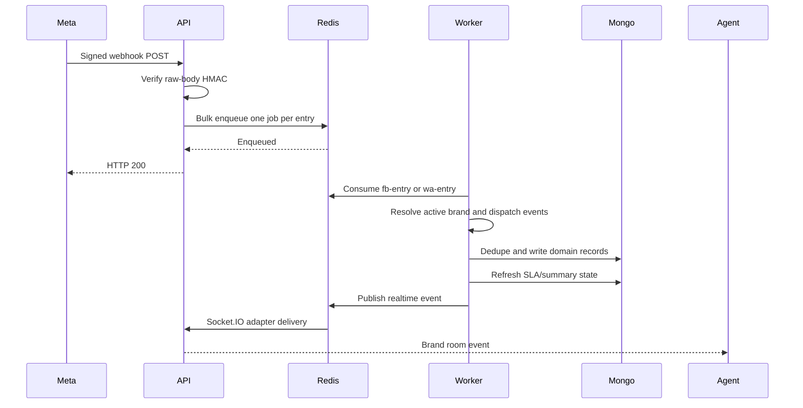

<SessionSimulator />

<SlaClock />

## Company provisioning and staffing

Public registration accepts companyName and owner identity/password. `provisionCompany` creates Company, creates a `company_owner` User, then links `ownerId`. On failure it attempts to delete the owner/company as compensation; cleanup failures are logged. Registration then attempts welcome email without undoing the account if delivery fails.

Admin staff creation derives companyId from the caller unless the caller is super admin. Query managers must select a team in that company; an active team and department are required when joining. Department membership is derived from the team. Query-manager operations apply a fixed role filter. Brand assignment checks that supplied departments/teams/agents belong to the right company.

## Team pools and personal ownership

Build the organization in this order: Company → Department → Team → Query manager. Grant brand visibility through departments, teams or individual agents. Manager-only assignment routes can pool an open query on an eligible active team/department or assign an individual. Query managers use Assign to me to take unassigned work or a pool they belong to; only then can they modify it. Routing or claiming does not end hold or resume SLA.

`mine=true` includes personal work plus own team and department pools. Claims and mine filters use current database membership; brand visibility uses the access-token membership until refresh. See [the code-level assignment walkthrough](/docs/listenyzen/code-assignment) for examples, conflicts and resolved-work restrictions.

## Channel connection

| Channel                    | Implemented connection path                                                                                                                                                    |
| -------------------------- | ------------------------------------------------------------------------------------------------------------------------------------------------------------------------------ |
| Facebook                   | Client-provided authorization information → user/page token resolution → verify page subscription → persist Page credentials and diagnostics.                                  |
| Instagram through Facebook | Resolve professional account linked to the Facebook Page; store Page-based token with `loginType: 'facebook'`. App Dashboard subscription setup remains relevant.              |
| Instagram direct login     | Get login URL with signed 10-minute state → OAuth callback → exchange code/token → subscribe/verify → save direct-login account and token expiry → redirect client.            |
| WhatsApp                   | Embedded Signup code + WABA/phone IDs → exchange code → read phone metadata to establish token access → subscribe WABA → attempt registration → persist connection/PIN/status. |

WhatsApp subscription is blocking in the normal signup path, while registration can remain pending. `connected` and `registered` are different states. Manual connect is guarded by `WHATSAPP_ALLOW_MANUAL_CONNECT`; it is a development escape hatch. Disconnect attempts WABA unsubscribe only when another brand is not using that WABA.

Instagram direct-token expiry is stored, but no active scheduled token-refresh job was found. Confirm the operational reconnection/refresh plan before relying on unattended long-lived integration.

Sources: `server/src/modules/brand/meta-channels.ts`, `server/src/modules/brand/whatsapp.ts`, `server/src/libraries/common/webhook-subscription.ts`.

## Incoming webhook processing

- Queue name: `webhooks`; topics: `fb-entry`, `wa-entry`.
- API acknowledges only after enqueue succeeds. Enqueue failure returns 500; invalid signature returns 403. Unsupported top-level webhook object types are acknowledged without processing.
- Producer timeout is two seconds. Failures reset its connection so delayed buffered writes do not silently outlive the expected request path.
- Worker default concurrency is 5 (`QUEUE_CONCURRENCY`). Each entry can contain several events; processing attempts events, records failures, then throws if any failed so the entry can be retried.
- Five total attempts; exponential backoff starting at two seconds. Completed jobs retained for up to one hour / 1,000 jobs; failed jobs retained for seven days.
- Database provider IDs are the primary duplicate defense. Delivery is not exactly-once: read-before-write checks and unique indexes do not make all preview/counter/session side effects atomic.
- Active channel resolution checks both brand and company status. Per-process TTL caches help resolve channel metadata; they are distinct from Redis transport state.
- Only `libraries/queue/index.ts` imports BullMQ. Add domain jobs through that wrapper rather than scattering queue setup through modules.

## Conversation and session lifecycle

`recordIncomingMessage` deduplicates by mid, upserts the conversation, increments unread state, calls `assignMessageToSession`, stores the message, recalculates SLA, then emits the update. Outgoing persistence follows a similar path and clears unread state.

Session selection:

| Existing latest session     | Message kind                     | Result                                |
| --------------------------- | -------------------------------- | ------------------------------------- |
| None                        | Any                              | Create sequence 1, status pending.    |
| Resolved                    | Incoming                         | Create next sequence, status pending. |
| Resolved                    | Explicit re-engagement send      | Create next sequence, status pending. |
| Resolved                    | Ordinary outgoing follow-up/echo | Keep the existing session.            |
| Pending | Incoming/outgoing | Continue the current session. |
| Unresolved | New customer message | Same session returns to pending. Agent replies leave it unresolved. |
| Hold | Qualifying non-automatic agent reply | Same session returns to pending. Customer messages leave it held. |

The newest session's status, sentiment, assignee and tags are copied onto Conversation. Updating historical sessions triggers synchronization from the latest session rather than blindly copying the historical change.

Wrap-up accepts only unresolved/resolved/hold (not pending) and writes status, sentiment, sessionType, optional summary and tags. Notes and resolution summaries are limited to 8,000 characters by their input schemas. `resolvedAt` is stamped for resolved and removed for other statuses. Status/wrap-up paths clear conversation unread count and emit updates. Internal notes increment noteCount without becoming provider messages.

Session merging has been removed. `PATCH /sessions/:id/status` requires status and accepts an optional reason. The strict schema rejects the former mergeWithPrevious field with HTTP 400; there is no merge UI or merge event.

Concurrency caveat: selecting the latest session and creating the next one are separate operations. There is no unique session sequence constraint or per-conversation queue serialization in the shown paths. Parallel jobs can race; assess this when changing ingestion or increasing worker concurrency.

## Customer records

Customer details are accessed through `/conversations/:id/customer`. Reads establish conversation visibility first. Updates additionally enforce actionable access, find/create the channel identity, apply allowed contact fields and link customerId if absent. Platform display snapshots on Conversation and the editable Customer are related but not interchangeable; do not assume changing Customer rewrites every existing display snapshot.

## Public comments

Webhook handling records Facebook feed changes and Instagram comment events. The comment collection contains both roots and replies. Thread detail walks children using provider parent IDs, with brand/post constraints. List ordering uses a root's `lastActivityAt`, which is bumped by new replies.

Agents can reply, change classification, assign, tag, wrap up, hide/unhide, like/unlike where supported, and delete. Moderation calls the provider and then updates local state. Facebook-specific capabilities should not be assumed available for Instagram.

Deletion walks the local descendant tree. Hiding changes moderation state and can affect SLA. A customer reply after resolved wrap-up **does not reopen** the comment thread or create a new SLA cycle; it can still float the thread to the top. This differs from direct-message session creation.

## Tag vocabulary

Tag names normalize whitespace, strip an initial `#`, and use `/` for hierarchy. Empty levels are invalid. The maximum tags on a record is 25. Selection validates IDs against the brand vocabulary. Parent filters expand to descendants.

Agents may create tags; privileged roles curate rename/archive operations. Rename handles the subtree, creates missing ancestor paths, and rejects collisions with existing vocabulary names rather than merging references. The preflight collision check and bulk write are not a transaction. Archived IDs remain useful to historical records. Use `TAGS_POPULATE` for standard read shape. Do not restore older snapshot-style embedded tags from obsolete examples.

## Versioned settings and SLA

Settings save body is `{ baseVersion, value }`. The service loads current version, rejects a stale base with 409, and inserts version+1. A unique index catches simultaneous competing saves. History pages by numeric version cursor, unlike timestamp-based inbox cursors.

Current defaults:

| Setting                              | Default                                                                                                             |
| ------------------------------------ | ------------------------------------------------------------------------------------------------------------------- |
| SLA tier                             | Standard                                                                                                            |
| Standard first response / resolution | 60 / 480 business minutes                                                                                           |
| Priority first response / resolution | 45 / 240 business minutes                                                                                           |
| Overrides                            | Null means use tier default; `{ on: false, minutes: ... }` disables a target.                                       |
| Business timezone                    | `Asia/Dhaka`, fixed server-side; clients do not submit it.                                                          |
| Weekly hours                         | 09:00–21:00 Saturday–Thursday; Friday closed.                                                                       |
| Target range                         | Production minimum 5 minutes; other environments minimum 1 minute; maximum 4,320 minutes.                           |
| Holidays                             | Unique ISO date strings; up to 366; saved values prune dates older than the configured one-year retention boundary. |

SLA snapshots use the setting versions in force when the customer first wrote, not today's settings. Outbound-only sessions have nothing to measure until a customer message exists.

**First response:** earliest non-failed, non-automatic outgoing message at/after the first customer message. `isAutomatic: true` is excluded; hold and unresolved do not pause the first-response clock. A resolved session without a reply stops usage at resolvedAt: resolving by its deadline is “Not needed,” while resolving after the deadline is breached. Provider acceptance without a known failure currently counts; the code does not require a delivered receipt.

**Resolution:** business time from the first customer message (or customer-authored root comment), including customer silence while pending. The status timeline subtracts every hold, unresolved and resolved interval. Returning to pending resumes the same clock with its previous charged time; a newly created session has its own clock.

At-risk threshold is 80%; target is 100%. `usedMs` stores finished charged intervals; `waitingSince` (a retained legacy field name) and projected atRiskAt/dueAt represent an active pending span. While paused below a threshold, its date may be null. Equality at the resolution target is treated as on time by the calculation.

Session SLA recalculates from stored messages on message/status/failure changes. Guards compare messagesSeen, failedMessagesSeen, statusChangesSeen and resolvedAt to avoid overwriting newer computations. Failures are logged without blocking the main domain operation, so an SLA repair backfill may be needed after a processing issue.

Comment SLA starts at a customer-authored root and uses its status timeline for resolution. The earliest page reply at any depth supplies first response. A root-author reply can reopen unresolved work; another participant cannot. A page reply ends hold. Resolved comment threads do not automatically reopen. `slaRevision` guards derived-state writes.

`hold` and `unresolved` stop resolution but remain in the Overview open set. A stopped query is not resolution-at-risk; a target already exceeded before stopping stays breached. First response can still breach while held. The business-time helper bounds calendar scanning at 400 days; schedules with no usable work windows can yield no clock.

Sources: `server/src/modules/session/sla.ts`, `server/src/modules/comment/sla.ts`, `server/src/libraries/business-time/index.ts`, `settings-sla-progress-context.md`.

## Status history and hold reasons

Actual status transitions append an embedded log entry; same-status saves keep the original timestamp and reason. Optional reasons are trimmed and capped at 500 characters. Sessions and comment roots share the revision-guarded writer. Only managers can read status history and the cross-query hold log. Read [the full status walkthrough](/docs/listenyzen/code-status) for state transitions and input/output examples.

## Overview definitions

The UI mixes live API-backed metrics with illustrative data; not every visible chart has a complete backend implementation.

- `/stats`: pending sessions now; unassigned means no assignee (a department assignment counts as assigned).
- `/sla`: at-risk/breached current targets; open set includes pending, unresolved and hold. Sessions and comments can be requested separately.
- `/engagement`: inbound counts use first customer message for sessions and customer-authored comment roots in the selected range; response rates use firstResponseAt. Current unresolved backlog includes pending+unresolved, excluding hold.
- `/inbound-trend`: incoming versus resolved counts per day; closure uses resolvedAt.
- `/holds`: manager-only overlapping holds, newest first, at most 1,000; full wall-clock and historical-business-hour durations, with no pagination.
- `/sla-compliance`: combines session and comment targets; met targets divided by decided targets, not a naive all-record denominator.
- `/first-response`: DM sessions and customer comment roots **opened** in range that have a reply. Mean, p50 and p90 in business time (stored `sla.firstResponseMs`) and wall clock, pooled plus `dm` and `comments`.
- `/resolution-time`: the same shape for items **resolved** in range, using stored `sla.resolutionMs` (hold and unresolved excluded). `unresolved` wrap-ups are not timed.
- `/customers`: DM customers (one conversation = one customer) with repeat rate and new versus returning, the top 10 tags across sessions and comment roots, and handler sentiment per class.
- `/customer-trend`: the same customer counts per Saturday-to-Friday week, clipped to the range.
- `/peak-hours`: inbound DM messages plus customer comments (roots and replies) as a 7 × 24 Asia/Dhaka weekday × hour grid, with the busiest slot.

Percentiles come from database buckets (minutes below a day, hours past it): means are exact, and a percentile is its bucket's smallest value. Items without stored SLA milliseconds count in the wall clock only until the SLA backfills run.

Use `server/src/modules/overview/service.ts` and its date-boundary helpers when modifying reporting. Similar-looking metrics intentionally use different open/closed sets.

## Media and WhatsApp templates

- Outbound attachments first upload to object storage, then send through the selected provider, then persist a Message attachment storageKey. Instagram fetch URLs have a 900-second lifetime in the attachment-send path.
- A multi-file request sends optional text first and files sequentially. It is not all-or-nothing; earlier provider sends/uploads can succeed before a later failure.
- WhatsApp media may be stored initially as pending metadata with mediaId. The on-demand `POST /conversations/:id/messages/:messageId/media` resolves/downloads/stores media after visibility checks. In-flight requests for the same message collapse within a process.
- Media code uses its own timeouts and format/size rules. The on-demand route enforces a seven-day window from message time based on the integration's assumptions; this is a local implementation rule, not a freshly verified provider guarantee.
- Hosted media chooses public URL if configured; otherwise it is signed. Permanent storageKey is authoritative; an expiring URL is not a durable storage identity.
- Customer media failures can produce a system notice. Automatic customer replies occur only if `WHATSAPP_AUTO_REPLY_ON_MEDIA_FAILURE=true`.
- Brand routes administer WhatsApp templates in the provider; conversation routes list sendable templates and send them. Templates are not a separate Mongo collection.
- Send paths resolve the template from the provider/cache, check approval/quality/support constraints, validate values and construct components. Media-header templates are not supported by the current agent picker/send implementation.
- The code distinguishes normal messages from template re-engagement, including starting a new session after resolved work. The client's messaging-window UI is not proof of a universal server-side window guard on every free-form send.
- Current WhatsApp status handler ignores every status except `failed`; enum support for `delivered` and `read` does not mean those receipts are recorded.

## Realtime contract and background work

Rooms are `brand:<brandId>`. Server events: `message:new`, `message:reaction`, `message:updated`, `conversation:read`, `session:updated`, `note:added`, `comment:new`, `comment:updated`, `comment:deleted`, `assignment:changed`, `brand:tags-updated`, `typing`.

The API emits through Socket.IO; worker operations emit through Redis. `emitToRoom` selects the available transport and skips with a debug log if neither exists. Persistence can therefore succeed without a live event. Client consumers live in `features/inbox/use-inbox-realtime.ts`, `features/comments/use-comments-realtime.ts` and associated cache helpers.

Active background work is the BullMQ webhook consumer and process heartbeat intervals. No active general-purpose cron scheduler, automated temporary-file cleanup, ML worker, RabbitMQ consumer or Elasticsearch subsystem was found in the source wiring. Comments, schema fields or installed packages are not evidence of these being implemented.

