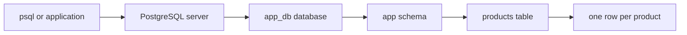

## A database is shared memory with rules

A file can store a list of products. A **DBMS** coordinates reading, writing, recovery, permissions, and simultaneous users. PostgreSQL is a relational DBMS: you express facts as rows, connect them with keys, and ask questions using SQL. A database is the organized data managed by that software.

SQL is a language, not a product. PostgreSQL and MySQL both support relational SQL; their syntax, types, and operational details differ. MongoDB stores documents, which can fit nested data read together. Neither “SQL cannot store JSON” nor “NoSQL has no schema” is a useful rule: PostgreSQL has JSONB, and document applications still need validation and consistency decisions.

Start from access patterns and invariants. If orders refer to customers and products, foreign keys can protect those relationships. If provider metadata changes frequently and is not the core relational model, JSONB may fit that field. Do not put all order items into JSON simply to avoid learning joins.



A server installation manages databases. A connection chooses a database. A schema names a group of objects. A table defines columns; a row records one fact. A key identifies a row independently of its physical position. Rows have **no guaranteed display order** without `ORDER BY`.

## Choose types by meaning

| Meaning | Type | Why it fits |
| --- | --- | --- |
| Counts and small identifiers | `integer` | Exact whole numbers, bounded range |
| Large counters | `bigint` | Larger range; JavaScript number may lose precision |
| Human text | `text` | No arbitrary length promise |
| A business length limit | `varchar(n)` | Enforces a maximum, not a general speed improvement |
| Yes/no | `boolean` | Avoid ambiguous strings such as “yes” and “1” |
| Calendar date | `date` | A birthday is not a global instant |
| Local wall-clock schedule | `timestamp` | No time-zone interpretation is stored |
| An event instant | `timestamptz` | Same instant displayed in the session time zone |
| Exact decimal amount | `numeric(12,2)` | Exact fixed-scale arithmetic, unlike floating point |
| Distributed identifier | `uuid` | Useful when identities originate in multiple places |
| Variable metadata | `jsonb` | Queryable structured metadata |

`timestamptz` does not preserve the original named time zone. Store a separate zone such as `Asia/Dhaka` when you need to reconstruct local scheduling rules. `numeric(12,2)` allows 12 total digits, of which two follow the decimal point. Choose units and ranges explicitly.

An identity column asks PostgreSQL to allocate a number; it is not guaranteed gapless. Use a primary key as well: identity generation and uniqueness are different responsibilities.

## NULL means unknown or absent

JavaScript instincts can mislead you here. SQL comparisons with NULL generally produce **unknown**. `WHERE` retains only true rows; false and unknown both disappear.

```sql
SELECT NULL = NULL AS comparison, NULL IS NULL AS is_missing;
SELECT name FROM customers WHERE city IS NULL;
SELECT name, COALESCE(city, 'Not supplied') AS display_city
FROM customers ORDER BY id;
```

The first query returns NULL and true. The second returns Nila. `COALESCE` selects the first non-NULL argument; it changes presentation, not the stored value. `COUNT(*)` counts rows, while `COUNT(city)` counts non-NULL cities.

## Challenge · Predict before you run

Predict the outputs of these statements. Then design a column for a customer's birthday and one for a payment completion time.

```sql
SELECT count(*), count(city) FROM customers;
SELECT name FROM customers WHERE city <> 'Dhaka' ORDER BY name;
SELECT name FROM customers
WHERE city <> 'Dhaka' OR city IS NULL ORDER BY name;
```

<details>
<summary>Hint</summary>

Do not treat an unknown city as a known non-Dhaka city. Return to the three-valued logic rule.

</details>

<details>
<summary>Worked solution</summary>

Counts are 4 and 3. The second query returns Rafi. The third returns Nila and Rafi. Birthday should normally be `date`; a payment completion instant should normally be `timestamptz`, nullable until completion. If “not yet completed” and “unknown due to imported data” must be distinguished, add an explicit state instead of making NULL carry both meanings.

</details>

**Explain-back:** Why does `city = NULL` find nobody? Why can two people have the same name but need different IDs?

**Stretch:** Explain which parts of a MongoDB customer document you would normalize and which you would retain as JSONB. Include the queries you need to support.

Reference: [PostgreSQL data types](https://www.postgresql.org/docs/18/datatype.html).
