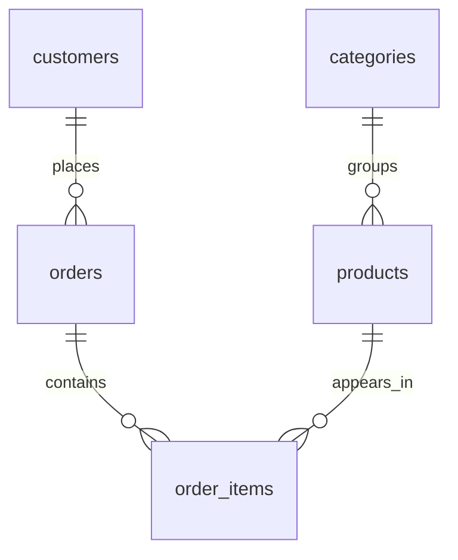

## Start a dedicated PostgreSQL

Install Docker Desktop first, or use an existing local PostgreSQL 17/18 installation. The following creates a learning-only server bound to your computer. The password is a disposable lab value.

```bash
 docker run --name pg-handbook \
  -e POSTGRES_PASSWORD=handbook-local \
  -e POSTGRES_DB=handbook_lab \
  -p 127.0.0.1:55432:5432 \
  -v pg-handbook-data:/var/lib/postgresql/data \
  -d postgres:17
 docker exec pg-handbook pg_isready -U postgres -d handbook_lab
```

Wait until readiness reports “accepting connections.” On later days use `docker start pg-handbook`; do not run the creation command again. The named volume retains data after stopping the container.

Download [setup.sql](/labs/postgresql/setup.sql) and [check.sql](/labs/postgresql/check.sql). From the directory containing those downloads:

```bash
docker exec -i pg-handbook psql -U postgres -d handbook_lab < setup.sql
docker exec -i pg-handbook psql -U postgres -d handbook_lab < check.sql
docker exec -it pg-handbook psql -U postgres -d handbook_lab
```

If PostgreSQL is already installed, create a dedicated database with `createdb handbook_lab`, then use `psql -d handbook_lab -f setup.sql`. Match your local credentials and port; Docker commands are unnecessary in that case.

## Orient yourself

Inside **each new psql session**, run:

```sql
SET search_path TO handbook;
SET TIME ZONE 'UTC';
SELECT current_database(), current_schema();
\dt
\d products
SELECT id, name, price, stock FROM products ORDER BY id;
```

You should see four products: Keyboard (1200, 10), Mouse (600, 5), SQL Book (800, 20), USB Cable (200, 0). There are four customers, four orders, and five order items. Paid revenue is **4800**. Units are a single assumed shop currency; multi-currency accounting needs an explicit currency model.

`psql` is a client; PostgreSQL is the server. `\dt` lists tables, `\d` describes a table, `\timing on` prints timings, `\i file.sql` loads a local file, and `\q` exits. SQL ends with a semicolon. A prompt ending in `-#` often means an unfinished command; `\r` clears the buffer. After an error inside a transaction, use `ROLLBACK`.

Prefer pgAdmin? Connect to host `localhost`, port `55432`, database `handbook_lab`, user `postgres`, password `handbook-local`. Use its query tool for SQL. Backslash commands are psql commands and do not run in pgAdmin.

## The shop we will use



Each order item stores the price **at purchase time**. Changing today's catalog price must not change yesterday's revenue. Tables are qualified as `handbook.products` in application code; interactive SQL uses the search path above.

## Reset strategy

Run modifying exercises inside `BEGIN` and finish with `ROLLBACK` unless a chapter explicitly builds a separate lab table. This preserves predictable answers. Setup is intentionally not silently destructive: running it twice reports existing tables.

To restart, create a **new** empty learning database, for example `handbook_lab_2`, then load setup there. Do not aim reset scripts at an application database. Disposable scratch tables are used for DDL exercises.

## Challenge · Prove your connection

Without looking below, show the server version, active database, and customer names sorted alphabetically. Explain why changing a GUI connection's database changes what tables you can see.

<details>
<summary>Hint</summary>

Use `version()`, `current_database()`, and `ORDER BY`. A server can host multiple databases.

</details>

<details>
<summary>Worked solution</summary>

```sql
SELECT version(), current_database();
SELECT name FROM customers ORDER BY name;
```

Expected names: Amina, Nila, Rafi, Sami. A connection selects one database. Schemas are namespaces within that database; they do not make tables in another database automatically accessible.

</details>

**Exit checkpoint:** reconnect, set your search path, and reproduce paid revenue later using joins. Keep your SQL in a `learning-journal.sql` file and write predictions as comments.
