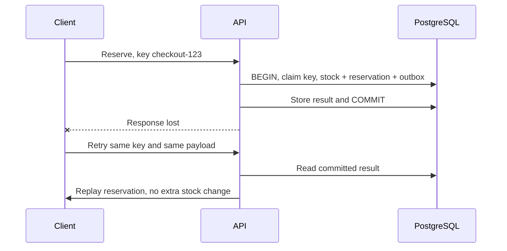

## The database committed, but the response disappeared

A mobile client times out after reserving stock. It cannot tell whether the server committed. Retrying with a new request identifier can reserve twice. An idempotency key identifies the **same intended operation**, so the server can return the earlier result.

Scope the key to the authenticated actor and operation, store the normalized payload, and reject reuse with different input. Persist the result in the same transaction as the business write. Document retention: expiring a key means an old retry might execute again. The [runnable API lab](/docs/postgresql-handbook/api-project) implements successful-result replay without expiration.



`INSERT ... ON CONFLICT DO NOTHING` against the unique scoped key coordinates concurrent duplicates. At Read Committed, a subsequent statement can see the winner after its commit. If the first transaction rolls back, another attempt can claim the key. Do not commit a placeholder key separately without a recovery protocol for permanently “processing” requests.

## A database transaction cannot atomically send email

If you send first and then roll back, the email describes a reservation that never existed. If you commit first and crash before sending, the email is missing. Store an **outbox event** in the same database transaction as the reservation. A worker later delivers it.

The downloadable API writes this event; it deliberately has no external publisher. The table records delivery intent, not proof of delivery.

For a lease-based worker, extend an outbox with `lease_until`, `claim_token`, and `attempts`, then claim a bounded batch inside a short transaction:

```sql
-- Applied to reservation_lab.outbox from the API project.
ALTER TABLE reservation_lab.outbox ADD COLUMN lease_until timestamptz;
ALTER TABLE reservation_lab.outbox ADD COLUMN claim_token uuid;
ALTER TABLE reservation_lab.outbox ADD COLUMN attempts integer NOT NULL DEFAULT 0;
BEGIN;
WITH batch AS (
 SELECT id FROM reservation_lab.outbox
 WHERE published_at IS NULL
   AND (lease_until IS NULL OR lease_until < now())
 ORDER BY created_at,id FOR UPDATE SKIP LOCKED LIMIT 10
)
UPDATE reservation_lab.outbox o
SET lease_until=now()+interval '30 seconds', claim_token=gen_random_uuid(), attempts=attempts+1
FROM batch WHERE o.id=batch.id
RETURNING o.id,o.claim_token,o.payload;
COMMIT;
```

Publish outside the transaction. After downstream acknowledgement, update `published_at` only if the claim token still matches. Otherwise an old worker could acknowledge work now owned by another worker. Add backoff, retry limits, and a visible dead-letter state. Choose lease duration from measured processing times or renew the lease safely.

A crash after delivery but before acknowledgement causes redelivery. Give downstream consumers a stable event ID and deduplicate their business effects transactionally. This is at-least-once delivery with deduplication, not a blanket exactly-once promise.

## Soft deletion changes every read and uniqueness rule

`deleted_at` preserves a record while hiding it from normal views. It does not erase its data, prevent accidental queries, or satisfy a retention policy by itself. Decide whether child records stay visible, whether identifiers can be reused, and what restoration means.

```sql
CREATE TEMP TABLE contacts (
 id integer PRIMARY KEY, email text NOT NULL, deleted_at timestamptz
);
CREATE UNIQUE INDEX contacts_live_email ON contacts(lower(email)) WHERE deleted_at IS NULL;
INSERT INTO contacts VALUES (1,'a@example.test',NULL);
UPDATE contacts SET deleted_at=now() WHERE id=1;
INSERT INTO contacts VALUES (2,'a@example.test',NULL);
SELECT * FROM contacts WHERE deleted_at IS NULL; -- only ID 2
```

A foreign key can still reference a deleted row. If a business rule prohibits new references to inactive records, implement a correctly synchronized write path; the foreign key alone does not encode that rule.

## Audit history records who changed what

Use an append-only audit table with entity identity, action, actor, time, and necessary before/after fields. Record the actor from verified server context. The write and its audit row should share a transaction. Restrict modification rights on history, and decide whether administrators need a stronger external audit trail.

Avoid copying passwords, tokens, or entire sensitive payloads into audit JSON. An unrestricted table owner can alter ordinary audit tables; “append-only by application convention” is not tamper-proof storage. Trigger-based history catches multiple writers, but actor context and bulk-operation semantics still need design.

## Challenge · Four crash windows

For each crash, decide what a retry should do: before commit; after commit before HTTP response; after downstream delivery before outbox acknowledgement; after an outbox lease expires while the old worker is still running.

<details>
<summary>Worked solution</summary>

Before commit, database work rolls back and the same key may execute. After commit, the key replays the stored response. After delivery but before acknowledgement, the event may be delivered again; downstream deduplication prevents a repeated business effect. After lease expiry, a new worker may claim the event; a claim-token check prevents stale acknowledgement, but cannot itself stop the old worker from making a duplicate external call. The receiver still needs deduplication.

</details>

## Challenge · Restore a deleted contact

Try restoring contact 1 after contact 2 reused its email. What should your API return, and what must remain unchanged?

<details>
<summary>Worked solution</summary>

```sql
UPDATE contacts SET deleted_at=NULL WHERE id=1;
```

The partial unique index rejects the restore. Map that known conflict to a useful domain response, typically 409. Contact 1 stays deleted and contact 2 remains active. Ask the user to choose a different email or resolve the newer record through an explicit workflow; never silently steal the identity.

</details>

**Exit checkpoint:** draw the commit boundary, list every possible duplicate effect, and explain which layer prevents each one.
