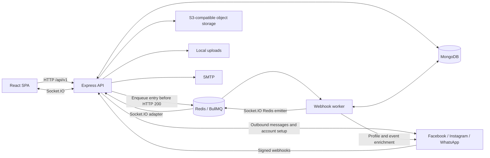
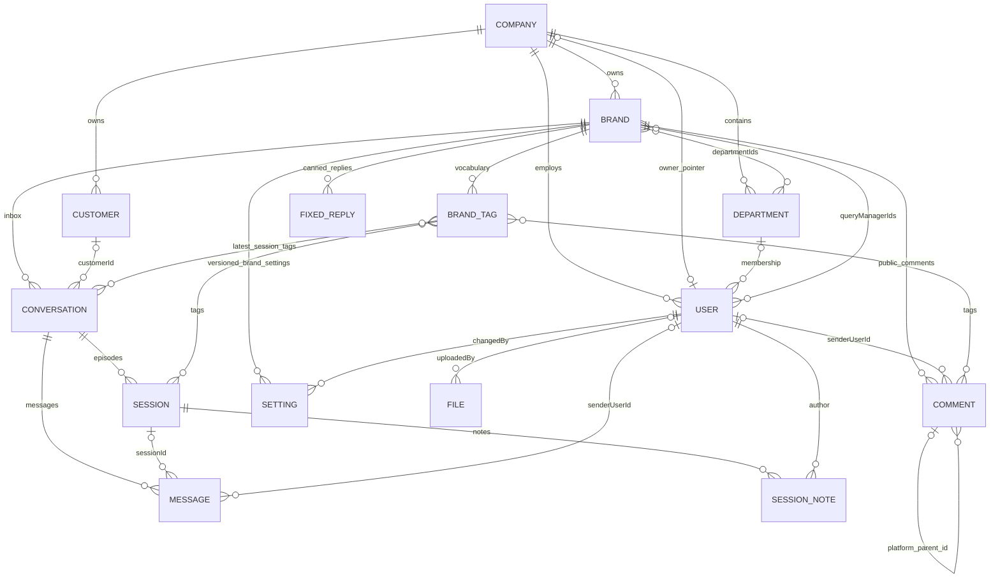
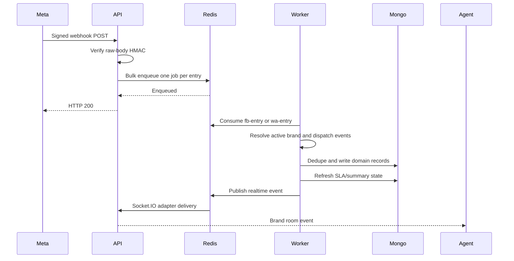

# Listenyzen 2.0 — Backend Developer Onboarding & Architecture Guide

**Inspected:** 15 October 2026  
**Repository:** `/Users/mdsalahuddin/Developer/Analyzen/listenyzen-v2.0`  
**Revision:** `aebd2800be08e767c88bb325d4c0b157000679ed` (clean working tree at inspection)

This guide describes the checked-out implementation. Source links are relative to this document in the project's `docs/` directory. Version numbers are manifest declarations unless explicitly described as a Docker image or pinned version. This was a static code/configuration review: deployment state, external credentials, provider permissions, and live database contents were not inspected. No existing secrets are reproduced. Repository behavior is documented from local source; Context7 tools were not available in this session, so no external library/provider documentation was consulted.

## Contents

1. [System & Tech Stack Overview](#1-system--tech-stack-overview)
2. [Project Architecture & Code Organization](#2-project-architecture--code-organization)
3. [Data Layer, Schemas & Entity Relationships](#3-data-layer-schemas--entity-relationships)
4. [Authentication, Authorization & Security](#4-authentication-authorization--security)
5. [Business Logic & Core Workflows](#5-business-logic--core-workflows)
6. [Error Handling, Logging & Common Conventions](#6-error-handling-logging--common-conventions)
7. [Local Setup & Development Workflows](#7-local-setup--development-workflows)

## 1. System & Tech Stack Overview

### 1.1 What this application does

Listenyzen is a multi-tenant customer engagement application. A **company** owns **brands**. Each brand connects social accounts; staff handle private messages and public comments from those accounts in a shared inbox. Staff can assign work, add internal notes, classify interactions, maintain customer details, use reusable replies, and record outcomes. Versioned SLA and business-hour settings support response and resolution reporting.

The critical vocabulary is:

| Term            | Meaning in this codebase                                                                                            |
| --------------- | ------------------------------------------------------------------------------------------------------------------- |
| Company         | Tenant boundary; owns brands and staff.                                                                             |
| Brand           | Operational inbox boundary; contains connected channel credentials and staff/department access assignments.         |
| Query manager   | An agent handling customer interactions; a `User` with `role: 'query_manager'`, not a separate database model.      |
| Customer        | A channel-specific identity and editable contact record. Not automatically one identity across all social channels. |
| Conversation    | Long-lived direct-message thread for a page/phone/account and participant.                                          |
| Message         | One incoming/outgoing item within a conversation, usually attached to a session.                                    |
| Session         | A support episode within a conversation; carries ownership, classification, outcome, notes, and SLA.                |
| Comment thread  | A root public comment plus replies; separate from direct-message conversations and sessions.                        |
| Post            | Platform context copied onto comments, not a `Post` collection.                                                     |
| Assignment      | Either one query manager or one department; distinct from permission to see a brand.                                |
| Brand tag       | A reusable, optionally hierarchical label; records store its ID.                                                    |
| Setting version | An immutable saved configuration record; history and current value share one collection.                            |

### 1.2 Runtime and dependencies

Sources: [server/package.json](../server/package.json), [server/tsconfig.json](../server/tsconfig.json), [server/Dockerfile](../server/Dockerfile), [root package.json](../package.json).

| Concern           | Implementation                                                                                                                                  |
| ----------------- | ----------------------------------------------------------------------------------------------------------------------------------------------- |
| Runtime           | Node.js; Docker images use `node:24-alpine`. No backend `engines` constraint in the manifest.                                                   |
| Language          | TypeScript pinned to `5.8.3`; CommonJS modules, `target: ES2015`.                                                                               |
| HTTP              | Express `^5.1.0`; routes under `/api/v1`.                                                                                                       |
| Package manager   | `pnpm@11.9.0`; separate root, server, and client installs/lockfiles. This is not a package workspace.                                           |
| Database          | MongoDB via Mongoose `^8.16.2`. MongoDB server version is not pinned by these app manifests; deployment comments expect external Atlas.         |
| Queue             | BullMQ `^6.3.2`, using ioredis `^5.8.2`.                                                                                                        |
| Realtime          | Socket.IO `^4.8.1`, Redis adapter `^8.3.0`, Redis emitter `^5.1.0`.                                                                             |
| Redis clients     | Both `redis` `^5.9.0` and `ioredis`; they serve different transport/queue roles. Compose uses `redis:7-alpine`.                                 |
| Authentication    | Passport `^0.7.0`, passport-local `^1.0.0`, jsonwebtoken `^9.0.2`, bcrypt `^6.0.0`.                                                             |
| Validation        | Zod `^4.1.9`, plus Mongoose schemas and application-level checks.                                                                               |
| Storage           | AWS SDK S3 client/presigner `^3.896.0`, multer `^2.0.2`, multer-s3 `^3.0.1`; local disk for logos/avatars.                                      |
| Email             | Nodemailer `^7.0.9`; SMTP transport.                                                                                                            |
| HTTP controls     | Helmet, CORS, HPP, express-rate-limit, compression, cookie-parser, `qs`.                                                                        |
| Logging           | Winston `^3.17.0`, winston-daily-rotate-file `^5.0.0`.                                                                                          |
| Development/build | nodemon, tsx, TypeScript compiler, tsc-alias, ESLint, Prettier.                                                                                 |
| Client context    | React/Vite SPA, Axios with credentials, TanStack Query consumers and Socket.IO client; backend changes often require cache/event updates there. |

`prom-client` is declared, but no active metrics exporter or `/metrics` route was found in `server/src`. Likewise, installed dependencies and old commented scaffolding do not establish that a service is running.

### 1.3 Processes and infrastructure



- **API:** `src/app.ts` connects MongoDB, builds Express, and delegates HTTP/realtime startup to `src/server.ts`.
- **Worker:** `src/worker.ts` independently connects MongoDB, configures a Redis socket emitter, registers webhook handlers, and starts BullMQ. It has no HTTP listener.
- **Redis:** durable webhook work plus cross-process realtime transport. It is not an HTTP session store; application authentication uses JWTs.
- **MongoDB:** persistent domain records. API and worker share the database.
- **Meta:** Facebook Page/Messenger, Instagram through two login paths, and WhatsApp Cloud API. `FACEBOOK_GRAPH_VERSION` defaults to `v25.0` in this checkout; that is a code default, not a statement about the provider's current preferred version.
- **S3-compatible storage:** AWS S3 or an endpoint such as R2; credentials are application-level. Public media URLs are optional; private reads use presigned URLs.
- **Local uploads:** brand/company logos and user avatars. Public `/uploads` URLs are built with `BASE_URL`.
- **SMTP:** registration welcome messages; email failure does not roll back successful company registration.

## 2. Project Architecture & Code Organization

### 2.1 Architectural style

This is a **feature-first modular monolith with route/service/schema layers**, plus a sibling worker using the same modules. It is not a strict Clean Architecture implementation. Route handlers contain authorization and some integration orchestration; services query Mongoose directly. There is no universal repository layer, dependency injection container, or separate controller class convention.

Typical dependency path:

```text
modules/<feature>/index.ts        mount URL prefix
    → modules/<feature>/api.ts    middleware, access checks, HTTP handlers
    → validation.ts              parsed request contract
    → service.ts                 domain operations + queries
    → schema.ts                  Mongoose models
    → libraries/                 shared infrastructure/integrations
```

Modules call other modules directly. For example, conversation ingestion calls session assignment and SLA synchronization; session changes update the conversation's summary fields. Changes to these boundaries must preserve both sides.

### 2.2 Directory map

```text
listenyzen-v2.0/
├── server/
│   ├── src/
│   │   ├── app.ts                    API entrypoint
│   │   ├── server.ts                 HTTP middleware, sockets, shutdown
│   │   ├── worker.ts                 queue consumer entrypoint
│   │   ├── routes.ts                 /api/v1, health routes, fallback 404
│   │   ├── auth/                     login, JWT identity, tenant/assignment rules
│   │   ├── configs/                  config loader and Zod schema
│   │   ├── modules/                  business features
│   │   ├── middlewares/              auth, validation, uploads, request context/logs
│   │   ├── libraries/                DB, Redis, queue, Graph clients, storage, utilities
│   │   └── types/express/            Express request/user augmentation
│   ├── config/                      shared and environment JSON config
│   ├── scripts/dev/                 seed, backfills, index creation, scaffolding
│   ├── uploads/                     local image assets
│   ├── docker/                      server-side nginx configuration
│   ├── Dockerfile*                  Node images
│   └── docker-compose.*.yml         server-specific container definitions
├── client/                          SPA; API contracts and realtime consumers
├── docs/                            feature notes and architecture references
├── handbook/                        existing developer learning material
├── listenyzen.postman_collection.json
├── docker-compose*.yml              root deployment definitions
├── docker-bake.hcl                  image build/publish configuration
├── DEPLOY.md / RELEASE.md           deployment/release notes
└── .husky/, .lintstagedrc.json, .prettierrc, .commitlintrc.json
```

No active cron directory/scheduler was found under `server/src`, despite references to one in older descriptive material.

### 2.3 Feature ownership

| Feature         | Responsibility and important files                                                                                                       |
| --------------- | ---------------------------------------------------------------------------------------------------------------------------------------- |
| `auth`          | Company registration/provisioning, login/refresh/logout; `tenant.ts`, `reply-access.ts`, `company-access.ts` define shared access rules. |
| `company`       | Tenant CRUD, owner link, active status, `onlyAssignedCanAct` setting.                                                                    |
| `user`          | Staff CRUD, self-profile, password changes, role hierarchy enforcement.                                                                  |
| `department`    | Tenant department CRUD and membership validation helpers.                                                                                |
| `query-manager` | Agent-oriented operations over the User model; department and avatar handling.                                                           |
| `brand`         | Brand CRUD, visibility assignments, account credentials; `meta-channels.ts`, `whatsapp.ts`, `whatsapp-templates.ts`, `assignees.ts`.     |
| `brand/tags`    | Hierarchical vocabulary, normalized uniqueness, rename/archive/restore, ID resolution.                                                   |
| `conversation`  | Inbox listing, customer access, messages, sending, reactions; `access.ts`, `send-channel.ts`, `media.ts`, `whatsapp-templates.ts`.       |
| `session`       | Episode selection, notes, assignments, wrap-up, conversation summary synchronization, SLA.                                               |
| `customer`      | Channel identity lookup/upsert and editable contact details; accessed through conversation routes.                                       |
| `comment`       | Public thread reconstruction, replies, moderation, tags, assignment, wrap-up and SLA.                                                    |
| `fixed-reply`   | Brand-specific reusable reply title/body records.                                                                                        |
| `settings`      | Versioned SLA/business-hours values, defaults, validation and history.                                                                   |
| `overview`      | Aggregated current workload, engagement, trends and SLA statistics.                                                                      |
| `webhook`       | Signed ingress and queued Facebook/Instagram/WhatsApp event processing.                                                                  |
| `file`          | Generic S3 upload/metadata endpoints; has important access-control exceptions described below.                                           |

### 2.4 Standard HTTP lifecycle — complete read example

Example request:

```http
GET /api/v1/conversations?brandId=507f1f77bcf86cd799439011&limit=20&mine=true
Cookie: access_token=<JWT>
```

1. `server.ts` installs cookie parsing, HPP, Helmet, CORS and the global per-IP limiter. Request context then establishes `x-request-id`. JSON/urlencoded parsing and compression are configured; JSON raw bytes are retained for webhook signatures.
2. `routes.ts` mounts `/api/v1`; `modules/index.ts` registers the conversation router at `/conversations`.
3. `conversation/api.ts` runs `authenticate`. It verifies a Bearer token or the access-token cookie, checks active-company access, attaches the token principal to `req.user`, and enriches logging context.
4. `authorize(...READ_ROLES)` permits the four defined roles. This alone does **not** establish access to the requested brand.
5. `validateQuery(listConversationsSchema)` checks `brandId`, coerces `limit`, validates filters, rejects unknown cursor-list parameters, and writes parsed values back to `req.query`.
6. The handler loads the brand through `getBrandById(brandId, getBrandScope(req.user))`. Owners/admins are company-scoped; query managers additionally need direct or department brand assignment. A missing/inaccessible brand returns 404.
7. `mine=true` derives assignee IDs from the user's ID and department ID. Optional tag filters expand selected parent tags to descendant tag IDs.
8. `listConversations` builds a query with mandatory `{ brandId }`, optional assignee/tag restrictions, allowlisted search/filter fields, and cursor ordering by `lastMessageAt DESC, _id DESC`.
9. `QueryBuilder` applies a cursor boundary, fetches one extra result to establish `hasNext`, and returns plain documents via `.lean()`.
10. `paginatedSuccessResponse` dispatches the result. `logRequest` records completion status/duration.

Illustrative response shape:

```json
{
  "success": true,
  "message": "success",
  "data": [],
  "pagination": {
    "limit": 20,
    "hasNext": false
  }
}
```

When there is another page, `pagination.nextCursor` is supplied. Send it back unchanged with the same filters. Do not send `page` or `sort` on cursor endpoints.

Sources: [conversation/api.ts](../server/src/modules/conversation/api.ts), [conversation/service.ts](../server/src/modules/conversation/service.ts), [QueryBuilder.ts](../server/src/libraries/query/QueryBuilder.ts), [sendResponse.ts](../server/src/libraries/utils/sendResponse.ts).

### 2.5 Write example — agent replies

`POST /api/v1/conversations/:id/messages` accepts a strict `{ "text": "Hello" }` body; text is trimmed and limited to 2,000 characters.

1. Authentication, route-role checks and parameter/body validation run.
2. `ensureSendableConversation` calls `loadActionableConversation`: load conversation, establish brand visibility, enforce assigned-only policy, then verify the brand/company is operational.
3. `resolveSendChannel` selects Messenger, Instagram Page login, Instagram direct login, or WhatsApp and resolves the server-side token.
4. `deliverText` makes the actual provider request. If it fails, no successful outgoing message is recorded by this path.
5. After provider acceptance, `recordOutgoingMessage` checks the provider `mid`, upserts the conversation preview, selects/creates a session, creates the Message, recalculates SLA and emits `message:new` to the brand room.
6. HTTP 201 returns `{ success: true, message: 'Reply sent', data: <message> }`.

This is **not an atomic transaction spanning Meta and MongoDB**. A provider send can succeed before persistence fails. Retrying a failed HTTP request can send twice; do not assume an outbound idempotency key exists. The incoming echo can also arrive concurrently with local persistence.

### 2.6 API navigation map

All paths below have `/api/v1` prepended, except health and uploads. The complete literal route inventory is included at the end of this guide.

| Prefix                            | Main operations                                                                                                                |
| --------------------------------- | ------------------------------------------------------------------------------------------------------------------------------ |
| `/auth`                           | Register company, login, logout, refresh.                                                                                      |
| `/companies`                      | Super-admin tenant management; `/me` and `/me/settings` for the current tenant.                                                |
| `/users`                          | Staff management; `/me`, `/me/change-password`.                                                                                |
| `/departments`, `/query-managers` | Tenant staffing and routing configuration.                                                                                     |
| `/brands`                         | CRUD, department/agent assignment, tags, channel connection, template administration.                                          |
| `/brands/:brandId/fixed-replies`  | Reusable reply CRUD.                                                                                                           |
| `/brands/:brandId/settings`       | Get/save `sla` and `business-hours`; per-type history.                                                                         |
| `/brands/:brandId/overview`       | `stats`, `sla`, `engagement`, `inbound-trend`, `sla-compliance`.                                                               |
| `/conversations`                  | Cursor inbox list, thread messages/session groups/stats, customer details, send/upload/react, media retrieval, template sends. |
| `/sessions`                       | Session listing/detail, status/sentiment/wrap-up, assignees, assignment, tags and notes.                                       |
| `/comments`                       | Root-thread list, post grouping, detail, replies, assignment, tags, wrap-up, hide/like/delete.                                 |
| `/files`                          | Generic metadata listing and single/multiple uploads.                                                                          |
| `/webhooks`                       | Facebook/Instagram ingress, separate trusted relay, WhatsApp ingress; GET verification and POST delivery.                      |

The checked-in Postman collection is a useful request catalog, but mounted route code and Zod schemas take precedence when examples diverge. No collection was published or modified for this guide.

## 3. Data Layer, Schemas & Entity Relationships

### 3.1 Persistence fundamentals

Mongoose models live beside features. There are **13 base domain models**: Company, User, Department, Brand, BrandTag, Customer, Conversation, Message, Session, SessionNote, Comment, FixedReply and File, plus **Setting** with two discriminator models. In total this is **14 base collections**, with SLA/business-hours discriminators sharing the Setting collection.

ObjectId references are application links, not relational foreign-key constraints. Mongoose `ref` enables population; it does not enforce existence, company membership, cascading deletion, or relationship cardinality. Several references are deliberately polymorphic or use external string IDs.

[db/index.ts](../server/src/libraries/db/index.ts) configures `strictQuery: true`, pool size 10–25, 45-second socket timeout and 10-second connection timeout. API `autoIndex` defaults on outside production; the worker always disables it. Production index creation is an operational step. `autoCreate` is enabled.

### 3.2 Core ER diagram

The diagram shows intended domain relationships; optional links and application conventions are explained below. It does not imply foreign-key enforcement.



A Session/Comment can additionally point to a User **or** Department through `assignee.kind` and `assignee.id`. These polymorphic links are omitted from the diagram to avoid implying both are populated simultaneously. Settings also support a company scope in the schema; currently mounted settings routes are brand-scoped.

### 3.3 Model-by-model inventory

#### Company

Source: [company/schema.ts](../server/src/modules/company/schema.ts).

- `name`: required, trimmed, globally unique.
- `status`: `active | inactive`, default `active`.
- `logo?`: local storage key; virtual `logoUrl` builds a public URL.
- `ownerId?`: User pointer. Provisioning creates a company and its owner, then sets this pointer. No unique index makes ownership strictly one-to-one at database level.
- `settings.onlyAssignedCanAct`: defaults false; determines whether query managers can modify only assigned work.
- One company has many brands, departments, users and customer records. Active-company checks gate login, refresh and authenticated operations.

#### User

Source: [user/schema.ts](../server/src/modules/user/schema.ts).

- Required `name`, globally unique `email`, `role`, `password`.
- `companyId?`: absent for super admin; expected for tenant roles by route/provisioning logic.
- `departmentId?`: one department membership; agent-facing workflows use it.
- `avatar?`: local storage key with virtual `avatarUrl`.
- Roles: `super_admin`, `company_owner`, `company_admin`, `query_manager`.
- Password is excluded from ordinary queries via `select: false` and removed by document serialization transforms. Login/password-change explicitly select it.
- A pre-save hook hashes modified passwords using bcrypt with cost 10. Password updates must preserve the document `save()` path; raw update queries do not automatically execute that hook.
- Query-manager operations reuse this collection with a role filter.

#### Department

Source: [department/schema.ts](../server/src/modules/department/schema.ts).

- Required `name`, `companyId`; `status` defaults active.
- Unique `(companyId, name)`.
- A department has many users and can be assigned to many brands. Brand membership and department existence are checked in application code.

#### Brand

Source: [brand/schema.ts](../server/src/modules/brand/schema.ts).

- Required `name`, normalized lowercase `email`, local `logo`, `companyId`; active/inactive status.
- `departmentIds[]`, `queryManagerIds[]`: two independent ways an agent can gain access.
- `facebook?`: `pageId`, `pageName`, page/user tokens, connection state/date, verified webhook subscription fields/missing fields/check time.
- `instagram?`: `accountId`, `username`, token, connection state/date, `loginType` (`facebook` or `instagram`), optional token expiry, webhook subscription diagnostics for the direct-login flow.
- `whatsapp?`: `wabaId`, `phoneNumberId`, display number, verified name, token, `registered`, registration PIN, connection state/date.
- Unique `(companyId, name)`, sparse unique `facebook.pageId` and `whatsapp.phoneNumberId`.
- No equivalent unique Instagram-account index is declared in this schema; do not assume symmetry across channels.
- Virtuals: `logoUrl`, `facebookConnected`, `instagramConnected`, `whatsappConnected`.
- `toJSON`/`toObject` remove channel tokens and WhatsApp PIN. `.lean()` bypasses these document transforms; use explicit safe projections when returning lean brand documents.

#### BrandTag

Source: [brand/tags/schema.ts](../server/src/modules/brand/tags/schema.ts).

- Required `brandId`, `companyId`, `name`, `nameLower`; `archived` defaults false.
- `name` is a slash-separated path such as `Complaint/Billing`; ancestor levels are separate tag documents.
- Unique `(brandId, nameLower)` enforces case-insensitive vocabulary uniqueness through a normalized field.
- Sessions, comments and conversation summaries store tag ObjectIds. Session/comment read paths populate only tag `name`; consumers may therefore receive `{ _id, name }` instead of bare IDs.
- Archive hides a tag from ordinary selection but preserves existing references. Rename is reflected when records are populated again.

#### Customer

Source: [customer/schema.ts](../server/src/modules/customer/schema.ts).

- Required `companyId`, `platform`, `pageId`, `externalId`.
- `name` defaults empty; optional `avatarUrl`, `mobile`, `email`, `address`, `gender` (`male | female | other`).
- Unique `(platform, pageId, externalId)`.
- For WhatsApp, the common `pageId` field represents the business phone-number ID and the participant/external ID represents the customer's provider identity. Do not reformat opaque provider IDs as phone numbers.
- `customerId` on Conversation is optional; services also resolve customers by the channel identity tuple and can lazily create/link them during editing.

#### Conversation

Source: [conversation/schema.ts](../server/src/modules/conversation/schema.ts).

- Required `brandId`, `companyId`, `platform`, `pageId`, `participantId`.
- Participant display snapshot: `participantName`, optional `participantAvatarUrl`; optional `customerId`.
- Inbox summary: `lastMessageText`, `lastMessageAt`, `lastMessageDirection`, `unreadCount`.
- Latest-session summary: `status`, `sentiment`, optional `assignee`, `tags[]`.
- Defaults: incoming direction, unread count 0, status `pending`, sentiment `NEUTRAL`.
- Unique `(pageId, participantId)` — **platform and company are not in this unique key**.
- One conversation has many sessions/messages. Customer-to-conversation is not constrained to one-to-one by a unique customer reference.
- Summary fields are intentionally denormalized; update them through the session/message services.

#### Message

Source: [conversation/schema.ts](../server/src/modules/conversation/schema.ts), model `Message`.

- Required `conversationId`, `brandId`, `platform`, `direction`, `senderId`; optional `sessionId` for older or incomplete records.
- Optional provider `mid` is sparse unique and underpins deduplication.
- Optional `senderUserId`, `senderName` identify the internal sender; the provider sender ID is a separate field.
- `text`, `sentAt`, optional `system` flag.
- `attachments[]`: required `type`; optional `url`, persistent `storageKey`, display `name`, provider `mediaId`, `mimeType`, status `pending | ready | failed`.
- `reactions[]`: `emoji`, optional provider reaction/reactor ID, `source: customer | agent`, `at`.
- `template?`: name, language, category snapshot for WhatsApp templates.
- `deliveryStatus?`: enum includes `sent | delivered | read | failed`; successful sends write `sent`, and current WhatsApp status processing persists failures only.
- `failure?`: code/title/details/message, optional remediation owner (`agent | admin`), timestamp.
- No `companyId` field. Access must go through the visible conversation/brand, not an assumed direct tenant filter on Message.

#### Session

Source: [session/schema.ts](../server/src/modules/session/schema.ts).

- Required `conversationId`, `brandId`, `companyId`, `platform`, and `sequence`.
- Status `pending | unresolved | resolved | hold`; sentiment `POSITIVE | NEUTRAL | NEGATIVE | MIXED`.
- `startedAt`, `lastActivityAt`; optional `resolvedAt`, `statusChangedBy`, `statusChangedAt`.
- Optional `assignee: { kind: query_manager | department, id, name }`. `name` is a display snapshot; `id` has no fixed Mongoose `ref`.
- `tags[]`, `messageCount`, `noteCount`.
- Optional `sessionType`: `complain | inquiry | compliment | support | sales | other`. Preserve the exact spelling `complain` in payloads.
- Optional `resolutionSummary`, `firstCustomerMessageAt`, `firstResponseAt`, `sla`.
- Sequence is computed from the previous session, required without a default, but has no unique `(conversationId, sequence)` index.

SLA state shape:

```typescript
{
  slaVersion: number;
  hoursVersion: number;
  firstResponse: null | { minutes: number; atRiskAt: Date; dueAt: Date };
  resolution: null | {
    minutes: number;
    usedMs: number;
    waitingSince: Date | null;
    atRiskAt: Date | null;
    dueAt: Date | null;
  };
  messagesSeen: number;
  failedMessagesSeen: number;
}
```

The last two counters guard against stale concurrent SLA computations. Dates become ISO strings in JSON.

#### SessionNote

Source: [session/schema.ts](../server/src/modules/session/schema.ts), model `SessionNote`.

- Required `sessionId`, `conversationId`, `companyId`, `authorId`, `text`; `authorName` snapshot defaults empty.
- Notes are internal records, not outgoing channel messages.
- Chronological index `(sessionId, createdAt)`; adding a note increments the session's `noteCount` and emits `note:added`.

#### Comment

Source: [comment/schema.ts](../server/src/modules/comment/schema.ts).

- Required post/routing context: `pageId`, `platformPostId`, `brandId`, `companyId`, `platform` (`facebook | instagram`), `direction`, `authorId`.
- Optional `permalinkUrl`, provider `commentId`, and `parentCommentId`. Parent linkage uses the provider's **string comment ID**, not Mongo `_id`.
- Author display snapshot: `authorName`, optional `authorAvatarUrl`; optional internal `senderUserId`.
- `text`; optional attachment URL/type (`image | video`).
- Status uses the four session status values; sentiment supports `POSITIVE | NEUTRAL | NEGATIVE` and has no default. There is no comment `MIXED` sentiment.
- Optional `resolutionSummary`; `topicTags[]` are free-string labels, separate from user-maintained `tags[]` ObjectIds. Their presence does not establish an active ML pipeline.
- Optional polymorphic `assignee`; `reactions` count, `isHidden`, `likedByPage`.
- `commentedAt`, `lastActivityAt`; root comments carry `slaStartAt`, `firstResponseAt`, `resolvedAt`, SLA state and `slaRevision` when applicable.
- `commentId` is sparse unique. Thread traversal scopes by brand/post and follows `parentCommentId`.

#### FixedReply

Source: [fixed-reply/schema.ts](../server/src/modules/fixed-reply/schema.ts).

Required `title`, `body`, `brandId`, `companyId`. Title/body are trimmed. This is a local canned-reply record, distinct from a provider-approved WhatsApp template.

#### File

Source: [file/schema.ts](../server/src/modules/file/schema.ts).

Required `filename`, `mimeType`, nonnegative `size`, unique S3 `key`; optional `uploadedBy`; mixed `metadata`; `isTemporary` defaults true. It has no company or brand field. Its `url` virtual constructs an AWS-style URL directly and does not share the newer R2/public-media URL behavior. Message attachments store their own metadata and are not File references.

#### Setting, SlaSetting and BusinessHoursSetting

Source: [settings/schema.ts](../server/src/modules/settings/schema.ts), [definitions.ts](../server/src/modules/settings/definitions.ts).

- Base fields: `scope` (`brand | company`), `scopeId`, `companyId`, discriminator `type`, positive `version`, `changedBy: { id, name }`.
- `scopeId` is polymorphic, not a fixed reference. The currently mounted API establishes the scope through an authorized Brand.
- Unique `(scope, scopeId, type, version DESC)` prevents concurrent duplicate versions.
- `SlaSetting` discriminator value `sla`: tier `Standard | Priority`; nullable first-response/resolution overrides with `{ on, minutes }`.
- `BusinessHoursSetting` discriminator value `business-hours`: fixed server timezone, seven day entries `{ day, open, opens, closes }`, holiday date strings.
- Each save inserts another document. Version 0 is a synthesized default and need not exist in MongoDB.

### 3.4 Index strategy

| Data             | Important indexes / purpose                                                                                                                                     |
| ---------------- | --------------------------------------------------------------------------------------------------------------------------------------------------------------- |
| Company/User     | Unique company name / user email.                                                                                                                               |
| Department/Brand | Unique company+name; tenant and assignment lookups.                                                                                                             |
| Brand channels   | Sparse unique Facebook page and WhatsApp phone IDs.                                                                                                             |
| BrandTag         | Unique brand+normalized path; company index.                                                                                                                    |
| Customer         | Unique platform+page+external identity.                                                                                                                         |
| Conversation     | Unique page+participant; brand+lastMessageAt+\_id cursor order; compound platform/status/sentiment/tag variants; partial assignee index.                        |
| Message          | Sparse unique provider mid; conversation+sentAt, session+sentAt, individual reference indexes.                                                                  |
| Session          | Conversation+startedAt+\_id; conversation/brand+lastActivityAt+\_id; brand+status+resolvedAt; brand+firstCustomerMessageAt; partial assignee index; brand+tags. |
| Comment          | Sparse unique provider commentId; brand+post+parent+commentedAt+\_id traversal; brand+lastActivityAt+\_id; status/resolvedAt and assignment-oriented indexes.   |
| SessionNote      | Session+createdAt and reference indexes.                                                                                                                        |
| Setting          | Unique scope+scopeId+type+version for history/concurrent-save protection.                                                                                       |
| File             | Unique key; uploadedBy and createdAt indexes.                                                                                                                   |

The schema files remain the exact index definitions. The cursor-index maintenance script creates a **selected** set of indexes, not every schema index. MongoDB production startup will not automatically create the rest.

### 3.5 Validation, timestamps, deletion and consistency

- `baseSchema` defines `createdAt`/`updatedAt` with defaults/indexes and uses `timestamps: true`; feature schemas add it. Distinguish audit dates from business dates such as `sentAt`, `commentedAt`, `startedAt`, and `resolvedAt`.
- Request Zod validation, service invariant checks, Mongoose validation and unique indexes each protect different things. A unique database index is not equivalent to a Zod uniqueness check.
- The DB helper contains middleware intended to enable update validators, but it merely returns `{ runValidators: true }` from a pre-hook rather than setting query options. Do not assume this globally enables update validation; use explicit query options where needed.
- There is no universal soft-delete plugin or `deletedAt` convention. Companies, brands, departments and users have hard-delete service paths; active/inactive status is a separate concept. Brand tags are archived; comment hiding is provider moderation, not deletion.
- Deleting a brand explicitly deletes its vocabulary, but the general CRUD service paths do not cascade every dependent conversation/session/user/etc. MongoDB does not prevent dangling references.
- `withTransaction` exists but no production source caller was found. Company provisioning uses compensating deletions; message/session updates are multiple sequential writes.
- Session state copied onto Conversation must remain synchronized. Tag and customer display fields have different ownership: do not introduce arbitrary snapshots where existing reads intentionally populate live names.

## 4. Authentication, Authorization & Security

### 4.1 Authentication lifecycle

Sources: [auth/api.ts](../server/src/auth/api.ts), [auth/service.ts](../server/src/auth/service.ts), [tokens.ts](../server/src/libraries/utils/tokens.ts), [cookies.ts](../server/src/libraries/utils/cookies.ts).

- Passport local strategy authenticates email/password. There is no Passport server-session persistence in this flow.
- Login and company registration issue access/refresh JWTs in **HTTP-only cookies** named `access_token` and `refresh_token`. Their success payload returns the user, not raw tokens.
- Protected HTTP middleware first reads the Authorization header, then falls back to the cookie.
- JWT identity includes `sub`, email, name, role, companyId and departmentId, with separate signing secrets for access and refresh.
- `POST /auth/refresh` reads the refresh cookie, verifies it, reloads the User, rechecks company access, and issues another token pair with current identity fields.
- Logout clears cookies. No token blacklist, persisted refresh-token family, single-use rotation record or password-change token revocation mechanism was found.
- Cookie options are `httpOnly`, `sameSite: 'strict'`, and secure in production. Cookie max ages are hardcoded to 15 minutes and seven days; JWT expirations are configurable. Keep both aligned when changing lifetimes.
- Ordinary access authentication uses role/department claims from the access token, rather than reloading the User on every request. Changes may therefore remain stale until refresh/expiry. Assigned-only department checks explicitly load current department membership.
- Password creation/update policy: 8–72 characters, at least one letter and digit. The rule counts characters, while bcrypt's effective limit is bytes; do not describe this as a byte-aware Unicode length check.

The client Axios interceptor makes one shared refresh request for concurrent 401s, retries the original request once, and clears local user state if refresh fails. See [client/src/lib/api.ts](../client/src/lib/api.ts).

### 4.2 Access-control layers

| Layer                 | Mechanism                                            | What it establishes                                                                        |
| --------------------- | ---------------------------------------------------- | ------------------------------------------------------------------------------------------ |
| Identity              | `authenticate`                                       | Valid access JWT and active company (super admin exempt from tenant status).               |
| Route role            | `authorize(...roles)`                                | Caller role can perform this category of operation.                                        |
| Tenant scope          | `getTenantScope(user)`                               | Non-super-admin queries use caller companyId.                                              |
| Brand visibility      | `getBrandScope(user)`                                | Query managers require direct brand assignment or membership in an assigned department.    |
| Resource visibility   | `loadVisibleConversation` and route-specific loaders | Resource belongs to a brand the caller can see.                                            |
| Mutation permission   | `assertCanAct`                                       | Under assigned-only policy, query manager matches direct or current department assignment. |
| Assignment permission | `assertCanChangeAssignment`                          | Under assigned-only policy, agents cannot reassign work themselves.                        |
| Operational channel   | `assertActiveChannelOwner`, `resolveSendChannel`     | Brand/company active and relevant connection/token available.                              |

These are cumulative checks. A route-role check alone is never a replacement for tenant/brand/resource checks. Many service helpers default to an empty scope; callers must supply one or establish visibility before invoking unscoped helpers.

### 4.3 Role behavior

| Role            | Intended/current capabilities                                                                                                                                                                    |
| --------------- | ------------------------------------------------------------------------------------------------------------------------------------------------------------------------------------------------ |
| `super_admin`   | Cross-company administration; company CRUD; broad brand/staff/inbox access. Some `/me` company operations inherently require a company-bound identity.                                           |
| `company_owner` | Manage own company staff/brands/departments; create/manage subordinate company admins and agents; settings/overview access.                                                                      |
| `company_admin` | Manage brands/departments/agents within their company; cannot mutate owners or peer admins through the guarded user-management paths.                                                            |
| `query_manager` | Work on visible brand inboxes/comments, use fixed replies and add/select tags; cannot curate tag renames/archives or administer SLA settings. Assigned-only policy further constrains mutations. |

`ROLE_RANK` exists, but `authorize` uses explicit membership, not automatic hierarchy inheritance. User management has separate `resolveCreateRole`, `assertCanAssignRole`, and `assertCanActOnUser` logic.

Session access follows its parent conversation; mutation checks use the conversation’s current assignee, not the historical session’s assignee.

`onlyAssignedCanAct` is a **mutation policy**, not a universal hiding policy. An unassigned thread can be visible but reject modification. Visibility failures commonly become 404; assignment policy failures become 403.

### 4.4 Socket security

Socket authentication reads the `access_token` cookie, checks JWT/company access, and stores the principal on `socket.data.user`. A client requests `join:brand`; the server loads the brand through `getBrandScope` before joining `brand:<id>`. Typing relay validates ObjectId-shaped IDs, kind and boolean state, requires room membership, and attaches server-known user identity.

Socket auth occurs on connection. No periodic JWT revalidation or general room-eviction mechanism on permission changes was found. Brand broadcasts are room-based, not individually filtered by current session assignment.

### 4.5 Request protections and their boundaries

- Global Helmet, HPP, credentialed CORS allowlist, and per-IP rate limiting are installed. `trust proxy` is set to 1; deployment proxy topology must match.
- Global limit is `RATE` requests per 15 minutes; `/api/v1/webhooks...` is exempt. Auth routes add another limiter with the same window/configured maximum. No Redis-backed limiter store is configured, so limits are per process.
- JSON/urlencoded bodies are limited to 1 MB. Multipart limits are separate.
- Zod validators parse and **replace** body/query/params. The middleware uses `Object.defineProperty` because Express 5 query access is not a normal writable property.
- Many write schemas are strict objects; cursor-list schemas reject unknown keys, obsolete `page`, and caller-defined `sort`. Some offset schemas strip undeclared fields instead.
- QueryBuilder constrains searchable/sortable/filterable fields and escapes regex search text; do not accept arbitrary Mongo query objects from callers.
- Uploads validate both declared MIME type and extension-derived MIME type, with configured size limits. This is not magic-byte inspection or malware scanning. Memory uploads accept up to 10 files; conversation attachments use a 25 MB per-file ceiling before channel-specific restrictions.
- HMAC verification uses retained raw request bytes. Facebook/Instagram direct ingress accepts the relevant Facebook or Instagram secret; WhatsApp uses the Facebook app secret. The separate relay route uses `X-Relay-Token`.
- CORS is not a general authorization mechanism. No dedicated CSRF-token middleware was found; the implementation relies in part on strict same-site cookies and origin handling.

### 4.6 Concrete security exceptions to know

These are observations from the checkout, not claims that the repository has already fixed them:

1. `/files/upload-image-single` and `/files/upload-image-multiple` have **no authentication middleware**. File listing requires authentication but has no tenant/uploader scope; File lacks companyId. Do not copy these routes as the pattern for new uploads.
2. Channel tokens are ordinary persisted Brand strings. Serialization removal protects ordinary API responses, not database-at-rest storage, arbitrary projections, or `.lean()` output.
3. The relay failure logger includes six-character token prefixes under `expectedPrefix`/`receivedPrefix`. The logger's sensitive-key matcher does not reliably redact such names.
4. General error fallback sends `error.message` to the client. Avoid throwing raw provider/SDK messages containing secrets or internal infrastructure details.
5. Credentials should never be added to log messages or query URLs; key-based redaction cannot scrub every secret embedded in a free-form string.

## 5. Business Logic & Core Workflows

### 5.1 Company provisioning and staffing

Public registration accepts companyName and owner identity/password. `provisionCompany` creates Company, creates a `company_owner` User, then links `ownerId`. On failure it attempts to delete the owner/company as compensation; cleanup failures are logged. Registration then attempts welcome email without undoing the account if delivery fails.

Admin staff creation derives companyId from the caller unless the caller is super admin. Department membership is validated against that company. Query-manager operations apply a fixed role filter. Brand assignment checks that supplied departments/agents belong to the right company.

### 5.2 Channel connection

| Channel                    | Implemented connection path                                                                                                                                                    |
| -------------------------- | ------------------------------------------------------------------------------------------------------------------------------------------------------------------------------ |
| Facebook                   | Client-provided authorization information → user/page token resolution → verify page subscription → persist Page credentials and diagnostics.                                  |
| Instagram through Facebook | Resolve professional account linked to the Facebook Page; store Page-based token with `loginType: 'facebook'`. App Dashboard subscription setup remains relevant.              |
| Instagram direct login     | Get login URL with signed 10-minute state → OAuth callback → exchange code/token → subscribe/verify → save direct-login account and token expiry → redirect client.            |
| WhatsApp                   | Embedded Signup code + WABA/phone IDs → exchange code → read phone metadata to establish token access → subscribe WABA → attempt registration → persist connection/PIN/status. |

WhatsApp subscription is blocking in the normal signup path, while registration can remain pending. `connected` and `registered` are different states. Manual connect is guarded by `WHATSAPP_ALLOW_MANUAL_CONNECT`; it is a development escape hatch. Disconnect attempts WABA unsubscribe only when another brand is not using that WABA.

Instagram direct-token expiry is stored, but no active scheduled token-refresh job was found. Confirm the operational reconnection/refresh plan before relying on unattended long-lived integration.

Sources: [meta-channels.ts](../server/src/modules/brand/meta-channels.ts), [whatsapp.ts](../server/src/modules/brand/whatsapp.ts), [webhook-subscription.ts](../server/src/libraries/common/webhook-subscription.ts).

### 5.3 Incoming webhook processing



- Queue name: `webhooks`; topics: `fb-entry`, `wa-entry`.
- API acknowledges only after enqueue succeeds. Enqueue failure returns 500; invalid signature returns 403. Unsupported top-level webhook object types are acknowledged without processing.
- Producer timeout is two seconds. Failures reset its connection so delayed buffered writes do not silently outlive the expected request path.
- Worker default concurrency is 5 (`QUEUE_CONCURRENCY`). Each entry can contain several events; processing attempts events, records failures, then throws if any failed so the entry can be retried.
- Five total attempts; exponential backoff starting at two seconds. Completed jobs retained for up to one hour / 1,000 jobs; failed jobs retained for seven days.
- Database provider IDs are the primary duplicate defense. Delivery is not exactly-once: read-before-write checks and unique indexes do not make all preview/counter/session side effects atomic.
- Active channel resolution checks both brand and company status. Per-process TTL caches help resolve channel metadata; they are distinct from Redis transport state.
- Only `libraries/queue/index.ts` imports BullMQ. Add domain jobs through that wrapper rather than scattering queue setup through modules.

### 5.4 Conversation and session lifecycle

`recordIncomingMessage` deduplicates by mid, upserts the conversation, increments unread state, calls `assignMessageToSession`, stores the message, recalculates SLA, then emits the update. Outgoing persistence follows a similar path and clears unread state.

Session selection:

| Existing latest session     | Message kind                     | Result                                |
| --------------------------- | -------------------------------- | ------------------------------------- |
| None                        | Any                              | Create sequence 1, status pending.    |
| Resolved                    | Incoming                         | Create next sequence, status pending. |
| Resolved                    | Explicit re-engagement send      | Create next sequence, status pending. |
| Resolved                    | Ordinary outgoing follow-up/echo | Keep the existing session.            |
| Pending, unresolved or hold | Incoming/outgoing                | Continue the current session.         |

The newest session's status, sentiment, assignee and tags are copied onto Conversation. Updating historical sessions triggers synchronization from the latest session rather than blindly copying the historical change.

Wrap-up accepts only unresolved/resolved/hold (not pending) and writes status, sentiment, sessionType, optional summary and tags. Notes and resolution summaries are limited to 8,000 characters by their input schemas. `resolvedAt` is stamped for resolved and removed for other statuses. Status/wrap-up paths clear conversation unread count and emit updates. Internal notes increment noteCount without becoming provider messages.

`PATCH /sessions/:id/status` also accepts `{ "mergeWithPrevious": true }`. This invokes `mergeIntoPrevious`, which moves messages/notes to the immediately preceding session, recounts them, removes the current session, recalculates SLA and emits `session:merged`. The merge branch takes precedence over a supplied status; it preserves the previous session’s outcome rather than applying that status. This multi-document operation is not transactional.

Concurrency caveat: selecting the latest session and creating the next one are separate operations. There is no unique session sequence constraint or per-conversation queue serialization in the shown paths. Parallel jobs can race; assess this when changing ingestion or increasing worker concurrency.

### 5.5 Customer records

Customer details are accessed through `/conversations/:id/customer`. Reads establish conversation visibility first. Updates additionally enforce actionable access, find/create the channel identity, apply allowed contact fields and link customerId if absent. Platform display snapshots on Conversation and the editable Customer are related but not interchangeable; do not assume changing Customer rewrites every existing display snapshot.

### 5.6 Public comments

Webhook handling records Facebook feed changes and Instagram comment events. The comment collection contains both roots and replies. Thread detail walks children using provider parent IDs, with brand/post constraints. List ordering uses a root's `lastActivityAt`, which is bumped by new replies.

Agents can reply, change classification, assign, tag, wrap up, hide/unhide, like/unlike where supported, and delete. Moderation calls the provider and then updates local state. Facebook-specific capabilities should not be assumed available for Instagram.

Deletion walks the local descendant tree. Hiding changes moderation state and can affect SLA. A customer reply after resolved wrap-up **does not reopen** the comment thread or create a new SLA cycle; it can still float the thread to the top. This differs from direct-message session creation.

### 5.7 Tag vocabulary

Tag names normalize whitespace, strip an initial `#`, and use `/` for hierarchy. Empty levels are invalid. The maximum tags on a record is 25. Selection validates IDs against the brand vocabulary. Parent filters expand to descendants.

Agents may create tags; privileged roles curate rename/archive operations. Rename handles the subtree, creates missing ancestor paths, and rejects collisions with existing vocabulary names rather than merging references. The preflight collision check and bulk write are not a transaction. Archived IDs remain useful to historical records. Use `TAGS_POPULATE` for standard read shape. Do not restore older snapshot-style embedded tags from obsolete examples.

### 5.8 Versioned settings and SLA

Settings save body is `{ baseVersion, value }`. The service loads current version, rejects a stale base with 409, and inserts version+1. A unique index catches simultaneous competing saves. History pages by numeric version cursor, unlike timestamp-based inbox cursors.

Current defaults:

| Setting                              | Default                                                                                                             |
| ------------------------------------ | ------------------------------------------------------------------------------------------------------------------- |
| SLA tier                             | Standard                                                                                                            |
| Standard first response / resolution | 60 / 480 business minutes                                                                                           |
| Priority first response / resolution | 45 / 240 business minutes                                                                                           |
| Overrides                            | Null means use tier default; `{ on: false, minutes: ... }` disables a target.                                       |
| Business timezone                    | `Asia/Dhaka`, fixed server-side; clients do not submit it.                                                          |
| Weekly hours                         | 09:00–21:00 Saturday–Thursday; Friday closed.                                                                       |
| Target range                         | Production minimum 5 minutes; other environments minimum 1 minute; maximum 4,320 minutes.                           |
| Holidays                             | Unique ISO date strings; up to 366; saved values prune dates older than the configured one-year retention boundary. |

SLA snapshots use the setting versions in force when the customer first wrote, not today's settings. Outbound-only sessions have nothing to measure until a customer message exists.

**First response:** earliest non-failed outgoing message at/after the first customer message. Provider acceptance without a known failure currently counts; the code does not require a delivered receipt.

**Resolution:** accumulated business time during which the customer waits on the team. A wait starts with a customer message and ends at the team's last reply before the next customer message, or resolved wrap-up if unanswered. Customer silence after a reply is excluded. A later agent reply can extend the previous charged interval. Failed sends and messages after resolvedAt are excluded from the resolution calculation.

At-risk threshold is 80%; target is 100%. `usedMs` stores finished charged intervals; `waitingSince` and projected atRiskAt/dueAt represent an active wait. While paused below a threshold, its date may be null. Equality at the resolution target is treated as on time by the calculation.

Session SLA recalculates from stored messages on message/status/failure changes. Guards compare messagesSeen, failedMessagesSeen and resolvedAt to avoid overwriting newer computations. Failures are logged without blocking the main domain operation, so an SLA repair backfill may be needed after a processing issue.

Comment SLA reuses this calculation on customer-authored roots. Only visible comments from the **root author** start waits; page replies can end them. Other participants' incoming comments do not start that root's wait. `slaRevision` guards updates.

`hold` and `unresolved` remain open for SLA calculations; this is explicitly provisional in the repository notes. The business-time helper bounds calendar scanning at 400 days; schedules with no usable work windows can yield no clock.

Sources: [session/sla.ts](../server/src/modules/session/sla.ts), [comment/sla.ts](../server/src/modules/comment/sla.ts), [business-time/index.ts](../server/src/libraries/business-time/index.ts), [SLA context](settings-sla-progress-context.md).

### 5.9 Overview definitions

The UI mixes live API-backed metrics with illustrative data; not every visible chart has a complete backend implementation.

- `/stats`: pending sessions now; unassigned means no assignee (a department assignment counts as assigned).
- `/sla`: at-risk/breached current targets; open set includes pending, unresolved and hold. Sessions and comments can be requested separately.
- `/engagement`: inbound counts use first customer message for sessions and customer-authored comment roots in the selected range; response rates use firstResponseAt. Current unresolved backlog includes pending+unresolved, excluding hold.
- `/inbound-trend`: incoming versus resolved counts per day; closure uses resolvedAt.
- `/sla-compliance`: combines session and comment targets; met targets divided by decided targets, not a naive all-record denominator.

Use [overview/service.ts](../server/src/modules/overview/service.ts) and its date-boundary helpers when modifying reporting. Similar-looking metrics intentionally use different open/closed sets.

### 5.10 Media and WhatsApp templates

- Outbound attachments first upload to object storage, then send through the selected provider, then persist a Message attachment storageKey. Instagram fetch URLs have a 900-second lifetime in the attachment-send path.
- A multi-file request sends optional text first and files sequentially. It is not all-or-nothing; earlier provider sends/uploads can succeed before a later failure.
- WhatsApp media may be stored initially as pending metadata with mediaId. The on-demand `POST /conversations/:id/messages/:messageId/media` resolves/downloads/stores media after visibility checks. In-flight requests for the same message collapse within a process.
- Media code uses its own timeouts and format/size rules. The on-demand route enforces a seven-day window from message time based on the integration's assumptions; this is a local implementation rule, not a freshly verified provider guarantee.
- Hosted media chooses public URL if configured; otherwise it is signed. Permanent storageKey is authoritative; an expiring URL is not a durable storage identity.
- Customer media failures can produce a system notice. Automatic customer replies occur only if `WHATSAPP_AUTO_REPLY_ON_MEDIA_FAILURE=true`.
- Brand routes administer WhatsApp templates in the provider; conversation routes list sendable templates and send them. Templates are not a separate Mongo collection.
- Send paths resolve the template from the provider/cache, check approval/quality/support constraints, validate values and construct components. Media-header templates are not supported by the current agent picker/send implementation.
- The code distinguishes normal messages from template re-engagement, including starting a new session after resolved work. The client's messaging-window UI is not proof of a universal server-side window guard on every free-form send.
- Current WhatsApp status handler ignores every status except `failed`; enum support for `delivered` and `read` does not mean those receipts are recorded.

### 5.11 Realtime contract and background work

Rooms are `brand:<brandId>`. Server events: `message:new`, `message:reaction`, `message:updated`, `conversation:read`, `session:updated`, `session:merged`, `note:added`, `comment:new`, `comment:updated`, `comment:deleted`, `assignment:changed`, `brand:tags-updated`, `typing`.

The API emits through Socket.IO; worker operations emit through Redis. `emitToRoom` selects the available transport and skips with a debug log if neither exists. Persistence can therefore succeed without a live event. Client consumers live in `features/inbox/use-inbox-realtime.ts`, `features/comments/use-comments-realtime.ts` and associated cache helpers.

Active background work is the BullMQ webhook consumer and process heartbeat intervals. No active general-purpose cron scheduler, automated temporary-file cleanup, ML worker, RabbitMQ consumer or Elasticsearch subsystem was found in the source wiring. Comments, schema fields or installed packages are not evidence of these being implemented.

## 6. Error Handling, Logging & Common Conventions

### 6.1 Error and response conventions

[AppError](../server/src/libraries/error-handling/index.ts) carries a statusCode, status, message and comingFrom. Subclasses cover 400, 401, 403, 404, 409, 413 and 500. Express 5 async route errors reach the global handler; callback-style Passport handling explicitly forwards errors.

Global translation in `server.ts`:

| Condition                 | Response                                                   |
| ------------------------- | ---------------------------------------------------------- |
| Mongoose ValidationError  | 400 with validation messages.                              |
| CastError                 | 400 identifying invalid field/value.                       |
| Mongo duplicate key 11000 | 409 naming the duplicate field.                            |
| Multer oversized upload   | 413.                                                       |
| Other Multer error        | 400.                                                       |
| AppError                  | Its serialized status/message.                             |
| Unknown error             | Provided statusCode or 500, and error.message or fallback. |

Typical envelopes:

```json
{ "success": true, "message": "success", "data": {} }
```

```json
{ "success": false, "status": "error", "message": "Brand not found" }
```

Pagination adds a top-level `pagination` beside `data`; it does not wrap items inside `data.items` on the wire. Cursor pagination includes limit/hasNext/nextCursor; offset pagination also includes page, totalCount/totalPages where available, hasPrev and index bounds.

Exceptions exist: login failure can return only `{ message }`; webhook handlers send plain status responses; unmatched routes return plain `Not Found`; rate-limit and health responses have their own shapes. Do not promise a universal envelope to clients.

### 6.2 Logs and observability

- Winston defaults to debug outside production and info in production, with `LOG_LEVEL` override.
- Service name is `SERVICE_NAME` or inferred from the entrypoint (`api-service`/`worker-service`).
- Production console output is JSON; development output is readable/colorized. File output is JSON with hourly filename patterns, 20 MB rotation, compressed archives and 14-day retention.
- `LOG_DIR` defaults to `logs`; `LOG_TO_FILE=false` disables file transport.
- AsyncLocalStorage carries requestId/userId into downstream logs. `x-request-id` is accepted or generated and echoed back.
- `logRequest` logs selected request metadata at debug and completion/status/duration at info. Body fields are opt-in; do not opt in passwords/tokens/message contents indiscriminately.
- Global error handling chooses warn for known 4xx and error for 5xx. Because logging precedes some error translations, raw Mongoose/Multer errors without statusCode may be logged as 500 even when translated to a 4xx response.
- Sensitive-key redaction recurses through metadata, but preserved messages and arbitrary string values are not automatically secret-scanned.
- Heartbeats default to every 30 seconds and include DB/Redis state, uptime, RSS and heap; API heartbeat can include realtime. Queue health is read on demand rather than polled on every heartbeat.

Health endpoints:

| Endpoint            | Meaning                                                                                                                                            |
| ------------------- | -------------------------------------------------------------------------------------------------------------------------------------------------- |
| `GET /health`       | Reports Mongo, Redis and realtime state. HTTP 200 depends on Mongo being connected; Redis/realtime failure can return 200 with `status: degraded`. |
| `GET /health/queue` | Queue waiting/active/delayed/failed counts and oldest waiting age. 503 for waiting age >300 seconds, backlog >5,000, or unavailable stats.         |

A failed-job count alone does not flip queue status. Healthy API status does not prove a worker exists. The worker has no HTTP health route; inspect its heartbeat/logs and actual queue progress.

### 6.3 Coding and typing conventions

- Source uses `@/` imports mapped to `src/`. `tsc-alias` rewrites aliases in build output. Output entrypoints are `dist/src/app.js` and `dist/src/worker.js` because rootDir is the server directory.
- Strict TypeScript settings include strict, noImplicitAny, noUnusedLocals, noUnusedParameters, alwaysStrict and consistent filename casing. Explicit `any` still exists in infrastructure; strict mode does not make every query/response fully typed.
- Zod-inferred input types, `as const` enum arrays, explicit role lists, Mongoose interfaces and small named access helpers are common patterns.
- Root Prettier configuration: single quotes, semicolons, two spaces, width 100, `arrowParens: avoid`, trailing commas `es5`.
- Backend ESLint combines JS/TypeScript recommended rules with security and SonarJS. Client uses oxlint, not the backend linter.
- Root Husky/lint-staged applies server ESLint fixes, client oxlint fixes and formatting. Conventional Commits are enforced; `pnpm commit` invokes Commitizen.
- Shared utilities include filename sanitization, query building, response helpers, token/cookie handling and business-time calculation. Reuse the named module seams instead of reproducing access or SLA logic inside handlers.

### 6.4 Practical change checklist

For a new feature or field:

1. Identify the authoritative document and any derived copies (especially Session → Conversation).
2. Define allowed inputs in the feature Zod schema and persistence shape in its Mongoose schema.
3. Establish role, tenant, brand and mutation-policy checks before unscoped service calls.
4. Keep credentials out of serialized documents, lean results and logs.
5. Preserve indexes/order when adding filters or pagination; consider existing production data and backfills.
6. Decide whether changes require realtime events and client cache updates.
7. Preserve provider deduplication, partial-failure semantics and SLA recalculation where applicable.
8. Update the checked-in request collection and relevant Markdown notes when the external contract changes.

## 7. Local Setup & Development Workflows

### 7.1 Configuration precedence

[configs/index.ts](../server/src/configs/index.ts) resolves configuration relative to **process.cwd()**:

1. Select environment from process.env.NODE_ENV, default development.
2. Load `.env.<environment>`; only if it does not exist, try `.env`.
3. Require `config/config.<environment>.json`.
4. Shallow-merge shared JSON followed by environment JSON.
5. For each recognized top-level config-schema key, prefer process.env over JSON.
6. Validate through Zod and fail startup for invalid/missing values.

Run backend commands inside `server/`, or use `pnpm --dir server ...`. Environment files alone do not eliminate the required JSON file. Nested `file`/`email` objects are not automatically parsed from JSON strings in environment variables; keep them in JSON. Unknown keys such as a legacy nested `jwt` object are ignored by this loader.

### 7.2 Environment/config inventory

**Critical** means required by configuration or needed for core runtime behavior. **Feature** means optional to boot but required to use that integration. Existing private environment values were not included here.

| Key / location                                                  | Class                     | Purpose / default / caveat                                                                                 |
| --------------------------------------------------------------- | ------------------------- | ---------------------------------------------------------------------------------------------------------- |
| `NODE_ENV`                                                      | Runtime                   | Set development locally or production for deployment. Determines file selection.                           |
| `MONGODB_URI`                                                   | Critical                  | Nonempty MongoDB URI; use a dedicated local/development database.                                          |
| `REDIS_HOST`                                                    | Critical                  | `localhost` for host processes, service name `redis` inside Compose.                                       |
| `REDIS_PASSWORD`                                                | Critical                  | Nonempty and must match Redis requirepass.                                                                 |
| `REDIS_PORT`                                                    | Critical/default          | Defaults 6379; numeric coercion, minimum 1000.                                                             |
| `ACCESS_TOKEN_SECRET`, `REFRESH_TOKEN_SECRET`                   | Critical                  | Independent nonempty JWT signing secrets.                                                                  |
| `ACCESS_TOKEN_EXPIRATION`, `REFRESH_TOKEN_EXPIRATION`           | Critical/default          | Required strings; shared JSON supplies `15m` and `7d`.                                                     |
| `RATE`                                                          | Critical/default          | Requests/IP/15 minutes; shared JSON supplies 1000.                                                         |
| `PORT`                                                          | Runtime/default           | Defaults 5000; numeric minimum 1000.                                                                       |
| `BASE_URL`                                                      | Runtime/default           | Public API origin for local upload URLs; default `http://localhost:5000`. Missing from `.env.example`.     |
| `ALLOWED_ORIGINS`                                               | Runtime/default           | Comma-separated browser origins; default `http://localhost:3000`.                                          |
| `CLIENT_URL`                                                    | Feature/default           | OAuth completion redirect base; default `http://localhost:3000`. Set to your actual SPA origin.            |
| `QUEUE_CONCURRENCY`                                             | Runtime/default           | Defaults 5; worker concurrency.                                                                            |
| `AWS_S3_ACCESS_KEY_ID`, `AWS_S3_SECRET_ACCESS_KEY`              | Critical schema / storage | Required even if current work does not use uploads.                                                        |
| `AWS_S3_REGION`, `AWS_S3_BUCKET`                                | Critical schema / storage | Required nonempty strings. R2 commonly uses `auto` region per local integration comments.                  |
| `AWS_S3_ENDPOINT`                                               | Optional storage          | Account/service API endpoint for non-AWS storage. Omit entirely for ordinary AWS. Blank is invalid.        |
| `AWS_S3_PUBLIC_BASE_URL`                                        | Optional storage          | Public read origin; otherwise private presigned reads. URL must be valid. Not in `.env.example`.           |
| JSON `file.allowedMimeTypes`                                    | Critical object/default   | Default image MIME allowlist if member omitted. Feature upload calls can override it.                      |
| JSON `file.maxFileSize`                                         | Critical                  | Positive bytes; no default.                                                                                |
| JSON `email.secure`                                             | Critical                  | Boolean SMTP TLS mode; must be an actual JSON boolean.                                                     |
| JSON `email.from`, `email.fromName`                             | Critical                  | Sender address/name.                                                                                       |
| `SMTP_HOST`, `SMTP_PORT`, `SMTP_USER`, `SMTP_PASS`              | Feature                   | Read directly from process.env by Nodemailer; not validated by main schema and absent from `.env.example`. |
| `FACEBOOK_APP_ID`, `FACEBOOK_APP_SECRET`                        | Feature                   | Shared Meta app wiring for Facebook and WhatsApp. Nonempty when present.                                   |
| `FACEBOOK_GRAPH_VERSION`                                        | Feature/default           | `v25.0` default in code.                                                                                   |
| `GRAPH_TIMEOUT_MS`                                              | Feature/default           | Defaults 10000; outbound Graph JSON timeout. Not in `.env.example`.                                        |
| `FACEBOOK_WEBHOOK_VERIFY_TOKEN`                                 | Feature                   | GET webhook verification; no usable verification without it.                                               |
| `FACEBOOK_RELAY_TOKEN`                                          | Optional development      | Enables separately authenticated v1 relay. Omit when unused.                                               |
| `INSTAGRAM_APP_ID`, `INSTAGRAM_APP_SECRET`                      | Feature                   | Direct Instagram Login app credentials.                                                                    |
| `INSTAGRAM_OAUTH_REDIRECT_URI`                                  | Feature                   | Exact callback URL including `/api/v1/brands/instagram/oauth/callback`.                                    |
| `WHATSAPP_WEBHOOK_VERIFY_TOKEN`                                 | Feature                   | Separate WhatsApp webhook handshake token.                                                                 |
| `WHATSAPP_ALLOW_MANUAL_CONNECT`                                 | Optional development      | Only literal string `true` enables manual token onboarding; default false.                                 |
| `WHATSAPP_AUTO_REPLY_ON_MEDIA_FAILURE`                          | Optional behavior         | Only literal string `true` enables an automatic message to the customer; default false.                    |
| `WHATSAPP_MEDIA_TIMEOUT_MS`                                     | Feature/default           | Defaults 30000; transfer timeout, separate from Graph JSON timeout. Not in `.env.example`.                 |
| `SUPER_ADMIN_EMAIL`, `SUPER_ADMIN_PASSWORD`                     | Seed only                 | Required by the privileged-user seed script, not main configuration.                                       |
| `SUPER_ADMIN_NAME`                                              | Seed optional             | Defaults `Super Admin`.                                                                                    |
| `SERVICE_NAME`, `LOG_LEVEL`, `LOG_DIR`, `LOG_TO_FILE`           | Operational               | Read directly by logger; set in process environment before startup.                                        |
| `IMAGE_TAG`, `DOCKERHUB_USER`                                   | Deployment                | Compose/build interpolation, not domain runtime config. Usage varies by Compose file.                      |
| Client `VITE_API_URL`, `VITE_FACEBOOK_APP_ID`, related `VITE_*` | Client build              | Public client configuration; never put server secrets in Vite variables.                                   |

**Example-file traps:** copying `.env.example` verbatim leaves required S3 values empty and optional `.min(1).optional()` keys present as empty strings. Optional means absent, not empty. Remove unused optional lines rather than leaving `KEY=`. `config.example.json` contains only a minimal subset and lacks required `file`/`email` objects. Legacy nested email transport fields in JSON do not replace the actual `SMTP_*` environment reads.

### 7.3 Install and prepare

Use Node 24 to match the Docker runtime and the pinned package manager. From the repository root:

```bash
cd /Users/mdsalahuddin/Developer/Analyzen/listenyzen-v2.0
corepack enable
pnpm install --frozen-lockfile
pnpm --dir server install --frozen-lockfile
pnpm --dir client install --frozen-lockfile
```

The root install sets up repository tooling; it does not install both applications. The server `pnpm-workspace.yaml` supplies dependency build permissions rather than defining a multi-package workspace.

For a fresh checkout only, create missing config files without overwriting existing local configuration:

```bash
cd server
cp -n .env.example .env.development
cp -n config/config.example.json config/config.development.json
```

Edit the files afterward. A minimal **illustrative non-secret JSON structure**, supplying the nested objects missing from the example, is:

```json
{
  "NODE_ENV": "development",
  "PORT": 5000,
  "BASE_URL": "http://localhost:5000",
  "file": {
    "allowedMimeTypes": ["image/jpeg", "image/png", "image/gif"],
    "maxFileSize": 5242880
  },
  "email": {
    "secure": false,
    "from": "noreply@example.com",
    "fromName": "Listenyzen Local"
  }
}
```

The five-megabyte value above is a local example, not a claim about the existing private environment configuration. Supply required Mongo/Redis/JWT/storage values separately. Generate local JWT secrets with `openssl rand -base64 32`. Use real development storage credentials for media work; schema-valid placeholders cannot make uploads function.

### 7.4 Start infrastructure and both backend processes

The simplest arrangement is MongoDB/Redis as infrastructure with API and worker running on the host. The repository does not bundle a MongoDB service; obtain a development URI or run an isolated local MongoDB instance. Match its URI in `.env.development`.

To start the repository's Redis service only, from `server/` after configuring its password:

```bash
docker compose -f docker-compose.dev.yml --env-file .env.development up -d redis
```

Use `REDIS_HOST=localhost` for host-run API/worker. Confirm Redis availability through your local infrastructure tools. The development Compose health command lacks password authentication even though requirepass is configured; do not treat that probe as proof of authenticated app access.

Terminal 1:

```bash
cd /Users/mdsalahuddin/Developer/Analyzen/listenyzen-v2.0/server
NODE_ENV=development pnpm dev
```

Terminal 2:

```bash
cd /Users/mdsalahuddin/Developer/Analyzen/listenyzen-v2.0/server
NODE_ENV=development pnpm dev:worker
```

Terminal 3, when using the UI:

```bash
cd /Users/mdsalahuddin/Developer/Analyzen/listenyzen-v2.0/client
pnpm dev
```

The Vite config proxies `/api` and `/socket.io` to `localhost:5000`. It strips Origin for proxied HTTP requests so the API sees a server-to-server request; cookie credentials stay same-origin to the browser. Use the actual Vite port shown at startup (normally 5173 unless overridden), and align CLIENT_URL/origin configuration for direct connections and OAuth redirects.

Inspect startup/logs and service status:

```bash
curl -i http://localhost:5000/health
curl -i http://localhost:5000/health/queue
```

These are operational status checks; no webhook or customer message needs to be sent merely to inspect them.

**Compose limitation:** neither the inspected server development Compose file nor the inspected root/server production Compose definitions contains a worker service. Root `pnpm dev` starts the server Compose stack and client, but does not add a worker. Arrange a separate worker process/container using the same database, Redis and config. Do not run a second host API on port 5000 if the Compose API already occupies it.

### 7.5 First account and domain setup

Use public company registration to obtain a company owner, or create a super admin for tenant administration:

1. Configure `SUPER_ADMIN_EMAIL`, a strong `SUPER_ADMIN_PASSWORD`, and optionally `SUPER_ADMIN_NAME` in your local environment file.
2. Run from `server/`:

```bash
pnpm seed:super-admin
```

The seed **updates an existing user with that email**, resets its password, sets role to super_admin and clears company/department links. It is not an insert-only script. Confirm that the configured database and email are the intended local/development target.

Create a company/owner, departments and query managers, then create a brand and assign its departments/agents. Channel connection is a separate step. SLA/business-hour defaults work without saved Setting records; first save produces version 1.

No general all-domain sample-data seeder or formal migration runner was found.

### 7.6 Backfills and indexes

Run maintenance scripts from `server/` with the intended environment selected. The listed backfills have a dry-run default and require `--apply` to write:

| Command                          | Purpose                                                      |
| -------------------------------- | ------------------------------------------------------------ |
| `pnpm backfill:tag-ids`          | Migrate legacy tag snapshots to vocabulary IDs.              |
| `pnpm backfill:attachment-keys`  | Recover persistent storage keys from legacy attachment data. |
| `pnpm backfill:session-sequence` | Add episode sequences to older sessions.                     |
| `pnpm backfill:session-sla`      | Populate missing session SLA state.                          |
| `pnpm backfill:comment-sla`      | Populate customer-root comment SLA state.                    |
| `pnpm indexes:cursor-pagination` | Preview selected compound indexes needed by cursor lists.    |

Examples of explicit write modes:

```bash
pnpm backfill:session-sequence --apply
pnpm backfill:session-sla --apply
pnpm backfill:comment-sla --apply
pnpm indexes:cursor-pagination --apply
```

Session/comment SLA scripts also support `--all --apply` to recompute existing records. Read the relevant script before applying to shared data; there is no central migration ledger/rollback manager. Index creation should be reviewed separately from backfills, and the cursor script does not create every unique/business index.

### 7.7 Build, formatting and feature scaffolding

```bash
cd /Users/mdsalahuddin/Developer/Analyzen/listenyzen-v2.0/server
pnpm type-check
pnpm exec eslint src --ext .ts,.js
pnpm exec prettier --check 'src/**/*.{ts,js,json}'
pnpm build
```

`pnpm build` removes dist, compiles and rewrites aliases. Production process commands, with valid production JSON/environment configuration:

```bash
pnpm start
pnpm start:worker
```

Run those in separate processes. `pnpm create-module` invokes `scripts/dev/domain-generator.js`; inspect generated scaffolding before copying patterns into a feature. Register the new mount in `modules/index.ts` and apply the existing tenant/resource checks.

### 7.8 Deployment implications

- Root production Compose pulls prebuilt images; root build configuration and server-specific Compose files serve different purposes. Read [DEPLOY.md](../DEPLOY.md) and [RELEASE.md](../RELEASE.md), then compare against the actual chosen file.
- The production image copies dist/node_modules/package.json but expects runtime config through mounted `/app/config` and environment variables.
- The API and worker both need MongoDB/Redis. Redis queue storage should retain AOF and `noeviction`; the production definitions use these settings.
- API and worker perform graceful shutdown with a 30-second deadline. Supervisors must allow enough time for HTTP/socket closure and in-flight job completion.
- Production Compose definitions shown here mount config/logs but do not mount a persistent uploads directory. Local logos/avatars can be lost with container replacement; provision persistent writable upload storage.
- There is no automatic worker service in those definitions. A successful API deployment does not imply inbound social events are processed.
- MongoDB connection pools scale with process count; increasing API/worker replicas or concurrency has database connection consequences.

### 7.9 Gotchas and likely bottlenecks

| Symptom / change area                            | Where to investigate                                                                                                                                |
| ------------------------------------------------ | --------------------------------------------------------------------------------------------------------------------------------------------------- |
| Startup says missing/invalid config              | Wrong cwd; missing environment JSON; missing nested file/email objects; blank optional env values overriding JSON.                                  |
| Messages accepted by webhook but inbox silent    | Worker absent/stopped; queue backlog; wrong Redis instance; worker emitter not connected; client not joined to brand room.                          |
| Connected channel receives nothing               | Webhook subscription diagnostics, app permissions/dashboard setup, signature secret, active brand/company; connection flags alone are insufficient. |
| Agent sees thread but cannot reply               | onlyAssignedCanAct and current assignee; direct/department mismatch; inactive or disconnected channel.                                              |
| Same endpoint behaves differently by user        | Route roles, tenant scope, brand assignment, access-token department/role staleness.                                                                |
| R2 upload DNS or URL problems                    | API endpoint versus public read base; correct region; File.url legacy AWS-only virtual.                                                             |
| Logo/avatar disappears after deploy              | Ephemeral local upload directory or incorrect BASE_URL.                                                                                             |
| Long thread appears incomplete                   | `/conversations/:id/messages` returns the earliest 200 messages in ascending order; use grouped session thread reads appropriately.                 |
| Large conversation response                      | Session thread pages cap session count, but fetch all messages/notes for selected sessions.                                                         |
| SLA changes look surprising                      | Historical setting versions, business hours, root-author-only comments, last reply ending waits, hold/unresolved provisional behavior.              |
| SLA field missing although message saved         | SLA synchronization logs errors without failing the main write; inspect logs and use the relevant backfill.                                         |
| Duplicate event/counter anomalies                | Non-atomic read-before-write dedupe and session creation; whole-entry retries; concurrent jobs and provider echoes.                                 |
| Incorrect preview after late events              | Conversation upsert sets last-message values from the arriving event without a general monotonic timestamp guard.                                   |
| Slow lists/search                                | Missing production compound indexes; regex searches; filter selectivity; tenant scopes and cursor sort mismatch.                                    |
| Increasing ingestion latency on long sessions    | SLA rereads and sorts the full session message history on updates; public-thread traversal also grows with thread size.                             |
| Status stays sent in WhatsApp                    | Delivered/read receipts currently ignored; only failed statuses mutate stored delivery state.                                                       |
| Old links/users remain after deletion            | Generic CRUD hard deletion lacks full relationship cascades.                                                                                        |
| Build/deployment works but media/config does not | Config and local uploads are runtime resources outside the compiled code.                                                                           |
| `obs:*` commands fail                            | Manifest references observability shell scripts, but those paths were not present in the inspected file inventory.                                  |

### 7.10 Suggested code-reading order

1. `src/app.ts`, `src/server.ts`, `src/routes.ts`, `src/modules/index.ts` — process and HTTP wiring.
2. `auth/roles.ts`, `auth/tenant.ts`, `auth/reply-access.ts`, `middlewares/auth/index.ts` — access boundaries.
3. Brand, Conversation, Message and Session schemas — the operational data model.
4. Conversation API/access/send-channel/service and Session service — a complete inbox workflow.
5. Webhook ingress, queue wrapper and worker — durable inbound event processing.
6. Settings definitions, Session SLA and Comment SLA — historical policy and timing rules.
7. Client API/realtime/cache consumers — the other side of backend response/event contracts.

Useful focused notes: [realtime inbox](realtime-inbox-sockets.md), [webhook queues](webhook-queue-bullmq.md), [tag system](tag-system.md), [WhatsApp integration](whatsapp-integration.md), [webhook subscriptions](webhook-subscription-verification.md), [logging context](logging-progress-context.md). Treat progress/plan documents as context and verify their claims against current source before changing behavior.

### 7.11 Literal route reference

The following inventory is extracted from mounted feature router files. Paths include the `/api/v1` mount. Middleware and Zod schemas in the linked source remain authoritative for permissions, inputs and returned shapes. Internal service functions are not included merely because they are exported.

**Source:** [server/src/auth/api.ts](../server/src/auth/api.ts)

| Method | Path                            |
| ------ | ------------------------------- |
| POST   | `/api/v1/auth/register-company` |
| POST   | `/api/v1/auth/login`            |
| POST   | `/api/v1/auth/logout`           |
| POST   | `/api/v1/auth/refresh`          |

**Source:** [server/src/modules/company/api.ts](../server/src/modules/company/api.ts)

| Method | Path                            |
| ------ | ------------------------------- |
| GET    | `/api/v1/companies/me`          |
| GET    | `/api/v1/companies/me/settings` |
| PATCH  | `/api/v1/companies/me/settings` |
| GET    | `/api/v1/companies`             |
| POST   | `/api/v1/companies`             |
| GET    | `/api/v1/companies/:id`         |
| PATCH  | `/api/v1/companies/:id`         |
| DELETE | `/api/v1/companies/:id`         |

**Source:** [server/src/modules/user/api.ts](../server/src/modules/user/api.ts)

| Method | Path                               |
| ------ | ---------------------------------- |
| GET    | `/api/v1/users`                    |
| POST   | `/api/v1/users`                    |
| GET    | `/api/v1/users/me`                 |
| GET    | `/api/v1/users/:id`                |
| PATCH  | `/api/v1/users/me`                 |
| PATCH  | `/api/v1/users/me/change-password` |
| PATCH  | `/api/v1/users/:id`                |
| DELETE | `/api/v1/users/:id`                |

**Source:** [server/src/modules/department/api.ts](../server/src/modules/department/api.ts)

| Method | Path                      |
| ------ | ------------------------- |
| GET    | `/api/v1/departments`     |
| POST   | `/api/v1/departments`     |
| GET    | `/api/v1/departments/:id` |
| PATCH  | `/api/v1/departments/:id` |
| DELETE | `/api/v1/departments/:id` |

**Source:** [server/src/modules/query-manager/api.ts](../server/src/modules/query-manager/api.ts)

| Method | Path                         |
| ------ | ---------------------------- |
| GET    | `/api/v1/query-managers`     |
| POST   | `/api/v1/query-managers`     |
| GET    | `/api/v1/query-managers/:id` |
| PATCH  | `/api/v1/query-managers/:id` |
| DELETE | `/api/v1/query-managers/:id` |

**Source:** [server/src/modules/brand/api.ts](../server/src/modules/brand/api.ts)

| Method | Path                                |
| ------ | ----------------------------------- |
| GET    | `/api/v1/brands`                    |
| POST   | `/api/v1/brands`                    |
| GET    | `/api/v1/brands/:id`                |
| GET    | `/api/v1/brands/:id/departments`    |
| PUT    | `/api/v1/brands/:id/departments`    |
| GET    | `/api/v1/brands/:id/query-managers` |
| PUT    | `/api/v1/brands/:id/query-managers` |
| PATCH  | `/api/v1/brands/:id`                |
| DELETE | `/api/v1/brands/:id`                |

**Source:** [server/src/modules/conversation/api.ts](../server/src/modules/conversation/api.ts)

| Method | Path                                                     |
| ------ | -------------------------------------------------------- |
| GET    | `/api/v1/conversations`                                  |
| GET    | `/api/v1/conversations/:id/messages`                     |
| GET    | `/api/v1/conversations/:id/sessions`                     |
| GET    | `/api/v1/conversations/:id/stats`                        |
| GET    | `/api/v1/conversations/:id/customer`                     |
| PATCH  | `/api/v1/conversations/:id/customer`                     |
| POST   | `/api/v1/conversations/:id/messages`                     |
| POST   | `/api/v1/conversations/:id/attachments`                  |
| POST   | `/api/v1/conversations/:id/messages/:messageId/reaction` |
| DELETE | `/api/v1/conversations/:id/messages/:messageId/reaction` |

**Source:** [server/src/modules/session/api.ts](../server/src/modules/session/api.ts)

| Method | Path                              |
| ------ | --------------------------------- |
| GET    | `/api/v1/sessions`                |
| GET    | `/api/v1/sessions/assignees`      |
| GET    | `/api/v1/sessions/:id`            |
| PATCH  | `/api/v1/sessions/:id/status`     |
| PATCH  | `/api/v1/sessions/:id/sentiment`  |
| PATCH  | `/api/v1/sessions/:id/wrap-up`    |
| PATCH  | `/api/v1/sessions/:id/assignment` |
| PUT    | `/api/v1/sessions/:id/tags`       |
| GET    | `/api/v1/sessions/:id/notes`      |
| POST   | `/api/v1/sessions/:id/notes`      |

**Source:** [server/src/modules/comment/api.ts](../server/src/modules/comment/api.ts)

| Method | Path                              |
| ------ | --------------------------------- |
| GET    | `/api/v1/comments`                |
| GET    | `/api/v1/comments/posts`          |
| GET    | `/api/v1/comments/:id`            |
| POST   | `/api/v1/comments/:id/replies`    |
| PATCH  | `/api/v1/comments/:id`            |
| PUT    | `/api/v1/comments/:id/tags`       |
| PATCH  | `/api/v1/comments/:id/assignment` |
| PATCH  | `/api/v1/comments/:id/wrap-up`    |
| POST   | `/api/v1/comments/:id/hide`       |
| POST   | `/api/v1/comments/:id/like`       |
| DELETE | `/api/v1/comments/:id`            |

**Source:** [server/src/modules/file/api.ts](../server/src/modules/file/api.ts)

| Method | Path                                  |
| ------ | ------------------------------------- |
| GET    | `/api/v1/files`                       |
| POST   | `/api/v1/files/upload-image-single`   |
| POST   | `/api/v1/files/upload-image-multiple` |

**Source:** [server/src/modules/fixed-reply/api.ts](../server/src/modules/fixed-reply/api.ts)

| Method | Path                                        |
| ------ | ------------------------------------------- |
| GET    | `/api/v1/brands/:brandId/fixed-replies`     |
| POST   | `/api/v1/brands/:brandId/fixed-replies`     |
| PATCH  | `/api/v1/brands/:brandId/fixed-replies/:id` |
| DELETE | `/api/v1/brands/:brandId/fixed-replies/:id` |

**Source:** [server/src/modules/settings/api.ts](../server/src/modules/settings/api.ts)

| Method | Path                                             |
| ------ | ------------------------------------------------ |
| GET    | `/api/v1/brands/:brandId/settings/:type`         |
| PUT    | `/api/v1/brands/:brandId/settings/:type`         |
| GET    | `/api/v1/brands/:brandId/settings/:type/history` |

**Source:** [server/src/modules/overview/api.ts](../server/src/modules/overview/api.ts)

| Method | Path                                              |
| ------ | ------------------------------------------------- |
| GET    | `/api/v1/brands/:brandId/overview/stats`          |
| GET    | `/api/v1/brands/:brandId/overview/sla`            |
| GET    | `/api/v1/brands/:brandId/overview/engagement`     |
| GET    | `/api/v1/brands/:brandId/overview/inbound-trend`  |
| GET    | `/api/v1/brands/:brandId/overview/sla-compliance` |

**Source:** [server/src/modules/brand/meta-channels.ts](../server/src/modules/brand/meta-channels.ts)

| Method | Path                                      |
| ------ | ----------------------------------------- |
| POST   | `/api/v1/brands/:id/facebook/connect`     |
| DELETE | `/api/v1/brands/:id/facebook`             |
| POST   | `/api/v1/brands/:id/instagram/connect`    |
| DELETE | `/api/v1/brands/:id/instagram`            |
| GET    | `/api/v1/brands/:id/instagram/login-url`  |
| GET    | `/api/v1/brands/instagram/oauth/callback` |

**Source:** [server/src/modules/brand/whatsapp.ts](../server/src/modules/brand/whatsapp.ts)

| Method | Path                                         |
| ------ | -------------------------------------------- |
| POST   | `/api/v1/brands/:id/whatsapp/connect`        |
| POST   | `/api/v1/brands/:id/whatsapp/connect-manual` |
| POST   | `/api/v1/brands/:id/whatsapp/register`       |
| DELETE | `/api/v1/brands/:id/whatsapp`                |

**Source:** [server/src/modules/brand/whatsapp-templates.ts](../server/src/modules/brand/whatsapp-templates.ts)

| Method | Path                                                |
| ------ | --------------------------------------------------- |
| GET    | `/api/v1/brands/:id/whatsapp/templates`             |
| POST   | `/api/v1/brands/:id/whatsapp/templates`             |
| POST   | `/api/v1/brands/:id/whatsapp/templates/:templateId` |
| DELETE | `/api/v1/brands/:id/whatsapp/templates/:templateId` |

**Source:** [server/src/modules/brand/tags/api.ts](../server/src/modules/brand/tags/api.ts)

| Method | Path                                     |
| ------ | ---------------------------------------- |
| GET    | `/api/v1/brands/:id/tags`                |
| POST   | `/api/v1/brands/:id/tags`                |
| PATCH  | `/api/v1/brands/:id/tags/:tagId`         |
| PATCH  | `/api/v1/brands/:id/tags/:tagId/archive` |

**Source:** [server/src/modules/conversation/media.ts](../server/src/modules/conversation/media.ts)

| Method | Path                                                  |
| ------ | ----------------------------------------------------- |
| POST   | `/api/v1/conversations/:id/messages/:messageId/media` |

**Source:** [server/src/modules/conversation/whatsapp-templates.ts](../server/src/modules/conversation/whatsapp-templates.ts)

| Method | Path                                           |
| ------ | ---------------------------------------------- |
| GET    | `/api/v1/conversations/:id/whatsapp/templates` |
| POST   | `/api/v1/conversations/:id/whatsapp/templates` |

**Source:** [server/src/modules/webhook/index.ts](../server/src/modules/webhook/index.ts)

| Method | Path                              |
| ------ | --------------------------------- |
| GET    | `/api/v1/webhooks/facebook`       |
| POST   | `/api/v1/webhooks/facebook`       |
| POST   | `/api/v1/webhooks/facebook/relay` |
| GET    | `/api/v1/webhooks/whatsapp`       |
| POST   | `/api/v1/webhooks/whatsapp`       |

Outside the versioned router: `GET /health`, `GET /health/queue`, static `/uploads`, and the Socket.IO transport.
