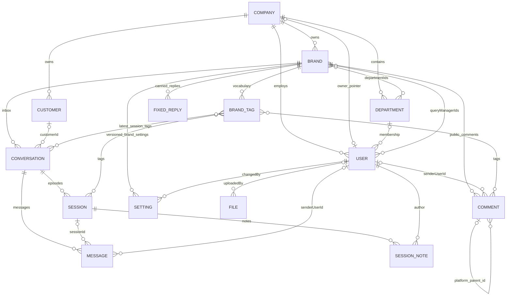
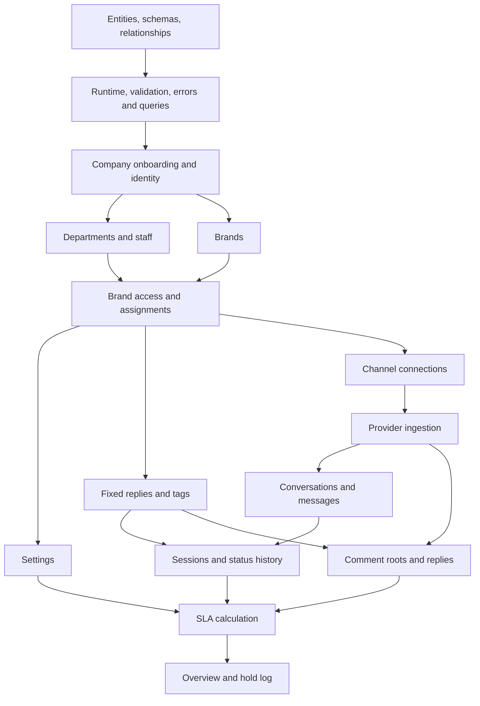
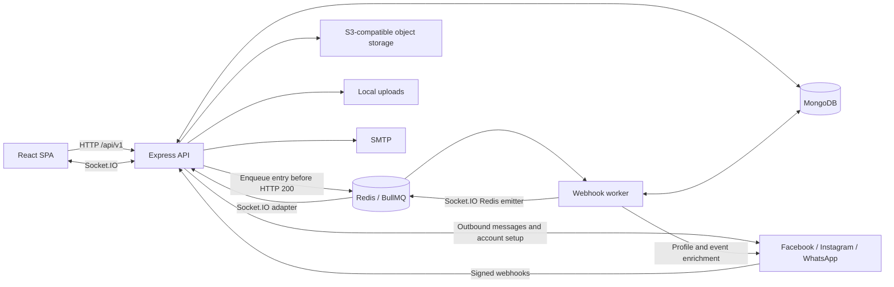
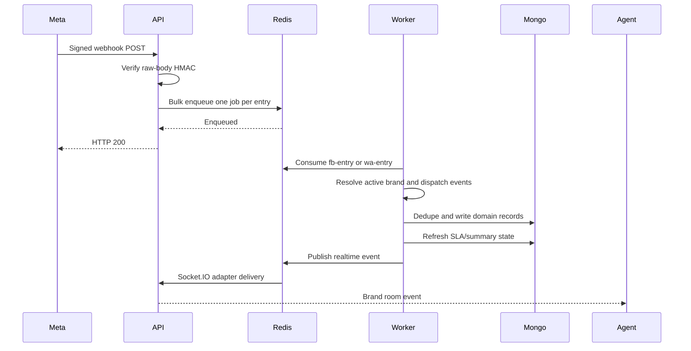
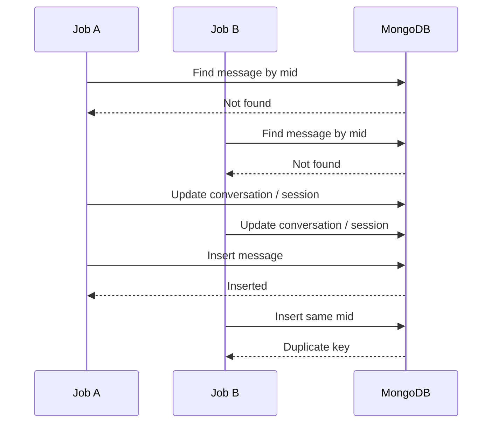

# Listenyzen backend — database-first learning guide

Inspected 17 October 2026 at source revision `ea791d3`. Source-derived examples; no live API or database verification. Source paths refer to the Listenyzen repository.

# Data models & relationships
*Interactive illustration available in the website chapter.*


## Persistence fundamentals

Mongoose models live beside features. There are **13 base domain models**: Company, User, Department, Brand, BrandTag, Customer, Conversation, Message, Session, SessionNote, Comment, FixedReply and File, plus **Setting** with two discriminator models. In total this is **14 base collections**, with SLA/business-hours discriminators sharing the Setting collection.

ObjectId references are application links, not relational foreign-key constraints. Mongoose `ref` enables population; it does not enforce existence, company membership, cascading deletion, or relationship cardinality. Several references are deliberately polymorphic or use external string IDs.

`server/src/libraries/db/index.ts` configures `strictQuery: true`, pool size 10–25, 45-second socket timeout and 10-second connection timeout. API `autoIndex` defaults on outside production; the worker always disables it. Production index creation is an operational step. `autoCreate` is enabled.

## Core ER diagram

The diagram shows intended domain relationships; optional links and application conventions are explained below. It does not imply foreign-key enforcement.



A Session/Comment can additionally point to a User **or** Department through `assignee.kind` and `assignee.id`. These polymorphic links are omitted from the diagram to avoid implying both are populated simultaneously. Settings also support a company scope in the schema; currently mounted settings routes are brand-scoped.

## Model-by-model inventory

### Company

Source: `server/src/modules/company/schema.ts`.

- `name`: required, trimmed, globally unique.
- `status`: `active | inactive`, default `active`.
- `logo?`: local storage key; virtual `logoUrl` builds a public URL.
- `ownerId?`: User pointer. Provisioning creates a company and its owner, then sets this pointer. No unique index makes ownership strictly one-to-one at database level.
- `settings.onlyAssignedCanAct`: defaults false; determines whether query managers can modify only assigned work.
- One company has many brands, departments, users and customer records. Active-company checks gate login, refresh and authenticated operations.

### User

Source: `server/src/modules/user/schema.ts`.

- Required `name`, globally unique `email`, `role`, `password`.
- `companyId?`: absent for super admin; expected for tenant roles by route/provisioning logic.
- `departmentId?`: one department membership; agent-facing workflows use it.
- `avatar?`: local storage key with virtual `avatarUrl`.
- Roles: `super_admin`, `company_owner`, `company_admin`, `query_manager`.
- Password is excluded from ordinary queries via `select: false` and removed by document serialization transforms. Login/password-change explicitly select it.
- A pre-save hook hashes modified passwords using bcrypt with cost 10. Creation uses the document `save()` hook. Password updates through `user/service.ts` explicitly hash before `findOneAndUpdate`; raw update queries do not automatically execute the pre-save hook.
- Query-manager operations reuse this collection with a role filter.

### Department

Source: `server/src/modules/department/schema.ts`.

- Required `name`, `companyId`; `status` defaults active.
- Unique `(companyId, name)`.
- A department has many users and can be assigned to many brands. Brand membership and department existence are checked in application code.

### Brand

Source: `server/src/modules/brand/schema.ts`.

- Required `name`, normalized lowercase `email`, local `logo`, `companyId`; active/inactive status.
- `departmentIds[]`, `queryManagerIds[]`: two independent ways an agent can gain access.
- `facebook?`: `pageId`, `pageName`, page/user tokens, connection state/date, verified webhook subscription fields/missing fields/check time.
- `instagram?`: `accountId`, `username`, token, connection state/date, `loginType` (`facebook` or `instagram`), optional token expiry, webhook subscription diagnostics for the direct-login flow.
- `whatsapp?`: `wabaId`, `phoneNumberId`, display number, verified name, token, `registered`, registration PIN, connection state/date.
- Unique `(companyId, name)`, sparse unique `facebook.pageId` and `whatsapp.phoneNumberId`.
- No equivalent unique Instagram-account index is declared in this schema; do not assume symmetry across channels.
- Virtuals: `logoUrl`, `facebookConnected`, `instagramConnected`, `whatsappConnected`.
- `toJSON`/`toObject` remove channel tokens and WhatsApp PIN. `.lean()` bypasses these document transforms; use explicit safe projections when returning lean brand documents.

### BrandTag

Source: `server/src/modules/brand/tags/schema.ts`.

- Required `brandId`, `companyId`, `name`, `nameLower`; `archived` defaults false.
- `name` is a slash-separated path such as `Complaint/Billing`; ancestor levels are separate tag documents.
- Unique `(brandId, nameLower)` enforces case-insensitive vocabulary uniqueness through a normalized field.
- Sessions, comments and conversation summaries store tag ObjectIds. Session/comment read paths populate only tag `name`; consumers may therefore receive `{ _id, name }` instead of bare IDs.
- Archive hides a tag from ordinary selection but preserves existing references. Rename is reflected when records are populated again.

### Customer

Source: `server/src/modules/customer/schema.ts`.

- Required `companyId`, `platform`, `pageId`, `externalId`.
- `name` defaults empty; optional `avatarUrl`, `mobile`, `email`, `address`, `gender` (`male | female | other`).
- Unique `(platform, pageId, externalId)`.
- For WhatsApp, the common `pageId` field represents the business phone-number ID and the participant/external ID represents the customer's provider identity. Do not reformat opaque provider IDs as phone numbers.
- `customerId` on Conversation is optional; services also resolve customers by the channel identity tuple and can lazily create/link them during editing.

### Conversation

Source: `server/src/modules/conversation/schema.ts`.

- Required `brandId`, `companyId`, `platform`, `pageId`, `participantId`.
- Participant display snapshot: `participantName`, optional `participantAvatarUrl`; optional `customerId`.
- Inbox summary: `lastMessageText`, `lastMessageAt`, `lastMessageDirection`, `unreadCount`.
- Latest-session summary: `status`, `sentiment`, optional `assignee`, `tags[]`.
- Defaults: incoming direction, unread count 0, status `pending`, sentiment `NEUTRAL`.
- Unique `(pageId, participantId)` — **platform and company are not in this unique key**.
- One conversation has many sessions/messages. Customer-to-conversation is not constrained to one-to-one by a unique customer reference.
- Summary fields are intentionally denormalized; update them through the session/message services.

### Message

Source: `server/src/modules/conversation/schema.ts`, model `Message`.

- Required `conversationId`, `brandId`, `platform`, `direction`, `senderId`; optional `sessionId` for older or incomplete records.
- Optional provider `mid` is sparse unique and underpins deduplication.
- Optional `senderUserId`, `senderName` identify the internal sender; the provider sender ID is a separate field.
- `text`, `sentAt`, optional `system` flag.
- `attachments[]`: required `type`; optional `url`, persistent `storageKey`, display `name`, provider `mediaId`, `mimeType`, status `pending | ready | failed`.
- `reactions[]`: `emoji`, optional provider reaction/reactor ID, `source: customer | agent`, `at`.
- `template?`: name, language, category snapshot for WhatsApp templates.
- `deliveryStatus?`: enum includes `sent | delivered | read | failed`; successful sends write `sent`, and current WhatsApp status processing persists failures only.
- `failure?`: code/title/details/message, optional remediation owner (`agent | admin`), timestamp.
- No `companyId` field. Access must go through the visible conversation/brand, not an assumed direct tenant filter on Message.

### Session

Source: `server/src/modules/session/schema.ts`.

- Required `conversationId`, `brandId`, `companyId`, `platform`, and `sequence`.
- Status `pending | unresolved | resolved | hold`; sentiment `POSITIVE | NEUTRAL | NEGATIVE | MIXED`.
- `startedAt`, `lastActivityAt`; optional `resolvedAt`, `statusChangedBy`, `statusChangedAt`.
- Optional `assignee: { kind: query_manager | department, id, name }`. `name` is a display snapshot; `id` has no fixed Mongoose `ref`.
- `tags[]`, `messageCount`, `noteCount`.
- Optional `sessionType`: `complain | inquiry | compliment | support | sales | other`. Preserve the exact spelling `complain` in payloads.
- Optional `resolutionSummary`, `firstCustomerMessageAt`, `firstResponseAt`, `sla`.
- Sequence is computed from the previous session, required without a default, but has no unique `(conversationId, sequence)` index.

SLA state shape:

```typescript
{
  rulesVersion?: number; // current clock rules: 2 for sessions and comments
  slaVersion: number;
  hoursVersion: number;
  firstResponse: null | { minutes: number; atRiskAt: Date; dueAt: Date };
  resolution: null | {
    minutes: number;
    usedMs: number;
    waitingSince: Date | null;
    atRiskAt: Date | null;
    dueAt: Date | null;
  };
  messagesSeen: number;
  failedMessagesSeen: number;
  statusChangesSeen: number;
}
```

The three counters guard against stale concurrent SLA computations. Dates become ISO strings in JSON.

### SessionNote

Source: `server/src/modules/session/schema.ts`, model `SessionNote`.

- Required `sessionId`, `conversationId`, `companyId`, `authorId`, `text`; `authorName` snapshot defaults empty.
- Notes are internal records, not outgoing channel messages.
- Chronological index `(sessionId, createdAt)`; adding a note increments the session's `noteCount` and emits `note:added`.

### Comment

Source: `server/src/modules/comment/schema.ts`.

- Required post/routing context: `pageId`, `platformPostId`, `brandId`, `companyId`, `platform` (`facebook | instagram`), `direction`, `authorId`.
- Optional `permalinkUrl`, provider `commentId`, and `parentCommentId`. Parent linkage uses the provider's **string comment ID**, not Mongo `_id`.
- Author display snapshot: `authorName`, optional `authorAvatarUrl`; optional internal `senderUserId`.
- `text`; optional attachment URL/type (`image | video`).
- Status uses the four session status values; sentiment supports `POSITIVE | NEUTRAL | NEGATIVE` and has no default. There is no comment `MIXED` sentiment.
- Optional `resolutionSummary`; `topicTags[]` are free-string labels, separate from user-maintained `tags[]` ObjectIds. Their presence does not establish an active ML pipeline.
- Optional polymorphic `assignee`; `reactions` count, `isHidden`, `likedByPage`.
- `commentedAt`, `lastActivityAt`; root comments carry `slaStartAt`, `firstResponseAt`, `resolvedAt`, SLA state and `slaRevision` when applicable.
- `commentId` is sparse unique. Thread traversal scopes by brand/post and follows `parentCommentId`.

### FixedReply

Source: `server/src/modules/fixed-reply/schema.ts`.

Required `title`, `body`, `brandId`, `companyId`. Title/body are trimmed. This is a local canned-reply record, distinct from a provider-approved WhatsApp template.

### File

Source: `server/src/modules/file/schema.ts`.

Required `filename`, `mimeType`, nonnegative `size`, unique S3 `key`; optional `uploadedBy`; mixed `metadata`; `isTemporary` defaults true. It has no company or brand field. Its `url` virtual constructs an AWS-style URL directly and does not share the newer R2/public-media URL behavior. Message attachments store their own metadata and are not File references.

### Setting, SlaSetting and BusinessHoursSetting

Source: `server/src/modules/settings/schema.ts`, `server/src/modules/settings/definitions.ts`.

- Base fields: `scope` (`brand | company`), `scopeId`, `companyId`, discriminator `type`, positive `version`, `changedBy: { id, name }`.
- `scopeId` is polymorphic, not a fixed reference. The currently mounted API establishes the scope through an authorized Brand.
- Unique `(scope, scopeId, type, version DESC)` prevents concurrent duplicate versions.
- `SlaSetting` discriminator value `sla`: tier `Standard | Priority`; nullable first-response/resolution overrides with `{ on, minutes }`.
- `BusinessHoursSetting` discriminator value `business-hours`: fixed server timezone, seven day entries `{ day, open, opens, closes }`, holiday date strings.
- Each save inserts another document. Version 0 is a synthesized default and need not exist in MongoDB.


### Embedded status history (Session and Comment)

This is an embedded array, **not a fifteenth collection**. Both schemas reuse `statusChangeSchema` from `server/src/modules/session/schema.ts`.

| Field | Schema / meaning |
| --- | --- |
| `statusLog[]` | Default empty, `select: false`; explicitly selected for clock computation and manager history reads. Ordinary reads and socket payloads should not expose it. |
| `statusLog[].status` | Required `pending`, `hold`, `unresolved` or `resolved`. |
| `statusLog[].at` | Required Date; an interval ends at the next entry's date. |
| `statusLog[].cause` | Required `agent` (manual), `reply` (agent message ends hold), or `customer` (customer reopens unresolved). |
| `statusLog[].by?` | User ObjectId reference. Absent for provider-originated changes without an internal actor. |
| `statusLog[].reason?` | Trimmed string, maximum 500 characters; optional, including for hold. |
| `statusRevision?` | Incremented on an actual status transition; used to guard concurrent status writes. |
| `statusChangedAt`, `statusChangedBy` | Latest transition metadata; comment roots now store these too. |
| `sla.rulesVersion?` | Calculation version, currently 2 for both sources; distinct from historical setting versions. |
| `sla.statusChangesSeen` | Session calculation's count of log entries; guards against an older derived result overwriting a newer one. Comment SLA instead uses `slaRevision`. |

The embedded entries have no `_id`. The chronological log records real transitions; re-saving the same status does not append an entry or change its original reason. History resolves user names at read time: a deleted user has an ID with a null name. This differs from `assignee.name` and `Setting.changedBy.name` snapshots.

Both Session and Comment add `(brandId, statusChangedAt)` indexes for hold-log reads. Schema declarations do not establish that those indexes have been created in production. The hold-log service derives rows from these documents, so merging away a session or deleting a thread removes its history from that view.

Message adds optional `isAutomatic: boolean`, with no default. It marks an actual automatic outgoing reply and is distinct from `system`, which marks an internal informational notice. First-response calculation and hold-ending rules ignore automatic replies.

## Index strategy

| Data             | Important indexes / purpose                                                                                                                                     |
| ---------------- | --------------------------------------------------------------------------------------------------------------------------------------------------------------- |
| Company/User     | Unique company name / user email.                                                                                                                               |
| Department/Brand | Unique company+name; tenant and assignment lookups.                                                                                                             |
| Brand channels   | Sparse unique Facebook page and WhatsApp phone IDs.                                                                                                             |
| BrandTag         | Unique brand+normalized path; company index.                                                                                                                    |
| Customer         | Unique platform+page+external identity.                                                                                                                         |
| Conversation     | Unique page+participant; brand+lastMessageAt+\_id cursor order; compound platform/status/sentiment/tag variants; partial assignee index.                        |
| Message          | Sparse unique provider mid; conversation+sentAt, session+sentAt, individual reference indexes.                                                                  |
| Session          | Conversation+startedAt+\_id; conversation/brand+lastActivityAt+\_id; brand+status+resolvedAt; brand+firstCustomerMessageAt; partial assignee index; brand+tags. |
| Comment          | Sparse unique provider commentId; brand+post+parent+commentedAt+\_id traversal; brand+lastActivityAt+\_id; status/resolvedAt and assignment-oriented indexes.   |
| SessionNote      | Session+createdAt and reference indexes.                                                                                                                        |
| Setting          | Unique scope+scopeId+type+version for history/concurrent-save protection.                                                                                       |
| File             | Unique key; uploadedBy and createdAt indexes.                                                                                                                   |

The schema files remain the exact index definitions. The cursor-index maintenance script creates a **selected** set of indexes, not every schema index. MongoDB production startup will not automatically create the rest.

## Validation, timestamps, deletion and consistency

- `baseSchema` defines `createdAt`/`updatedAt` with defaults/indexes and uses `timestamps: true`; feature schemas add it. Distinguish audit dates from business dates such as `sentAt`, `commentedAt`, `startedAt`, and `resolvedAt`.
- Request Zod validation, service invariant checks, Mongoose validation and unique indexes each protect different things. A unique database index is not equivalent to a Zod uniqueness check.
- The DB helper contains middleware intended to enable update validators, but it merely returns `{ runValidators: true }` from a pre-hook rather than setting query options. Do not assume this globally enables update validation; use explicit query options where needed.
- There is no universal soft-delete plugin or `deletedAt` convention. Companies, brands, departments and users have hard-delete service paths; active/inactive status is a separate concept. Brand tags are archived; comment hiding is provider moderation, not deletion.
- Deleting a brand explicitly deletes its vocabulary, but the general CRUD service paths do not cascade every dependent conversation/session/user/etc. MongoDB does not prevent dangling references.
- `withTransaction` exists but no production source caller was found. Company provisioning uses compensating deletions; message/session updates are multiple sequential writes.
- Session state copied onto Conversation must remain synchronized. Tag and customer display fields have different ownership: do not introduce arbitrary snapshots where existing reads intentionally populate live names.

---

# Business requirements & learning order
## How to read this documentation

Begin with [every database entity, schema and relationship](/docs/listenyzen/data-model). Then follow the stages below. “No dependency” means no earlier **business feature** is required; database/runtime primitives still exist. Authentication and tenant scope are cross-cutting prerequisites, not optional steps.

For each stage, read the requirement, prerequisites and code path before trying the input/output example. The examples are source-derived illustrations using fictional IDs, not recorded integration-test results. Entity outputs omit nonessential fields. The [complete API reference](/docs/listenyzen/api-reference) provides the exact handler and validation declarations for every operation, plus request/response examples and access rules.



Settings and reusable replies can be learned independently once brand access is understood. Private inbox and public comments are parallel domain paths. Standalone files are storage support; they do not require an existing support episode.

## 0. Foundation: schemas and shared mechanics

**Prerequisites:** No business record prerequisite. Learn MongoDB identities, references, indexes, response envelopes and API/worker health first.

**Business rule and implementation:** A healthy request process is not evidence that queued work is being consumed. /health checks process dependencies; /health/queue reports stalled or flooded work.

**Read the code:** `server/src/routes.ts; server/src/libraries/db/index.ts; server/src/libraries/utils/sendResponse.ts`.

### Example input and output

`GET /health`

```sh
curl -i "${BASE_URL}/health"
```

```json title="Illustrative response — HTTP 200"
{
  "status": "ok",
  "uptime": 120,
  "components": {
    "mongo": "connected",
    "redis": "connected",
    "realtime": "up"
  }
}
```

### Endpoints in this stage

| Method | Endpoint |
| --- | --- |
| GET | `/health` |
| GET | `/health/queue` |

Use the endpoint explorer’s **Business logic** tab for prerequisites and implementation entry points, then **Validation** and **Handler code** to follow the individual operation.

## 1. Company onboarding and authentication

**Prerequisites:** Database foundation. Registration bootstraps Company and User together; login needs an existing user. Company administration needs an authenticated permitted role.

**Business rule and implementation:** A company is the tenant boundary. Registration creates the company and owner, links ownerId and uses compensating cleanup on failure. Password verification precedes issuing access/refresh cookies. Company settings control assigned-only action policy; suspension is checked separately from role permission.

**Read the code:** `server/src/auth/api.ts → auth/service.ts; auth/company-access.ts; modules/company/service.ts`.

### Example input and output

`POST /api/v1/auth/register-company`

```sh
curl -i -X POST "${BASE_URL}/api/v1/auth/register-company" \
  -b cookies.txt -c cookies.txt \
  -H "Content-Type: application/json" \
  --data '{"companyName":"Example Company","name":"Amina Rahman","email":"amina@example.com","password":"ExamplePassword1!"}'
```

```json title="Illustrative response — HTTP 200"
{
  "success": true,
  "message": "Company registered successfully",
  "data": {
    "user": {
      "_id": "670000000000000000000002",
      "name": "Amina Rahman",
      "email": "amina@example.com",
      "role": "company_owner",
      "companyId": "670000000000000000000001"
    }
  }
}
```

### Endpoints in this stage

| Method | Endpoint |
| --- | --- |
| POST | `/api/v1/auth/register-company` |
| POST | `/api/v1/auth/login` |
| POST | `/api/v1/auth/logout` |
| POST | `/api/v1/auth/refresh` |
| GET | `/api/v1/companies/me` |
| GET | `/api/v1/companies/me/settings` |
| PATCH | `/api/v1/companies/me/settings` |
| GET | `/api/v1/companies` |
| POST | `/api/v1/companies` |
| GET | `/api/v1/companies/:id` |
| PATCH | `/api/v1/companies/:id` |
| DELETE | `/api/v1/companies/:id` |

Use the endpoint explorer’s **Business logic** tab for prerequisites and implementation entry points, then **Validation** and **Handler code** to follow the individual operation.

## 2. Staff and departments

**Prerequisites:** Company and authenticated role. A department can exist before agents; an agent department assignment needs a department in the same company.

**Business rule and implementation:** Query managers are Users filtered by role, not another collection. Tenant filters limit reads and writes. Password creation runs the save hook; direct password updates explicitly hash. Department membership later grants one of the brand-access and assignment paths.

**Read the code:** `server/src/modules/user/service.ts; modules/department/service.ts; modules/query-manager/service.ts; auth/tenant.ts`.

### Example input and output

`POST /api/v1/departments`

```sh
curl -i -X POST "${BASE_URL}/api/v1/departments" \
  -b cookies.txt -c cookies.txt \
  -H "Content-Type: application/json" \
  --data '{"name":"Customer Care"}'
```

```json title="Illustrative response — HTTP 200"
{
  "success": true,
  "message": "Department created successfully",
  "data": {
    "_id": "670000000000000000000003",
    "name": "Customer Care",
    "companyId": "670000000000000000000001",
    "status": "active"
  }
}
```

### Endpoints in this stage

| Method | Endpoint |
| --- | --- |
| GET | `/api/v1/departments` |
| POST | `/api/v1/departments` |
| GET | `/api/v1/departments/:id` |
| PATCH | `/api/v1/departments/:id` |
| DELETE | `/api/v1/departments/:id` |
| GET | `/api/v1/query-managers` |
| POST | `/api/v1/query-managers` |
| GET | `/api/v1/query-managers/:id` |
| PATCH | `/api/v1/query-managers/:id` |
| DELETE | `/api/v1/query-managers/:id` |
| GET | `/api/v1/users` |
| POST | `/api/v1/users` |
| GET | `/api/v1/users/me` |
| GET | `/api/v1/users/:id` |
| PATCH | `/api/v1/users/me` |
| PATCH | `/api/v1/users/me/change-password` |
| PATCH | `/api/v1/users/:id` |
| DELETE | `/api/v1/users/:id` |

Use the endpoint explorer’s **Business logic** tab for prerequisites and implementation entry points, then **Validation** and **Handler code** to follow the individual operation.

## 3. Brands, access assignments and provider connections

**Prerequisites:** Company and identity. Department/agent assignment additionally needs those records; social connection needs provider credentials and the selected brand.

**Business rule and implementation:** Brand departmentIds and queryManagerIds grant alternative visibility paths inside the tenant scope. Provider identifiers and secrets live in channel subdocuments. Connections, provider templates and tags have different prerequisites: local tags need only a visible brand, while provider calls need a connected operational channel. Archived tags preserve existing references.

**Read the code:** `server/src/modules/brand/service.ts; brand/assignees.ts; brand/channel-access.ts; brand/tags/service.ts; auth/tenant.ts`.

### Example input and output

`POST /api/v1/brands/:id/tags`

```sh
curl -i -X POST "${BASE_URL}/api/v1/brands/670000000000000000000004/tags" \
  -b cookies.txt -c cookies.txt \
  -H "Content-Type: application/json" \
  --data '{"name":"Support"}'
```

```json title="Illustrative response — HTTP 200"
{
  "success": true,
  "message": "Tag added successfully",
  "data": {
    "created": {
      "_id": "670000000000000000000009",
      "name": "Support",
      "id": "670000000000000000000009",
      "archived": false
    },
    "tags": [
      {
        "_id": "670000000000000000000009",
        "name": "Support",
        "id": "670000000000000000000009",
        "archived": false
      }
    ]
  }
}
```

### Endpoints in this stage

| Method | Endpoint |
| --- | --- |
| GET | `/api/v1/brands` |
| POST | `/api/v1/brands` |
| GET | `/api/v1/brands/:id` |
| GET | `/api/v1/brands/:id/departments` |
| PUT | `/api/v1/brands/:id/departments` |
| GET | `/api/v1/brands/:id/query-managers` |
| PUT | `/api/v1/brands/:id/query-managers` |
| PATCH | `/api/v1/brands/:id` |
| DELETE | `/api/v1/brands/:id` |
| POST | `/api/v1/brands/:id/facebook/connect` |
| DELETE | `/api/v1/brands/:id/facebook` |
| POST | `/api/v1/brands/:id/instagram/connect` |
| DELETE | `/api/v1/brands/:id/instagram` |
| GET | `/api/v1/brands/:id/instagram/login-url` |
| GET | `/api/v1/brands/instagram/oauth/callback` |
| GET | `/api/v1/brands/:id/tags` |
| POST | `/api/v1/brands/:id/tags` |
| PATCH | `/api/v1/brands/:id/tags/:tagId` |
| PATCH | `/api/v1/brands/:id/tags/:tagId/archive` |
| GET | `/api/v1/brands/:id/whatsapp/templates` |
| POST | `/api/v1/brands/:id/whatsapp/templates` |
| POST | `/api/v1/brands/:id/whatsapp/templates/:templateId` |
| DELETE | `/api/v1/brands/:id/whatsapp/templates/:templateId` |
| POST | `/api/v1/brands/:id/whatsapp/connect` |
| POST | `/api/v1/brands/:id/whatsapp/connect-manual` |
| POST | `/api/v1/brands/:id/whatsapp/register` |
| DELETE | `/api/v1/brands/:id/whatsapp` |

Use the endpoint explorer’s **Business logic** tab for prerequisites and implementation entry points, then **Validation** and **Handler code** to follow the individual operation.

## 4. Independent brand configuration and reusable replies

**Prerequisites:** Visible brand and permitted role. Settings and fixed replies do not require conversations, sessions or comments, and can be learned independently of each other.

**Business rule and implementation:** FixedReply stores reusable local text; it is not a provider-approved WhatsApp template. Settings append immutable versions. baseVersion prevents silent overwrites, and the unique scope/type/version index resolves concurrent saves. Virtual version zero provides defaults without inserting a row. SLA later uses the settings in force at clock start.

**Read the code:** `server/src/modules/fixed-reply/service.ts; modules/settings/service.ts; modules/settings/definitions.ts`.

### Example input and output

`PUT /api/v1/brands/:brandId/settings/:type`

```sh
curl -i -X PUT "${BASE_URL}/api/v1/brands/670000000000000000000004/settings/sla" \
  -b cookies.txt -c cookies.txt \
  -H "Content-Type: application/json" \
  --data '{"baseVersion":0,"value":{"tier":"Standard","overrides":{"firstResponse":null,"resolution":null}}}'
```

```json title="Illustrative response — HTTP 200"
{
  "success": true,
  "message": "Saved as version 1",
  "data": {
    "type": "sla",
    "version": 1,
    "value": {
      "tier": "Standard",
      "overrides": {
        "firstResponse": null,
        "resolution": null
      }
    },
    "changedBy": {
      "id": "670000000000000000000002",
      "name": "Amina Rahman"
    },
    "savedAt": "2026-10-15T09:00:00.000Z"
  }
}
```

### Endpoints in this stage

| Method | Endpoint |
| --- | --- |
| GET | `/api/v1/brands/:brandId/fixed-replies` |
| POST | `/api/v1/brands/:brandId/fixed-replies` |
| PATCH | `/api/v1/brands/:brandId/fixed-replies/:id` |
| DELETE | `/api/v1/brands/:brandId/fixed-replies/:id` |
| GET | `/api/v1/brands/:brandId/settings/:type` |
| PUT | `/api/v1/brands/:brandId/settings/:type` |
| GET | `/api/v1/brands/:brandId/settings/:type/history` |

Use the endpoint explorer’s **Business logic** tab for prerequisites and implementation entry points, then **Validation** and **Handler code** to follow the individual operation.

## 5. Storage support

**Prerequisites:** Authentication and configured object storage; no conversation is required for the standalone file routes.

**Business rule and implementation:** File metadata is independent of Message attachment metadata. Uploads involve external storage, and File has no company field; inspect the actual route access checks rather than inventing a tenant foreign key. Conversation attachments additionally require a visible actionable conversation and provider send.

**Read the code:** `server/src/modules/file/api.ts; modules/file/service.ts; modules/conversation/media.ts`.

### Example input and output

`GET /api/v1/files`

```sh
curl -i -X GET "${BASE_URL}/api/v1/files?limit=20" \
  -b cookies.txt -c cookies.txt
```

```json title="Illustrative response — HTTP 200"
{
  "success": true,
  "message": "success",
  "data": [
    {
      "_id": "67000000000000000000000a",
      "filename": "photo.png",
      "key": "generated-photo.png",
      "size": 2048,
      "mimeType": "image/png"
    }
  ],
  "pagination": {
    "page": 1,
    "limit": 20,
    "totalCount": 1,
    "totalPages": 1,
    "hasNext": false,
    "hasPrev": false,
    "startIndex": 1,
    "endIndex": 1
  }
}
```

### Endpoints in this stage

| Method | Endpoint |
| --- | --- |
| GET | `/api/v1/files` |
| POST | `/api/v1/files/upload-image-single` |
| POST | `/api/v1/files/upload-image-multiple` |

Use the endpoint explorer’s **Business logic** tab for prerequisites and implementation entry points, then **Validation** and **Handler code** to follow the individual operation.

## 6. Provider ingestion

**Prerequisites:** Operational connected brand, signature/verification configuration, Redis queue and worker. Browser login is not the provider authentication mechanism.

**Business rule and implementation:** Verification and signature checks precede queue work. The worker translates provider identities into domain input. Incoming message persistence updates conversation preview, chooses a session, inserts Message, applies status rules and recomputes SLA before emitting. Sparse unique provider IDs prevent duplicate records, but earlier cross-document writes are not one transaction.

**Read the code:** `server/src/modules/webhook/index.ts; webhook/queue.ts; webhook/facebook.ts; webhook/whatsapp.ts; modules/conversation/service.ts`.

### Example input and output

`POST /api/v1/webhooks/whatsapp`

```sh
curl -i -X POST "${BASE_URL}/api/v1/webhooks/whatsapp" \
  -H "X-Hub-Signature-256: sha256=<VALID_HMAC>" \
  -H "Content-Type: application/json" \
  --data '{"object":"whatsapp_business_account","entry":[]}'
```

```json title="Illustrative response — HTTP 200"
"OK"
```

### Endpoints in this stage

| Method | Endpoint |
| --- | --- |
| GET | `/api/v1/webhooks/facebook` |
| POST | `/api/v1/webhooks/facebook` |
| POST | `/api/v1/webhooks/facebook/relay` |
| GET | `/api/v1/webhooks/whatsapp` |
| POST | `/api/v1/webhooks/whatsapp` |

Use the endpoint explorer’s **Business logic** tab for prerequisites and implementation entry points, then **Validation** and **Handler code** to follow the individual operation.

## 7. Private inbox and customer context

**Prerequisites:** Visible brand and stored conversation; provider sends additionally need channel access, action policy and provider configuration. Session/message knowledge is needed to interpret summaries.

**Business rule and implementation:** Conversation is the long-lived thread, Message is the event and Session is the support episode. List routes use stable compound cursors. Customer lookup/editing can resolve the external identity and lazily link a Customer. A send checks access before provider work and local storage. Attachments can partially succeed; template re-engagement can start a new episode after resolved work.

**Read the code:** `server/src/modules/conversation/api.ts; conversation/access.ts; conversation/service.ts; conversation/send-channel.ts; conversation/whatsapp-templates.ts`.

### Example input and output

`POST /api/v1/conversations/:id/messages`

```sh
curl -i -X POST "${BASE_URL}/api/v1/conversations/670000000000000000000005/messages" \
  -b cookies.txt -c cookies.txt \
  -H "Content-Type: application/json" \
  --data '{"text":"How can we help?"}'
```

```json title="Illustrative response — HTTP 201"
{
  "success": true,
  "message": "Reply sent",
  "data": {
    "_id": "670000000000000000000007",
    "conversationId": "670000000000000000000005",
    "sessionId": "670000000000000000000006",
    "mid": "provider-message-id",
    "direction": "outgoing",
    "text": "How can we help?",
    "sentAt": "2026-10-15T09:00:00.000Z"
  }
}
```

### Endpoints in this stage

| Method | Endpoint |
| --- | --- |
| GET | `/api/v1/conversations` |
| GET | `/api/v1/conversations/:id/messages` |
| GET | `/api/v1/conversations/:id/sessions` |
| GET | `/api/v1/conversations/:id/stats` |
| GET | `/api/v1/conversations/:id/customer` |
| PATCH | `/api/v1/conversations/:id/customer` |
| POST | `/api/v1/conversations/:id/messages` |
| POST | `/api/v1/conversations/:id/attachments` |
| POST | `/api/v1/conversations/:id/messages/:messageId/reaction` |
| DELETE | `/api/v1/conversations/:id/messages/:messageId/reaction` |
| POST | `/api/v1/conversations/:id/messages/:messageId/media` |
| GET | `/api/v1/conversations/:id/whatsapp/templates` |
| POST | `/api/v1/conversations/:id/whatsapp/templates` |

Use the endpoint explorer’s **Business logic** tab for prerequisites and implementation entry points, then **Validation** and **Handler code** to follow the individual operation.

## 8. Session handling, classification and history

**Prerequisites:** Conversation and session. Tags need the brand vocabulary; assignees need eligible staff/departments. Status reporting requires manager access; SLA depends on settings.

**Business rule and implementation:** Wrap-up records the outcome; notes stay internal. hold/unresolved/resolved stop resolution, and pending resumes it. A customer message reopens unresolved work; a qualifying agent reply ends hold. A same-status save does not append history. Status changes mirror the latest session onto Conversation. Session merge moves work into the previous episode and removes the merged episode, including its own hold history.

**Read the code:** `server/src/modules/session/api.ts; session/service.ts; session/status-log.ts; session/status-history.ts; session/sla.ts`.

### Example input and output

`PATCH /api/v1/sessions/:id/status`

```sh
curl -i -X PATCH "${BASE_URL}/api/v1/sessions/670000000000000000000006/status" \
  -b cookies.txt -c cookies.txt \
  -H "Content-Type: application/json" \
  --data '{"status":"hold","reason":"Waiting for warehouse confirmation"}'
```

```json title="Illustrative response — HTTP 200"
{
  "success": true,
  "message": "Session status updated",
  "data": {
    "_id": "670000000000000000000006",
    "conversationId": "670000000000000000000005",
    "brandId": "670000000000000000000004",
    "companyId": "670000000000000000000001",
    "platform": "facebook",
    "status": "hold",
    "sentiment": "NEUTRAL",
    "sequence": 1,
    "startedAt": "2026-10-15T09:00:00.000Z",
    "lastActivityAt": "2026-10-15T09:00:00.000Z",
    "tags": [],
    "messageCount": 1
  }
}
```

### Endpoints in this stage

| Method | Endpoint |
| --- | --- |
| GET | `/api/v1/sessions` |
| GET | `/api/v1/sessions/assignees` |
| GET | `/api/v1/sessions/:id` |
| PATCH | `/api/v1/sessions/:id/status` |
| PATCH | `/api/v1/sessions/:id/sentiment` |
| PATCH | `/api/v1/sessions/:id/wrap-up` |
| PATCH | `/api/v1/sessions/:id/assignment` |
| PUT | `/api/v1/sessions/:id/tags` |
| GET | `/api/v1/sessions/:id/notes` |
| POST | `/api/v1/sessions/:id/notes` |
| GET | `/api/v1/sessions/:id/status-log` |

Use the endpoint explorer’s **Business logic** tab for prerequisites and implementation entry points, then **Validation** and **Handler code** to follow the individual operation.

## 9. Public comment threads

**Prerequisites:** Brand/channel and ingested comment tree. Uses the shared access, tag, status and SLA concepts; no Conversation or Session document is required.

**Business rule and implementation:** Provider parentCommentId joins replies to a root within brand/post scope. The root owns thread status and SLA. Page replies end hold, and root-author replies reopen unresolved roots. Resolved roots do not automatically reopen. Replies, hiding, liking and deletion can call the provider; local wrap-up and classification update domain state. Reading history using a reply ID resolves the root first.

**Read the code:** `server/src/modules/comment/api.ts; comment/service.ts; comment/sla.ts; modules/session/status-log.ts`.

### Example input and output

`PATCH /api/v1/comments/:id/wrap-up`

```sh
curl -i -X PATCH "${BASE_URL}/api/v1/comments/670000000000000000000008/wrap-up" \
  -b cookies.txt -c cookies.txt \
  -H "Content-Type: application/json" \
  --data '{"status":"resolved","sentiment":"POSITIVE","resolutionSummary":"Issue resolved.","tagIds":[]}'
```

```json title="Illustrative response — HTTP 200"
{
  "success": true,
  "message": "Comment wrapped up",
  "data": {
    "_id": "670000000000000000000008",
    "brandId": "670000000000000000000004",
    "companyId": "670000000000000000000001",
    "platform": "facebook",
    "commentId": "page_comment_id",
    "platformPostId": "page_post_id",
    "text": "Thank you for contacting us.",
    "status": "resolved",
    "sentiment": "NEUTRAL",
    "tags": []
  }
}
```

### Endpoints in this stage

| Method | Endpoint |
| --- | --- |
| GET | `/api/v1/comments` |
| GET | `/api/v1/comments/posts` |
| GET | `/api/v1/comments/:id` |
| POST | `/api/v1/comments/:id/replies` |
| PATCH | `/api/v1/comments/:id` |
| PUT | `/api/v1/comments/:id/tags` |
| PATCH | `/api/v1/comments/:id/assignment` |
| PATCH | `/api/v1/comments/:id/wrap-up` |
| POST | `/api/v1/comments/:id/hide` |
| POST | `/api/v1/comments/:id/like` |
| DELETE | `/api/v1/comments/:id` |
| GET | `/api/v1/comments/:id/status-log` |

Use the endpoint explorer’s **Business logic** tab for prerequisites and implementation entry points, then **Validation** and **Handler code** to follow the individual operation.

## 10. Supervisor reporting

**Prerequisites:** Visible brand, manager role, stored sessions/comment roots, status history and historical settings. Reports derive from earlier workflows; they do not create support queries.

**Business rule and implementation:** Stats count pending sessions now. SLA reporting includes pending/hold/unresolved as open, but stopped resolution clocks are not at risk and retain earlier breaches. Engagement backlog excludes holds. Compliance counts decided targets. Hold rows are computed on read, not stored separately; an overlapping-date filter still returns full-hold durations, capped at 1,000 newest rows.

**Read the code:** `server/src/modules/overview/api.ts; overview/service.ts; overview/holds.ts; modules/settings/service.ts`.

### Example input and output

`GET /api/v1/brands/:brandId/overview/holds`

```sh
curl -i "${BASE_URL}/api/v1/brands/670000000000000000000004/overview/holds?from=2026-10-17&to=2026-10-17&source=sessions" \
  -b cookies.txt -c cookies.txt
```

```json title="Illustrative response — HTTP 200"
{
  "success": true,
  "message": "success",
  "data": [
    {
      "source": "session",
      "id": "670000000000000000000006",
      "conversationId": "670000000000000000000005",
      "heldBy": {
        "id": "670000000000000000000002",
        "name": "Amina Rahman"
      },
      "reason": "Waiting for warehouse confirmation",
      "startedAt": "2026-10-17T04:10:00.000Z",
      "endedAt": "2026-10-17T04:40:00.000Z",
      "endedBy": {
        "cause": "reply",
        "by": {
          "id": "670000000000000000000002",
          "name": "Amina Rahman"
        }
      },
      "durationMs": 1800000,
      "businessMs": 1800000
    }
  ]
}
```

### Endpoints in this stage

| Method | Endpoint |
| --- | --- |
| GET | `/api/v1/brands/:brandId/overview/stats` |
| GET | `/api/v1/brands/:brandId/overview/sla` |
| GET | `/api/v1/brands/:brandId/overview/engagement` |
| GET | `/api/v1/brands/:brandId/overview/inbound-trend` |
| GET | `/api/v1/brands/:brandId/overview/sla-compliance` |
| GET | `/api/v1/brands/:brandId/overview/holds` |

Use the endpoint explorer’s **Business logic** tab for prerequisites and implementation entry points, then **Validation** and **Handler code** to follow the individual operation.

## What changed in this revision

Compared with the previous documentation snapshot (`aebd2800`), revision `ea791d3` adds full pending-business-time resolution accounting, logged status transitions, hold reasons, unresolved reopening, manager history/hold endpoints and automatic-reply exclusion. The client adds hold-reason fields, manager History tabs and the Admin hold-log page. The detailed transition examples are in [hold, reopen and history](/docs/listenyzen/code-status).

The assignment redesign and hold-row deep links remain deferred. Existing production index/backfill state is not verified by this source review. See [development and repair](/docs/listenyzen/development) before operating on stored data.

---

# System & tech stack
*Interactive illustration available in the website chapter.*


## What this application does

Listenyzen is a multi-tenant customer engagement application. A **company** owns **brands**. Each brand connects social accounts; staff handle private messages and public comments from those accounts in a shared inbox. Staff can assign work, add internal notes, classify interactions, maintain customer details, use reusable replies, and record outcomes. Versioned SLA and business-hour settings support response and resolution reporting.

The critical vocabulary is:

| Term            | Meaning in this codebase                                                                                            |
| --------------- | ------------------------------------------------------------------------------------------------------------------- |
| Company         | Tenant boundary; owns brands and staff.                                                                             |
| Brand           | Operational inbox boundary; contains connected channel credentials and staff/department access assignments.         |
| Query manager   | An agent handling customer interactions; a `User` with `role: 'query_manager'`, not a separate database model.      |
| Customer        | A channel-specific identity and editable contact record. Not automatically one identity across all social channels. |
| Conversation    | Long-lived direct-message thread for a page/phone/account and participant.                                          |
| Message         | One incoming/outgoing item within a conversation, usually attached to a session.                                    |
| Session         | A support episode within a conversation; carries ownership, classification, outcome, notes, and SLA.                |
| Comment thread  | A root public comment plus replies; separate from direct-message conversations and sessions.                        |
| Post            | Platform context copied onto comments, not a `Post` collection.                                                     |
| Assignment      | Either one query manager or one department; distinct from permission to see a brand.                                |
| Brand tag       | A reusable, optionally hierarchical label; records store its ID.                                                    |
| Setting version | An immutable saved configuration record; history and current value share one collection.                            |

## Runtime and dependencies

Sources: `server/package.json`, `server/tsconfig.json`, `server/Dockerfile`, `package.json`.

| Concern           | Implementation                                                                                                                                  |
| ----------------- | ----------------------------------------------------------------------------------------------------------------------------------------------- |
| Runtime           | Node.js; Docker images use `node:24-alpine`. No backend `engines` constraint in the manifest.                                                   |
| Language          | TypeScript pinned to `5.8.3`; CommonJS modules, `target: ES2015`.                                                                               |
| HTTP              | Express `^5.1.0`; routes under `/api/v1`.                                                                                                       |
| Package manager   | `pnpm@11.9.0`; separate root, server, and client installs/lockfiles. This is not a package workspace.                                           |
| Database          | MongoDB via Mongoose `^8.16.2`. MongoDB server version is not pinned by these app manifests; deployment comments expect external Atlas.         |
| Queue             | BullMQ `^6.3.2`, using ioredis `^5.8.2`.                                                                                                        |
| Realtime          | Socket.IO `^4.8.1`, Redis adapter `^8.3.0`, Redis emitter `^5.1.0`.                                                                             |
| Redis clients     | Both `redis` `^5.9.0` and `ioredis`; they serve different transport/queue roles. Compose uses `redis:7-alpine`.                                 |
| Authentication    | Passport `^0.7.0`, passport-local `^1.0.0`, jsonwebtoken `^9.0.2`, bcrypt `^6.0.0`.                                                             |
| Validation        | Zod `^4.1.9`, plus Mongoose schemas and application-level checks.                                                                               |
| Storage           | AWS SDK S3 client/presigner `^3.896.0`, multer `^2.0.2`, multer-s3 `^3.0.1`; local disk for logos/avatars.                                      |
| Email             | Nodemailer `^7.0.9`; SMTP transport.                                                                                                            |
| HTTP controls     | Helmet, CORS, HPP, express-rate-limit, compression, cookie-parser, `qs`.                                                                        |
| Logging           | Winston `^3.17.0`, winston-daily-rotate-file `^5.0.0`.                                                                                          |
| Development/build | nodemon, tsx, TypeScript compiler, tsc-alias, ESLint, Prettier.                                                                                 |
| Client context    | React/Vite SPA, Axios with credentials, TanStack Query consumers and Socket.IO client; backend changes often require cache/event updates there. |

`prom-client` is declared, but no active metrics exporter or `/metrics` route was found in `server/src`. Likewise, installed dependencies and old commented scaffolding do not establish that a service is running.

## Processes and infrastructure



- **API:** `src/app.ts` connects MongoDB, builds Express, and delegates HTTP/realtime startup to `src/server.ts`.
- **Worker:** `src/worker.ts` independently connects MongoDB, configures a Redis socket emitter, registers webhook handlers, and starts BullMQ. It has no HTTP listener.
- **Redis:** durable webhook work plus cross-process realtime transport. It is not an HTTP session store; application authentication uses JWTs.
- **MongoDB:** persistent domain records. API and worker share the database.
- **Meta:** Facebook Page/Messenger, Instagram through two login paths, and WhatsApp Cloud API. `FACEBOOK_GRAPH_VERSION` defaults to `v25.0` in this checkout; that is a code default, not a statement about the provider's current preferred version.
- **S3-compatible storage:** AWS S3 or an endpoint such as R2; credentials are application-level. Public media URLs are optional; private reads use presigned URLs.
- **Local uploads:** brand/company logos and user avatars. Public `/uploads` URLs are built with `BASE_URL`.
- **SMTP:** registration welcome messages; email failure does not roll back successful company registration.

---

# Architecture & request lifecycle
*Interactive illustration available in the website chapter.*


## Architectural style

This is a **feature-first modular monolith with route/service/schema layers**, plus a sibling worker using the same modules. It is not a strict Clean Architecture implementation. Route handlers contain authorization and some integration orchestration; services query Mongoose directly. There is no universal repository layer, dependency injection container, or separate controller class convention.

Typical dependency path:

```text
modules/<feature>/index.ts        mount URL prefix
    → modules/<feature>/api.ts    middleware, access checks, HTTP handlers
    → validation.ts              parsed request contract
    → service.ts                 domain operations + queries
    → schema.ts                  Mongoose models
    → libraries/                 shared infrastructure/integrations
```

Modules call other modules directly. For example, conversation ingestion calls session assignment and SLA synchronization; session changes update the conversation's summary fields. Changes to these boundaries must preserve both sides.

## Directory map

```text
listenyzen-v2.0/
├── server/
│   ├── src/
│   │   ├── app.ts                    API entrypoint
│   │   ├── server.ts                 HTTP middleware, sockets, shutdown
│   │   ├── worker.ts                 queue consumer entrypoint
│   │   ├── routes.ts                 /api/v1, health routes, fallback 404
│   │   ├── auth/                     login, JWT identity, tenant/assignment rules
│   │   ├── configs/                  config loader and Zod schema
│   │   ├── modules/                  business features
│   │   ├── middlewares/              auth, validation, uploads, request context/logs
│   │   ├── libraries/                DB, Redis, queue, Graph clients, storage, utilities
│   │   └── types/express/            Express request/user augmentation
│   ├── config/                      shared and environment JSON config
│   ├── scripts/dev/                 seed, backfills, index creation, scaffolding
│   ├── uploads/                     local image assets
│   ├── docker/                      server-side nginx configuration
│   ├── Dockerfile*                  Node images
│   └── docker-compose.*.yml         server-specific container definitions
├── client/                          SPA; API contracts and realtime consumers
├── docs/                            feature notes and architecture references
├── handbook/                        existing developer learning material
├── listenyzen.postman_collection.json
├── docker-compose*.yml              root deployment definitions
├── docker-bake.hcl                  image build/publish configuration
├── DEPLOY.md / RELEASE.md           deployment/release notes
└── .husky/, .lintstagedrc.json, .prettierrc, .commitlintrc.json
```

No active cron directory/scheduler was found under `server/src`, despite references to one in older descriptive material.

## Feature ownership

| Feature         | Responsibility and important files                                                                                                       |
| --------------- | ---------------------------------------------------------------------------------------------------------------------------------------- |
| `auth`          | Company registration/provisioning, login/refresh/logout; `tenant.ts`, `reply-access.ts`, `company-access.ts` define shared access rules. |
| `company`       | Tenant CRUD, owner link, active status, `onlyAssignedCanAct` setting.                                                                    |
| `user`          | Staff CRUD, self-profile, password changes, role hierarchy enforcement.                                                                  |
| `department`    | Tenant department CRUD and membership validation helpers.                                                                                |
| `query-manager` | Agent-oriented operations over the User model; department and avatar handling.                                                           |
| `brand`         | Brand CRUD, visibility assignments, account credentials; `meta-channels.ts`, `whatsapp.ts`, `whatsapp-templates.ts`, `assignees.ts`.     |
| `brand/tags`    | Hierarchical vocabulary, normalized uniqueness, rename/archive/restore, ID resolution.                                                   |
| `conversation`  | Inbox listing, customer access, messages, sending, reactions; `access.ts`, `send-channel.ts`, `media.ts`, `whatsapp-templates.ts`.       |
| `session`       | Episode selection, notes, assignments, wrap-up, conversation summary synchronization, SLA.                                               |
| `customer`      | Channel identity lookup/upsert and editable contact details; accessed through conversation routes.                                       |
| `comment`       | Public thread reconstruction, replies, moderation, tags, assignment, wrap-up and SLA.                                                    |
| `fixed-reply`   | Brand-specific reusable reply title/body records.                                                                                        |
| `settings`      | Versioned SLA/business-hours values, defaults, validation and history.                                                                   |
| `overview`      | Aggregated current workload, engagement, trends and SLA statistics.                                                                      |
| `webhook`       | Signed ingress and queued Facebook/Instagram/WhatsApp event processing.                                                                  |
| `file`          | Generic S3 upload/metadata endpoints; has important access-control exceptions described below.                                           |

## Standard HTTP lifecycle — complete read example

Example request:

```http
GET /api/v1/conversations?brandId=507f1f77bcf86cd799439011&limit=20&mine=true
Cookie: access_token=<JWT>
```

1. `server.ts` installs cookie parsing, HPP, Helmet, CORS and the global per-IP limiter. Request context then establishes `x-request-id`. JSON/urlencoded parsing and compression are configured; JSON raw bytes are retained for webhook signatures.
2. `routes.ts` mounts `/api/v1`; `modules/index.ts` registers the conversation router at `/conversations`.
3. `conversation/api.ts` runs `authenticate`. It verifies a Bearer token or the access-token cookie, checks active-company access, attaches the token principal to `req.user`, and enriches logging context.
4. `authorize(...READ_ROLES)` permits the four defined roles. This alone does **not** establish access to the requested brand.
5. `validateQuery(listConversationsSchema)` checks `brandId`, coerces `limit`, validates filters, rejects unknown cursor-list parameters, and writes parsed values back to `req.query`.
6. The handler loads the brand through `getBrandById(brandId, getBrandScope(req.user))`. Owners/admins are company-scoped; query managers additionally need direct or department brand assignment. A missing/inaccessible brand returns 404.
7. `mine=true` derives assignee IDs from the user's ID and department ID. Optional tag filters expand selected parent tags to descendant tag IDs.
8. `listConversations` builds a query with mandatory `{ brandId }`, optional assignee/tag restrictions, allowlisted search/filter fields, and cursor ordering by `lastMessageAt DESC, _id DESC`.
9. `QueryBuilder` applies a cursor boundary, fetches one extra result to establish `hasNext`, and returns plain documents via `.lean()`.
10. `paginatedSuccessResponse` dispatches the result. `logRequest` records completion status/duration.

Illustrative response shape:

```json
{
  "success": true,
  "message": "success",
  "data": [],
  "pagination": {
    "limit": 20,
    "hasNext": false
  }
}
```

When there is another page, `pagination.nextCursor` is supplied. Send it back unchanged with the same filters. Do not send `page` or `sort` on cursor endpoints.

Sources: `server/src/modules/conversation/api.ts`, `server/src/modules/conversation/service.ts`, `server/src/libraries/query/QueryBuilder.ts`, `server/src/libraries/utils/sendResponse.ts`.

## Write example — agent replies

`POST /api/v1/conversations/:id/messages` accepts a strict `{ "text": "Hello" }` body; text is trimmed and limited to 2,000 characters.

1. Authentication, route-role checks and parameter/body validation run.
2. `ensureSendableConversation` calls `loadActionableConversation`: load conversation, establish brand visibility, enforce assigned-only policy, then verify the brand/company is operational.
3. `resolveSendChannel` selects Messenger, Instagram Page login, Instagram direct login, or WhatsApp and resolves the server-side token.
4. `deliverText` makes the actual provider request. If it fails, no successful outgoing message is recorded by this path.
5. After provider acceptance, `recordOutgoingMessage` checks the provider `mid`, upserts the conversation preview, selects/creates a session, creates the Message, recalculates SLA and emits `message:new` to the brand room.
6. HTTP 201 returns `{ success: true, message: 'Reply sent', data: <message> }`.

This is **not an atomic transaction spanning Meta and MongoDB**. A provider send can succeed before persistence fails. Retrying a failed HTTP request can send twice; do not assume an outbound idempotency key exists. The incoming echo can also arrive concurrently with local persistence.

## API navigation map

All paths below have `/api/v1` prepended, except health and uploads. The complete literal route inventory is included at the end of this guide.

| Prefix                            | Main operations                                                                                                                |
| --------------------------------- | ------------------------------------------------------------------------------------------------------------------------------ |
| `/auth`                           | Register company, login, logout, refresh.                                                                                      |
| `/companies`                      | Super-admin tenant management; `/me` and `/me/settings` for the current tenant.                                                |
| `/users`                          | Staff management; `/me`, `/me/change-password`.                                                                                |
| `/departments`, `/query-managers` | Tenant staffing and routing configuration.                                                                                     |
| `/brands`                         | CRUD, department/agent assignment, tags, channel connection, template administration.                                          |
| `/brands/:brandId/fixed-replies`  | Reusable reply CRUD.                                                                                                           |
| `/brands/:brandId/settings`       | Get/save `sla` and `business-hours`; per-type history.                                                                         |
| `/brands/:brandId/overview`       | `stats`, `sla`, `engagement`, `inbound-trend`, `sla-compliance`.                                                               |
| `/conversations`                  | Cursor inbox list, thread messages/session groups/stats, customer details, send/upload/react, media retrieval, template sends. |
| `/sessions`                       | Session listing/detail, status/sentiment/wrap-up, assignees, assignment, tags and notes.                                       |
| `/comments`                       | Root-thread list, post grouping, detail, replies, assignment, tags, wrap-up, hide/like/delete.                                 |
| `/files`                          | Generic metadata listing and single/multiple uploads.                                                                          |
| `/webhooks`                       | Facebook/Instagram ingress, separate trusted relay, WhatsApp ingress; GET verification and POST delivery.                      |

The checked-in Postman collection is a useful request catalog, but mounted route code and Zod schemas take precedence when examples diverge. No collection was published or modified for this guide.

---

# Authentication & access control
*Interactive illustration available in the website chapter.*


## Authentication lifecycle

Sources: `server/src/auth/api.ts`, `server/src/auth/service.ts`, `server/src/libraries/utils/tokens.ts`, `server/src/libraries/utils/cookies.ts`.

- Passport local strategy authenticates email/password. There is no Passport server-session persistence in this flow.
- Login and company registration issue access/refresh JWTs in **HTTP-only cookies** named `access_token` and `refresh_token`. Their success payload returns the user, not raw tokens.
- Protected HTTP middleware first reads the Authorization header, then falls back to the cookie.
- JWT identity includes `sub`, email, name, role, companyId and departmentId, with separate signing secrets for access and refresh.
- `POST /auth/refresh` reads the refresh cookie, verifies it, reloads the User, rechecks company access, and issues another token pair with current identity fields.
- Logout clears cookies. No token blacklist, persisted refresh-token family, single-use rotation record or password-change token revocation mechanism was found.
- Cookie options are `httpOnly`, `sameSite: 'strict'`, and secure in production. Cookie max ages are hardcoded to 15 minutes and seven days; JWT expirations are configurable. Keep both aligned when changing lifetimes.
- Ordinary access authentication uses role/department claims from the access token, rather than reloading the User on every request. Changes may therefore remain stale until refresh/expiry. Assigned-only department checks explicitly load current department membership.
- Password creation/update policy: 8–72 characters, at least one letter and digit. The rule counts characters, while bcrypt's effective limit is bytes; do not describe this as a byte-aware Unicode length check.

The client Axios interceptor makes one shared refresh request for concurrent 401s, retries the original request once, and clears local user state if refresh fails. See `client/src/lib/api.ts`.

## Access-control layers

| Layer                 | Mechanism                                            | What it establishes                                                                        |
| --------------------- | ---------------------------------------------------- | ------------------------------------------------------------------------------------------ |
| Identity              | `authenticate`                                       | Valid access JWT and active company (super admin exempt from tenant status).               |
| Route role            | `authorize(...roles)`                                | Caller role can perform this category of operation.                                        |
| Tenant scope          | `getTenantScope(user)`                               | Non-super-admin queries use caller companyId.                                              |
| Brand visibility      | `getBrandScope(user)`                                | Query managers require direct brand assignment or membership in an assigned department.    |
| Resource visibility   | `loadVisibleConversation` and route-specific loaders | Resource belongs to a brand the caller can see.                                            |
| Mutation permission   | `assertCanAct`                                       | Under assigned-only policy, query manager matches direct or current department assignment. |
| Assignment permission | `assertCanChangeAssignment`                          | Under assigned-only policy, agents cannot reassign work themselves.                        |
| Operational channel   | `assertActiveChannelOwner`, `resolveSendChannel`     | Brand/company active and relevant connection/token available.                              |

These are cumulative checks. A route-role check alone is never a replacement for tenant/brand/resource checks. Many service helpers default to an empty scope; callers must supply one or establish visibility before invoking unscoped helpers.

## Role behavior

| Role            | Intended/current capabilities                                                                                                                                                                    |
| --------------- | ------------------------------------------------------------------------------------------------------------------------------------------------------------------------------------------------ |
| `super_admin`   | Cross-company administration; company CRUD; broad brand/staff/inbox access. Some `/me` company operations inherently require a company-bound identity.                                           |
| `company_owner` | Manage own company staff/brands/departments; create/manage subordinate company admins and agents; settings/overview access.                                                                      |
| `company_admin` | Manage brands/departments/agents within their company; cannot mutate owners or peer admins through the guarded user-management paths.                                                            |
| `query_manager` | Work on visible brand inboxes/comments, use fixed replies and add/select tags; cannot curate tag renames/archives or administer SLA settings. Assigned-only policy further constrains mutations. |

`ROLE_RANK` exists, but `authorize` uses explicit membership, not automatic hierarchy inheritance. User management has separate `resolveCreateRole`, `assertCanAssignRole`, and `assertCanActOnUser` logic.

Session access follows its parent conversation; mutation checks use the conversation’s current assignee, not the historical session’s assignee.

`onlyAssignedCanAct` is a **mutation policy**, not a universal hiding policy. An unassigned thread can be visible but reject modification. Visibility failures commonly become 404; assignment policy failures become 403.

## Socket security

Socket authentication reads the `access_token` cookie, checks JWT/company access, and stores the principal on `socket.data.user`. A client requests `join:brand`; the server loads the brand through `getBrandScope` before joining `brand:<id>`. Typing relay validates ObjectId-shaped IDs, kind and boolean state, requires room membership, and attaches server-known user identity.

Socket auth occurs on connection. No periodic JWT revalidation or general room-eviction mechanism on permission changes was found. Brand broadcasts are room-based, not individually filtered by current session assignment.

## Request protections and their boundaries

- Global Helmet, HPP, credentialed CORS allowlist, and per-IP rate limiting are installed. `trust proxy` is set to 1; deployment proxy topology must match.
- Global limit is `RATE` requests per 15 minutes; `/api/v1/webhooks...` is exempt. Auth routes add another limiter with the same window/configured maximum. No Redis-backed limiter store is configured, so limits are per process.
- JSON/urlencoded bodies are limited to 1 MB. Multipart limits are separate.
- Zod validators parse and **replace** body/query/params. The middleware uses `Object.defineProperty` because Express 5 query access is not a normal writable property.
- Many write schemas are strict objects; cursor-list schemas reject unknown keys, obsolete `page`, and caller-defined `sort`. Some offset schemas strip undeclared fields instead.
- QueryBuilder constrains searchable/sortable/filterable fields and escapes regex search text; do not accept arbitrary Mongo query objects from callers.
- Uploads validate both declared MIME type and extension-derived MIME type, with configured size limits. This is not magic-byte inspection or malware scanning. Memory uploads accept up to 10 files; conversation attachments use a 25 MB per-file ceiling before channel-specific restrictions.
- HMAC verification uses retained raw request bytes. Facebook/Instagram direct ingress accepts the relevant Facebook or Instagram secret; WhatsApp uses the Facebook app secret. The separate relay route uses `X-Relay-Token`.
- CORS is not a general authorization mechanism. No dedicated CSRF-token middleware was found; the implementation relies in part on strict same-site cookies and origin handling.

## Concrete security exceptions to know

These are observations from the checkout, not claims that the repository has already fixed them:

1. `/files/upload-image-single` and `/files/upload-image-multiple` have **no authentication middleware**. File listing requires authentication but has no tenant/uploader scope; File lacks companyId. Do not copy these routes as the pattern for new uploads.
2. Channel tokens are ordinary persisted Brand strings. Serialization removal protects ordinary API responses, not database-at-rest storage, arbitrary projections, or `.lean()` output.
3. The relay failure logger includes six-character token prefixes under `expectedPrefix`/`receivedPrefix`. The logger's sensitive-key matcher does not reliably redact such names.
4. General error fallback sends `error.message` to the client. Avoid throwing raw provider/SDK messages containing secrets or internal infrastructure details.
5. Credentials should never be added to log messages or query URLs; key-based redaction cannot scrub every secret embedded in a free-form string.

---

# Errors, logging & conventions
## Error and response conventions

`server/src/libraries/error-handling/index.ts` carries a statusCode, status, message and comingFrom. Subclasses cover 400, 401, 403, 404, 409, 413 and 500. Express 5 async route errors reach the global handler; callback-style Passport handling explicitly forwards errors.

Global translation in `server.ts`:

| Condition                 | Response                                                   |
| ------------------------- | ---------------------------------------------------------- |
| Mongoose ValidationError  | 400 with validation messages.                              |
| CastError                 | 400 identifying invalid field/value.                       |
| Mongo duplicate key 11000 | 409 naming the duplicate field.                            |
| Multer oversized upload   | 413.                                                       |
| Other Multer error        | 400.                                                       |
| AppError                  | Its serialized status/message.                             |
| Unknown error             | Provided statusCode or 500, and error.message or fallback. |

Typical envelopes:

```json
{ "success": true, "message": "success", "data": {} }
```

```json
{ "success": false, "status": "error", "message": "Brand not found" }
```

Pagination adds a top-level `pagination` beside `data`; it does not wrap items inside `data.items` on the wire. Cursor pagination includes limit/hasNext/nextCursor; offset pagination also includes page, totalCount/totalPages where available, hasPrev and index bounds.

Exceptions exist: login failure can return only `{ message }`; webhook handlers send plain status responses; unmatched routes return plain `Not Found`; rate-limit and health responses have their own shapes. Do not promise a universal envelope to clients.

## Logs and observability

- Winston defaults to debug outside production and info in production, with `LOG_LEVEL` override.
- Service name is `SERVICE_NAME` or inferred from the entrypoint (`api-service`/`worker-service`).
- Production console output is JSON; development output is readable/colorized. File output is JSON with hourly filename patterns, 20 MB rotation, compressed archives and 14-day retention.
- `LOG_DIR` defaults to `logs`; `LOG_TO_FILE=false` disables file transport.
- AsyncLocalStorage carries requestId/userId into downstream logs. `x-request-id` is accepted or generated and echoed back.
- `logRequest` logs selected request metadata at debug and completion/status/duration at info. Body fields are opt-in; do not opt in passwords/tokens/message contents indiscriminately.
- Global error handling chooses warn for known 4xx and error for 5xx. Because logging precedes some error translations, raw Mongoose/Multer errors without statusCode may be logged as 500 even when translated to a 4xx response.
- Sensitive-key redaction recurses through metadata, but preserved messages and arbitrary string values are not automatically secret-scanned.
- Heartbeats default to every 30 seconds and include DB/Redis state, uptime, RSS and heap; API heartbeat can include realtime. Queue health is read on demand rather than polled on every heartbeat.

Health endpoints:

| Endpoint            | Meaning                                                                                                                                            |
| ------------------- | -------------------------------------------------------------------------------------------------------------------------------------------------- |
| `GET /health`       | Reports Mongo, Redis and realtime state. HTTP 200 depends on Mongo being connected; Redis/realtime failure can return 200 with `status: degraded`. |
| `GET /health/queue` | Queue waiting/active/delayed/failed counts and oldest waiting age. 503 for waiting age >300 seconds, backlog >5,000, or unavailable stats.         |

A failed-job count alone does not flip queue status. Healthy API status does not prove a worker exists. The worker has no HTTP health route; inspect its heartbeat/logs and actual queue progress.

## Coding and typing conventions

- Source uses `@/` imports mapped to `src/`. `tsc-alias` rewrites aliases in build output. Output entrypoints are `dist/src/app.js` and `dist/src/worker.js` because rootDir is the server directory.
- Strict TypeScript settings include strict, noImplicitAny, noUnusedLocals, noUnusedParameters, alwaysStrict and consistent filename casing. Explicit `any` still exists in infrastructure; strict mode does not make every query/response fully typed.
- Zod-inferred input types, `as const` enum arrays, explicit role lists, Mongoose interfaces and small named access helpers are common patterns.
- Root Prettier configuration: single quotes, semicolons, two spaces, width 100, `arrowParens: avoid`, trailing commas `es5`.
- Backend ESLint combines JS/TypeScript recommended rules with security and SonarJS. Client uses oxlint, not the backend linter.
- Root Husky/lint-staged applies server ESLint fixes, client oxlint fixes and formatting. Conventional Commits are enforced; `pnpm commit` invokes Commitizen.
- Shared utilities include filename sanitization, query building, response helpers, token/cookie handling and business-time calculation. Reuse the named module seams instead of reproducing access or SLA logic inside handlers.

## Practical change checklist

For a new feature or field:

1. Identify the authoritative document and any derived copies (especially Session → Conversation).
2. Define allowed inputs in the feature Zod schema and persistence shape in its Mongoose schema.
3. Establish role, tenant, brand and mutation-policy checks before unscoped service calls.
4. Keep credentials out of serialized documents, lean results and logs.
5. Preserve indexes/order when adding filters or pagination; consider existing production data and backfills.
6. Decide whether changes require realtime events and client cache updates.
7. Preserve provider deduplication, partial-failure semantics and SLA recalculation where applicable.
8. Update the checked-in request collection and relevant Markdown notes when the external contract changes.

---

# Code walkthrough: identity & access
## What you are tracing

An agent wants to reply to a conversation. Before a provider request is made, the backend must answer four different questions: who is calling, which company they belong to, whether they can see the brand, and whether they may modify this thread.

```text
POST /conversations/:id/messages
  → authenticate
  → authorize(...READ_ROLES)
  → validateParams + validateBody
  → ensureSendableConversation
      → loadActionableConversation
          → loadVisibleConversation
          → assertCanAct
      → assertActiveChannelOwner
      → resolveSendChannel
  → deliverText
```

This is a call path through the current code, not a proposal for a new abstraction. Open `server/src/modules/conversation/api.ts` and follow these names in your editor.

## 1. Authentication turns a token into a request principal

Source: `server/src/middlewares/auth/index.ts`.

```typescript title="server/src/middlewares/auth/index.ts"
export const authenticate = async (
  req: Request,
  _res: Response,
  next: NextFunction
): Promise<void> => {
  try {
    // Extract token from Authorization header or cookies
    let token = req.headers.authorization?.replace('Bearer ', '');

    if (!token) {
      token = req.cookies?.access_token;
    }

    if (!token) {
      throw new UnauthorizedError('You are not authenticated', AUTHENTICATE_FROM);
    }

    // Verify token
    const payload = verifyAccessToken(token);

    // Company suspension takes effect on the next request, even for an access token minted while
    // the tenant was active. Super-admins bypass this because they are platform identities.
    await assertActiveCompanyAccess(payload, AUTHENTICATE_FROM);

    // Attach user to request
    req.user = {
      id: payload.sub,
      email: payload.email,
      name: payload.name,
      role: payload.role,
      companyId: payload.companyId,
      departmentId: payload.departmentId,
    };
    setUserId(payload.sub);

    next();
  } catch (error) {
    // An expired token is what every active session does every 15 minutes — routine, and logging it
    // at `error` buried the failures that are not routine. A bad signature is worth a closer look:
    // it is either a stale deploy secret or someone forging tokens.
    const name = error instanceof Error ? error.name : '';
    if (name === 'TokenExpiredError') {
      logger.info('Authentication failed: token expired', { name });
    } else {
      logger.warn('Authentication failed', {
        name,
        reason: error instanceof Error ? error.message : String(error),
      });
    }
    next(new UnauthorizedError('Unauthenticated', AUTHENTICATE_FROM));
  }
};
```

Read the function in four blocks:

| Expression | Meaning | Why it matters |
| --- | --- | --- |
| `req.headers.authorization?.replace('Bearer ', '')` | Prefer the Authorization header; fall back to the cookie when absent. | A supplied invalid header is not silently replaced by a valid cookie. |
| `verifyAccessToken(token)` | Validate the JWT using the configured access secret. | Expired or invalid tokens throw before the handler runs. |
| `assertActiveCompanyAccess(payload, ...)` | Check current company availability. | Company deactivation can deny a still-unexpired token. |
| `req.user = ...` | Construct the principal consumed by route and domain helpers. | The role/department here are token claims, not a freshly loaded User. |
| `setUserId(payload.sub)` | Attach identity to AsyncLocalStorage logging context. | Downstream loggers gain userId without passing it through every function. |
| `next()` / `next(new UnauthorizedError(...))` | Continue or enter the global error path. | The route does not need its own JWT try/catch. |

The catch logs expiry at info and other failures at warn, then gives clients the normalized `Unauthenticated` error. This avoids exposing every internal authentication failure reason.

## 2. A scope is a query object, not a permission check by itself

Source: `server/src/auth/tenant.ts`.

```typescript title="server/src/auth/tenant.ts"
export const getTenantScope = (
  user?: Express.User
): Record<string, never> | { companyId: string } => {
  if (!user) {
    throw new UnauthorizedError('Cannot scope a query without an authenticated user', comingFrom);
  }
  if (user.role === ROLES.SUPER_ADMIN) return {};
  // Fall back to '' (matches nothing) rather than dropping the key, which would match everything.
  return { companyId: user.companyId ?? '' };
};
```

`getTenantScope` returns a Mongo filter. It does not execute a query. For a tenant user, the caller must actually apply the returned companyId to a database read/write. For super admin, the empty object intentionally means no company restriction.

Source: `server/src/auth/tenant.ts:42`

```typescript
export const getBrandScope = (
  user?: Express.User
): { companyId?: string; $or?: Record<string, unknown>[] } => {
  const scope = getTenantScope(user);
  // Not optional-chained: getTenantScope above throws when there is no user, so reaching this line
  // means there is one. Chaining here would imply otherwise.
  if (user!.role === ROLES.QUERY_MANAGER) {
    // Matching a scalar against an array field means "array contains it". Fall back to ''
    // (matches nothing) if the token somehow lacks a department.
    return {
      ...scope,
      $or: [{ departmentIds: user!.departmentId ?? '' }, { queryManagerIds: user!.id }],
    };
  }
  return scope;
};
```

- **Start with the tenant:** This first filter restricts tenant roles to their own company. The super-admin scope is empty.
- **Narrow agent access:** Only the query-manager role gets the extra assignment filter. Owners/admins retain their company-wide brand visibility.
- **Keep both constraints:** The spread preserves companyId. The OR beneath it is evaluated within that tenant restriction, not instead of it.
- **Accept either access path:** The agent can be assigned individually or through a department. Missing department uses an empty value, not an unrestricted branch.
- **Return elevated-role scope:** For other roles the existing tenant scope is enough. This function builds data; the later query executes the restriction.

For an agent in company A, department D, with user ID U, the generated brand filter is conceptually:

```typescript title="Illustrative filter — identifiers abbreviated"
{
  companyId: 'A',
  $or: [
    { departmentIds: 'D' },
    { queryManagerIds: 'U' }
  ]
}
```

The surrounding brand service adds `_id` and executes `Model.findOne`. Mongo combines the top-level predicates: the brand must match the ID **and** company **and** at least one assignment branch. Do not move companyId inside just one `$or` branch.

## 3. Visible and actionable are deliberately different

`loadVisibleConversation` first loads the conversation, then resolves its brand with `getBrandScope`. An inaccessible brand is reported as a missing conversation. A guessed Mongo ID therefore does not bypass brand access.

`loadActionableConversation` reuses that visibility result, then passes the conversation’s companyId and current assignee to the following guard:

Source: `server/src/auth/reply-access.ts`.

```typescript title="server/src/auth/reply-access.ts"
export const assertCanAct = async (
  user: Express.User | undefined,
  companyId: Types.ObjectId | string,
  assignee: AssigneeRef | undefined | null,
  comingFrom: string
): Promise<void> => {
  if (!(await policyApplies(user, companyId))) return;

  if (!assignee) {
    throw new ForbiddenError(
      'This conversation is unassigned — an owner or admin has to assign it first',
      comingFrom
    );
  }
  if (!(await pointsAtCaller(user as Express.User, assignee))) {
    throw new ForbiddenError('This conversation is assigned to someone else', comingFrom);
  }
};
```

- `policyApplies` is false for owners/admins/super admins. For query managers it reads the company setting and compares it to literal `true`.
- An unset setting behaves as off, supporting companies created before the field existed.
- Unassigned work is rejected when the policy applies; it is not implicitly available to everyone.
- An individual assignment compares assignee.id with user.id.
- A department assignment reloads the caller’s current department from User. This is a deliberate fresh read rather than trusting the JWT department claim.
- Changing assignment has a separate guard, so agents cannot defeat assigned-only access by assigning work to themselves.

**Historical session access**
Session mutation routes delegate through the parent conversation. The current thread holder controls action on its history; an old session’s assignee is not an independent permission grant.


## 4. Refresh reloads the current user

Source: `server/src/auth/service.ts`.

```typescript title="server/src/auth/service.ts"
export const refresh = async (
  token: string
): Promise<{ accessToken: string; refreshToken: string }> => {
  let payload;
  try {
    payload = verifyRefreshToken(token);
  } catch (error) {
    logger.warn(REFRESH_REJECTED, error);
    throw new BadRequestError(REFRESH_REJECTED, REFRESH_FROM);
  }

  // Unscoped on purpose: the subject is the token's own user, so there is no tenant to scope to —
  // the token IS the claim of identity being re-checked.
  const user = await getById(payload.sub);
  if (!user) {
    throw new BadRequestError(REFRESH_REJECTED, REFRESH_FROM);
  }

  const companyId = user.companyId?.toString();
  if (!(await hasActiveCompanyAccess({ role: user.role, companyId }))) {
    // Do not disclose whether the token, user, or tenant caused the rejection.
    throw new BadRequestError(REFRESH_REJECTED, REFRESH_FROM);
  }

  // TODO: save refresh token in DB or cache
  return generateTokens({
    id: user.id,
    email: user.email,
    name: user.name,
    role: user.role,
    companyId,
    departmentId: user.departmentId?.toString(),
  });
};
```

After verifying the refresh JWT, the service loads User by `payload.sub`. New tokens take role, company and department from this current record. A deleted user or inactive company is rejected.

One comment in `auth/reply-access.ts` still describes older refresh behavior that reused token claims. The implementation above is the current behavior: **refresh rereads User**. This is an example of why following executable code matters more than repeating comments.

## 5. Password updates have two hashing paths

Creating a User calls `.save()`, which triggers the schema’s bcrypt pre-save hook. Updating an existing password through `user/service.ts` instead hashes explicitly before a query update:

Source: `server/src/modules/user/service.ts`.

```typescript title="server/src/modules/user/service.ts"
export const updateById = async (
  userId: string,
  data: Partial<Omit<IUser, 'departmentId' | 'companyId'>> & {
    departmentId?: string | Types.ObjectId;
    companyId?: string | Types.ObjectId;
  },
  scope: Scope = {}
): Promise<IUser | null> => {
  if (data.password) {
    data.password = await bcrypt.hash(data.password, 10);
  }
  const item = await Model.findOneAndUpdate({ _id: userId, ...scope }, data, {
    new: true,
  }).select('-password');
  if (!item) {
    logger.info(`updateById(): ${model} not found`, { userId });
    return null;
  }
  logger.info(`updateById(): ${model} updated`, { userId });
  return item;
};
```

The `if (data.password)` branch converts the plaintext password to a bcrypt hash. `findOneAndUpdate` then persists that already-hashed value and returns the new document. `.select('-password')` prevents the hash being returned.

**Preserve the service path for password changes.** A raw `findOneAndUpdate` does not run the document pre-save hashing hook. Conversely, passing an already-hashed password into a `.save()` path with a modified password can hash it again. Know which path you are using.

## When you add a new protected operation


### Establish identity and route role
Use the existing middleware; do not read unverified JWT payloads yourself.


### Resolve the resource through the correct scope
For conversation operations, prefer the shared visible/actionable loaders. Many low-level services default to an empty scope and are not safe authorization boundaries by themselves.


### Decide whether the operation is a mutation
Reads need visibility. Replies, notes, status edits and customer changes also need the applicable action policy. Assignment changes have their own rule.


### Keep provider readiness separate
A caller can be authorized while the channel is disconnected. The send-channel helper adds operational checks after access checks.


Continue with [query construction and pagination](/docs/listenyzen/code-queries).

---

# Code walkthrough: queries & pagination
## Start at the feature, not at the utility

`GET /conversations` first proves brand visibility in the router. Only then does it call this service with the accepted brandId, parsed query, and server-derived assignment/tag restrictions:

Source: `server/src/modules/conversation/service.ts`.

```typescript title="server/src/modules/conversation/service.ts"
export const listConversations = async (
  brandId: string,
  query: SearchQuery,
  { assigneeIds, tagIds }: ListNarrowing = {}
): Promise<CursorPaginatedData<IConversation>> => {
  const builder = createQueryBuilder(QUERY_CONFIG)
    .query(ConversationModel, query)
    .where({ brandId });
  if (assigneeIds?.length) {
    builder.where({ 'assignee.id': { $in: assigneeIds } });
  }
  if (tagIds?.length) builder.where({ tags: { $in: tagIds } });
  return builder
    .lean()
    .cursorPaginate({ sortField: 'lastMessageAt', direction: -1 })
    .execute<IConversation>();
};
```

### Read the fluent chain from top to bottom

1. `createQueryBuilder(QUERY_CONFIG)` creates **a fresh mutable builder**. Share configuration constants, not builder instances between requests.
2. `.query(ConversationModel, query)` establishes the model and input parameters.
3. `.where({ brandId })` adds a server-controlled boundary. Optional `assigneeIds` and expanded `tagIds` add further narrowing.
4. `.lean()` requests plain objects. This avoids document instances but also bypasses document serialization transforms and virtuals.
5. `.cursorPaginate(...)` fixes the date field and direction for the endpoint.
6. `.execute<IConversation>()` parses allowed input, constructs the query, executes it and produces the typed result shape.

The TypeScript generic documents the expected result; it does not independently validate database output at runtime.


The feature config allowlists searchable/filterable/sortable fields. The router validates the request. The service adds mandatory server-derived filters. All three layers matter; none is a substitute for the others.


## The query builder has three execution modes

| Call | Runtime path | Result before HTTP serialization |
| --- | --- | --- |
| No pagination modifier | `executeStandardQuery` | An array. |
| `.paginate()` | `executeWithPagination` | Items plus page/count metadata. |
| `.cursorPaginate(config)` | `executeWithCursorPagination` | Items plus hasNext/nextCursor metadata. |

The builder’s generic mode changes with the modifier. Internally it uses a type assertion where runtime mode and TypeScript’s generic cannot be connected automatically. Do not infer that every `.execute()` call has the same response shape.

## Cursor execution does not count every matching document

Source: `server/src/libraries/query/QueryBuilder.ts`.

```typescript title="server/src/libraries/query/QueryBuilder.ts"
  private async executeWithCursorPagination<T>(
    filter: Record<string, any>,
    select: string[],
    config: CursorPaginationConfig
  ): Promise<CursorPaginatedData<T>> {
    const limit = Math.min(
      Math.max(Number(this.queryParams.limit) || this.config.defaultLimit, 1),
      this.config.maxLimit
    );
    const finalFilter = this.addCursorToFilter(filter, config);
    let query = this.model.find(finalFilter).maxTimeMS(this.config.queryTimeout);

    if (this.customSelect || select.length > 0) {
      query = query.select(this.customSelect || select.join(' '));
    }

    if (this.projection) {
      query = query.select(this.projection);
    }

    if (this.populateFields.length > 0) {
      query = query.populate(this.populateFields);
    }

    if (this.isLean) {
      query = query.lean();
    }

    if (this.indexHint) {
      query = query.hint(this.indexHint);
    }

    if (this.collation) {
      query = query.collation(this.collation);
    }

    const found = (await query
      .sort({ [config.sortField]: config.direction, _id: config.direction })
      .limit(limit + 1)) as T[];
    return this.buildCursorResult(found, limit, config.sortField);
  }
```

The first block clamps the page size. `addCursorToFilter` adds the boundary without removing the original scope. Projection, population, lean, hints and collation are applied before the final query.

The two key lines at the end are the compound sort and `limit + 1`. If the client asks for 20 records, fetching 21 establishes whether another page exists. The extra record is not returned; the next cursor comes from the last returned record.

Offset pagination follows a different path: `.skip()` plus `.limit()`, alongside `countDocuments`. That is useful when total pages are required but can cost more as offsets grow.

## Why the cursor includes both a date and an ID

Suppose newest-first rows have these positions:

| Row | lastMessageAt | _id suffix |
| --- | --- | --- |
| A | 12:00 | 09 |
| B | 12:00 | 08 |
| C | 11:59 | 07 |

After returning A, a cursor containing only `12:00` cannot distinguish A from B. The tie-breaker says “older timestamp, **or** same timestamp and smaller ID.”

Source: `server/src/libraries/query/cursorPagination.ts`.

```typescript title="server/src/libraries/query/cursorPagination.ts"
export const buildDateCursorFilter = (
  sortField: string,
  direction: 1 | -1,
  position: DateCursorPosition
): Record<string, unknown> => {
  const operator = direction === -1 ? '$lt' : '$gt';
  return {
    $or: [
      { [sortField]: { [operator]: position.value } },
      { [sortField]: position.value, _id: { [operator]: position.id } },
    ],
  };
};
```

For descending order, the operator is `$lt`; for ascending order it becomes `$gt`. The query compares dates first and IDs only when dates tie. The expected compound index follows the same field order after the scope prefix.

This yields deterministic tie handling, not an immutable snapshot. If another message updates a conversation’s lastMessageAt between page requests, its position can move. Clients still need sensible realtime/cache reconciliation.

## A cursor is encoded data, not authorization

Source: `server/src/libraries/query/cursorPagination.ts`.

```typescript title="server/src/libraries/query/cursorPagination.ts"
export const decodeDateCursor = (cursor: string, expectedSortField: string): DateCursorPosition => {
  try {
    const decoded = JSON.parse(Buffer.from(cursor, 'base64url').toString('utf8')) as Record<
      string,
      unknown
    >;
    const value = new Date(String(decoded.value));
    const id = String(decoded.id);
    if (
      decoded.version !== 1 ||
      decoded.sortField !== expectedSortField ||
      Number.isNaN(value.getTime()) ||
      !Types.ObjectId.isValid(id)
    ) {
      throw new Error('Invalid cursor payload');
    }
    return { value, id: new Types.ObjectId(id) };
  } catch {
    throw new BadRequestError('Invalid pagination cursor', COMING_FROM);
  }
};
```

The decoder validates version, expected sortField, date and ObjectId. It converts the date string back to Date and the ID back to ObjectId before constructing the Mongo condition. Invalid input becomes a 400 AppError.

The cursor is base64url JSON, not encrypted or signed. This is acceptable only because the server reapplies tenant/brand filters independently. Possessing a cursor never grants access to another brand.


**Why can I not send sort or page on this endpoint?**

The cursor describes a position in a specific fixed order. A different sort invalidates that position. The strict cursor-list schema explicitly rejects `sort` and legacy `page`, rather than silently returning the wrong slice. Settings history is a separate exception: it pages by version number, not this date cursor.


## What the response helper changes

The service returns `{ items, pagination }`. `paginatedSuccessResponse` sends `{ success, message, data: items, pagination }`. This is why a client should read `response.data.data` for the items, rather than expecting an `items` property inside the API data field.

## Recipe: adding a conversation filter


### Validate the public input
Extend `listConversationsSchema` with the exact supported shape and any coercion. Unknown keys are rejected on this cursor list.


### Decide where the filter belongs
A simple allowed stored field may fit QUERY_CONFIG. A domain filter such as a tag subtree needs service work before the database read. Caller-controlled filters must not replace the mandatory brand predicate.


### Match the index to the access path
Use the scoped field, optional filter field and fixed sort pair when planning a compound index. Production autoIndex is disabled; a schema declaration alone does not deploy it.


### Preserve the client contract
Keep ordering and nextCursor semantics stable, and update client query keys when a filter changes the result set.


Continue with [message persistence and session assignment](/docs/listenyzen/code-ingestion).

---

# Business workflows
*Interactive illustration available in the website chapter.*

*Interactive illustration available in the website chapter.*


## Company provisioning and staffing

Public registration accepts companyName and owner identity/password. `provisionCompany` creates Company, creates a `company_owner` User, then links `ownerId`. On failure it attempts to delete the owner/company as compensation; cleanup failures are logged. Registration then attempts welcome email without undoing the account if delivery fails.

Admin staff creation derives companyId from the caller unless the caller is super admin. Department membership is validated against that company. Query-manager operations apply a fixed role filter. Brand assignment checks that supplied departments/agents belong to the right company.

## Channel connection

| Channel                    | Implemented connection path                                                                                                                                                    |
| -------------------------- | ------------------------------------------------------------------------------------------------------------------------------------------------------------------------------ |
| Facebook                   | Client-provided authorization information → user/page token resolution → verify page subscription → persist Page credentials and diagnostics.                                  |
| Instagram through Facebook | Resolve professional account linked to the Facebook Page; store Page-based token with `loginType: 'facebook'`. App Dashboard subscription setup remains relevant.              |
| Instagram direct login     | Get login URL with signed 10-minute state → OAuth callback → exchange code/token → subscribe/verify → save direct-login account and token expiry → redirect client.            |
| WhatsApp                   | Embedded Signup code + WABA/phone IDs → exchange code → read phone metadata to establish token access → subscribe WABA → attempt registration → persist connection/PIN/status. |

WhatsApp subscription is blocking in the normal signup path, while registration can remain pending. `connected` and `registered` are different states. Manual connect is guarded by `WHATSAPP_ALLOW_MANUAL_CONNECT`; it is a development escape hatch. Disconnect attempts WABA unsubscribe only when another brand is not using that WABA.

Instagram direct-token expiry is stored, but no active scheduled token-refresh job was found. Confirm the operational reconnection/refresh plan before relying on unattended long-lived integration.

Sources: `server/src/modules/brand/meta-channels.ts`, `server/src/modules/brand/whatsapp.ts`, `server/src/libraries/common/webhook-subscription.ts`.

## Incoming webhook processing



- Queue name: `webhooks`; topics: `fb-entry`, `wa-entry`.
- API acknowledges only after enqueue succeeds. Enqueue failure returns 500; invalid signature returns 403. Unsupported top-level webhook object types are acknowledged without processing.
- Producer timeout is two seconds. Failures reset its connection so delayed buffered writes do not silently outlive the expected request path.
- Worker default concurrency is 5 (`QUEUE_CONCURRENCY`). Each entry can contain several events; processing attempts events, records failures, then throws if any failed so the entry can be retried.
- Five total attempts; exponential backoff starting at two seconds. Completed jobs retained for up to one hour / 1,000 jobs; failed jobs retained for seven days.
- Database provider IDs are the primary duplicate defense. Delivery is not exactly-once: read-before-write checks and unique indexes do not make all preview/counter/session side effects atomic.
- Active channel resolution checks both brand and company status. Per-process TTL caches help resolve channel metadata; they are distinct from Redis transport state.
- Only `libraries/queue/index.ts` imports BullMQ. Add domain jobs through that wrapper rather than scattering queue setup through modules.

## Conversation and session lifecycle

`recordIncomingMessage` deduplicates by mid, upserts the conversation, increments unread state, calls `assignMessageToSession`, stores the message, recalculates SLA, then emits the update. Outgoing persistence follows a similar path and clears unread state.

Session selection:

| Existing latest session     | Message kind                     | Result                                |
| --------------------------- | -------------------------------- | ------------------------------------- |
| None                        | Any                              | Create sequence 1, status pending.    |
| Resolved                    | Incoming                         | Create next sequence, status pending. |
| Resolved                    | Explicit re-engagement send      | Create next sequence, status pending. |
| Resolved                    | Ordinary outgoing follow-up/echo | Keep the existing session.            |
| Pending | Incoming/outgoing | Continue the current session. |
| Unresolved | New customer message | Same session returns to pending. Agent replies leave it unresolved. |
| Hold | Qualifying non-automatic agent reply | Same session returns to pending. Customer messages leave it held. |

The newest session's status, sentiment, assignee and tags are copied onto Conversation. Updating historical sessions triggers synchronization from the latest session rather than blindly copying the historical change.

Wrap-up accepts only unresolved/resolved/hold (not pending) and writes status, sentiment, sessionType, optional summary and tags. Notes and resolution summaries are limited to 8,000 characters by their input schemas. `resolvedAt` is stamped for resolved and removed for other statuses. Status/wrap-up paths clear conversation unread count and emit updates. Internal notes increment noteCount without becoming provider messages.

`PATCH /sessions/:id/status` also accepts `{ "mergeWithPrevious": true }`. This invokes `mergeIntoPrevious`, which moves messages/notes to the immediately preceding session, recounts them, removes the current session, recalculates SLA and emits `session:merged`. The merge branch takes precedence over a supplied status; it preserves the previous session’s outcome rather than applying that status. This multi-document operation is not transactional.

Concurrency caveat: selecting the latest session and creating the next one are separate operations. There is no unique session sequence constraint or per-conversation queue serialization in the shown paths. Parallel jobs can race; assess this when changing ingestion or increasing worker concurrency.

## Customer records

Customer details are accessed through `/conversations/:id/customer`. Reads establish conversation visibility first. Updates additionally enforce actionable access, find/create the channel identity, apply allowed contact fields and link customerId if absent. Platform display snapshots on Conversation and the editable Customer are related but not interchangeable; do not assume changing Customer rewrites every existing display snapshot.

## Public comments

Webhook handling records Facebook feed changes and Instagram comment events. The comment collection contains both roots and replies. Thread detail walks children using provider parent IDs, with brand/post constraints. List ordering uses a root's `lastActivityAt`, which is bumped by new replies.

Agents can reply, change classification, assign, tag, wrap up, hide/unhide, like/unlike where supported, and delete. Moderation calls the provider and then updates local state. Facebook-specific capabilities should not be assumed available for Instagram.

Deletion walks the local descendant tree. Hiding changes moderation state and can affect SLA. A customer reply after resolved wrap-up **does not reopen** the comment thread or create a new SLA cycle; it can still float the thread to the top. This differs from direct-message session creation.

## Tag vocabulary

Tag names normalize whitespace, strip an initial `#`, and use `/` for hierarchy. Empty levels are invalid. The maximum tags on a record is 25. Selection validates IDs against the brand vocabulary. Parent filters expand to descendants.

Agents may create tags; privileged roles curate rename/archive operations. Rename handles the subtree, creates missing ancestor paths, and rejects collisions with existing vocabulary names rather than merging references. The preflight collision check and bulk write are not a transaction. Archived IDs remain useful to historical records. Use `TAGS_POPULATE` for standard read shape. Do not restore older snapshot-style embedded tags from obsolete examples.

## Versioned settings and SLA

Settings save body is `{ baseVersion, value }`. The service loads current version, rejects a stale base with 409, and inserts version+1. A unique index catches simultaneous competing saves. History pages by numeric version cursor, unlike timestamp-based inbox cursors.

Current defaults:

| Setting                              | Default                                                                                                             |
| ------------------------------------ | ------------------------------------------------------------------------------------------------------------------- |
| SLA tier                             | Standard                                                                                                            |
| Standard first response / resolution | 60 / 480 business minutes                                                                                           |
| Priority first response / resolution | 45 / 240 business minutes                                                                                           |
| Overrides                            | Null means use tier default; `{ on: false, minutes: ... }` disables a target.                                       |
| Business timezone                    | `Asia/Dhaka`, fixed server-side; clients do not submit it.                                                          |
| Weekly hours                         | 09:00–21:00 Saturday–Thursday; Friday closed.                                                                       |
| Target range                         | Production minimum 5 minutes; other environments minimum 1 minute; maximum 4,320 minutes.                           |
| Holidays                             | Unique ISO date strings; up to 366; saved values prune dates older than the configured one-year retention boundary. |

SLA snapshots use the setting versions in force when the customer first wrote, not today's settings. Outbound-only sessions have nothing to measure until a customer message exists.

**First response:** earliest non-failed, non-automatic outgoing message at/after the first customer message. `isAutomatic: true` is excluded; holding or wrapping up does not pause the first-response clock. Provider acceptance without a known failure currently counts; the code does not require a delivered receipt.

**Resolution:** business time from the first customer message (or customer-authored root comment), including customer silence while pending. The status timeline subtracts every hold, unresolved and resolved interval. Returning to pending resumes the same clock with its previous charged time; a newly created session has its own clock.

At-risk threshold is 80%; target is 100%. `usedMs` stores finished charged intervals; `waitingSince` (a retained legacy field name) and projected atRiskAt/dueAt represent an active pending span. While paused below a threshold, its date may be null. Equality at the resolution target is treated as on time by the calculation.

Session SLA recalculates from stored messages on message/status/failure changes. Guards compare messagesSeen, failedMessagesSeen, statusChangesSeen and resolvedAt to avoid overwriting newer computations. Failures are logged without blocking the main domain operation, so an SLA repair backfill may be needed after a processing issue.

Comment SLA starts at a customer-authored root and uses its status timeline for resolution. The earliest page reply at any depth supplies first response. A root-author reply can reopen unresolved work; another participant cannot. A page reply ends hold. Resolved comment threads do not automatically reopen. `slaRevision` guards derived-state writes.

`hold` and `unresolved` stop resolution but remain in the Overview open set. A stopped query is not resolution-at-risk; a target already exceeded before stopping stays breached. First response can still breach while held. The business-time helper bounds calendar scanning at 400 days; schedules with no usable work windows can yield no clock.

Sources: `server/src/modules/session/sla.ts`, `server/src/modules/comment/sla.ts`, `server/src/libraries/business-time/index.ts`, `settings-sla-progress-context.md`.

## Status history and hold reasons

Actual status transitions append an embedded log entry; same-status saves keep the original timestamp and reason. Optional reasons are trimmed and capped at 500 characters. Sessions and comment roots share the revision-guarded writer. Only managers can read status history and the cross-query hold log. Read [the full status walkthrough](/docs/listenyzen/code-status) for state transitions and input/output examples.

## Overview definitions

The UI mixes live API-backed metrics with illustrative data; not every visible chart has a complete backend implementation.

- `/stats`: pending sessions now; unassigned means no assignee (a department assignment counts as assigned).
- `/sla`: at-risk/breached current targets; open set includes pending, unresolved and hold. Sessions and comments can be requested separately.
- `/engagement`: inbound counts use first customer message for sessions and customer-authored comment roots in the selected range; response rates use firstResponseAt. Current unresolved backlog includes pending+unresolved, excluding hold.
- `/inbound-trend`: incoming versus resolved counts per day; closure uses resolvedAt.
- `/holds`: manager-only overlapping holds, newest first, at most 1,000; full wall-clock and historical-business-hour durations, with no pagination.
- `/sla-compliance`: combines session and comment targets; met targets divided by decided targets, not a naive all-record denominator.

Use `server/src/modules/overview/service.ts` and its date-boundary helpers when modifying reporting. Similar-looking metrics intentionally use different open/closed sets.

## Media and WhatsApp templates

- Outbound attachments first upload to object storage, then send through the selected provider, then persist a Message attachment storageKey. Instagram fetch URLs have a 900-second lifetime in the attachment-send path.
- A multi-file request sends optional text first and files sequentially. It is not all-or-nothing; earlier provider sends/uploads can succeed before a later failure.
- WhatsApp media may be stored initially as pending metadata with mediaId. The on-demand `POST /conversations/:id/messages/:messageId/media` resolves/downloads/stores media after visibility checks. In-flight requests for the same message collapse within a process.
- Media code uses its own timeouts and format/size rules. The on-demand route enforces a seven-day window from message time based on the integration's assumptions; this is a local implementation rule, not a freshly verified provider guarantee.
- Hosted media chooses public URL if configured; otherwise it is signed. Permanent storageKey is authoritative; an expiring URL is not a durable storage identity.
- Customer media failures can produce a system notice. Automatic customer replies occur only if `WHATSAPP_AUTO_REPLY_ON_MEDIA_FAILURE=true`.
- Brand routes administer WhatsApp templates in the provider; conversation routes list sendable templates and send them. Templates are not a separate Mongo collection.
- Send paths resolve the template from the provider/cache, check approval/quality/support constraints, validate values and construct components. Media-header templates are not supported by the current agent picker/send implementation.
- The code distinguishes normal messages from template re-engagement, including starting a new session after resolved work. The client's messaging-window UI is not proof of a universal server-side window guard on every free-form send.
- Current WhatsApp status handler ignores every status except `failed`; enum support for `delivered` and `read` does not mean those receipts are recorded.

## Realtime contract and background work

Rooms are `brand:<brandId>`. Server events: `message:new`, `message:reaction`, `message:updated`, `conversation:read`, `session:updated`, `session:merged`, `note:added`, `comment:new`, `comment:updated`, `comment:deleted`, `assignment:changed`, `brand:tags-updated`, `typing`.

The API emits through Socket.IO; worker operations emit through Redis. `emitToRoom` selects the available transport and skips with a debug log if neither exists. Persistence can therefore succeed without a live event. Client consumers live in `features/inbox/use-inbox-realtime.ts`, `features/comments/use-comments-realtime.ts` and associated cache helpers.

Active background work is the BullMQ webhook consumer and process heartbeat intervals. No active general-purpose cron scheduler, automated temporary-file cleanup, ML worker, RabbitMQ consumer or Elasticsearch subsystem was found in the source wiring. Comments, schema fields or installed packages are not evidence of these being implemented.

---

# Code walkthrough: messages & sessions
## The unit of queue work is an entry

The webhook router verifies the signature, creates one queue job per provider entry, and returns 200 after Redis accepts the jobs. The worker calls `processFbEntry` or `processWaEntry`. These processors translate provider events into application inputs, resolve the operational brand and invoke domain services.

For a direct message, the domain write path is `recordIncomingMessage`. Its input includes brand/company IDs, platform, channel ID, participant ID, provider mid, sender identity, text/attachments and sentAt. These are supplied by the trusted processing path, not copied from an authenticated browser body.

Source: `server/src/modules/conversation/service.ts:368`

```typescript
export const recordIncomingMessage = async (
  input: IncomingMessageInput
): Promise<{ conversation: IConversation; message: IMessage } | null> => {
  if (input.mid) {
    const existing = await MessageModel.findOne({ mid: input.mid });
    if (existing) {
      logger.info('recordIncomingMessage(): duplicate webhook ignored', { mid: input.mid });
      const conversation = await ConversationModel.findById(existing.conversationId);
      return conversation ? { conversation, message: existing } : null;
    }
  }

  const conversation = await upsertConversation(
    input,
    { text: input.preview ?? input.text, at: input.sentAt, direction: 'incoming' },
    true
  );

  const session = await assignMessageToSession({
    conversationId: conversation._id,
    brandId: conversation.brandId,
    companyId: conversation.companyId,
    platform: input.platform,
    direction: 'incoming',
    sentAt: input.sentAt,
  });

  const message = await MessageModel.create({
    conversationId: conversation._id,
    sessionId: session.id,
    brandId: conversation.brandId,
    platform: input.platform,
    direction: 'incoming',
    mid: input.mid,
    senderId: input.senderId,
    text: input.text,
    system: input.system,
    attachments: input.attachments ?? [],
    sentAt: input.sentAt,
  });

  // After the insert, so the status rules and the SLA clock work from a view that includes this
  // message (a customer message reopens an unresolved session).
  const statusChanged = await onMessageStored({
    sessionId: session.id,
    direction: 'incoming',
    sentAt: input.sentAt,
  });
  const current = statusChanged ? await reloadConversation(conversation) : conversation;

  logger.info('recordIncomingMessage(): stored inbound message', {
    conversationId: String(conversation._id),
    mid: input.mid,
  });
  emitToRoom(brandRoom(String(conversation.brandId)), EVENTS.MESSAGE_NEW, {
    conversationId: String(conversation._id),
    brandId: String(conversation.brandId),
    message,
    conversation: current,
  });
  return { conversation: current, message };
};
```

- **Check the provider ID:** A repeated provider message can return the existing record. This early read is a convenience, not an atomic lock.
- **Update the inbox preview:** This write can increment unread state before Message.create succeeds. It is a separate database operation.
- **Choose the episode:** The latest episode and message direction determine whether to continue or create a session.
- **Persist the message:** Store references to conversation and session plus the provider identity. The sparse unique mid index rejects duplicate IDs.
- **Apply status rules after persistence:** onMessageStored can reopen an unresolved episode for a new customer message, synchronize its conversation summary and recompute SLA. Reload the conversation when status changed so the event carries current state.
- **Notify the room:** Persistence happens before the event. The transport is Socket.IO in the API or Redis emitter in the worker.

## 1. The early duplicate read is not the whole idempotency story

When `input.mid` exists, the service searches Message by provider ID. If found, it returns the existing message and conversation. This prevents ordinary sequential redelivery from repeating the whole write path.

However, two parallel jobs can both observe “not found.” The sparse unique index on mid protects the Message collection from duplicate rows, but preview and session writes occur **before** `MessageModel.create`. Those earlier side effects can already have happened when a duplicate insert is rejected.



This diagram illustrates a possible race in the shown ordering, not a claim that a specific production incident occurred. If you improve ingestion, define idempotency for **all side effects**, not just Message insertion.

## 2. Conversation upsert owns the inbox preview

`upsertConversation` uses `(pageId, participantId)` as its identity filter and `findOneAndUpdate` with `{ new: true, upsert: true, setDefaultsOnInsert: true }`.

| Update | Meaning |
| --- | --- |
| `$set` routing fields | Retains the brand/company/platform identity supplied by the processing path. |
| `$set` lastMessageText / lastMessageAt / direction | Makes the event visible in the inbox summary. |
| Conditional participant display fields | Updates name/avatar only when nonempty input is supplied. |
| `$inc: { unreadCount: 1 }` | Incoming work increases unread count. |
| `$set: { unreadCount: 0 }` for outgoing | Replying clears unread state. |

There is no general “only if newer” timestamp condition on that preview update. An out-of-order event can affect the summary even though its sentAt is older. Preserve this distinction between event arrival order and business timestamp when investigating inbox ordering.

## 3. Session assignment selects a business episode

Source: `server/src/modules/session/service.ts`.

```typescript title="server/src/modules/session/service.ts"
export const assignMessageToSession = async (input: AssignInput): Promise<AssignedSession> => {
  const latest = await SessionModel.findOne({
    conversationId: input.conversationId,
  }).sort({ startedAt: -1 });

  /**
   * Who may reopen a wrapped-up thread as a new episode.
   *
   * A customer writing back always does. An agent's outgoing message normally does not — an afterthought
   * typed after a wrap-up belongs to the episode it follows. The exception is a re-engagement, which is
   * a deliberate new outreach rather than a trailing remark.
   */
  const canStartNewEpisode = input.direction === 'incoming' || Boolean(input.isReengagement);
  const startNew = !latest || (latest.status === 'resolved' && canStartNewEpisode);

  if (startNew) {
    const created = await SessionModel.create({
      conversationId: input.conversationId,
      brandId: input.brandId,
      companyId: input.companyId,
      platform: input.platform,
      status: 'pending',
      startedAt: input.sentAt,
      lastActivityAt: input.sentAt,
      // Numbered off `latest`, which the lookup above already fetched — the ordinal costs no extra
      // read. Merging the newest session away frees its number and the next episode reuses it;
      // merging a middle one leaves a gap, since nothing renumbers the sessions that follow.
      sequence: (latest?.sequence ?? 0) + 1,
      messageCount: 1,
    });
    logger.info('assignMessageToSession(): opened new session', {
      conversationId: String(input.conversationId),
      sessionId: String(created._id),
    });
    // A fresh session becomes the latest — reflect its (default pending/NEUTRAL) status on the
    // conversation so a reopened thread stops reading as `resolved` in the list.
    await syncConversationFromLatestSession(input.conversationId);
    return { id: created._id as Types.ObjectId };
  }

  await SessionModel.updateOne(
    { _id: latest._id },
    { $set: { lastActivityAt: input.sentAt }, $inc: { messageCount: 1 } }
  );
  return { id: latest._id as Types.ObjectId };
};
```

### Branch A — create a new session

`startNew` is true when no session exists, or when the latest session is resolved and the input is incoming/explicit re-engagement. Creation writes a pending session, sequence `(latest.sequence ?? 0) + 1`, the input timestamp and messageCount 1.

The required sequence has no schema default: the creating path must derive it. It also has no unique conversation+sequence index in this snapshot. Two concurrent creators can race after the same latest-session read.

### Branch B — continue an episode

Otherwise, the service updates lastActivityAt and increments messageCount on the existing session. It returns the session’s ObjectId so Message can reference it. Ordinary outgoing follow-ups to a resolved episode remain in that episode; unresolved and hold also reuse the episode. After the message insert, `onMessageStored` may return that same episode to pending: a new customer message reopens unresolved, while a qualifying non-automatic outgoing reply ends hold.

The function increments a counter before the subsequent message insert. A later insertion failure can therefore leave a counter that requires reconciliation. There is no cross-document transaction around this sequence.

## 4. Message is the durable item; Session and Conversation summarize it

The insertion stores conversationId and sessionId together. `mid` is provider identity; `_id` is local identity. `senderId` is the provider sender; `senderUserId`, when present on outgoing records, is an internal staff user. These values serve different joins and should not be interchanged.

Attachments are embedded subdocuments, not references to the generic File model. A permanent storageKey and a temporary URL have different lifetimes. Do not persist an expiring URL as the only way to retrieve your own hosted media.

## 5. Session changes synchronize the current summary

Source: `server/src/modules/session/service.ts`.

```typescript title="server/src/modules/session/service.ts"
const syncConversationFromLatestSession = async (
  conversationId: Types.ObjectId | string
): Promise<void> => {
  const latest = await SessionModel.findOne({ conversationId }).sort({
    startedAt: -1,
  });
  if (!latest) return;
  // Mirror status/sentiment/tags and the assignee snapshot; `$unset` the assignee when the latest
  // session is unassigned so the conversation stops matching the "assigned to me" filter. Tags need
  // no such dance — an empty array is a perfectly good "no tags", and it keeps the field's type stable.
  const update: Record<string, unknown> = {
    $set: {
      status: latest.status,
      sentiment: latest.sentiment,
      // Bare ids: this read doesn't populate, so `tags` is exactly what the conversation should store.
      tags: latest.tags,
      ...(latest.assignee ? { assignee: latest.assignee } : {}),
    },
    ...(latest.assignee ? {} : { $unset: { assignee: '' } }),
  };
  await ConversationModel.updateOne({ _id: conversationId }, update);
};

// Push a session- or note-level event to everyone viewing the brand's inbox.
```

The helper always loads the **latest** session. It copies status, sentiment and tags, then either sets or unsets assignee. This matters when a historical session is edited: copying that old session directly onto Conversation would make the inbox display stale ownership and outcome.

Mongo update operators are intentional here:

- `$set` replaces the selected summary fields.
- `$unset` removes a previous assignment when the latest session has none.
- Omitting assignee from `$set` alone would leave an old assignee behind.

Status, sentiment, tag and assignment service functions call this helper after their session write. A new direct update that bypasses those services must account for the derived copy.

## 6. Realtime is after persistence

The emitted `message:new` payload contains conversationId, brandId, message and conversation. `emitToRoom` uses the API Socket.IO server or the worker’s Redis emitter. The room name is derived from the brand ID.

If emission is unavailable, the helper can skip delivery without rolling back storage. If a client reconnects, it must refetch persisted state; socket delivery is not the database’s source of truth.


**Why might the emitted conversation object lag a later write?**

The service obtains a conversation document from the upsert before session assignment and synchronization finish. Later writes can change the stored conversation without refreshing that in-memory object. When extending event payloads, distinguish the object held by the function from the final persisted state and the client’s refetch behavior.


## Outgoing messages reverse the external side of the flow

The send route establishes access and channel readiness, calls the provider, then invokes `recordOutgoingMessage`. Provider acceptance supplies the mid used for local persistence. A send can succeed externally and fail locally afterward; there is no transaction that can roll back the recipient’s delivered message.

Attachment sends can also partially succeed. The request sends optional text and then files sequentially. Existing storage uploads and earlier provider sends remain side effects if a later step fails.

## Where to put your change

| Desired behavior | Start here | Follow through |
| --- | --- | --- |
| Recognize a new provider event | `modules/webhook/facebook.ts` or `whatsapp.ts` | Normalize input, duplicate handling, domain write. |
| Change episode boundaries | `assignMessageToSession` | Sequence, counters, summary synchronization, SLA. |
| Add a message field | Message interface/schema + recorder input | Provider normalization, client types, event payload and reads. |
| Change assignment rules | Shared access/assignee helpers | Conversation and comment mutations, historical session access. |
| Change unread behavior | Conversation upsert + session clear helper | `conversation:read` event and client cache. |
| Persist a delivery status | WhatsApp status handler + message service | Monotonic status handling, failure semantics, SLA recomputation. |

Continue with [versioned settings and guarded SLA writes](/docs/listenyzen/code-sla).

## Status transitions follow message persistence

The current ingestion path calls `onMessageStored` after inserting Message. It applies the pending rules, synchronizes the conversation summary and refreshes SLA. When status changed, `reloadConversation` ensures the emitted message event contains the updated summary. See [hold and reopening code](/docs/listenyzen/code-status) for timestamp guards and the distinction between provider rejection and a later delivery failure.

---

# Code walkthrough: hold, reopen & history
## Requirement and prerequisites

A support query can be parked while staff wait for external work. Supervisors need to know who parked it, why, and for how long. An unresolved wrap-up stops charging but must resume if the customer returns. Read [schemas](/docs/listenyzen/data-model), [access checks](/docs/listenyzen/code-access) and [message persistence](/docs/listenyzen/code-ingestion) first. SLA calculation depends on this status history; it does not own status changes.

Source snapshot: `ea791d3`, 17 October 2026. Examples below are illustrative, not live responses. All API paths include `/api/v1`.

## One writer for both kinds of query

`server/src/modules/session/status-log.ts` exports `applyStatusChange`, used for sessions and comment roots. Its inputs are a Mongoose model, authorized record filter, change (`status`, `at`, `cause`, optional `by` and `reason`), optional extra wrap-up fields, and an acceptance predicate.

1. Read current status, revision, timestamps and the last log entry.
2. Evaluate the acceptance predicate against this current state. No match or rejected predicate returns null.
3. If the status is unchanged, write only supplied extra fields; do not append history, move the timestamp, or replace the original reason.
4. For a real transition, catch up missing legacy status history, clamp the new time so it is not earlier than its predecessor, set status metadata and append the new entry. Entering resolved sets resolvedAt; leaving it clears resolvedAt.
5. Increment statusRevision and write with a filter matching the revision just read. A competing writer causes a re-read and retry, up to three attempts, then ConflictError (409).

This is optimistic concurrency on one document. Conversation summaries, derived SLA and socket events remain separate writes. A successful status change does not make all those side effects transactional.

## Put a session on hold

`PATCH /api/v1/sessions/:id/status` first authenticates and validates, then `ensureVisibleSession(id, user, { act: true })` applies visibility and action policy. `changeStatus` delegates the transition to the shared writer and updates derived state. Use the actual session ID, not the conversation ID.

```json title="Example input"
{
  "status": "hold",
  "reason": "Waiting for warehouse confirmation"
}
```

```json title="Example output — HTTP 200, compact entity"
{
  "success": true,
  "message": "Session status updated",
  "data": {
    "_id": "670000000000000000000006",
    "status": "hold",
    "statusChangedAt": "2026-10-17T04:10:00.000Z"
  }
}
```

The ordinary response omits statusLog. Read the manager-only endpoint below for reason/history. The API accepts an optional trimmed reason up to 500 characters. Empty input does not become a meaningful reason; an overlong reason fails validation with 400. A concurrent status race can produce 409. Visibility, assignment policy and authentication can separately produce 404, 403 or 401.

The same reason is accepted on session wrap-up, comment update and comment wrap-up. Wrap-up accepts hold/unresolved/resolved, with the required classification fields shown in the [API reference](/docs/listenyzen/api-reference). Session `mergeWithPrevious: true` chooses merge instead of the status-change branch; do not interpret a supplied reason as a guaranteed new history entry on that path.

## Messages can move a query back to pending

`conversation/service.ts` calls `onMessageStored` **after** Message.create. Session rules select the transition; `moveToPending` checks that the triggering message was initiated/sent at or after the current status began. Our send paths capture initiatedAt before the provider request, preventing a reply already in flight from ending a subsequently placed hold. Provider-originated messages use their message timestamp. Future event timestamps are capped at now for the log.

| Current status | Event | Result |
| --- | --- | --- |
| hold | Qualifying outgoing agent message | Same query becomes pending; cause reply; resolution resumes. |
| hold | Customer message, automatic reply, note or tag | Remains hold. |
| unresolved | Customer message sent after wrap-up | Same session becomes pending; cause customer. |
| unresolved | Agent message or older delayed customer event | Remains unresolved. |
| resolved session | New customer message or explicit re-engagement | Creates another session; old session stays resolved. |
| resolved session | Ordinary outgoing follow-up | Stays in that resolved session. |
| unresolved comment root | New reply by the root author | Root returns to pending. Other participants cannot reopen it. |
| resolved comment root | Later customer reply | Does not automatically reopen its SLA cycle. |

An automatic reply has `isAutomatic: true`. It neither counts as first response nor ends hold. A `system` notice is a separate internal-message concept. The current automatic outbound use case is the optional WhatsApp media-failure reply.

A provider-rejected send is not stored as a successful reply. A later asynchronous failure can disqualify first response, but **does not undo a hold already ended**. Native-platform echoes may end hold without an internal user ID. When eligible messages arrive out of order, whichever is stored first may establish the transition. `moveToPending` logs failure and returns false; it does not throw and undo stored messages.

Send any courtesy message before putting the query on hold: a qualifying message afterwards ends the hold. The UI now shows this hint beside the optional hold reason.

## Read one query's history

`GET /api/v1/sessions/:id/status-log` and `GET /api/v1/comments/:id/status-log` require super_admin, company_owner or company_admin plus record visibility. A query manager receives 403. There is no separate supervisor role. A comment reply ID is resolved to its root.

The route calls `readStatusLog`, explicitly selecting the normally hidden array. `namedStatusLog` loads unique user IDs once, resolves current names, and returns oldest first:

```json title="Example output — HTTP 200"
{
  "success": true,
  "message": "success",
  "data": [
    {
      "status": "hold",
      "at": "2026-10-17T04:10:00.000Z",
      "cause": "agent",
      "by": { "id": "670000000000000000000002", "name": "Amina Rahman" },
      "reason": "Waiting for warehouse confirmation"
    },
    {
      "status": "pending",
      "at": "2026-10-17T04:40:00.000Z",
      "cause": "reply",
      "by": null,
      "reason": null
    }
  ]
}
```

No log returns an empty array. An unknown actor is null; a deleted account is an object retaining its ID with name null. Historical names are not snapshots here. These endpoints return recorded entries, whereas clock calculations can infer a missing legacy status point.

## Derive the brand hold log

Input: `GET /api/v1/brands/:brandId/overview/holds?from=2026-10-17&to=2026-10-17&source=sessions`. This uses the same manager roles and resolves a visible brand before calling `overview/holds.ts:listHolds`.

1. Convert inclusive Asia/Dhaka dates to a start-inclusive/end-exclusive time range. Both dates or neither are required; default is the last 30 days, maximum range one year.
2. Read candidate sessions and comment roots, selecting status history. Optional source is sessions or comments; omission combines both. There is no platform filter here.
3. Pair each hold entry with its next transition (or now if still held). Keep holds that overlap the range, including ones that started before it.
4. Sort newest hold first and keep at most 1,000 rows. There is no continuation cursor or truncation flag.
5. Resolve users and business-hour versions. Measure the full hold, not just the portion overlapping the selected range, using hours applicable when the query's SLA clock started.

```json title="Example output — HTTP 200"
{
  "success": true,
  "message": "success",
  "data": [{
    "source": "session",
    "id": "670000000000000000000006",
    "conversationId": "670000000000000000000005",
    "heldBy": { "id": "670000000000000000000002", "name": "Amina Rahman" },
    "reason": "Waiting for warehouse confirmation",
    "startedAt": "2026-10-17T04:10:00.000Z",
    "endedAt": "2026-10-17T04:40:00.000Z",
    "endedBy": { "cause": "reply", "by": null },
    "durationMs": 1800000,
    "businessMs": 1800000
  }]
}
```

The example is 10:10–10:40 Dhaka on a working Saturday, assuming the default schedule. An active hold has endedAt/endedBy null and durations calculated to read time. Comment rows use source comment and conversationId null. Query parameter sources are plural; row sources are singular.

The client exposes a manager-only History tab and Admin → Hold log (`/dashboard/admin/holds`). Deep links from hold rows and the broader assignment work remain deferred. Holds live on the query; merging away a session or deleting a thread removes its holds from this report. No separate immutable audit collection exists.

Continue to [settings and SLA](/docs/listenyzen/code-sla) to see how these transitions determine charged time.

---

# Code walkthrough: settings & SLA
## Separate policy, calculation and persistence

Three responsibilities cooperate:

```text
settings/service.ts       Which policy version applied at the clock start?
         ↓
session/sla.ts           What do messages and status history imply about the clocks?
         ↓
slaWrite + bulkWrite     Is this calculation still safe to persist?
```

The UI does not send a precomputed due date. The backend derives it from stored business events and the settings applicable at that time.

## 1. Saving settings appends history

The route first resolves an authorized brand, validates `{ baseVersion, value }`, selects the definition for the setting type and parses its value. Only then does it call `save`.

Source: `server/src/modules/settings/service.ts:83`

```typescript
export const save = async (
  owner: Owner,
  type: SettingType,
  baseVersion: number,
  value: unknown,
  changedBy: { id: string; name: string }
): Promise<SettingView> => {
  const latest = await findLatest(owner, type);
  const current = latest?.version ?? 0;
  if (baseVersion !== current) {
    throw new ConflictError(
      `Settings changed since you opened them (now version ${current}). Reload and try again.`,
      comingFrom
    );
  }

  try {
    const doc = await modelOf(type).create({
      scope: owner.scope,
      scopeId: owner.scopeId,
      companyId: owner.companyId,
      version: current + 1,
      value,
      changedBy,
    });
    logger.info(`save(): ${type} setting saved`, {
      scopeId: String(owner.scopeId),
      version: doc.version,
    });
    return toView(doc);
  } catch (error) {
    // A concurrent save took this version first.
    if ((error as { code?: number }).code === DUPLICATE_KEY) {
      throw new ConflictError(
        'Settings were just changed by someone else. Reload and try again.',
        comingFrom
      );
    }
    throw error;
  }
};
```

- **Read the current version:** Load the latest saved setting for this scope and type. An unsaved setting has virtual version zero.
- **Detect a stale editor:** A caller must save against the version it read. A mismatch is a conflict, so the editor should reload rather than overwrite.
- **Append a version:** Select the discriminator model for the setting type. Insert a new record instead of updating the previous one.
- **Advance the version:** The unique scope/type/version index arbitrates simultaneous writers. History is retained in the same collection.
- **Handle a race:** Two callers may both read the same current value. Translate the losing insert into a 409 conflict.

For example, two editors read version 3. Both request a save with baseVersion 3. The first insert creates version 4. The second either sees version 4 during the initial read or loses the unique-index race when inserting another version 4. Both failure paths become ConflictError, HTTP 409.

The uniqueness key includes scope, scopeId, type and version. SLA and business-hours are independent version streams. The changedBy name is copied so a history entry remains readable if the user is renamed.

**The authorization boundary is the caller**
Settings service lookups use scope, scopeId and type. The route resolves these from a visible Brand; it does not accept arbitrary scope IDs as proof of access. Keep this boundary if you expose additional setting scopes later.


## 2. Defaults are virtual version zero

`getCurrent` returns the latest saved record or a synthesized default with version 0, changedBy null and savedAt null. No insert is needed just to read defaults.

`getAt(owner, type, at)` restricts records to `createdAt <= at`, then selects the latest matching version. This allows an older episode to use the policy that existed when it started. Changing today’s target does not retroactively rewrite the setting history.

SLA state stores slaVersion and hoursVersion so the chosen policy is visible on the record. Default tier values still come from code; changing those defaults can affect computations that use virtual version zero, especially a full recomputation.

## 3. Compute from stored messages, not event arrival order

Source: `server/src/modules/session/sla.ts`.

```typescript title="server/src/modules/session/sla.ts"
export const computeSessionSla = async (
  session: SlaSessionRef
): Promise<SessionSlaState | null> => {
  const messages = await MessageModel.find({ sessionId: session._id })
    .select({ direction: 1, sentAt: 1, deliveryStatus: 1, isAutomatic: 1 })
    .lean<SlaMessage[]>();
  const start = messages
    .filter(message => message.direction === 'incoming')
    .reduce<Date | null>(
      (min, message) => (!min || message.sentAt < min ? message.sentAt : min),
      null
    );
  if (!start) return null;

  const firstResponseAt = firstResponseAfter(messages, start);

  const sla = await buildSlaState(
    session.brandId,
    session.companyId,
    start,
    statusTimeline(session)
  );

  return {
    firstCustomerMessageAt: start,
    firstResponseAt,
    sla: {
      ...sla,
      messagesSeen: messages.length,
      failedMessagesSeen: messages.filter(message => message.deliveryStatus === 'failed').length,
      statusChangesSeen: session.statusLog?.length ?? 0,
    },
  };
};
```

Walk through the return value:

| Value | How it is derived |
| --- | --- |
| `firstCustomerMessageAt` | Minimum sentAt among incoming messages. No incoming message means no measurable session SLA. |
| `firstResponseAt` | Earliest outgoing message at/after the customer start whose deliveryStatus is not failed and whose isAutomatic flag is not true. |
| `sla` | Historical policy plus the first-response and resolution clocks. |
| `messagesSeen` | Number of message records included in this computation. |
| `failedMessagesSeen` | Number whose known deliveryStatus is failed. |
| `statusChangesSeen` | Number of status-log entries used for resolution. |
| `rulesVersion` | Clock algorithm version; currently 2, separate from policy versions. |

The query selects only the fields needed for the calculation and uses lean objects. It still reads every message in the session. This trades bounded simplicity for work proportional to session history; do not assume a constant-cost update when sessions get large.


**Does “first response” mean a delivery receipt was received?**

No. The predicate excludes failed sends; it does not require `deliveryStatus === 'delivered'`. A provider-accepted send counts until a known failure disqualifies it. That distinction matters because current WhatsApp processing does not persist ordinary delivered/read receipt transitions.


## 4. Resolution follows status intervals

Prerequisite: [status transitions and history](/docs/listenyzen/code-status). `computeSessionSla` uses messages to find the first customer timestamp and first qualifying response. It passes `statusTimeline(session)` to `buildSlaState` for resolution. Replies no longer split resolution into customer-wait intervals.

`chargedSpans` starts with a running interval at the first customer message. Each hold, resolved or unresolved entry closes that interval. A later pending entry opens another. `resolutionClock` counts only business hours within these intervals using the policy selected at the original clock start.

```text
10:00 customer writes          pending begins
10:05 agent acknowledges      pending continues
10:10 customer goes silent    pending continues
10:30 agent places hold       30 business minutes charged
11:00 customer asks for news  hold continues
11:30 agent replies           pending resumes
11:45 agent resolves          another 15 minutes charged

Elapsed: 105 minutes
Hold:     60 minutes
Charged:  45 business minutes
```

For a 60-minute resolution target, this completed example returns:

```json
{
  "minutes": 60,
  "usedMs": 2700000,
  "waitingSince": null,
  "atRiskAt": null,
  "dueAt": null
}
```

The interval has not exceeded the 48-minute at-risk threshold. In a running interval, `waitingSince` records its start and due dates are projected; `usedMs` alone omits the still-running interval. The legacy field name does not mean the customer must be waiting for an agent reply.

A finished interval must be strictly beyond a threshold to record its crossing; exactly 60 minutes at wrap-up is on time for a 60-minute target. A hold below the target has no future resolution due date until pending resumes. If the target was already exceeded before hold, its historical breach stays visible. The independent first-response clock keeps running during hold.

`statusTimeline` also handles legacy records. If the log lacks the current status, it uses known statusChangedAt (resolvedAt for a legacy resolved record). If the stop time is unknown, resolution is left unmeasured instead of inventing an elapsed duration. `sla.rulesVersion` lets repair scripts find values computed under older rules.

*Interactive illustration available in the website chapter.*

## 5. A calculation must not overwrite a newer one

Source: `server/src/modules/session/sla.ts`.

```typescript title="server/src/modules/session/sla.ts"
export const slaWrite = (session: SlaSessionRef, state: SessionSlaState): SlaWrite => ({
  updateOne: {
    filter: {
      _id: session._id,
      resolvedAt: session.resolvedAt ?? { $exists: false },
      $and: [
        {
          $or: [
            { 'sla.messagesSeen': { $exists: false } },
            { 'sla.messagesSeen': { $lte: state.sla.messagesSeen } },
          ],
        },
        {
          $or: [
            { 'sla.failedMessagesSeen': { $exists: false } },
            { 'sla.failedMessagesSeen': { $lte: state.sla.failedMessagesSeen } },
          ],
        },
        {
          $or: [
            { 'sla.statusChangesSeen': { $exists: false } },
            { 'sla.statusChangesSeen': { $lte: state.sla.statusChangesSeen } },
          ],
        },
      ],
    },
    update: {
      $set: {
        firstCustomerMessageAt: state.firstCustomerMessageAt,
        sla: state.sla,
        ...(state.firstResponseAt ? { firstResponseAt: state.firstResponseAt } : {}),
      },
      ...(state.firstResponseAt ? {} : { $unset: { firstResponseAt: '' as const } }),
    },
  },
});
```

This function returns a Mongo bulkWrite operation; it does not execute it. Its filter is an optimistic guard:

1. The session ID must match.
2. resolvedAt must still match the value read before calculation (or still be absent).
3. No already-persisted SLA may have seen more messages.
4. No already-persisted SLA may have seen more failed messages.
5. No already-persisted SLA may have seen more status changes.

Suppose calculation A reads five messages, then B reads six and saves first. A’s messagesSeen 5 cannot overwrite B’s messagesSeen 6. If a send later becomes failed, failedMessagesSeen prevents an older success-only calculation from replacing the newer failure-aware state.

The update sets firstCustomerMessageAt and SLA. It conditionally sets firstResponseAt or explicitly unsets it. Unset matters when the only qualifying response later fails: leaving the old date would falsely claim that a response still qualifies.

These guards protect the message, failure and append-only status counters plus resolution state shown here. They are not a universal transaction or general document revision check for every possible future message edit/deletion.

## 6. Synchronization is deliberately best-effort

Source: `server/src/modules/session/sla.ts`.

```typescript title="server/src/modules/session/sla.ts"
export const syncSessionSla = async (sessionId: Types.ObjectId | string): Promise<void> => {
  try {
    const session = await SessionModel.findById(sessionId).select(SLA_SESSION_FIELDS).lean();
    if (!session) return;
    const state = await computeSessionSla(session);
    if (state) await SessionModel.bulkWrite([slaWrite(session, state)]);
  } catch (error) {
    logger.error('syncSessionSla(): failed', { sessionId: String(sessionId), error });
  }
};
```

The wrapper loads only session reference fields, computes state, and executes one guarded bulkWrite. Any exception is logged and swallowed. This preserves ingestion/status progress when timing calculation fails, but means successful message storage does not guarantee fresh SLA fields.

Investigate `syncSessionSla(): failed` logs when derived timing is missing. The repair scripts can recompute existing data; confirm whether default behavior or `--all` matches the intended repair before applying it.

## 7. Comments reuse the clock, not the session storage model

`comment/sla.ts` uses the root comment as the timing record. It traverses descendants within the same brand/post to find the earliest page response, then calls the shared SLA builder with the root’s status timeline. Other participants do not create a new root clock. Root-author-only matching belongs to the unresolved-reopen rule, not resolution interval calculation.

Because comment deletion/hiding can change a thread without monotonically increasing a message count, comment synchronization uses `slaRevision`. Every relevant thread mutation bumps the root revision; the final write only applies when it still matches. A reply after resolved wrap-up does not create a new comment SLA cycle in the current implementation.

## A safe way to extend SLA behavior

Before changing a status or timing rule, decide all of these together:

- Which status transitions stop/resume the clock, and which messages qualify as a response?
- Which historical policy version should be used?
- What makes an earlier calculation stale?
- Which mutation paths trigger recomputation?
- Which overview aggregations depend on the persisted dates?
- How will existing records be brought into the new representation?

Changing only the UI’s color threshold will not change backend dueAt values or aggregation semantics. Conversely, changing the backend clock without updating the explanation and client labels can make correct data look contradictory.

Return to [business workflows](/docs/listenyzen/workflows) for the complete domain context, or [local development](/docs/listenyzen/development) for the repair commands.

---

# Local development & operations
**Two processes, one backend**


## Configuration precedence

`server/src/configs/index.ts` resolves configuration relative to **process.cwd()**:

1. Select environment from process.env.NODE_ENV, default development.
2. Load `.env.<environment>`; only if it does not exist, try `.env`.
3. Require `config/config.<environment>.json`.
4. Shallow-merge shared JSON followed by environment JSON.
5. For each recognized top-level config-schema key, prefer process.env over JSON.
6. Validate through Zod and fail startup for invalid/missing values.

Run backend commands inside `server/`, or use `pnpm --dir server ...`. Environment files alone do not eliminate the required JSON file. Nested `file`/`email` objects are not automatically parsed from JSON strings in environment variables; keep them in JSON. Unknown keys such as a legacy nested `jwt` object are ignored by this loader.

## Environment/config inventory

**Critical** means required by configuration or needed for core runtime behavior. **Feature** means optional to boot but required to use that integration. Existing private environment values were not included here.

| Key / location                                                  | Class                     | Purpose / default / caveat                                                                                 |
| --------------------------------------------------------------- | ------------------------- | ---------------------------------------------------------------------------------------------------------- |
| `NODE_ENV`                                                      | Runtime                   | Set development locally or production for deployment. Determines file selection.                           |
| `MONGODB_URI`                                                   | Critical                  | Nonempty MongoDB URI; use a dedicated local/development database.                                          |
| `REDIS_HOST`                                                    | Critical                  | `localhost` for host processes, service name `redis` inside Compose.                                       |
| `REDIS_PASSWORD`                                                | Critical                  | Nonempty and must match Redis requirepass.                                                                 |
| `REDIS_PORT`                                                    | Critical/default          | Defaults 6379; numeric coercion, minimum 1000.                                                             |
| `ACCESS_TOKEN_SECRET`, `REFRESH_TOKEN_SECRET`                   | Critical                  | Independent nonempty JWT signing secrets.                                                                  |
| `ACCESS_TOKEN_EXPIRATION`, `REFRESH_TOKEN_EXPIRATION`           | Critical/default          | Required strings; shared JSON supplies `15m` and `7d`.                                                     |
| `RATE`                                                          | Critical/default          | Requests/IP/15 minutes; shared JSON supplies 1000.                                                         |
| `PORT`                                                          | Runtime/default           | Defaults 5000; numeric minimum 1000.                                                                       |
| `BASE_URL`                                                      | Runtime/default           | Public API origin for local upload URLs; default `http://localhost:5000`. Missing from `.env.example`.     |
| `ALLOWED_ORIGINS`                                               | Runtime/default           | Comma-separated browser origins; default `http://localhost:3000`.                                          |
| `CLIENT_URL`                                                    | Feature/default           | OAuth completion redirect base; default `http://localhost:3000`. Set to your actual SPA origin.            |
| `QUEUE_CONCURRENCY`                                             | Runtime/default           | Defaults 5; worker concurrency.                                                                            |
| `AWS_S3_ACCESS_KEY_ID`, `AWS_S3_SECRET_ACCESS_KEY`              | Critical schema / storage | Required even if current work does not use uploads.                                                        |
| `AWS_S3_REGION`, `AWS_S3_BUCKET`                                | Critical schema / storage | Required nonempty strings. R2 commonly uses `auto` region per local integration comments.                  |
| `AWS_S3_ENDPOINT`                                               | Optional storage          | Account/service API endpoint for non-AWS storage. Omit entirely for ordinary AWS. Blank is invalid.        |
| `AWS_S3_PUBLIC_BASE_URL`                                        | Optional storage          | Public read origin; otherwise private presigned reads. URL must be valid. Not in `.env.example`.           |
| JSON `file.allowedMimeTypes`                                    | Critical object/default   | Default image MIME allowlist if member omitted. Feature upload calls can override it.                      |
| JSON `file.maxFileSize`                                         | Critical                  | Positive bytes; no default.                                                                                |
| JSON `email.secure`                                             | Critical                  | Boolean SMTP TLS mode; must be an actual JSON boolean.                                                     |
| JSON `email.from`, `email.fromName`                             | Critical                  | Sender address/name.                                                                                       |
| `SMTP_HOST`, `SMTP_PORT`, `SMTP_USER`, `SMTP_PASS`              | Feature                   | Read directly from process.env by Nodemailer; not validated by main schema and absent from `.env.example`. |
| `FACEBOOK_APP_ID`, `FACEBOOK_APP_SECRET`                        | Feature                   | Shared Meta app wiring for Facebook and WhatsApp. Nonempty when present.                                   |
| `FACEBOOK_GRAPH_VERSION`                                        | Feature/default           | `v25.0` default in code.                                                                                   |
| `GRAPH_TIMEOUT_MS`                                              | Feature/default           | Defaults 10000; outbound Graph JSON timeout. Not in `.env.example`.                                        |
| `FACEBOOK_WEBHOOK_VERIFY_TOKEN`                                 | Feature                   | GET webhook verification; no usable verification without it.                                               |
| `FACEBOOK_RELAY_TOKEN`                                          | Optional development      | Enables separately authenticated v1 relay. Omit when unused.                                               |
| `INSTAGRAM_APP_ID`, `INSTAGRAM_APP_SECRET`                      | Feature                   | Direct Instagram Login app credentials.                                                                    |
| `INSTAGRAM_OAUTH_REDIRECT_URI`                                  | Feature                   | Exact callback URL including `/api/v1/brands/instagram/oauth/callback`.                                    |
| `WHATSAPP_WEBHOOK_VERIFY_TOKEN`                                 | Feature                   | Separate WhatsApp webhook handshake token.                                                                 |
| `WHATSAPP_ALLOW_MANUAL_CONNECT`                                 | Optional development      | Only literal string `true` enables manual token onboarding; default false.                                 |
| `WHATSAPP_AUTO_REPLY_ON_MEDIA_FAILURE`                          | Optional behavior         | Only literal string `true` enables an automatic message to the customer; default false.                    |
| `WHATSAPP_MEDIA_TIMEOUT_MS`                                     | Feature/default           | Defaults 30000; transfer timeout, separate from Graph JSON timeout. Not in `.env.example`.                 |
| `SUPER_ADMIN_EMAIL`, `SUPER_ADMIN_PASSWORD`                     | Seed only                 | Required by the privileged-user seed script, not main configuration.                                       |
| `SUPER_ADMIN_NAME`                                              | Seed optional             | Defaults `Super Admin`.                                                                                    |
| `SERVICE_NAME`, `LOG_LEVEL`, `LOG_DIR`, `LOG_TO_FILE`           | Operational               | Read directly by logger; set in process environment before startup.                                        |
| `IMAGE_TAG`, `DOCKERHUB_USER`                                   | Deployment                | Compose/build interpolation, not domain runtime config. Usage varies by Compose file.                      |
| Client `VITE_API_URL`, `VITE_FACEBOOK_APP_ID`, related `VITE_*` | Client build              | Public client configuration; never put server secrets in Vite variables.                                   |

**Example-file traps:** copying `.env.example` verbatim leaves required S3 values empty and optional `.min(1).optional()` keys present as empty strings. Optional means absent, not empty. Remove unused optional lines rather than leaving `KEY=`. `config.example.json` contains only a minimal subset and lacks required `file`/`email` objects. Legacy nested email transport fields in JSON do not replace the actual `SMTP_*` environment reads.

## Install and prepare

Use Node 24 to match the Docker runtime and the pinned package manager. From the repository root:

```bash
cd /Users/mdsalahuddin/Developer/Analyzen/listenyzen-v2.0
corepack enable
pnpm install --frozen-lockfile
pnpm --dir server install --frozen-lockfile
pnpm --dir client install --frozen-lockfile
```

The root install sets up repository tooling; it does not install both applications. The server `pnpm-workspace.yaml` supplies dependency build permissions rather than defining a multi-package workspace.

For a fresh checkout only, create missing config files without overwriting existing local configuration:

```bash
cd server
cp -n .env.example .env.development
cp -n config/config.example.json config/config.development.json
```

Edit the files afterward. A minimal **illustrative non-secret JSON structure**, supplying the nested objects missing from the example, is:

```json
{
  "NODE_ENV": "development",
  "PORT": 5000,
  "BASE_URL": "http://localhost:5000",
  "file": {
    "allowedMimeTypes": ["image/jpeg", "image/png", "image/gif"],
    "maxFileSize": 5242880
  },
  "email": {
    "secure": false,
    "from": "noreply@example.com",
    "fromName": "Listenyzen Local"
  }
}
```

The five-megabyte value above is a local example, not a claim about the existing private environment configuration. Supply required Mongo/Redis/JWT/storage values separately. Generate local JWT secrets with `openssl rand -base64 32`. Use real development storage credentials for media work; schema-valid placeholders cannot make uploads function.

## Start infrastructure and both backend processes

The simplest arrangement is MongoDB/Redis as infrastructure with API and worker running on the host. The repository does not bundle a MongoDB service; obtain a development URI or run an isolated local MongoDB instance. Match its URI in `.env.development`.

To start the repository's Redis service only, from `server/` after configuring its password:

```bash
docker compose -f docker-compose.dev.yml --env-file .env.development up -d redis
```

Use `REDIS_HOST=localhost` for host-run API/worker. Confirm Redis availability through your local infrastructure tools. The development Compose health command lacks password authentication even though requirepass is configured; do not treat that probe as proof of authenticated app access.

Terminal 1:

```bash
cd /Users/mdsalahuddin/Developer/Analyzen/listenyzen-v2.0/server
NODE_ENV=development pnpm dev
```

Terminal 2:

```bash
cd /Users/mdsalahuddin/Developer/Analyzen/listenyzen-v2.0/server
NODE_ENV=development pnpm dev:worker
```

Terminal 3, when using the UI:

```bash
cd /Users/mdsalahuddin/Developer/Analyzen/listenyzen-v2.0/client
pnpm dev
```

The Vite config proxies `/api` and `/socket.io` to `localhost:5000`. It strips Origin for proxied HTTP requests so the API sees a server-to-server request; cookie credentials stay same-origin to the browser. Use the actual Vite port shown at startup (normally 5173 unless overridden), and align CLIENT_URL/origin configuration for direct connections and OAuth redirects.

Inspect startup/logs and service status:

```bash
curl -i http://localhost:5000/health
curl -i http://localhost:5000/health/queue
```

These are operational status checks; no webhook or customer message needs to be sent merely to inspect them.

**Compose limitation:** neither the inspected server development Compose file nor the inspected root/server production Compose definitions contains a worker service. Root `pnpm dev` starts the server Compose stack and client, but does not add a worker. Arrange a separate worker process/container using the same database, Redis and config. Do not run a second host API on port 5000 if the Compose API already occupies it.

## First account and domain setup

Use public company registration to obtain a company owner, or create a super admin for tenant administration:

1. Configure `SUPER_ADMIN_EMAIL`, a strong `SUPER_ADMIN_PASSWORD`, and optionally `SUPER_ADMIN_NAME` in your local environment file.
2. Run from `server/`:

```bash
pnpm seed:super-admin
```

The seed **updates an existing user with that email**, resets its password, sets role to super_admin and clears company/department links. It is not an insert-only script. Confirm that the configured database and email are the intended local/development target.

Create a company/owner, departments and query managers, then create a brand and assign its departments/agents. Channel connection is a separate step. SLA/business-hour defaults work without saved Setting records; first save produces version 1.

No general all-domain sample-data seeder or formal migration runner was found.

## Backfills and indexes

Run maintenance scripts from `server/` with the intended environment selected. The listed backfills have a dry-run default and require `--apply` to write:

| Command                          | Purpose                                                      |
| -------------------------------- | ------------------------------------------------------------ |
| `pnpm backfill:tag-ids`          | Migrate legacy tag snapshots to vocabulary IDs.              |
| `pnpm backfill:attachment-keys`  | Recover persistent storage keys from legacy attachment data. |
| `pnpm backfill:session-sequence` | Add episode sequences to older sessions.                     |
| `pnpm backfill:session-sla`      | Populate missing session SLA state.                          |
| `pnpm backfill:comment-sla`      | Populate customer-root comment SLA state.                    |
| `pnpm indexes:cursor-pagination` | Preview selected compound indexes needed by cursor lists.    |

Examples of explicit write modes:

```bash
pnpm backfill:session-sequence --apply
pnpm backfill:session-sla --apply
pnpm backfill:comment-sla --apply
pnpm indexes:cursor-pagination --apply
```

Session/comment SLA scripts also support `--all --apply` to recompute existing records. Read the relevant script before applying to shared data; there is no central migration ledger/rollback manager. Index creation should be reviewed separately from backfills, and the cursor script does not create every unique/business index.

## Build, formatting and feature scaffolding

```bash
cd /Users/mdsalahuddin/Developer/Analyzen/listenyzen-v2.0/server
pnpm type-check
pnpm exec eslint src --ext .ts,.js
pnpm exec prettier --check 'src/**/*.{ts,js,json}'
pnpm build
```

`pnpm build` removes dist, compiles and rewrites aliases. Production process commands, with valid production JSON/environment configuration:

```bash
pnpm start
pnpm start:worker
```

Run those in separate processes. `pnpm create-module` invokes `scripts/dev/domain-generator.js`; inspect generated scaffolding before copying patterns into a feature. Register the new mount in `modules/index.ts` and apply the existing tenant/resource checks.

## Deployment implications

- Root production Compose pulls prebuilt images; root build configuration and server-specific Compose files serve different purposes. Read `DEPLOY.md` and `RELEASE.md`, then compare against the actual chosen file.
- The production image copies dist/node_modules/package.json but expects runtime config through mounted `/app/config` and environment variables.
- The API and worker both need MongoDB/Redis. Redis queue storage should retain AOF and `noeviction`; the production definitions use these settings.
- API and worker perform graceful shutdown with a 30-second deadline. Supervisors must allow enough time for HTTP/socket closure and in-flight job completion.
- Production Compose definitions shown here mount config/logs but do not mount a persistent uploads directory. Local logos/avatars can be lost with container replacement; provision persistent writable upload storage.
- There is no automatic worker service in those definitions. A successful API deployment does not imply inbound social events are processed.
- MongoDB connection pools scale with process count; increasing API/worker replicas or concurrency has database connection consequences.

## Gotchas and likely bottlenecks

| Symptom / change area                            | Where to investigate                                                                                                                                |
| ------------------------------------------------ | --------------------------------------------------------------------------------------------------------------------------------------------------- |
| Startup says missing/invalid config              | Wrong cwd; missing environment JSON; missing nested file/email objects; blank optional env values overriding JSON.                                  |
| Messages accepted by webhook but inbox silent    | Worker absent/stopped; queue backlog; wrong Redis instance; worker emitter not connected; client not joined to brand room.                          |
| Connected channel receives nothing               | Webhook subscription diagnostics, app permissions/dashboard setup, signature secret, active brand/company; connection flags alone are insufficient. |
| Agent sees thread but cannot reply               | onlyAssignedCanAct and current assignee; direct/department mismatch; inactive or disconnected channel.                                              |
| Same endpoint behaves differently by user        | Route roles, tenant scope, brand assignment, access-token department/role staleness.                                                                |
| R2 upload DNS or URL problems                    | API endpoint versus public read base; correct region; File.url legacy AWS-only virtual.                                                             |
| Logo/avatar disappears after deploy              | Ephemeral local upload directory or incorrect BASE_URL.                                                                                             |
| Long thread appears incomplete                   | `/conversations/:id/messages` returns the earliest 200 messages in ascending order; use grouped session thread reads appropriately.                 |
| Large conversation response                      | Session thread pages cap session count, but fetch all messages/notes for selected sessions.                                                         |
| SLA changes look surprising                      | Historical settings, business hours, status history, automatic-reply exclusion and SLA rulesVersion.              |
| SLA field missing although message saved         | SLA synchronization logs errors without failing the main write; inspect logs and use the relevant backfill.                                         |
| Duplicate event/counter anomalies                | Non-atomic read-before-write dedupe and session creation; whole-entry retries; concurrent jobs and provider echoes.                                 |
| Incorrect preview after late events              | Conversation upsert sets last-message values from the arriving event without a general monotonic timestamp guard.                                   |
| Slow lists/search                                | Missing production compound indexes; regex searches; filter selectivity; tenant scopes and cursor sort mismatch.                                    |
| Increasing ingestion latency on long sessions    | SLA rereads and sorts the full session message history on updates; public-thread traversal also grows with thread size.                             |
| Status stays sent in WhatsApp                    | Delivered/read receipts currently ignored; only failed statuses mutate stored delivery state.                                                       |
| Old links/users remain after deletion            | Generic CRUD hard deletion lacks full relationship cascades.                                                                                        |
| Build/deployment works but media/config does not | Config and local uploads are runtime resources outside the compiled code.                                                                           |
| `obs:*` commands fail                            | Manifest references observability shell scripts, but those paths were not present in the inspected file inventory.                                  |

## Suggested code-reading order

1. `src/app.ts`, `src/server.ts`, `src/routes.ts`, `src/modules/index.ts` — process and HTTP wiring.
2. `auth/roles.ts`, `auth/tenant.ts`, `auth/reply-access.ts`, `middlewares/auth/index.ts` — access boundaries.
3. Brand, Conversation, Message and Session schemas — the operational data model.
4. Conversation API/access/send-channel/service and Session service — a complete inbox workflow.
5. Webhook ingress, queue wrapper and worker — durable inbound event processing.
6. Settings definitions, Session SLA and Comment SLA — historical policy and timing rules.
7. Client API/realtime/cache consumers — the other side of backend response/event contracts.

Useful focused notes: `realtime-inbox-sockets.md`, `webhook-queue-bullmq.md`, `tag-system.md`, `whatsapp-integration.md`, `webhook-subscription-verification.md`, `logging-progress-context.md`. Treat progress/plan documents as context and verify their claims against current source before changing behavior.


## October 17 SLA and index rollout

Source revision `ea791d3` uses `CLOCK_RULES_VERSION = { sessions: 2, comments: 2 }`. Backfill eligibility now includes stale rule versions as well as missing/older clock state. Both scripts select hidden status history for calculation; session repair also considers statusChangesSeen. Existing automatic replies must retain their isAutomatic flag for first-response exclusion to work.

Run repair commands only against the intended Listenyzen environment, using the script options in `server/scripts/dev/backfill-session-sla.ts` and `backfill-comment-sla.ts`. A `--all` recomputation is useful when data already carries the current rulesVersion but a later first-response rule changed. Inspect the script first: these commands write derived database fields, and the documentation build does not execute them.

The source repository records a development backfill, but this review did not query that database or verify production completion. Production still needs the new `(brandId, statusChangedAt)` indexes on sessions and comments provisioned through the deployment process: production autoIndex is disabled. Greater charged resolution time after switching from the old customer-wait algorithm is expected.

Manager history is embedded in query records. Merging/deleting records can remove their holds from reports. Hold-row deep links and assignment redesign remain deferred; they are not promised by this release.

## Complete endpoint contracts

See [LISTENYZEN_API_REFERENCE.md](LISTENYZEN_API_REFERENCE.md) for all 114 API operations and two health checks.
